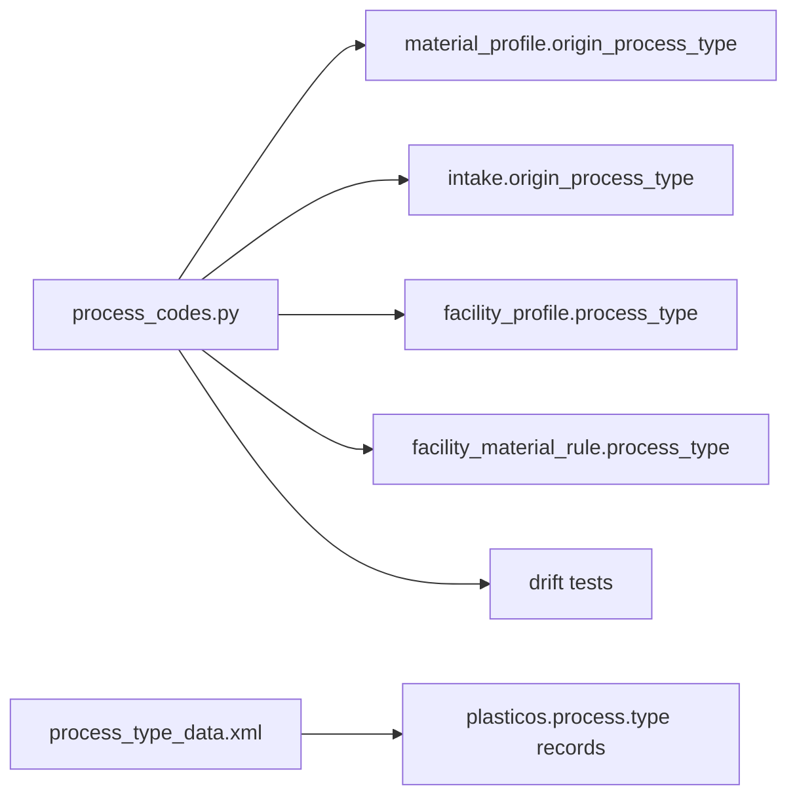
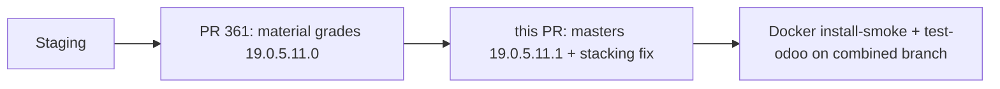

# Material-profile masters (19.0.5.11.1) plus stacked `make pr`, on one stacked PR

## Prerequisite: the material-grade work

The material-grade work is another agent's pull request, [PR #361](https://github.com/cryptoxdog/IB-Odoo_19/pull/361). It's on branch `feat/material-grade-catalog` and targets `Staging`. Its head is `a032e2c6`, which is level with origin as of 2026-11-04 12:45. It holds two commits:
- `b727e6f1` `feat(material_profile): add material grade catalog and move six forms onto grades`
- `a032e2c6` `fix(order_lines): ...`

It adds the `plasticos.material.grade` model, `grade_codes.py`, `material_grade_data.xml`, `material_grade_id` on the profile, and `migrations/19.0.5.11.0/`. It moves Bottles, Buckets, Crates, Drums, Pallets and Totes from forms to grades, and sets the version to `19.0.5.11.0`. It also changes `plasticos_order_lines`, `plasticos_transaction` and `plasticos_web_leads`. This plan ships on top of it as `19.0.5.11.1`, stacked on PR #361 rather than waiting for it to merge.

**Branch setup.** The main checkout (`IB-Odoo_19`) is clean, but it currently has `feat/material-grade-catalog` checked out; that's the other agent's working copy. Don't switch it or commit in it. All the work in this plan, including the stacking fix in step 11, goes on one branch in a separate worktree:
```bash
git fetch origin
git worktree add ../IB-Odoo_19-masters -b feat/material-profile-masters-2026-11-04 origin/feat/material-grade-catalog
cd ../IB-Odoo_19-masters
make venv
export ODOO_ENTERPRISE_PATH="$(realpath '../IB-Odoo_19/odoo-enterprise')"
```
A new worktree doesn't get three git-ignored items: the `odoo-enterprise` symlink, `.env` and `.venv`.
- Without `ODOO_ENTERPRISE_PATH`, `scripts/test_env.sh` stops with "no Odoo Enterprise checkout".
- Without `make venv`, ruff may not be the pinned `0.16.0`, and `pyproject.toml`'s `required-version` refuses to run.
- `.env` only supplies optional Gate and L9 variables (`GATE_URL`, `L9_*`), which all have defaults.
- Docker Compose pins `name: odoo19`, so the worktree uses the same compose project, not a second one, as rule 36 requires. `scripts/test_env.sh` names this worktree's own clone `odoo_test_<owner>`.

If PR #361 moves during review, merge it in rather than rebasing (`git merge origin/feat/material-grade-catalog`), because `make pr` never force-pushes. If PR #361's version moves past `19.0.5.11.0`, this plan's bump and migration folder move to the next number.

**PR #361's open review findings.** As of 2026-11-04 12:55, PR #361 is open at head `a032e2c6`, and GitHub now reports `mergeable_state: clean`. Its two Codex P1 review comments were still unresolved when last read. The other agent will probably push fixes for both, and each one affects this plan differently:
- **Material grade ACL** (`plasticos_material_profile/security/ir.model.access.csv:13`). Internal users have read-only access to `plasticos.material.grade` (`1,0,0,0`), and the comment asks for create, read and write access. The fix lands in this plan's module. Under rule 89 it probably bumps `plasticos_material_profile` to `19.0.5.11.1`, which is the number this plan uses today.
  - This plan doesn't touch that CSV. The only expected merge conflict is the manifest `version` line.
  - Resolve it by keeping one patch above the parent's version. Rename `migrations/<version>/` to match, so the backfill still runs.
- **Facility reconciliation keys** (`plasticos_crm_bridge/models/facility_profile.py` lines 74, 98 and 128). They still key on `(polymer_id, form_id)` without `material_grade_id`. That fix is in `plasticos_crm_bridge`, which this plan doesn't touch, so there's no textual conflict.
  - It does change runtime behaviour that `make test-odoo` exercises, so the Docker test must run on a branch that already contains it.
  - The new grades don't change what that fix has to do: they are ordinary `material_grade_id` values.

The `resync-parent` todo handles both. Run it before Verify and again just before the L4 release.
- Fetch and merge the parent's tip.
- Recompute the version.
- Re-run the Docker integration test.

Never edit PR #361's files from this branch to pre-empt those fixes. They belong to the other agent's PR.

Decisions recorded here:
- **Trash** is not added as a polymer. The material grade `TRASH` in `material_grade_data.xml` covers it.
- **Knockdown bins** get their own material grade, `KNOCKDOWN_BINS` (step 7). This overrides a PR #361 design choice: its builder maps every knockdown word to `CRATES` (`GRADE_WORDS`, line 232).
  - You chose to keep the new grade and move the builder's knockdown words to it (step 7, builder sub-step).
  - The six committed knockdown matrix rows that carry `CRATES` (89 ERP lines) stay as they are until the matrix is next rebuilt, because mapping rows are out of scope.

## Why more than the seed XML

Process types live in two places that must agree:
- [plasticos_material_profile/process_codes.py](plasticos_material_profile/process_codes.py) is the canonical registry. `PROCESS_SELECTION` from it feeds `origin_process_type` on the material profile (static list) and on intake, plus `process_type` on the facility profile and the semantic-kernel rule (lazy callables).
- [plasticos_material_profile/data/process_type_data.xml](plasticos_material_profile/data/process_type_data.xml) seeds the `plasticos.process.type` master records.



## Changes

1. **[process_codes.py](plasticos_material_profile/process_codes.py)**: add `compression_mold` in three places.
   - `PROCESS_CODES`: insert it after `"compounding"`, which keeps the tuple alphabetical.
   - `MFI_RANGES`: `"compression_mold": (None, None),  # any MFI`. It is permissive like `compounding`, so `check_mfi_compatibility` never rejects on it. `test_mfi_ranges_cover_all_codes` requires an entry here.
   - `PROCESS_LABELS`: `"compression_mold": "Compression Molding"`.

2. **[data/process_type_data.xml](plasticos_material_profile/data/process_type_data.xml)**: add a record inside the existing `<data noupdate="0">`, after `process_rotomold` (sequence 50):
   ```xml
   <record id="process_compression_mold" model="plasticos.process.type">
     <field name="name">Compression Molding</field>
     <field name="code">compression_mold</field>
     <field name="description">Pressing a heated charge of plastic into a closed mold under pressure.</field>
     <field name="sequence">55</field>
   </record>
   ```

3. **[tests/test_phantom_enum_values.py](tests/test_phantom_enum_values.py)**: `test_process_type_options` (around line 1406) compares the registry against a hardcoded set with exact equality, so it would fail. Add `"compression_mold"` to that `expected` set.

4. **[data/material_attribute_data.xml](plasticos_material_profile/data/material_attribute_data.xml)**: append twelve records after `attr_woven` (sequence 270), inside the existing `<data noupdate="1">` block with the other recent additions. Upgrade still creates records that are missing; `noupdate` only stops it from overwriting them later.
   ```xml
   <record id="attr_lined" model="plasticos.material.attribute">
     <field name="name">Lined</field>
     <field name="code">lined</field>
     <field name="description">Has an inner liner (e.g., lined super sacks or boxes).</field>
     <field name="sequence">280</field>
   </record>
   <record id="attr_unlined" model="plasticos.material.attribute">
     <field name="name">Unlined</field>
     <field name="code">unlined</field>
     <field name="description">No inner liner.</field>
     <field name="sequence">290</field>
   </record>
   <record id="attr_igps" model="plasticos.material.attribute">
     <field name="name">iGPS</field>
     <field name="code">igps</field>
     <field name="description">iGPS pooled plastic pallets.</field>
     <field name="sequence">300</field>
   </record>
   <record id="attr_washed" model="plasticos.material.attribute">
     <field name="name">Washed</field>
     <field name="code">washed</field>
     <field name="description">Material has been washed.</field>
     <field name="sequence">310</field>
   </record>
   <record id="attr_unwashed" model="plasticos.material.attribute">
     <field name="name">Un-Washed</field>
     <field name="code">unwashed</field>
     <field name="description">Material has not been washed.</field>
     <field name="sequence">320</field>
   </record>
   <record id="attr_structural_foam" model="plasticos.material.attribute">
     <field name="name">Structural Foam</field>
     <field name="code">structural_foam</field>
     <field name="description">Structural foam grade (foamed core, solid skin), typical of molded pallets and bins.</field>
     <field name="sequence">330</field>
   </record>
   <record id="attr_full_bottom" model="plasticos.material.attribute">
     <field name="name">Full Bottom</field>
     <field name="code">full_bottom</field>
     <field name="description">Gaylord with a full (solid) bottom.</field>
     <field name="sequence">340</field>
   </record>
   <record id="attr_half_bottom" model="plasticos.material.attribute">
     <field name="name">Half Bottom</field>
     <field name="code">half_bottom</field>
     <field name="description">Gaylord with a half (partial-flap) bottom.</field>
     <field name="sequence">350</field>
   </record>
   <record id="attr_with_lids" model="plasticos.material.attribute">
     <field name="name">With Lids</field>
     <field name="code">with_lids</field>
     <field name="description">Gaylords supplied with their lids.</field>
     <field name="sequence">360</field>
   </record>
   <record id="attr_trim" model="plasticos.material.attribute">
     <field name="name">Trim</field>
     <field name="code">trim</field>
     <field name="description">Trim scrap (edge trim or skeletal trim from film, sheet or thermoforming).</field>
     <field name="sequence">370</field>
   </record>
   <record id="attr_with_rubber" model="plasticos.material.attribute">
     <field name="name">With Rubber</field>
     <field name="code">with_rubber</field>
     <field name="description">Contains rubber (e.g., gaskets, seals or overmolded rubber parts).</field>
     <field name="sequence">380</field>
   </record>
   <record id="attr_pre_work_needed" model="plasticos.material.attribute">
     <field name="name">Pre-Work Needed</field>
     <field name="code">pre_work_needed</field>
     <field name="description">Needs sorting, cutting, cleaning or other preparation before it can be processed.</field>
     <field name="sequence">390</field>
   </record>
   ```
   **Copolymer and Homopolymer are not added.** They already exist as `attr_copolymer` (sequence 240) and `attr_homopolymer` (sequence 250).
   Full Bottom, Half Bottom and With Lids describe gaylords (packaging `packaging_gaylords`, polymer `polymer_gaylord_boxes`). They are attributes, not grades, so they don't collide with the existing `LIDS` and `TUBS_LIDS` material grades. Attribute records carry no polymer or packaging link, so "for gaylords" lives only in the descriptions.
   Structural Foam is a grade attribute like Frac Melt (`attr_frac_melt`), not a polymer or process. Existing matrix rows such as "HDPE STRUCT FOAM 5-10MI" (32 ERP lines) and "HDPE Structural Foam" are not retagged, because mapping is out of scope.
   The profile also has an older `previously_washed` Boolean (`material_profile.py`), which is hidden in the form view and still sent in the material packet as `washed`. It stays untouched. The two can disagree, because nothing syncs the Boolean with the new attributes. The attribute file's header calls attributes the source of truth for material flags.
   No model, view, ACL or test change is needed: `plasticos.material.attribute` is a plain master with a unique `code` constraint, and no test pins the attribute set (`test_crm45_classification` only checks that the count does not change during its own run).

5. **[data/polymer_data.xml](plasticos_material_profile/data/polymer_data.xml)**: append three records to the existing `<data noupdate="1">` block, after `polymer_auto_parts` (the block's last record, line 323), under a comment in the same style as the existing one at line 266: `<!-- ── Approved by the operator 2026-11-04 ── -->`. They follow the format of the 2026-11-03 batch:
   ```xml
   <record id="polymer_ldpe_lldpe" model="plasticos.polymer">
     <field name="name">LDPE/LLDPE</field>
     <field name="code">LDPE_LLDPE</field>
     <field name="full_name">LDPE / LLDPE Mix</field>
     <field name="resin_id_code">4</field>
     <field name="category">commodity</field>
     <field name="sequence">45</field>
   </record>
   <record id="polymer_pet_hdpe" model="plasticos.polymer">
     <field name="name">PET/HDPE</field>
     <field name="code">PET_HDPE</field>
     <field name="full_name">PET / HDPE Mix</field>
     <field name="category">commodity</field>
     <field name="sequence">72</field>
   </record>
   <record id="polymer_fiber" model="plasticos.polymer">
     <field name="name">Fiber</field>
     <field name="code">FIBER</field>
     <field name="full_name">Fiber</field>
     <field name="category">specialty</field>
     <field name="sequence">322</field>
   </record>
   ```
   Sequence 45 sorts LDPE/LLDPE between LDPE (40) and LLDPE (50); both parts are resin code 4. Sequence 72 sorts PET/HDPE right after PET (70); 322 sorts Fiber between Textile (320) and Fiberglass (325). The code style matches `PP_PE` for the mix. **Other** is not added: `polymer_other` (code `OTHER`, sequence 999) is already seeded.

6. **[models/material_profile.py](plasticos_material_profile/models/material_profile.py)**: the stored `polymer` Selection (just below `polymer_id`) is what `_compute_polymer_code` checks. A code outside that list is written as `False`:
   ```440:444:plasticos_material_profile/models/material_profile.py
       def _compute_polymer_code(self):
           valid_codes = {k for k, _ in self._fields["polymer"].selection}
           for rec in self:
               code = rec.polymer_id.code if rec.polymer_id else False
               rec.polymer = code if code in valid_codes else False
   ```
   The Selection starts at line 55 on PR #361's branch. Make four insertions:
   - Commodity group: `("LDPE_LLDPE", "LDPE/LLDPE")` after `("LLDPE", "LLDPE")` (line 63), and `("PET_HDPE", "PET/HDPE")` after `("PET", "PET")` (line 68).
   - Specialty group: `("FIBER", "Fiber")` after `("TEXTILE", "Textile")` (line 98).
   - The missing `("OTHER", "Other")` after `("AUTO_PARTS", "Auto Parts")` (line 101), at the end of the list. `OTHER` is seeded today but absent here, so every profile on the Other polymer stores an empty polymer code.

7. **Thirteen separate material grades**. Each is its own record and code. None is merged with another new grade or with an existing one such as Drums, Drip Tube, Strapping, Crates, Stretch Film or Trash. Before writing this, every name was checked against the grade, form, attribute and polymer seeds, and none exists. Three files have to agree.
   - [data/material_grade_data.xml](plasticos_material_profile/data/material_grade_data.xml): the whole file is `noupdate="1"`, and the upgrade still creates missing records. Each record uses this shape, with the XML id `material_grade_<lowercase code>`:
   ```xml
   <record id="material_grade_jerry_cans" model="plasticos.material.grade">
     <field name="name">Jerry Cans</field>
     <field name="code">JERRY_CANS</field>
     <field name="description">Plastic jerry cans and carboys, usually HDPE.</field>
     <field name="sequence">25</field>
   </record>
   ```
   Insert each one at this position, so the file stays in sequence order:

   | Insert after | Name | Code | Seq | Description |
   |---|---|---|---|---|
   | Drums (20) | Jerry Cans | `JERRY_CANS` | 25 | Plastic jerry cans and carboys, usually HDPE. |
   | Tubs/Lids (60) | Cups | `CUPS` | 62 | Plastic cups (drink, portion and yogurt cups). |
   | Cups | Jars | `JARS` | 64 | Plastic jars and wide-mouth containers. |
   | Jars | Flower Pots | `FLOWER_POTS` | 66 | Plastic flower and nursery pots and trays. |
   | Drip Tube (110) | Pipe | `PIPE` | 115 | Plastic pipe and conduit, including corrugated pipe. |
   | Pipe | Tubing | `TUBING` | 117 | Flexible plastic tubing and hose (other than drip tube). |
   | Strapping (140) | Cornerboards | `CORNERBOARDS` | 145 | Plastic corner boards and edge protectors used to secure loads. |
   | Cornerboards | Core Plugs | `CORE_PLUGS` | 147 | Plastic core plugs and end caps for film and paper rolls. |
   | Crates (150) | Knockdown Bins | `KNOCKDOWN_BINS` | 155 | Collapsible (knock-down) bulk bins and containers. |
   | Bumpers (160) | Siding | `SIDING` | 165 | Vinyl or plastic house siding and trim. |
   | Stretch Film (190) | Silage Film | `SILAGE_FILM` | 192 | Agricultural silage and bunker cover film. |
   | Silage Film | Nursery Film | `NURSERY_FILM` | 194 | Greenhouse and nursery film. |
   | OCC (200) | Disposal Fee | `DISPOSAL_FEE` | 205 | Material charged a disposal fee rather than purchased. |

   - **Near-overlaps, kept separate:**
     - Tubing is general tubing. The existing Drip Tube grade is agricultural drip irrigation only, and Pipe is rigid pipe.
     - Silage Film and Nursery Film are grades, like Stretch Film. A profile still takes the Film form with them.
     - Cups are separate from the Lids grade.
   - **Mapping is out of scope**, so nothing that already exists is remapped:
     - The matrix rows for pipe, trim, cornerboards ("HD/PP Cornerboards", 7 ERP lines, ambiguous) and disposal ("Disposal Fee", 8 ERP lines, `not_material` per the 2026-11-03 decision) stay as they are.
     - So do the normalizer hints `"hdpe pipe"`, `"hdpe corrugated pipe"` and `"ldpe nursery film"`. The last still resolves to LDPE plus the Film form, with no grade.
   - [grade_codes.py](plasticos_material_profile/grade_codes.py): insert each code into `GRADE_CODES` at the same position as in the table. `test_grade_codes_equal_the_grade_seed_in_order` compares the order against the seed file. The final order is:
     - BUCKETS, DRUMS, JERRY_CANS, SUPERACS, TRAYS, LIDS, TUBS_LIDS, CUPS, JARS, FLOWER_POTS, TOTES, TOTERS, IBC_TOTES, LINERS
     - DRIP_TUBE, PIPE, TUBING, PALLETS, BOTTLES, STRAPPING, CORNERBOARDS, CORE_PLUGS, CRATES, KNOCKDOWN_BINS, BUMPERS, SIDING, RETURNS, DUNNAGE
     - STRETCH_FILM, SILAGE_FILM, NURSERY_FILM, OCC, DISPOSAL_FEE, TRASH (`SHEET` is removed; see the Sheet bullet below)

     The XML ids already satisfy `test_grade_xmlids_carry_the_material_grade_prefix`.
   - [tests/test_material_grade_codes.py](tests/test_material_grade_codes.py): `test_displayed_names_are_title_case_except_acronyms` asserts `len(names) == 22`; change it to `34` (22, plus 13 new, minus Sheet). Every new name is title case.
   - None of the thirteen codes is added to `FORMER_FORM_CODES`, because none was ever a form.
   - **Sheet stays a form only (your decision).** PR #361 seeds a `material_grade_sheet` grade (code `SHEET`, sequence 220, "Sheet goods as supplied (distinct from the Sheet form).") next to the existing form `form_sheet` (code `SHEET`, sequence 110). That duplicates Sheet in two masters, and you can see it at runtime: web leads look the grade up by the form code (`grade_rec = _lookup(Grade, form_code, None)`, `web_lead.py` line 1115). With `_FORM_NORMALIZE["sheet"] = "SHEET"`, a lead that says "sheet" currently gets both the Sheet form and the Sheet grade.
     - Delete the `material_grade_sheet` record (PR #361's `material_grade_data.xml` lines 134-139). TRASH, at sequence 210, becomes the last grade.
     - Remove `"SHEET",` from `GRADE_CODES` in `grade_codes.py`.
     - These are not changed:
       - The Sheet form: `form_sheet`, `"SHEET"` in `FORM_CODES`, `_FORM_NORMALIZE` in web leads, and `plasticos_base`'s `form_sheet` partner tag.
       - The matrix: no row has `material_grade = SHEET`, and 30 rows use `form = SHEET`.
       - No grade template, normalizer phrase or test refers to the Sheet grade. The `"Sheet"` in `test_phantom_enum_values.py` line 1684 is an allowlisted descriptor word.
     - The builder never text-matches `SHEET` as a grade, because it isn't in `TEXT_RULE_GRADES`. Removing it changes no rebuild.
     - `web_lead.py` needs no edit: after this, `_lookup(Grade, "SHEET", None)` finds nothing, and the lead keeps only the Sheet form.
     - **Existing databases.** `material_grade_data.xml` is `noupdate="1"`, and Odoo's end-of-upgrade cleanup skips `noupdate` records. Deleting the XML therefore doesn't delete a Sheet grade that PR #361 has already created: on Staging, once PR #361 merges first, or on the shared `odoo` database. The test fixture is below `19.0.5.11.0` and never gets the record. Step 9's migration retires it.
     - This edits two of PR #361's files. If the other agent changes the same lines (for example, dropping Sheet in PR #361 itself), the merge conflicts there. Keep whichever side has no Sheet grade, and keep the migration: it does nothing when the record is absent.
   - **PR #361's migration requires the seed and the registry to change together.**
     - `grade_migration.grades_by_code` raises `GradeMigrationError` if any `GRADE_CODES` code isn't seeded, and the `19.0.5.11.0` post-migrate calls it.
     - Odoo loads a module's data files before its post-migrate scripts. On a database below `19.0.5.11.0` (the test fixture, then Staging), the thirteen new records therefore exist before that check runs.
     - Adding a code to `grade_codes.py` without its XML record would break the parent's migration. The Docker test proves this ordering.
   - **Builder: knockdowns move to `KNOCKDOWN_BINS`** ([scripts/build_material_mapping.py](scripts/build_material_mapping.py)). This is your decision; it doesn't regenerate the matrix.
     - `GRADE_WORDS` (line 231): rename the key `"CRATES"` to `"KNOCKDOWN_BINS"`, keeping its five words (`"knock-down crates"`, `"knockdown bins"`, `"knockdowns"`, `"knockdown"`, `"knock-down"`). `CRATES` keeps its seeded name and code as search words.
     - The exact rule `"knock-down crates": ("HDPE", None, None, (), None, "CRATES")` (line 122): change its last element to `"KNOCKDOWN_BINS"`.
     - `TEXT_RULE_GRADES` (line 236): add `"KNOCKDOWN_BINS"`. Without it, `vocabulary(..., skip=set(masters["material_grade"]) - TEXT_RULE_GRADES)` (line 768) skips the new grade, and the words above are dropped.
     - Change the comment above `TEXT_RULE_GRADES` to: "The free-text rule names the six grades that were forms before 2026-11 plus Knockdown Bins; other grade words (trash, liners, lids) recur in unrelated or negated text."
     - The polymer default `if not polymers and re.search(r"\bknock-?downs?\b", key): polymers = {"HDPE"}` (line 697) stays.
     - No test runs the builder (checked with grep). The check is `ruff check scripts/build_material_mapping.py` in Verify.
   - **Web leads (noted, not changed):** `plasticos_web_leads` keeps its operator-configured reusable-item allow-list (`PLASTIC_PALLETS|PALLETS|TOTES|CRATES`, `economic_policy.py`). Knockdown bins aren't added to it. That is a web-lead policy decision and is protected by rule 50.
   - [data/grade_template_data.xml](plasticos_material_profile/data/grade_template_data.xml): a grade carries no polymer, so the HDPE link is a grade template modelled on `grade_hdpe_drums`. Insert it right after that record:
   ```xml
   <record id="grade_hdpe_jerry_cans" model="plasticos.grade.template">
     <field name="name">HDPE Jerry Cans</field>
     <field name="code">HDPE_JERRY_CANS</field>
     <field name="polymer_id" ref="polymer_hdpe"/>
     <field name="material_grade_id" ref="material_grade_jerry_cans"/>
     <field name="packaging_type_id" ref="packaging_loose"/>
     <field name="quality_tier">standard</field>
     <field name="sequence">135</field>
   </record>
   ```
   `test_grade_templates_reference_seeded_grades_only` passes because `material_grade_jerry_cans` is seeded. The data file order in the manifest already loads `material_grade_data.xml` before `grade_template_data.xml`. Matrix rows such as "HDPE Jerry Cans" (12 ERP lines) stay polymer-only, because mapping is out of scope.

8. **Fluff material form**: it doesn't exist yet. The nearest existing forms are Regrind, Flake and Shred. Two files have to agree.
   - [data/material_form_data.xml](plasticos_material_profile/data/material_form_data.xml): add this inside the existing `<data noupdate="0">` block, right after `form_shred` (sequence 80):
   ```xml
   <record id="form_fluff" model="plasticos.material.form">
     <field name="name">Fluff</field>
     <field name="code">FLUFF</field>
     <field name="description">Light, low-bulk-density granulated or shredded material, typically from film or fiber.</field>
     <field name="sequence">85</field>
   </record>
   ```
   - [form_codes.py](plasticos_material_profile/form_codes.py): insert `"FLUFF",` between `"FLOORSWEEP",` and `"LOGS",`, because the tuple is alphabetical. `test_form_codes_equal_the_form_seed` compares the sorted seed codes with `FORM_CODES`.
   - The stored `form` Selection on the material profile is built from `FORM_SELECTION`, so it gains `FLUFF` with this module's upgrade. No backfill is needed, because no profile can be on Fluff yet.
   - `plasticos_facility_profile` reads `FORM_SELECTION` through a callable, so it needs no bump.
   - Fluff isn't in `EQUIPMENT_GATED_FORMS`, so matching treats it as a pass-through form. Gating it on granulator or shredder capability would be a separate matching decision.
   - The normalizer tests that use "mystery fluff" and "LDPE fluff" as unresolved phrases still pass. `material_normalizer.py` resolves only its fixed phrase tables, not seed names.

9. **Migration**: create `plasticos_material_profile/migrations/19.0.5.11.1/`.
   - `__init__.py` holds only a comment (`# Migration package for 19.0.5.11.1`), as in `19.0.5.9.0/`.
   - `post-migrate.py` does two things.
     - It backfills the Other polymer code. Adding a Selection value doesn't recompute existing stored rows, so profiles already on Other would otherwise stay empty.
     - It retires a Sheet grade that PR #361's `19.0.5.11.0` already created. When no row references the grade, it's unlinked, which also removes its `ir.model.data` row. When rows still reference it, it's archived, because every link to `plasticos.material.grade` is `ondelete="restrict"`: material profile, grade template, intake, and purchase and sale order lines. Archiving hides it from every grade picker, and the web-lead `_lookup` search skips archived records. Referencing records keep their value, and the warning names how many there are. Moving them to the Sheet form is an operator decision, not something the migration does.
     - The reference count reads foreign keys from `pg_constraint`, not the ORM. That's because `plasticos_intake` and `plasticos_order_lines` load after this module, so their models aren't in the registry yet during this post-migrate.
   ```python
   """Project the Other polymer onto the stored code and retire the Sheet material grade."""

   import logging

   from odoo import SUPERUSER_ID, api
   from odoo.tools import SQL

   _logger = logging.getLogger(__name__)

   SHEET_GRADE = "plasticos_material_profile.material_grade_sheet"


   def _backfill_other_polymer(cr):
       cr.execute(
           """
           UPDATE plasticos_material_profile mp
           SET polymer = p.code
           FROM plasticos_polymer p
           WHERE mp.polymer_id = p.id
             AND p.code = 'OTHER'
             AND mp.polymer IS NULL
           """
       )
       _logger.info("Backfilled polymer code OTHER on %s material profiles.", cr.rowcount)


   def _grade_references(cr, grade_id):
       cr.execute(
           """
           SELECT src.relname, att.attname
           FROM pg_constraint con
           JOIN pg_class src ON src.oid = con.conrelid
           JOIN pg_class dst ON dst.oid = con.confrelid
           JOIN pg_attribute att ON att.attrelid = con.conrelid AND att.attnum = con.conkey[1]
           WHERE con.contype = 'f' AND dst.relname = 'plasticos_material_grade'
           """
       )
       total = 0
       for table, column in cr.fetchall():
           cr.execute(
               SQL("SELECT count(*) FROM %s WHERE %s = %s", SQL.identifier(table), SQL.identifier(column), grade_id)
           )
           total += cr.fetchone()[0]
       return total


   def _retire_sheet_grade(env):
       grade = env.ref(SHEET_GRADE, raise_if_not_found=False)
       if not grade:
           return
       references = _grade_references(env.cr, grade.id)
       if references:
           grade.active = False
           _logger.warning(
               "Archived the Sheet material grade; %s records still reference it. Sheet stays a form.", references
           )
           return
       grade.unlink()
       _logger.info("Removed the Sheet material grade; Sheet stays a form.")


   def migrate(cr, version):
       _backfill_other_polymer(cr)
       _retire_sheet_grade(api.Environment(cr, SUPERUSER_ID, {}))
   ```
   - LDPE/LLDPE, PET/HDPE and Fiber need no backfill, because no profile can use them before this upgrade.
   - The Sheet retirement does nothing on the test fixture, where the record never exists. So the Docker run alone doesn't exercise it. That's why the test below covers it.
   - **New [plasticos_material_profile/tests/test_sheet_grade_retirement.py](plasticos_material_profile/tests/test_sheet_grade_retirement.py)**, imported from `plasticos_material_profile/tests/__init__.py` after `test_material_grade_migration`.
     - Setup: it loads `migrations/19.0.5.11.1/post-migrate.py` with `importlib`, the same way `test_material_grade_migration.py` loads `19.0.5.11.0`. It's a `TransactionCase` tagged `post_install`, `-at_install`. `setUpClass` creates a partner, and each test creates its own polymer through the same `_polymer` helper pattern (rule 80).
     - A helper creates a grade `{"name": "Sheet", "code": "SHEET"}` and binds it to the xmlid with `ir.model.data` (`module="plasticos_material_profile"`, `name="material_grade_sheet"`, `noupdate=True`). After this change no seed holds that code, so the unique-code constraint is free.
     - `test_absent_sheet_grade_is_a_no_op`: `migrate(cr, "19.0.5.11.0")` runs without error, and no grade has code `SHEET`.
     - `test_unreferenced_sheet_grade_is_removed`: after `migrate`, the grade no longer exists, and `env.ref(..., raise_if_not_found=False)` is empty.
     - `test_referenced_sheet_grade_is_archived`: a material profile with `material_grade_id` set to the grade keeps it. After `migrate`, the grade has `active = False` and the profile still points at it.
     - `test_rerun_changes_nothing`: run `migrate` twice on the referenced case. The second run leaves the grade archived and doesn't raise.

10. **[__manifest__.py](plasticos_material_profile/__manifest__.py)**: one bump covers every change, `19.0.5.11.0` to `19.0.5.11.1`, matching the migration folder. Run `ruff format` on it afterwards. The upgrade creates the new XML records, refreshes the `origin_process_type`, `polymer` and `form` selections, runs the backfill, and retires an existing Sheet grade.

11. **Stacked publication in `make pr`**: lets `make pr base=<branch>` target the parent's branch. This step needs no module version bump, because it touches only scripts, tests and docs. The `Makefile` already passes `base=` through (`$(if $(base),$(base),Staging)`). Only two guards refuse it today: [scripts/make_push_pipeline.sh](scripts/make_push_pipeline.sh) lines 44-46 and [scripts/git_open_pr.sh](scripts/git_open_pr.sh) lines 14-17. Everything after them already uses `BASE`: the open-PR lookup, the `prove_pr` base check, `git fetch origin "${BASE}"`, the ahead count and `build_pr_body.py`. The local gates still compare with `origin/Staging`, so a stacked branch is checked on its parent's changes plus its own.
   - **New [scripts/pr_stack_parent.sh](scripts/pr_stack_parent.sh)**: one owner for the stacking rule, with two subcommands. Each caller runs them at two different points (VF-01). It is `#!/usr/bin/env bash` with `set -euo pipefail`, like its callers, and prints `refusing to publish: <reason>` to stderr with exit 1.
     - **`pr_stack_parent.sh name <base>`** needs no `gh`, network or remote ref.
       - `Staging` passes.
       - Any base whose lowercase form is `staging`, `production` or `main` is refused with `destination must be Staging or a stacked parent branch (got <base>)`. This keeps the phrase "destination must be Staging", which `test_production_base_refuses_before_push`, `test_staging_to_production_refuses_before_push` and `test_open_pr_refuses_a_non_staging_base` assert.
       - Anything else passes this check.
     - **`pr_stack_parent.sh prove <base>`** runs only when the base isn't `Staging`, after the caller has exported `GH_REPO` and passed `gh api user`.
       1. `gh api --method GET "repos/${GH_REPO}/pulls" -f state=open -f base=Staging -f head="${GH_REPO%%/*}:<base>"` must return exactly one pull request. It's parsed with an inline `python3` block like `open_pr_number`, with the same malformed-JSON and wrong-repository refusals. It doesn't use `--jq`, because the fake `gh` supports only `.[].name` and `.body // ""`. Zero results are refused with `stacked parent <base> has no open PR into Staging`; more than one is refused too.
       2. `git fetch origin "<base>"`, then `git merge-base --is-ancestor "origin/<base>" HEAD`. If that fails, the refusal is `HEAD does not contain origin/<base>`.

       Only one level of stacking is allowed: the parent itself must target `Staging`.
   - **`make_push_pipeline.sh`**:
     - Replace the guard at lines 44-46 with `bash scripts/pr_stack_parent.sh name "${BASE}"`, in the same place. A protected destination is still refused before the protected-source check at line 49, so `test_staging_to_production_refuses_before_push` (`Staging` to `Production`) still gets "destination must be Staging", not "is a protected source branch".
     - After the `gh api user` check (line 94-96), add `if [[ "${BASE}" != "Staging" ]]; then bash scripts/pr_stack_parent.sh prove "${BASE}"; fi`. It runs before the L4 check, the local gate and any push.
     - Because `prove` fetches `origin/<base>`, the later `.cursor-commands` range check (`git merge-base HEAD "origin/${BASE}"`, line 141) finds the parent's ref, rather than falling back to the root commit.
     - Header line 4 becomes: "`make pr` publishes one committed feature branch into Staging, or onto an open parent PR's branch with `base=`."
   - **`git_open_pr.sh`**:
     - Replace the guard at lines 14-17 with the same `name` call, in the same place. `test_open_pr_refuses_a_non_staging_base` asserts that nothing is logged, including `gh` calls, so the refusal must come before `gh api user`.
     - Add the `prove` call after its `gh api user` check (line 52-55). The script can be run on its own, so it proves the parent itself.
   - **[Makefile](Makefile)** is `additive_only` in `ops/config/root-file-protection.json`, so line 684 ("Any base other than Staging is refused before push.") isn't rewritten (VF-02). Insert one new comment line after line 685 (`# Usage: make pr`): `# 2026-11-04: make pr base=<branch> stacks onto an open parent PR's branch (scripts/pr_stack_parent.sh); Production stays refused before push.` The recipe already passes `base=`.
   - **[tests/test_make_pr_publication.py](tests/test_make_pr_publication.py)**:
     - Add `"pr_stack_parent.sh"` to `PRODUCTION_SCRIPTS`. The fixture then copies it, and the REST-only `gh` check covers it.
     - The fixture's fake `git fetch` is a no-op unless `REAL_REMOTE` is set. So the new tests plant the parent ref the way `_behind_staging` does, with `git update-ref refs/remotes/origin/feat/parent <sha>`, and need no bare repository (VF-03). Each new test calls `_run(repo, tmp_path, "fix/example", "feat/parent", "1", "0")`.
     - New `test_stacked_base_without_parent_pr_refuses_before_push`: the parent ref is planted, but `gh-state` has no pull request for `feat/parent`. Expect exit 1, `stacked parent feat/parent has no open PR into Staging`, no push, and no `l4 ` line in the sequence log.
     - New `test_stacked_base_with_parent_pr_opens_pr_into_parent`:
       - Setup: plant `origin/feat/parent` at the fixture's init commit, then `_commit(repo, "feat: child")`. Seed the parent with `_set_gh_state(tmp_path, pulls=[_rest_pr(361, "feat/parent", <init sha>)])`; `_rest_pr`'s base is `Staging`.
       - Expect exit 0.
       - The new pull request in `gh-state.json` has `base.ref == "feat/parent"`.
       - Its body contains the stacked-on line.
       - `_gh_calls` include the parent lookup with `params == {"state": "open", "base": "Staging", "head": "cryptoxdog:feat/parent"}`.
     - New `test_stacked_base_not_containing_parent_refuses`: same as the previous test, except `origin/feat/parent` points at a commit that isn't an ancestor of HEAD (commit on a side branch, plant the ref, switch back). Expect exit 1, `HEAD does not contain origin/feat/parent`, and no push.
     - New `test_lowercase_main_base_refuses_before_any_gh_call`: `git_open_pr.sh fix/example main` exits 1 with "destination must be Staging", and the sequence log is empty. This covers the new `main` refusal.
     - The existing tests stay unchanged. The Staging publish's exact `gh` call sequence (lines 1057-1062) still holds, because `prove` doesn't run for `Staging` and `name` makes no `gh` call.
   - **Documentation**:
     - Append a dated 2026-11-04 correction to [AGENTS.md](AGENTS.md), which is append-only: "`make pr base=<branch>` stacks onto an open feature branch whose PR targets Staging; Production stays refused; merge the parent first."
     - Add one line to [.cursor/rules/70-github-api-commit.mdc](.cursor/rules/70-github-api-commit.mdc) under "`make pr` is the only publication command".

   - **[scripts/build_pr_body.py](scripts/build_pr_body.py)**: when `base != "Staging"`, add the line ``Stacked on `<base>`; merge that branch's pull request into Staging first.`` at the top of the body. `make pr` writes the description itself, with no manual input, so this is the only way the stacking note reaches the pull request.
   - `docs/reports/make-pr-validation-consolidation.md` is a dated report, not a contract, so it isn't edited.
   - The rest of the publication path needs no change:
     - `ci.yml` runs on every `pull_request` with no branch filter, so a stacked pull request still gets the full CI gate.
     - `pr_autopilot.py` finds the pull request by head branch only.
     - The L4 receipt is bound to the worktree's content, not the base.

   This branch publishes itself with this fix. `make pr` runs the scripts from the checked-out branch, so `make pr base=feat/material-grade-catalog` already uses the new guard.

## Not changed (confirmed)

- `plasticos_intake`, `plasticos_facility_profile`, `plasticos_semantic_kernel`: they read `PROCESS_SELECTION` through a callable, so the new value appears without a version bump or upgrade of those modules.
- [data/material_mapping.csv](plasticos_material_profile/data/material_mapping.csv): no rows are remapped (your choice). The builder changes only its knockdown words (step 7).
  - **Grades:** the builder text-matches only `TEXT_RULE_GRADES`, so the other twelve new grades never become search words.
  - **Knockdown Bins does.** On the next rebuild these rows would move from `CRATES` to `KNOCKDOWN_BINS`: "HDPE Knockdown Bins" (52 ERP lines), "Knockdown Bins - Not Repairable" (17), "HDPE Knockdowns" (13), "PP Knockdowns W/ Metal" (3), "48x45x34 Knockdowns in need of repair" (2) and "HDPE Bins/Knockdowns" (2).
  - "Plastic Pallets- Lids - Knockdowns - Totes" stays `PALLETS` through the pallet-polymer rule.
  - **Fluff:** it becomes a form search word, because only `OTHER` is in `NO_SUGGEST_FORMS`.
  - **Process, attributes and polymers:** the builder's vocabulary would only match "compression mold(ing)", not "compression molded", so a later rebuild would not change those rows. The attributes are different: the builder reads every seeded attribute code and name as a search word, so a future rebuild would start tagging descriptions such as "PP Supersacs (Lined)" with `lined`. It would also tag "PP Supersacs (un-lined)" as `lined`, not `unlined`, unless `ATTRIBUTE_WORDS` gets an `"unlined": ("un-lined", "un lined")` alias. "Un-washed" has the same problem and needs `"unwashed": ("un-washed", "un washed")`. That only matters when the matrix is next rebuilt; nothing here triggers a rebuild. The new polymers likewise become builder search words. The VanillaSoft type row `fiber` stays `not_material` (2026-11-03 decision) on a rebuild, because the not-material check runs before master matching. Descriptions such as "PET/HDPE bottles", which currently resolve to whichever single polymer the builder finds, would pick up `PET_HDPE` instead.
- Polymer tests: no test pins the full polymer set. `test_every_mapped_polymer_projects_onto_the_stored_code` in [tests/test_material_mapping_masters.py](tests/test_material_mapping_masters.py) only checks mapped matrix rows, and those are unchanged.
- Views and ACL: `process_type_views.xml` and the existing ACL rows already cover the model. The material grade ACL belongs to PR #361 and its open review fix, not this plan.
- `plasticos_crm_bridge`: its facility reconciliation-key fix belongs to PR #361. The new grades need nothing extra from it.

## Verify

Run all of this in the worktree, with `ODOO_ENTERPRISE_PATH` exported.

- First run the `resync-parent` todo. This branch has no commits of its own yet, so a fast-forward is enough. Park the uncommitted work, including the new untracked files:
  ```bash
  git fetch origin && git stash -u && git merge --ff-only origin/feat/material-grade-catalog && git stash pop
  ```
  If the parent bumped `plasticos_material_profile`, the pop conflicts on the manifest `version` line. Set it to one patch above the parent's version and rename the migration folder to match.
- `ruff check plasticos_material_profile scripts/build_material_mapping.py tests/test_phantom_enum_values.py tests/test_make_pr_publication.py && ruff format plasticos_material_profile scripts/build_material_mapping.py tests/test_make_pr_publication.py`, plus `shellcheck scripts/pr_stack_parent.sh scripts/make_push_pipeline.sh scripts/git_open_pr.sh`
- `python -m pytest tests/test_process_enum_alignment.py tests/test_phantom_enum_values.py tests/test_material_grade_codes.py tests/test_material_mapping_masters.py tests/test_make_pr_publication.py -q`. PR #361 already moved the former form codes into the matrix's `material_grade` column. No test or CI job runs `scripts/build_material_mapping.py` (checked with grep), so the new seed values can't change the matrix.
- **Manual UI check (optional, shared database).** `make update m=plasticos_material_profile` upgrades the shared development database `odoo`, not a disposable clone. Run it only after you confirm, because it puts unmerged code from both pull requests into a database the other agent may also use. Then check that the process type list shows "Compression Molding", that the material profile's origin process type dropdown offers it, that the twelve new attributes appear in the material profile's attributes selector with no second Copolymer or Homopolymer, that LDPE/LLDPE, PET/HDPE and Fiber appear in the polymer list, that the thirteen new grades appear as separate entries in the material grade list (34 in total, with no Sheet grade), that Sheet still appears in the form list, that Fluff appears in the form list after Shred, and that the HDPE Jerry Cans grade template exists. Check the update log for the backfill count, and confirm that a profile set to Other now shows `polymer = OTHER`.
- **Docker integration test of both changes together, before anything merges (mandatory).** The branch holds PR #361's `19.0.5.11.0` work plus this plan's `19.0.5.11.1`.
  - Run `make install-smoke` (the load gate), then `make test-odoo`.
  - `make test-odoo` clones the pinned fixture `odoo_test_tpl_ee_c9e8a81f52f23680` into this worktree's `odoo_test_<owner>`, then upgrades the declared roster. Both migrations run in order, as they will on Staging.
  - Use `test-odoo`, not just `test-module`: PR #361 also changes `plasticos_order_lines`, `plasticos_transaction` and `plasticos_web_leads`, and `plasticos_crm_sync`'s mapping test reads the grade codes.
  - The test fails on a missing Odoo test summary, any failure or error, or zero tests run. Record the receipt `.l9/runtime/test-env/<db>.test-receipt.json`.
  - If the fixture refuses because an admitted input changed, stop and report what changed. Don't rebuild the template.

## Publish (stacked, one branch, one PR)

- Everything is on the one branch `feat/material-profile-masters-2026-11-04`: the material-profile changes (steps 1-10) and the stacking fix (step 11).
- **Two commits.** `make commit` stages every change and defaults to the message `wip: snapshot local changes`, so always pass `m=`. Do the stacking fix first and commit it, then do the module work and commit it. `make pr` takes the pull request title from the last commit, so that one should be the masters commit.
  1. `make commit m="feat(scripts): let make pr stack onto an open parent PR"`
  2. `make commit m="feat(material_profile): add process, attribute, polymer, grade and form masters"`
- **Re-sync with PR #361 just before release.** Run `git fetch origin` and compare `origin/feat/material-grade-catalog` with the merge base.
  - If the parent moved (for example, its ACL or reconciliation-key fixes landed), run `git merge --no-ff --no-commit origin/feat/material-grade-catalog`. Fix the version and migration folder if needed.
    - `--no-commit` matters: a clean merge would otherwise commit straight away with git's default "Merge ..." message, and `make commit` would then find nothing to commit.
  - `git_open_pr.sh` sets the PR title only when it creates the PR, from the last commit's subject (line 187).
    - **Before the first `make pr`:** conclude the merge with `make commit m="feat(material_profile): add process, attribute, polymer, grade and form masters on PR #361's latest tip"`, so the title is still a masters title.
    - **After the PR exists:** `m="chore: merge feat/material-grade-catalog"` is fine.
  - Then re-run the Docker integration test.
  - `pr_stack_parent.sh` refuses a HEAD that doesn't contain `origin/<base>`, so a stale branch can't publish anyway.
- **L4 release (operator step).** `make pr` refuses without a `release_authorized` receipt for this worktree's exact content. You attest it after the last commit with `python3 "$HOME/.cursor-governance/ops/autonomy/l4_local.py" --workspace "$(pwd)" authorize-release`. Any later change to the files makes the receipt stale.
- `make pr base=feat/material-grade-catalog` opens one pull request with PR #361's branch as its base. Its diff then shows only this plan's two commits.
  - Keep `ODOO_ENTERPRISE_PATH` exported. `make pr` runs `make pr-check`, which runs the Docker install-smoke because addon files changed.
  - `make pr` writes the description itself with `build_pr_body.py`, so the stacking note comes from step 11's one-line addition to that script.
- Merge order is the parent first, then this pull request:
  - **If the parent's branch is deleted on merge,** GitHub moves this pull request's base to `Staging`. From then on a plain `make pr` finds it.
  - **If the parent's branch is kept,** change the base to `Staging` in the GitHub page.
  - **If the parent is squash-merged,** merge `origin/Staging` into this branch and run `make pr` again.



## Alignment audit (Recursive Alignment kernel, 2026-11-04)

**Scope.**
- Kernel: `.cursor-commands/kernels/Recursive Alignment.md`, audit-only mode.
- Target: this plan file, checked against this repo's rules (`AGENTS.md`, `CLAUDE.md`, `.cursor/rules/36`, `70`, `89`), the code on PR #361's branch at `a032e2c6`, and the publication scripts.
- Evidence came from read-only `git`, `gh api` and `grep`; nothing was executed.

**Findings, all now resolved in the text above.**

| ID | Severity | What was wrong | Fixed in |
|---|---|---|---|
| RA-01 | High | The migration snippet called `_logger` without importing or defining it, so the upgrade would fail with a `NameError`. | Step 9 now opens with the `19.0.5.9.0` pattern (`import logging`, `_logger = logging.getLogger(__name__)`). |
| RA-02 | High | The parent was a placeholder, and the plan said its work was uncommitted. It is actually PR #361 on `feat/material-grade-catalog` at `a032e2c6`, and the main checkout has that branch checked out. | The Prerequisite section, the todos and the Publish section now name PR #361 and say not to touch the main checkout. |
| RA-03 | High | A new worktree has no `odoo-enterprise`, so `scripts/test_env.sh` would stop. It also has no `.venv`, so ruff may not match the pinned `0.16.0`. | `worktree-setup` todo: `make venv`, plus `ODOO_ENTERPRISE_PATH` for Verify and `make pr`. |
| RA-04 | High | The plan left out the L4 `release_authorized` receipt, which `git_push_with_pr.sh` requires for the exact worktree content. | Publish: operator step `l4_local.py --workspace <worktree> authorize-release` after the last commit. |
| RA-05 | Medium | The bare `make commit` writes a `wip:` message, and the pull request title comes from the last commit. | Publish: two `m=` conventional commits, scripts first and masters last. |
| RA-06 | Medium | The plan promised a stacking note in the pull request description, but `make pr` writes the description itself. | Step 11: `build_pr_body.py` adds the stacked-on line. |
| RA-07 | Medium | `make update m=...` upgrades the shared `odoo` database with unmerged code from both pull requests. | Verify: marked optional and run only after you confirm. The mandatory proof is `make test-odoo` on this worktree's clone. |
| RA-08 | Medium | The Docker scope had to cover PR #361's other modules (`plasticos_order_lines`, `plasticos_transaction`, `plasticos_web_leads`). | Verify: `make test-odoo`, not `test-module`, with the receipt recorded. |
| RA-09 | Low | The Makefile, `AGENTS.md` and rule 70 say `make pr` targets `Staging` only. You authorized changing that. | Step 11 docs: append-only `AGENTS.md` correction, plus updates to rule 70 and the Makefile comment. |

**Checked and found consistent.**
- `ci.yml` runs on every pull request, with no base filter.
- `pr_autopilot.py` finds a pull request by head branch only.
- Compose's `name: odoo19` means one compose project.
- No test or CI job rebuilds the mapping matrix.
- The grade tests check seed order, XML-id prefix and an exact count. The form test compares sorted codes.
- PR #361's polymer list lacks `OTHER`, which confirms step 6.
- Copolymer and Homopolymer are already seeded.

### PR #361 alignment pass (2026-11-04)

Every code claim in this plan was re-read against PR #361's head `a032e2c6`, which the main checkout has checked out, clean. The PR's review threads were read through `gh api`.

| ID | Severity | Finding | Resolution |
|---|---|---|---|
| AL-01 | High | PR #361 has an open P1 review comment asking for create, read and write access to `plasticos.material.grade` for internal users. The fix lands in `plasticos_material_profile` and will probably bump it to `19.0.5.11.1`, the number this plan uses. | Prerequisite section and `resync-parent` todo: this plan's version is always the parent's plus one patch, and the migration folder follows it. The version line is the only expected conflict. |
| AL-02 | Medium | PR #361 has an open P1 comment saying the `plasticos_crm_bridge` facility reconciliation keys omit `material_grade_id`. No file overlaps with this plan, but the behaviour is covered by `make test-odoo`. | Verify and Publish re-sync with the parent and re-run the Docker test after it moves. Its files aren't edited here. |
| AL-03 | Medium | PR #361's builder deliberately maps every knockdown word to `CRATES`, which conflicts with a separate `KNOCKDOWN_BINS` grade. | Your decision: keep the grade and move the builder words (`GRADE_WORDS`, the `"knock-down crates"` rule, `TEXT_RULE_GRADES`). Matrix rows stay `CRATES` until the next rebuild. |
| AL-04 | Medium | `grade_migration.grades_by_code` raises if any `GRADE_CODES` code isn't seeded, so the registry and the seed must change together. | Step 7 note. Odoo loads data before the post-migrate step, so the parent's migration still passes. The Docker test proves it. |
| AL-05 | Low | The step 6 citation was stale: `_compute_polymer_code` is at lines 440-444 on the PR branch, not 438-442. | Citation and insertion line numbers updated. |
| AL-06 | Low | "Not changed" said every new master becomes a builder search word. For grades, only `TEXT_RULE_GRADES` do. | Corrected, and the six knockdown rows a rebuild would move are listed. |
| AL-07 | Low | The re-sync steps didn't say how the PR title survives a merge commit. A clean `git merge` also commits by itself. | Verify uses `--ff-only` before any commit. Publish uses `--no-ff --no-commit` plus `make commit m=` with a masters subject before the first `make pr`. |

**Confirmed on PR #361's branch.**
- `PROCESS_CODES` has nine codes, with `compounding` before where `compression_mold` goes. `process_rotomold` is sequence 50, in `noupdate="0"`.
- `polymer_ldpe` 40, `polymer_lldpe` 50, `polymer_pet` 70, `polymer_textile` 320 and `polymer_fiberglass` 325. `polymer_auto_parts` is the last record in the `noupdate="1"` block, and `polymer_other` is seeded at 999.
- `grade_hdpe_drums` is sequence 130 in `noupdate="0"`, with `polymer_id`, `material_grade_id`, `packaging_type_id=packaging_loose` and `quality_tier=standard`. `packaging_loose` is seeded.
- The manifest loads `material_grade_data.xml` before `grade_template_data.xml` and is at `19.0.5.11.0`.
- There are 22 grades, and `GRADE_CODES` is in seed order.
- `test_process_type_options`'s expected set is at line 1414 of `tests/test_phantom_enum_values.py`.
- The profile stores `material_grade_id` only, not a grade Selection, so no stored-grade backfill is needed.
- The normalizer has no knockdown phrase, so it needs no change.

### Validate & Fill Gaps pass (2026-11-04)

**Scope.**
- Kernel: `.cursor-commands/kernels/Validate & Fill Gaps.md`, which extends `Validate & Repair.md`. It ran in inspect-only mode, so only this plan file was edited.
- Every claim the plan relies on was checked against PR #361's head `a032e2c6`: scripts, tests, models, protection config and tooling.
- Checks were read-only `grep`, `sed`, `gh api` and `ls`. No test, ruff or Docker run happened, so no validation result is claimed.

| ID | Severity | Confidence | Finding | Evidence | Resolution |
|---|---|---|---|---|---|
| VF-01 | High | Confirmed | Deleting the destination guard and refusing only after `gh api user` would break two existing tests. `test_staging_to_production_refuses_before_push` would get the protected-source message from line 49 instead. `test_open_pr_refuses_a_non_staging_base` asserts an empty sequence log, and the fake `gh` logs every call there. The plan wrongly said the existing refusals would keep passing. | `make_push_pipeline.sh` lines 44-53 and 94-96; `git_open_pr.sh` lines 14-17 and 52-55; test lines 506-511 and 703-716; `FAKE_GH_LOG` points at `seq.log` | The helper is split into `name` (at the old guard position, no `gh`) and `prove` (after `gh api user`). |
| VF-02 | Medium | Probable | Rewriting `Makefile` line 684 in place breaks the `additive_only` rule in `ops/config/root-file-protection.json`. The gate that enforces it is the governance publish advisory (`root_file_advisory.py`), not this repo's `make pr`. | Protection contract `protected_files`: `Makefile` is `canonical`, `additive_only` | Add one dated comment line instead of rewriting. |
| VF-03 | Medium | Confirmed | The planned "accepted" test used a `REAL_REMOTE` bare repo. The fixture's fake `git fetch` is a no-op without it, so `origin/feat/parent` would never exist and `prove` would refuse. | Test lines 305-311 (fake `git fetch`); `_behind_staging` uses `update-ref` | The tests plant `refs/remotes/origin/feat/parent` with `update-ref`. |
| VF-04 | Low | Confirmed | No test covered the newly refused `main` base. | The helper's `name` rule | Added `test_lowercase_main_base_refuses_before_any_gh_call`. |
| VF-05 | Low | Confirmed | The helper's contract left its shell, its error format and the more-than-one-PR case unstated. | The callers' `refuse` pattern and `open_pr_number` | Stated in step 11. |
| VF-06 | Low | Confirmed | PR #361's status changed from blocked to `mergeable_state: clean`. | `gh api pulls/361` at 12:55 | Prerequisite section updated. |

**Confirmed, no change needed.**
- Every field the new seed records write exists on its model: `code`, `description` and `sequence` on attribute, grade, form and process type; `full_name`, `resin_id_code` and `category` on polymer. Polymer `category` offers `commodity`, `engineering` and `specialty`.
- The `19.0.5.9.0` migration has the `import logging` / `_logger` header that step 9 copies. The latest existing folder is `19.0.5.11.0`.
- Every test name the plan cites exists:
  - `test_mfi_ranges_cover_all_codes`
  - `test_grade_codes_equal_the_grade_seed_in_order`
  - `test_grade_xmlids_carry_the_material_grade_prefix`
  - `test_displayed_names_are_title_case_except_acronyms` (`len(names) == 22` at line 62)
  - `test_form_codes_equal_the_form_seed`
  - `test_grade_templates_reference_seeded_grades_only`
  - `test_every_mapped_polymer_projects_onto_the_stored_code`
  - `test_process_type_options`
- No test pins the process count or imports `GRADE_WORDS` or `TEXT_RULE_GRADES`.
- `test_material_normalizer.py` line 105 lists specialty polymer codes; FIBER isn't required there.
- The fake `gh` accepts the parent lookup exactly as planned: a GET on `pulls` with exactly `state`, `base` and `head`, filtered on `head.label`.
- `test_production_scripts_never_call_graphql_backed_gh` covers the helper once it's in `PRODUCTION_SCRIPTS`. It uses only `gh api`.
- After the guard, `git_open_pr.sh` and `git_push_with_pr.sh` already use `BASE` or the target only. `apply_pr_kernel_metadata.sh` has no base logic.
- `shellcheck` is installed (`/opt/homebrew/bin/shellcheck`). The Makefile's `pr` recipe (line 687) passes `base=`.

**Validation status.** All checks are Unknown until the plan runs: ruff, shellcheck, pytest, `make install-smoke`, `make test-odoo` and `make pr`. Nothing was executed in this pass.

**Convergence.** Not converged. No remaining finding needs another plan revision. Convergence needs the mandatory Verify gates, which can only run once the plan is executed.

**Unknowns that could change the outcome.**
- Whether PR #361 changes during review: its version, grade order or count. Its two open P1 fixes make a version move likely.
- Whether the other agent also rebuilds `material_mapping.csv` or edits the builder's `GRADE_WORDS`. That would conflict with AL-03 at merge.
- Whether the fixture admits this worktree's inputs. `make test-odoo` reports that.
- Whether PR #361 is merged with a merge commit or squashed.

**Readiness.** Not ready to merge until the Docker integration test and CI pass. The plan itself is consistent with the rules and the code.

**Minimum safe next action.** Create the worktree from `origin/feat/material-grade-catalog`, run `make venv` and export `ODOO_ENTERPRISE_PATH`, then start step 11. The stacking fix lands first because the publish depends on it. Run the Docker integration test only after PR #361's two P1 fixes have landed and been merged in, or after you decide to test before them.

## Build evidence (auto)

- detected_at: `2026-11-04T18:14:39Z`
- conversation_id: `d9012a4e-3c2d-4e58-91f5-d3f3a9d8d3ff`
- generation_id: `c335dac5-bfd8-47fc-9328-1436051b0512`
- transcript: `/Users/ib-mac/.cursor/projects/Users-ib-mac-IB-Odoo-19-LOCAL-IB-Odoo-19/agent-transcripts/d9012a4e-3c2d-4e58-91f5-d3f3a9d8d3ff/d9012a4e-3c2d-4e58-91f5-d3f3a9d8d3ff.jsonl`
- todos at build time:
- `worktree-setup`: completed
- `registry`: completed
- `seed`: completed
- `attributes`: completed
- `polymers`: completed
- `polymer-selection`: completed
- `knockdown-grade`: completed
- `sheet-grade`: completed
- `knockdown-builder`: completed
- `fluff-form`: completed
- `jerry-template`: completed
- `polymer-migration`: completed
- `sheet-grade-test`: completed
- `test`: completed
- `bump`: completed
- `resync-parent`: completed
- `stack-helper`: completed
- `stack-pipeline`: completed
- `stack-tests`: completed
- `stack-docs`: completed
- `verify`: completed
- `publish-stacked`: completed
