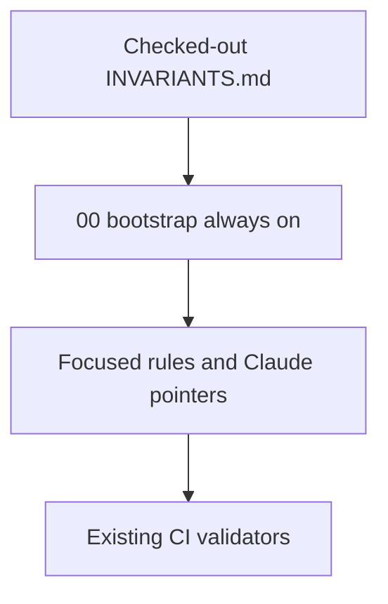

# Agent Instruction Realignment

Execution status: executable. Operator approval on 2026-11-08 admitted root [INVARIANTS.md](INVARIANTS.md) as **Status: ACTIVE**, **Version: 3.0.0**, superseding v2.2.0. The instruction edits below run on a clean worktree of `origin/Staging`. The historical alignment record later in this file is the pre-admission audit. BAN001 stays untouched.

The sentences this plan used to call an active wrapper live in [docs/campaigns/future-add-ons/PlasticOS_Export/GOVERNANCE/SOURCES/ODOO_INVARIANTS_v3.0.0_DRAFT_r3.md](docs/campaigns/future-add-ons/PlasticOS_Export/GOVERNANCE/SOURCES/ODOO_INVARIANTS_v3.0.0_DRAFT_r3.md). That file says `Proposed version: 3.0.0`, `Status: DRAFT`, and `Architectural draft only`. It is not the repository constitution. `POS-INV-17`, `POS-INV-18`, and `POS-INV-19` in the edit list below are citations of that draft.

Architecture is already settled: current validators and accepted ADRs own the facts the old rules got wrong.

- [tests/test_repo_dependency_integrity.py](tests/test_repo_dependency_integrity.py) explicitly does not enforce a layer order. Cycles are owned by `ci/check_circular_deps.py`.
- [plasticos_offer/models/offer.py](plasticos_offer/models/offer.py) already uses `intake_id = fields.Many2one("plasticos.intake")` with `plasticos_intake` in the offer manifest. [plasticos_intake/models/intake_match.py](plasticos_intake/models/intake_match.py) still stores `offer_id` as an `Integer` to dodge a layer cycle. That code stays for a later campaign. The rule that teaches the workaround goes away now.
- External intelligence is [docs/adr/ADR-003-single-external-intelligence-authority.md](docs/adr/ADR-003-single-external-intelligence-authority.md) and `POS-INV-17` / `POS-INV-18`. `plasticos_buyer_match_engine` is not in the tree.
- Pure-Python CI already runs `python3 -m pytest tests/` in [.github/workflows/ci.yml](.github/workflows/ci.yml). There is no hand-maintained test list.
- `POS-INV-19` forbids a layer diagram, a universal `noupdate` rule, or a blanket ACL formula from overriding real lifecycle and model semantics.



## Constitution wrapper

Do not apply this section to root [INVARIANTS.md](INVARIANTS.md). That file has no draft wrapper to strip. The checklist below describes the unadmitted draft, and applying it would replace Constitutional 2.2.0 without the invariant change process. The draft's own admission section requires operator approval, a v2.2.0-to-v3 mapping, and BRS/ADR reconciliation before agent guidance may be aligned.

If a later admission copies the draft into root `INVARIANTS.md`, the wrapper edit is:

- `Proposed version` becomes `Version: 3.0.0`.
- Supersession of v2.2.0 is unconditional. Drop "only after explicit approval".
- MUST and MUST NOT are binding. Keep the sentence that distinguishes assertion, observation, inference, proposal, approval, and posted fact.
- Ownership is current, not "once approved".
- Delete the admission checklist and the closing line "Architectural draft only".
- Replace them with three facts: this file is the canonical invariant source; it does not certify implementation conformance; unimplemented behavior must not be described as compliance. `BAN001` and `ci/check_banned_identifier.py` stay untouched.

No v2-to-v3 mapping memo and no BRS conflict memo in this change.

The draft's ownership bullet cites `plasticos_logistics/business_rules/README.md`, seven chapters, and `SUPERSESSION.md`. That tree is in the repo, including `BRS-01` through `BRS-07` and `BRS-POS-10`. Do not delete the bullet on the claim that the tree is missing. Do not copy, move, admit, or retarget anything under [docs/campaigns/PlasticOS_Native_First_BRS_v1.0.0_2026-10-25](docs/campaigns/PlasticOS_Native_First_BRS_v1.0.0_2026-10-25).

## Replace the bootstrap and delete the duplicate kernel

Replace the body of [.cursor/rules/00-plasticos-master-context.mdc](.cursor/rules/00-plasticos-master-context.mdc). Keep `alwaysApply: true`. Use the short router from the request, with these adjustments:

- The checked-out `INVARIANTS.md` is the canonical source. Historical agent text does not override it.
- Route models, manifests, XML, Odoo 19 patterns, web leads, upgrades, Enterprise tests, and deployment to rules 82, 81, 75, 84, 50, 89, 36, and 30.
- Do not tell the agent to read a BRS chapter, `SUPERSESSION.md`, or `plasticos_logistics/business_rules/`. That pack is not an admitted instruction target in this step.
- External intelligence stays on the accepted Gate path. Do not restore local matching or enrichment authority.
- Publication stays `make pr` into `Staging`. No raw git push. No merge, deploy, live activation, or financial-writer change without explicit authorization.
- Carry over the one unique hard abort from rule 10: never activate `pipeline_v2.py`; `ci/check_pipeline_v2_guard.py` rejects it.
- Do not copy the layer table, the integer-foreign-key instruction, the 29-module inventory, deploy recipes, or the ceremonial end marker.

Before deleting [.cursor/rules/10-plasticos-workspace-kernel.mdc](.cursor/rules/10-plasticos-workspace-kernel.mdc), confirm the three web-lead hotspots already live in rule 50. They do in the current 00/50 split: partner deferral, protected writes, and `_find_or_create_partner()`. Odoo 19 syntax stays in rule 84. Versioned upgrades stay in rule 89. Seed identity stays in the rewritten rule 75, without a universal `noupdate` mandate. Then delete rule 10.

Delete [.cursor/rules/35-plasticos-first-order-execution.mdc](.cursor/rules/35-plasticos-first-order-execution.mdc). Its always-on "defer external engine integration" line contradicts `POS-INV-17`. Fake-success rejection moves into the short rule 40. Nothing else in rule 35 is a PlasticOS owner.

## Rewrite the five retained rules

[.cursor/rules/40-plasticos-zero-stub-law.mdc](.cursor/rules/40-plasticos-zero-stub-law.mdc) — keep `globs: plasticos_*/models/**/*.py` and `alwaysApply: false`. Keep the ban on shipping `pass`, empty success returns, `NotImplementedError`, or "NOT IMPLEMENTED" as delivered behavior. Require a regression check that matches the behavior actually changed. Delete the 29-module map, PR #83/#85 anecdotes, local-engine and stub-mode exceptions, and duplicated test commands.

[.cursor/rules/81-ci-manifest-contract.mdc](.cursor/rules/81-ci-manifest-contract.mdc) — keep the manifest glob. Delete the ten-layer table and every claim that `test_depends_order_respects_layers` exists. Require a valid manifest, resolvable dependencies, no cycles (`ci/check_circular_deps.py`), and version format `19.0.X.Y.Z`. Point runtime version bumps and scoped `-u` at rule 89. Keep the phantom-dependency rule that matches `test_no_phantom_dependencies`.

[.cursor/rules/82-ci-module-wiring.mdc](.cursor/rules/82-ci-module-wiring.mdc) — delete the entire "Integer not Many2one" section. Require a real comodel, a manifest dependency, and an extension or bridge when a cycle would otherwise appear. Cite the offer addon as the owning side of the intake relation. An `if model not in self.env` guard is not permission to skip a dependency the installed graph actually needs. Keep `__init__.py` import wiring. Add one sentence for the existing commission/transaction cycle: it is the known non-fatal Makefile exception; do not copy it, and do not "fix" it by hiding a relation behind an integer.

[.cursor/rules/30-plasticos-deploy-validation.mdc](.cursor/rules/30-plasticos-deploy-validation.mdc) — split Enterprise Docker testing (`make test-module` / `make test-odoo`, fixture in rule 36) from Odoo.sh deployment (rule 98). Delete `make update-all`, the `plasticos_buyer_match_engine` upgrade example, local matching ICP checks, and the unverified `pg_dump` rollback. Scoped upgrade stays `make update m=<module>`. Activation and recovery require explicit authorization and a named runtime result. `make test-module` must not be documented as using a database named `odoo_test`.

[.cursor/rules/75-plasticos-xml-data-rules.mdc](.cursor/rules/75-plasticos-xml-data-rules.mdc) — replace "wrap ALL reference data in noupdate" and "crons are always noupdate and inactive" with lifecycle rules:

- Stable reference data that must survive `-u` uses `noupdate="1"`.
- Views, menus, and records that must refresh on upgrade do not.
- Cron `noupdate` and `active` follow the cron's real lifecycle and `tools/cron_invariant_check.py`, not one blanket.
- Keep XMLID prefix, no hardcoded database ids, no runtime CSV bootstrap, `numbercall`/`doall` bans, module-prefixed `model_id`, and `plasticos_base.user_system_cron` where that check still exists.
- Move XPath and view-pattern detail to a pointer to rule 84.
- Delete the `pg_try_advisory_lock` snippet. `cursor.execute(...)` does not return the lock boolean.

Also narrow the `noupdate="1"` example in [.cursor/rules/30-odoo-native.mdc](.cursor/rules/30-odoo-native.mdc) to stable reference data, with a pointer to rule 75. Leave rules 83, 84, and 95-test-fix-policy as they are unless a sentence repeats a retired doctrine.

## Change activation

- Keep always-on: rule 00, and [.cursor/rules/01-cursor-governance-law.mdc](.cursor/rules/01-cursor-governance-law.mdc). Rule 01 has no stale architecture claim; do not shorten it in this change.
- Set `alwaysApply: false` and rely on the description, with no globs: rules 02, 36, 70, 87, and 88. Rule 00 still states the publication prohibition so it survives when rule 70 is not selected.
- Rule 89: `alwaysApply: false` and `globs` covering `plasticos_*/**/*`, still pointing at `skills/plasticos-odoo-version-bump/SKILL.md`.
- Rule 50: keep the existing web-lead globs. Compare its pipeline text with `plasticos_web_leads/models/web_lead.py` and delete obsolete PR-history sentences. Keep partner deferral, idempotency, and protected transitions that the model still implements.
- Rule 88: keep the Odoo tooling boundary and `pyproject.toml` as the version authority. Drop any copied pin that the rule presents as a second source of truth.
- Rule 71: replace the blanket manager/user/readonly CRUD formula with "read the CSV, then judge effective ACL and record rules". State that `ci/check_acl_completeness.py` only proves an ACL row exists. Keep the preflight: read the whole CSV, refuse redundant rows, and do not mix XMLID prefixes.
- Rule 80: delete historical file counts and the PR #85 list. Point at `pytest tests/ --collect-only`, the pinned fixture in `config/test_env_fixture.conf`, and the separate outcomes `PASS`, `FAIL`, `NOT_RUN`, and skipped.
- Rule 86: delete the claim that pure-Python CI lists test files by hand. Describe `python3 -m pytest tests/` and the conftest collect-ignore. Keep SHA pins, fail-slow `ci-gate-result`, and the ban on reviving the deleted workflows.
- Rule 95 equipment: delete the buyer-matcher, graph-sync, and Cypher wiring steps. Facility evidence and projections stay in Odoo. Scoring semantics stay with CEG/EIE through Gate. Keep seed data, the capability flag, the facility packet, and a test of that Odoo projection.
- Rule 98: delete the snapshot table for build `36099032`. Keep discovery through gitignored `.env.local` (`ODOO_SH_STAGING_SSH` and `ODOO_SH_STAGING_URL`).

## Same change set for the other entry points

[.cursor/rules](.cursor/rules) is not the only surface Cursor and Claude load.

[AGENTS.md](AGENTS.md) is `additive_only` in [ops/config/root-file-protection.json](ops/config/root-file-protection.json). Insert a short binding block at the top: read the checked-out `INVARIANTS.md`, apply the cited `POS-INV-*` ids and `BAN001`, and do not follow a layer diagram, integer-foreign-key workaround, local matcher fallback, or universal `noupdate` rule from older text in this file. Removing the false lines is still required, because an agent reads the whole file. The commit that deletes those lines must contain:

`ALLOW-ROOT-DELETION: AGENTS.md — remove layer, universal noupdate, and depends-order instructions superseded by active INVARIANTS.md v3`

Delete or rewrite only the contradicted lines: Project Structure `Layer N` labels, the two universal `noupdate="1"` mandates, and the manifest-hook description that says the dependency test enforces depends order. Keep the tooling inventory, CI job map, ERP import corrections, repo-index path, and the existing "never treat local matcher as intelligence authority" prohibition. The PR body needs the protected-root stamp `<!-- L9_PROTECTED_ROOT_PR -->`.

[CLAUDE.md](CLAUDE.md) is managed, so an in-place edit is allowed. Remove Design Principles 2 and 3 (five-layer isolation and Neo4j scoring fallback) and the "18 invariants, all CI-enforced" lines. Replace principle 1 with lifecycle-specific seed data: stable reference records may use `noupdate="1"`; that is not a rule for every XML record. Keep the ERP import law and the generated formatter block.

[.claude/rules/invariants.md](.claude/rules/invariants.md) becomes a pointer to root `INVARIANTS.md`. Delete "18 CI-enforced invariants".

[.claude/rules/architecture.md](.claude/rules/architecture.md) drops the five-layer table and `plasticos_buyer_match_engine`. Point at manifest `depends`, `ci/check_circular_deps.py`, and accepted ADRs.

[.claude/rules/neo4j.md](.claude/rules/neo4j.md) drops local-graph scoring authority and the `graph_service.py` fallback. Point at ADR-003-single, the Gate ADRs, and `POS-INV-17` / `POS-INV-18`. Remove the `plasticos_buyer_match_engine` path glob.

[.claude/rules/xml-views.md](.claude/rules/xml-views.md) drops blanket `noupdate`. Point at rule 75.

[.claude/rules/security.md](.claude/rules/security.md) points at effective ACL and record rules, and at rule 71. Keep same-module ACL, the CSV preflight, and the `sudo()` justification rule.

## One regression test

Add [tests/test_agent_rule_alignment.py](tests/test_agent_rule_alignment.py) and negative fixtures under `tests/fixtures/agent_rule_alignment/`. The fixtures are not rule files.

The test parses `.mdc` frontmatter and checks the activation table above. It checks that rule 00 names `INVARIANTS.md` and that the constitution status line is `ACTIVE`. It scans only this instruction set: `.cursor/rules/*.mdc`, `AGENTS.md`, `CLAUDE.md`, and `.claude/rules/*.md`.

Banned in that set, as affirmative doctrine rather than as a prohibition:

- a layer-order mandate, including `test_depends_order_respects_layers` and "5 layers" / "Layer Isolation"
- an integer field recommended in place of `Many2one` to avoid a dependency
- a local matcher or Neo4j scoring fallback presented as acceptable intelligence
- "18 invariants" or "architectural draft"
- universal "wrap all reference data in noupdate"
- `make update-all` as a normal deploy path
- the retired staging build id `36099032` as operational truth
- a required read of `plasticos_logistics/business_rules/` or `SUPERSESSION.md`

The negative fixtures are one layer mandate, one local-matcher fallback, and one "18 invariants" assertion. Each must fail the same checker. Do not put the BAN001 identifier in any fixture. Do not scan addon Python, `skills/`, or root `ARCHITECTURE.md`. Those still contain old layer and `noupdate` teaching; they are a later documentation pass, not proof that this test is green.

`ci.yml` already collects `tests/`. Do not add a workflow. Do not edit `ci/check_banned_identifier.py`.

## Proof and boundary

Run `python3 -m pytest tests/test_agent_rule_alignment.py -q`. That is the automated proof. A fresh Cursor session that reads the checked-out `INVARIANTS.md` and names the relevant `POS-INV-*` ids is the manual proof; this change cannot record that session.

Out of scope: addon fields, the integer `offer_id` in `intake_match.py`, migrations, Docker upgrades, Odoo.sh activation, financial-writer cutover, skill-pack rewrites, and root `ARCHITECTURE.md`.

## Publication

The pull request for this change set targets `Staging`. The constitution is admitted, so publication runs after the instruction edits and the alignment test.

- Create the feature branch `docs/agent-rule-realignment` from a clean worktree of `origin/Staging`. The current checkout is dirty and stays untouched.
- Commit the instruction edits and the alignment test on that branch.
- Publish with `make pr`. Its default base is `Staging`.
- Leave the `Development` branch at the Mack commit. Do not push it, reset it, or pass it as `base`.
- Do not merge the pull request. Merge stays a separate decision.
- The `AGENTS.md` deletion still needs `ALLOW-ROOT-DELETION` in the commit and `<!-- L9_PROTECTED_ROOT_PR -->` in the pull request body.

## Recursive alignment 2026-11-08

Kernel: `.cursor-commands/kernels/Recursive Alignment.md` v1.0. The kernel stays audit-only. This section is the authorized correction of this plan. No rule file and no `INVARIANTS.md` was edited.

```yaml
audit_status: PartiallySucceeded
readiness_status: NotReady
convergence_status: Partial
target_binding:
  root: /Users/ib-mac/.cursor/plans/agent_rule_realignment_07c524c1.plan.md
  artifact_type: implementation_plan
  inspected_constitution: INVARIANTS.md
  constitution_revision: b5b6056f01639212e722ccdec5b964b36deee9f5
  constitution_blob: 3abc00c346fa1f8801471638969ff6a540e6cbf8
  constitution_status: Constitutional
  constitution_version: 2.2.0
  draft_source: docs/campaigns/future-add-ons/PlasticOS_Export/GOVERNANCE/SOURCES/ODOO_INVARIANTS_v3.0.0_DRAFT_r3.md
  development_tip: d9933baaf517750779e592181d9d5ef4abdc3485
authorized_scope: "Correct this plan's constitution premise, the missing-tree claim, and the publication gate."
excluded_scope: "Rule edits, INVARIANTS.md edits, AGENTS.md edits, the alignment test, make pr, Development."
source_authority_used:
  - source: .cursor-commands/kernels/Recursive Alignment.md
    precedence: audit output contract
    scope: this plan
  - source: INVARIANTS.md
    precedence: repository constitution
    scope: invariants 4, 7, 19, and 20, plus the invariant change process
  - source: docs/campaigns/future-add-ons/PlasticOS_Export/GOVERNANCE/SOURCES/ODOO_INVARIANTS_v3.0.0_DRAFT_r3.md
    precedence: unadmitted draft
    scope: the wrapper sentences and POS-INV ids this plan cites
  conflicts: "The plan treated the draft as an already active root constitution. The root file is Constitutional 2.2.0. The draft status line is DRAFT."
architecture_adapters:
  - id: plasticos_constitution
    name: INVARIANTS.md v2.2.0
    version: 2.2.0
    governing_source: INVARIANTS.md
    status: Applied
    scope: this plan's authority claims
  - id: recursive_alignment
    name: recursive_architecture_alignment_auditor
    version: "1.0"
    governing_source: .cursor-commands/kernels/Recursive Alignment.md
    status: Applied
    scope: this plan document
normalized_context: "Staging checkout b5b6056f is dirty and stays the checkout. Development remains the Mack squash. The instruction edits stay written in this plan and are not authorized to run."
artifact_inventory:
  - /Users/ib-mac/.cursor/plans/agent_rule_realignment_07c524c1.plan.md
  - INVARIANTS.md
  - docs/campaigns/future-add-ons/PlasticOS_Export/GOVERNANCE/SOURCES/ODOO_INVARIANTS_v3.0.0_DRAFT_r3.md
  - .cursor/rules/00-plasticos-master-context.mdc
  - plasticos_logistics/business_rules/README.md
  - plasticos_logistics/business_rules/SUPERSESSION.md
boundary_map:
  constitution_owner: INVARIANTS.md
  draft_owner: docs/campaigns/future-add-ons/PlasticOS_Export/GOVERNANCE/SOURCES/ODOO_INVARIANTS_v3.0.0_DRAFT_r3.md
  publication_owner: make pr into Staging
  publication_status: blocked
  development_owner: local Development at the Mack squash
  logistics_brs_owner: plasticos_logistics/business_rules
alignment_summary: "The plan no longer says the root constitution is already ACTIVE v3, and it no longer says the logistics business_rules tree is missing. The rule edits remain specified and blocked. The pull request base remains Staging."
alignment_score:
  overall: Partial
  warning: "Score does not override the constitution release blocker."
  domains:
    intent_and_scope: Failed
    communication_contracts: NotApplicable
    routing_and_integration: Passed
    authority_boundary: Failed
    structure_and_source_of_truth: Failed
    schema_and_configuration: NotApplicable
    security: Passed
    reliability_observability: NotApplicable
    testing_validation: Failed
  excluded_domains: []
critical_violations: []
high_violations:
  - id: CONSTITUTION_NOT_ADMITTED
    severity: High
    confidence: Confirmed
    governing_rule: "INVARIANTS.md invariant change process. The draft says it supersedes v2.2.0 only after explicit approval."
    rule_source: INVARIANTS.md and ODOO_INVARIANTS_v3.0.0_DRAFT_r3.md
    affected: constitution-wrapper and every rule todo that deletes layer or universal-noupdate doctrine
    evidence: "Root header is Status Constitutional, Version 2.2.0. The draft header is Status DRAFT and Proposed version 3.0.0. No POS-INV id exists in root INVARIANTS.md."
    observed: "The plan instructed a wrapper cleanup of an already ACTIVE v3 constitution."
    expected: "Agent guidance follows the admitted constitution until an operator admits v3."
    impact: "Executing the plan would replace constitutional invariants 4 and 7 and publish that replacement into Staging."
    root_cause: "The plan bound itself to the draft's POS-INV ids and treated the draft status as ACTIVE."
    smallest_correction: "Block the edits. Leave the intended text in this plan."
    owner: this plan
    blocks_release: true
    status: Open
medium_violations:
  - id: LOGISTICS_TREE_PRESENT
    severity: Medium
    confidence: Confirmed
    governing_rule: "Do not delete a source-of-truth pointer on a false absence claim."
    rule_source: recursive alignment source-of-truth domain
    affected: constitution-wrapper ownership bullet
    evidence: "plasticos_logistics/business_rules/ contains README.md, SUPERSESSION.md, BRS-01 through BRS-07, and BRS-POS-10."
    observed: "The plan said that tree is not in the repo and told the edit to delete the pointer."
    expected: "Keep the pointer. Do not treat the tree as missing."
    impact: "A later edit would drop a live ownership citation."
    root_cause: "The plan was written against an older absence claim."
    smallest_correction: "Record the tree as present and forbid the deletion."
    owner: this plan
    blocks_release: false
    status: Open
low_violations: []
unknowns:
  - id: OPERATOR_ADMISSION
    why: "No operator approval of the v3 draft was found in root INVARIANTS.md."
    affected: "Whether the blocked instruction edits become legal."
    evidence_needed: "An admitted root INVARIANTS.md whose status and version are the approved v3 text, produced through the invariant change process."
intent_and_scope_compliance:
  status: Failed
  governing_rules: "The plan's purpose is to bind guidance to the admitted constitution."
  evidence: "The cited ACTIVE v3 constitution is not the file at INVARIANTS.md."
  open_violations: [CONSTITUTION_NOT_ADMITTED]
  closing_validation: "Read the root header after any later admission. Do not execute these todos against Version 2.2.0."
communication_contract_compliance:
  status: NotApplicable
  governing_rules: "This plan does not change a message or packet contract."
  evidence: "No communication artifact is in the edit set."
  open_violations: []
  closing_validation: "None for this revision."
routing_and_integration_compliance:
  status: Passed
  governing_rules: "make pr publishes into Staging. Development stays the Mack tip."
  evidence: "Publication section names make pr and Staging. development_tip is d9933baaf517750779e592181d9d5ef4abdc3485."
  open_violations: []
  closing_validation: "When unblocked, make pr from a clean origin/Staging worktree, with no base=Development."
authority_boundary_compliance:
  status: Failed
  governing_rules: "INVARIANTS.md is constitutional. The draft is not an authority until admitted."
  evidence: "Draft line: Supersedes INVARIANTS.md v2.2.0 only after explicit approval. Draft closing line: Architectural draft only."
  open_violations: [CONSTITUTION_NOT_ADMITTED]
  closing_validation: "Operator admission recorded in root INVARIANTS.md before any rule edit."
structure_and_source_of_truth_compliance:
  status: Failed
  governing_rules: "One constitution file. A campaign draft does not compete with it."
  evidence: "Root blob 3abc00c346fa1f8801471638969ff6a540e6cbf8. POS-INV ids exist in the draft and in campaign notes, not in the root file."
  open_violations: [CONSTITUTION_NOT_ADMITTED, LOGISTICS_TREE_PRESENT]
  closing_validation: "The plan cites the draft as a draft and the root file as the constitution."
schema_and_configuration_compliance:
  status: NotApplicable
  governing_rules: "No schema or configuration contract is in this change set."
  evidence: "Addon fields and offer_id stay out of scope."
  open_violations: []
  closing_validation: "None for this revision."
security_compliance:
  status: Passed
  governing_rules: "BAN001 and ci/check_banned_identifier.py stay untouched."
  evidence: "The plan still forbids weakening BAN001 and forbids the identifier in fixtures."
  open_violations: []
  closing_validation: "The later test diff contains no BAN001 identifier."
reliability_observability_compliance:
  status: NotApplicable
  governing_rules: "No runtime service is in this change set."
  evidence: "Docker, Odoo.sh, and financial cutover stay out of scope."
  open_violations: []
  closing_validation: "None for this revision."
testing_validation_compliance:
  status: Failed
  governing_rules: "A test must not claim a constitution status the file does not have."
  evidence: "The planned test checks that the constitution status line is ACTIVE. The root status line is Constitutional."
  open_violations: [CONSTITUTION_NOT_ADMITTED]
  closing_validation: "Do not add tests/test_agent_rule_alignment.py until the admitted status line is the one the test asserts."
overbuilt_vs_underbuilt:
  overbuilt: "A wrapper cleanup of a constitution that has no wrapper, plus deletion of a logistics pointer that resolves."
  underbuilt: "No admission step before the rule deletions that contradict invariants 4 and 7."
  speculative: []
  simplest_correction: "Keep the instruction text. Block execution until v3 is admitted into root INVARIANTS.md."
leverage_analysis: "One constitution read removes the false ACTIVE premise. Publishing or editing rules before admission would put a contradicted constitution onto Staging."
correction_roadmap:
  - id: rebind_constitution
    owner: this revision
    status: applied
    affected: "overview, opening, constitution wrapper, logistics pointer, todos"
    closing_validation: "The plan names Constitutional 2.2.0 and the draft path."
  - id: gate_publication
    owner: this revision
    status: applied
    affected: "Publication and publish-to-staging"
    closing_validation: "make pr does not run while CONSTITUTION_NOT_ADMITTED is open."
  - id: admit_v3
    owner: operator
    status: not_performed
    prerequisite: "Explicit approval, a v2.2.0-to-v3 mapping, and BRS/ADR reconciliation, as the draft's admission section requires."
    affected: INVARIANTS.md
    risk: "Admitting v3 changes invariants 4 and 7."
    expected_value: "The blocked instruction edits become legal against the new constitution."
    closing_validation: "Root header matches the admitted text. Then the pending todos may run."
minimum_safe_next_action:
  action: "Leave the rules and INVARIANTS.md unchanged. Admit the v3 draft through the invariant change process, or withdraw the edits that contradict invariants 4 and 7."
  rationale: "The publication target is already Staging. The constitution conflict is the release blocker."
  resolves: CONSTITUTION_NOT_ADMITTED
  expected_evidence: "Either an admitted root INVARIANTS.md or a plan whose remaining edits agree with Constitutional 2.2.0."
validation_gates:
  - id: constitution_header
    status: failed
    observed: "Status Constitutional, Version 2.2.0"
  - id: draft_status
    status: failed
    observed: "Status DRAFT, Proposed version 3.0.0, Architectural draft only"
  - id: logistics_tree
    status: passed
    observed: "plasticos_logistics/business_rules/README.md, SUPERSESSION.md, and BRS-01 through BRS-07 are present"
  - id: alignment_test
    status: not_run
  - id: make_pr
    status: not_run
residual_risks:
  - "origin/Staging may move before a later execution. Re-read the INVARIANTS.md header before any edit."
  - "The current checkout is dirty. A later build must use a clean worktree of origin/Staging."
convergence:
  completed_passes: ["context and scope", "authority", "source of truth", "publication route"]
  skipped_passes:
    - pass: communication contracts
      reason: "No message contract is in scope."
    - pass: schema and configuration
      reason: "No schema change is in scope."
    - pass: reliability and observability
      reason: "No runtime service is in scope."
  remaining: "Operator admission of v3, or withdrawal of the contradicted edits. The instruction sections below the gate stay as the unblocked change set."
  evidence: "Direct reads of INVARIANTS.md, the v3 draft, rule 00, and the logistics business_rules directory."
```

## Next step, not this one

The BRS chapters already sit in [docs/campaigns/PlasticOS_Native_First_BRS_v1.0.0_2026-10-25](docs/campaigns/PlasticOS_Native_First_BRS_v1.0.0_2026-10-25). That directory is their home. The following step admits that pack and points `INVARIANTS.md` and the rule 00 router at it. This step does not move those files, does not edit them, and does not tell agents to treat the pack as current required reading. `GOVERNANCE/AGENT_READ_FIRST.md` in that pack stays a future consumer contract until that later admission.

## Build evidence (auto)

- detected_at: `2026-11-08T20:46:15Z`
- conversation_id: `3daa1fcf-bcbe-4111-b358-32762565f298`
- generation_id: `ba8c8fd4-fca5-4570-975f-dbc7d53fc7e9`
- transcript: `/Users/ib-mac/.cursor/projects/Users-ib-mac-IB-Odoo-19-LOCAL-IB-Odoo-19/agent-transcripts/3daa1fcf-bcbe-4111-b358-32762565f298/3daa1fcf-bcbe-4111-b358-32762565f298.jsonl`
- todos at build time:
- `constitution-wrapper`: completed
- `bootstrap-and-deletes`: completed
- `rewrite-core-rules`: completed
- `activation-and-focused`: completed
- `agent-entrypoints`: completed
- `alignment-test`: completed
- `publish-to-staging`: completed
