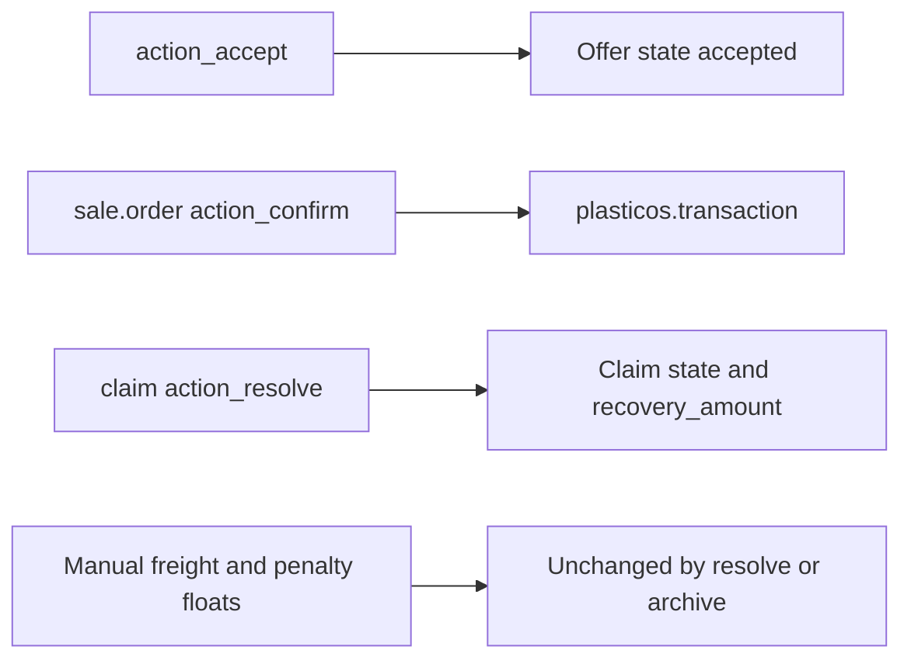

# Align the seven failures to the October 25 contract

Approving this plan authorizes only the named test edits below. It does not authorize production changes, ACL edits, a commit, or a pull request.

Architecture is already settled by the October 25, 2026 operator decisions in [docs/reports/evidence/pr303-cursor-handoff/offer-acceptance-brief.md](docs/reports/evidence/pr303-cursor-handoff/offer-acceptance-brief.md), [claims-recovery-brief.md](docs/reports/evidence/pr303-cursor-handoff/claims-recovery-brief.md), and [10_PR303_PUBLISHED_HANDOFF_ACCEPTANCE.md](docs/campaigns/Testing/Cursor_Import_PR_Isolation_Enterprise_Runbook_v2.3.1/10_PR303_PUBLISHED_HANDOFF_ACCEPTANCE.md). Those decisions supersede the earlier “three upstream fixes” framing.

## Binding contract

- Accepting an offer writes `state`, `accepted_by`, and `accepted_date` in [plasticos_offer/models/offer.py](plasticos_offer/models/offer.py) `action_accept`. It creates no transaction and no sale order. [plasticos_transaction/models/offer_bridge.py](plasticos_transaction/models/offer_bridge.py) keeps `transaction_id`, and nothing in production writes it.
- A live transaction is created only when [plasticos_transaction/models/sale_inherit.py](plasticos_transaction/models/sale_inherit.py) `action_confirm` finds an empty `sale.order.transaction_id`. That path is already covered by [plasticos_transaction/tests/test_sale_order_transaction_autocreate.py](plasticos_transaction/tests/test_sale_order_transaction_autocreate.py) `test_confirm_creates_transaction`. Do not duplicate it inside the offer tests.
- `freight_chargebacks` and `lightweight_penalties` stay plain floats in [plasticos_transaction/models/transaction.py](plasticos_transaction/models/transaction.py). Resolving or archiving a claim must not write them. A resolved claim is not a booked credit.
- The three ACL tests stay exactly as written and stay red.

## Out of scope

- No change to `action_accept`, sale-order confirmation, recovery computes, margin math, backfill, field help, READMEs, or `ARCHITECTURE.md`.
- No edit to [plasticos_transaction/security/ir.model.access.csv](plasticos_transaction/security/ir.model.access.csv) or [plasticos_claims/security/ir.model.access.csv](plasticos_claims/security/ir.model.access.csv).
- No `skip`, `xfail`, deletion of a behavior, or assertion that is true only because a value stays zero by accident.
- No version bump. These are test-file edits. No `make update`, no `make pr`, no push.
- Stale production prose stays recorded and untouched: `offer_bridge.py` help text, `action_resolve`’s compute docstring, and the unwired `_compute_chargebacks_penalties` methods.
- Domestic multi-load work and the accounting-seed error `TestErpWorksheetImport.setUpClass` stay out.

## Phase 1 — semantic test corrections that need this approval

Each rename replaces one method. The new docstring names the old method. The old assertion is not left behind under the old name.

### Offer acceptance

**B1.** In [plasticos_claims/tests/test_bridge_models.py](plasticos_claims/tests/test_bridge_models.py), replace `test_offer_accept_creates_transaction` with `test_offer_accept_leaves_transaction_unlinked`.

- Call `action_send` and `action_accept` with no `hasattr` bypass.
- Assert `state == "accepted"`, `accepted_by == self.env.user`, and `transaction_id` is empty.
- Assert `plasticos.transaction` and `sale.order` `search_count` are unchanged across accept.

**B2.** In [plasticos_security_base/tests/test_action_methods.py](plasticos_security_base/tests/test_action_methods.py), replace `test_action_accept_creates_transaction` with `test_action_accept_leaves_transaction_unlinked`, using the same assertions from a `state="sent"` offer. Leave the existing `test_action_accept` state test in place.

**B3.** In the same claims file, replace the vacuous `test_transaction_links_back_to_offer` with `test_offer_accept_does_not_link_a_transaction`. Today it passes only because `plasticos.transaction` has no `offer_id`, so the inner assert never runs. After accept, assert `transaction_id` is empty and `"offer_id" not in plasticos.transaction._fields`.

Leave these neighboring tests unchanged. They already match the contract:

- `test_offer_reject_no_transaction` asserts an empty `transaction_id`.
- `test_action_accept` asserts accepted state and `accepted_by`.
- `test_action_view_transaction` assigns `transaction_id` on a draft offer only to open the button. That is a fixture write, not a production writer. The accepted-offer write guard in `offer.py` still blocks a later link write that does not include `state`.
- [plasticos_commission/tests/test_golden_flows.py](plasticos_commission/tests/test_golden_flows.py) already creates a transaction by hand when accept does not.

**B4.** Docstring-only, assertions unchanged, in [plasticos_security_base/tests/test_bridge_contracts.py](plasticos_security_base/tests/test_bridge_contracts.py):

- `test_offer_has_transaction_id`: the field exists and targets `plasticos.transaction`. Acceptance does not write it.
- `test_offer_has_action_accept`: the method exists and changes offer state only. Remove the message “critical for transaction creation”.

### Claim recovery

**A1.** In [plasticos_claims/tests/test_depends_transaction_claims_bridge.py](plasticos_claims/tests/test_depends_transaction_claims_bridge.py), replace `test_freight_chargeback_recovery_flows_to_transaction` with `test_freight_chargeback_resolve_preserves_manual_amount`.

- Set `tx.freight_chargebacks = 40.0` before resolve.
- Resolve a `freight_chargeback` claim whose `recovery_amount` is `125.0` and whose `resolution_note` is set.
- Assert the claim is `resolved` and its `recovery_amount` is still `125.0`.
- Assert the transaction float is still `40.0`.
- `action_archive`, then assert the claim is `archived` and the transaction float is still `40.0`.

**A2.** Replace `test_lightweight_penalty_recovery_flows_to_transaction` with `test_lightweight_penalty_resolve_preserves_manual_amount`, using `lightweight_penalties = 40.0`, `case_type="lightweight_penalty"`, and `recovery_amount=75.0`. Same resolve and archive checks.

**A3.** Replace `test_unresolved_claim_contributes_no_recovery`. It currently passes only because the float stays `0.0`. Set `freight_chargebacks = 40.0`, create an unresolved `freight_chargeback` with `recovery_amount=500.0`, and assert the manual value is still `40.0`.

**A4.** Rewrite the module docstring at the top of that file. `claim_ids`, `claim_count`, and `has_quality_claim` remain the computed contract and their tests stay. The two money fields are manual: resolve and archive must not write them. In `test_bridge_contracts.py`, change only the docstring of `test_claim_case_type_has_required_values` so it says those case types exist and do not compute the transaction amounts. Keep the selection assertions. `buyer_claim`, `freight_chargeback`, and `lightweight_penalty` remain real claim types.

Do not change `test_claim_ids_and_count_track_new_claims` or `test_has_quality_claim_set_and_cleared_by_state`.

## Phase 2 — ACL findings stay red

Do not edit these methods in [plasticos_commission/tests/test_security_acl.py](plasticos_commission/tests/test_security_acl.py):

- `TestTransactionACL.test_base_user_cannot_write_tx_line`
- `TestClaimACL.test_claim_user_cannot_unlink`
- `TestClaimACL.test_no_group_cannot_read`

`make test-module m=plasticos_commission` is expected to fail on these three. That failure is preserved evidence, not a task to turn green.

### Effective access today

Odoo allows an operation when any of the user’s groups grants it. Record rules with `perm_unlink=False` are skipped for delete; they do not deny delete.

`plasticos.claim`, from [plasticos_claims/security/ir.model.access.csv](plasticos_claims/security/ir.model.access.csv) and [plasticos_claims/security/claims_security.xml](plasticos_claims/security/claims_security.xml):

- `access_claim_user` on `group_claims_user`: read, write, create. No unlink.
- `access_claim_manager` on `group_claims_manager`: full CRUD. Manager implies claims user.
- `access_claim_all` on `base.group_user`: full CRUD. This is the effective grant for every internal user, including a claims user, so the narrower no-unlink row never binds.
- Claims-user record rule domain is always true, and its unlink flag is off, so it does not block delete.
- `claim.unlink` raises `ValidationError` only for `resolved` and `archived`. A pending claim deletes.
- Claim-photo path: [plasticos_claims/models/document_inherit.py](plasticos_claims/models/document_inherit.py) `_check_claim_trigger` creates `plasticos.claim` as the uploading user, with no sudo, when the document tag code is `claim_pics`, `claim_photo`, or `claim` and the document has an exact transaction subject. An `AccessError` there rolls back the document save.
- The same blanket row also grants read, so `test_no_group_cannot_read` cannot pass while `access_claim_all` still has read.

`plasticos.transaction.line`:

- `access_transaction_line_user` on `base.group_user`: read only.
- `access_transaction_line_all` on `base.group_user`: full CRUD. This is the effective grant, so the read-only row never binds.
- [plasticos_security_base/security/ir.model.access.csv](plasticos_security_base/security/ir.model.access.csv): sales rep read; logistics read, write, create; accounting read. Each of those groups also has `base.group_user`, so the blanket row still grants unlink and, for sales and accounting, write and create.
- No record rule on lines. The sales-rep own-record rule in [plasticos_security_base/security/record_rules.xml](plasticos_security_base/security/record_rules.xml) applies to the transaction header only.
- CSV import: [plasticos_transaction/wizards/transaction_import_wizard.py](plasticos_transaction/wizards/transaction_import_wizard.py) `action_import` calls `plasticos.transaction.line.create` as the current user, with no sudo. The `except Exception` has no savepoint, so a denied create can leave a closed header without lines and only an error string.

Adjacent, not one of the seven, and not to be edited here: `access_transaction_all` also gives `base.group_user` full CRUD on the transaction header. `test_base_user_cannot_unlink` was reported green in the Community run, but the Python `unlink` raises `UserError` only for accounting links, closed state, or loads, not `AccessError` on a plain draft. That mechanism is still unproven. Do not treat the green header test as proof the blanket row is safe.

### Decisions required before any ACL edit

No surgical CSV change is authorized by this plan. A later change needs an explicit answer to each of these:

- Who may read a claim: every internal user, or only claims user and claims manager?
- Who may delete a pending claim: nobody but claims manager, or also claims user?
- Who may create a claim from a `claim_pics`, `claim_photo`, or `claim` document: the uploader’s own groups, or a justified sudo on that one create?
- Who may create and write transaction lines: logistics and manager only, or also the CSV import operator?
- If the import wizard must keep working for an internal user, does that path get a named importer group or a justified sudo, instead of `access_transaction_line_all`?
- Whether `access_claim_all` and `access_transaction_line_all` are removed, narrowed, or replaced. Narrowing the claim row to read-write-create with no unlink would turn only the unlink test green and would leave the no-group read test red.

Until those answers exist, the three tests remain the security findings.

## Verification after the approved edits

On the pinned fixture from [config/test_env_fixture.conf](config/test_env_fixture.conf):

- `make test-module m=plasticos_claims`
- `make test-module m=plasticos_security_base`

Report the renamed methods individually. Success for this change is: the offer and recovery replacements pass, `claim_count` and `has_quality_claim` still pass, and the sale-order confirmation test is untouched.

Then `make test-module m=plasticos_commission` and record the three ACL methods as still failing. Do not edit them to make that module green.

Stop after that evidence. Do not commit, push, or open a pull request unless a later message asks for it.

## Build evidence (auto)

- detected_at: `2026-10-30T05:03:06Z`
- conversation_id: `9eb9e6ec-5014-42dd-87a0-73514613619c`
- generation_id: `dcf5eda7-184d-45d1-915e-24f74cff685c`
- transcript: `/Users/ib-mac/.cursor/projects/Users-ib-mac-IB-Odoo-19-LOCAL-IB-Odoo-19/agent-transcripts/9eb9e6ec-5014-42dd-87a0-73514613619c/9eb9e6ec-5014-42dd-87a0-73514613619c.jsonl`
- todos at build time:
- `rewrite-offer-tests`: completed
- `rewrite-recovery-tests`: completed
- `preserve-acl-red`: completed
- `verify-scoped`: completed

