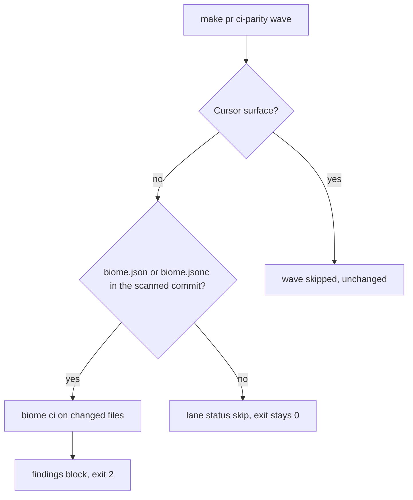

# Biome does not block repos Org CI skips

Org CI (l9-ci-core `org-ci.yml` at `68ed994`) runs Biome only when the checkout has a Biome config, and reports the check as not applicable otherwise. SplitWisely has no config, so its real Org CI run is already green.

The local publication gate does not use that predicate. On any non-Cursor surface, [`ops/scripts/run_pr_gate.sh`](ops/scripts/run_pr_gate.sh) `_gate_run_ci_parity` runs `ops/ci_parity/run.py --gate HEAD --lanes biome,semgrep-l9` and fails the gate on exit 2. [`_lane_biome`](ops/ci_parity/run.py) always executes `biome ci` on changed `*.js`, `*.jsx`, `*.ts`, `*.tsx`, `*.mjs`, `*.cjs`, and `*.json` files. With no config, Biome applies its defaults, so format, import sorting, and lint findings fail the gate. Import sorting changes compiled output, and lint autofixes can change UI behavior, so those findings are not a safe “just format it” fix.

Cursor desktop already skips this whole wave (`is_cursor_host_surface` in [`ops/scripts/resolve_governance_paths.sh`](ops/scripts/resolve_governance_paths.sh)). The break-glass is required on the surface that actually runs the wave (hosted Claude / `L9_GOVERNANCE_SURFACE` other than `cursor`). This change is that wave, not a new opt-out for security, pytest, wiring, or `semgrep-l9`.

## Change

In [`ops/ci_parity/tools.yaml`](ops/ci_parity/tools.yaml), declare the Org CI predicate on the `biome` lane:

- `requires_any_file: [biome.json, biome.jsonc]`

In [`ops/ci_parity/run.py`](ops/ci_parity/run.py) `run_lane`, after the tool resolves and before the lane function runs: if `requires_any_file` is set and none of those names is a file under `ctx.scan_dir`, return `status: skip` with a notice that Biome is not applicable. Do not call `biome ci`. `scan_dir` is the snapshot commit for `--gate` / `--commit` (the check runs after `ensure_snapshot`) and the workspace for edit-time `--file`.

[`summarize`](ops/ci_parity/run.py) already ignores `skip` when counting blockers, and a `skip` receipt is not reused, so a later commit that adds a config is scanned on the next gate. A repo that already has a config keeps today’s fail-closed behavior: any error in a changed file still blocks.

During implementation, confirm against l9-ci-core `68ed994` that the workflow accepts `biome.jsonc` as well as `biome.json`. If Core only looks for `biome.json`, the list is that one name.

## Docs and tests

- Update the Biome bullet in [`ops/ci_parity/README.md`](ops/ci_parity/README.md) and the lane comment in `tools.yaml`: the lane blocks only when the scanned tree has a Biome config, matching Analyze (central Core).
- Add a test in [`tests/ops/ci_parity/test_core_gate.py`](tests/ops/ci_parity/test_core_gate.py): a changed `.ts` file and no config yields `status=skip`, an empty `blocking` list, and no `biome ci` invocation. A second case with `biome.json` present still records blocking findings.
- No change to SplitWisely, no Biome autofix, and no `L9_CI_PARITY=0` (that would also skip the Semgrep lane Org CI does run).

## Left blocking on purpose

`semgrep-l9`, the security wave, pytest, wiring, and root-file protection stay fail-closed. They are checks this gate is supposed to run. The flexible case is a check whose Org CI applicability predicate is false for that repo.

## Build evidence (auto)

- detected_at: `2026-11-07T01:17:48Z`
- conversation_id: `b2ff9061-2e87-4825-9aa8-940f09c25c63`
- generation_id: `7bb86731-d8d1-4eea-833f-e3917771bacb`
- transcript: `/Users/ib-mac/.cursor/projects/Users-ib-mac-Cursor-Governance/agent-transcripts/b2ff9061-2e87-4825-9aa8-940f09c25c63/b2ff9061-2e87-4825-9aa8-940f09c25c63.jsonl`
- todos at build time:
- `confirm-core-predicate`: completed
- `skip-without-config`: completed
- `test-and-doc`: completed
