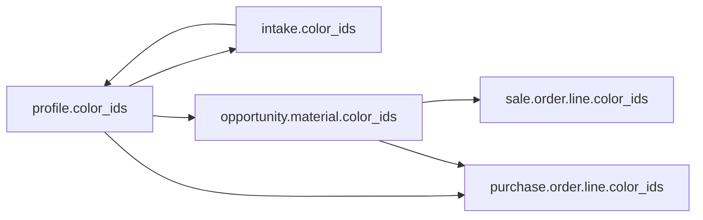

# Finish the color_ids cutover

The profile cutover is already shipped. [`plasticos.material.profile`](plasticos_material_profile/models/material_profile.py) stores `color_ids` (relation `plasticos_material_profile_color_rel`), and [`migrations/19.0.5.12.0/pre-migrate.py`](plasticos_material_profile/migrations/19.0.5.12.0/pre-migrate.py) copied the old column. The approved lot already freezes one code as a string and several codes as a list ([`opportunity_approval.py`](plasticos_crm_bridge/models/opportunity_approval.py) lines 192–196).

What remains is the collapse. Sale lines, purchase lines, intakes, opportunity material, grade templates, and semantic specifications still store `color_id`. Copy paths call `_sole_color()`, which returns a color only when the profile has exactly one and returns empty otherwise. A two-color profile therefore reaches those records as no color.

This plan applies the profile's decision to those owners. The relation is the only color field. Do not keep a computed `color_id`. `plasticos.transaction.line.color` is a free-text Char and stays as it is.

## Field shape

Match the attribute relation on the same model: `fields.Many2many("plasticos.material.color", ...)` with `widget="many2many_tags"`. Relation tables:

- `sale.order.line` — `sale_line_color_rel` (`line_id`, `color_id`), next to `sale_line_material_attribute_rel`
- `purchase.order.line` — `purchase_line_color_rel`
- `plasticos.intake` — `plasticos_intake_color_rel` (`intake_id`, `color_id`)
- `plasticos.opportunity.material` — `plasticos_opportunity_material_color_rel` (`material_id`, `color_id`)
- `plasticos.grade.template` — `plasticos_grade_template_color_rel` (`template_id`, `color_id`)
- `plasticos.material.specification` — `plasticos_material_spec_color_rel` (`specification_id`, `color_id`)

Copy the whole set with `[(6, 0, ids)]`. On sale and purchase onchange, an empty profile set clears the line, the same way attributes do. On intake onchange, copy only when the profile has colors, the same way intake attributes do. Take `color_id` out of the Many2one tuples (`RELATION_FIELDS`, `LINE_SPEC_FIELDS`, `MATERIAL_SPEC_FIELDS`, `_DESCRIBED_RELATIONS`) and copy it beside `material_attribute_ids`.

Delete `_sole_color()` once those callers are gone.

## Writers and readers

- [`sale_order_line.py`](plasticos_order_lines/models/sale_order_line.py) and [`purchase_order_line.py`](plasticos_order_lines/models/purchase_order_line.py): depend on `color_ids`; onchange copies `profile.color_ids.ids`.
- [`material_label.py`](plasticos_order_lines/models/material_label.py): one description segment, color names joined with a comma, the same way attributes are joined.
- [`material_profile.py`](plasticos_material_profile/models/material_profile.py) `action_create_purchase_order`: pass the set, not `_sole_color().id`.
- [`intake.py`](plasticos_intake/models/intake.py) onchange, [`material_profile_intake.py`](plasticos_intake/models/material_profile_intake.py) `default_color_ids`, and [`crm_lead.py`](plasticos_crm_bridge/models/crm_lead.py) `_intake_snapshot_from_material_profile`: copy the set.
- [`opportunity_material.py`](plasticos_crm_bridge/models/opportunity_material.py) `_vals_from_profile` and `_line_specification`: copy the set onto the material row and then onto both order lines.
- [`intake_delta_bridge.py`](plasticos_material_profile/intake_delta_bridge.py): read `intake.color_ids`. Profile vals and the bridge payload use `color_ids` (id list). Drop the `color_id` payload key. Add `color_ids` to `SHARED_PROFILE_FIELD_NAMES` next to attributes.
- [`gate_builders.py`](plasticos_gate/services/gate_builders.py): same shape the lot already uses. One named color stays the string `code or name`. More than one becomes the list. An empty set omits `color`.
- [`native_document_import.py`](plasticos_transaction/models/native_document_import.py): the pair becomes `("color_ids", "color")`. Empty stored set gets `[(6, 0, resolved.ids)]`. A different stored set is kept and reported. `resolved` may be one color record; treat it as a recordset.
- [`orchestrator.py`](plasticos_crm_sync/services/orchestrator.py) `_exact_color`: split on comma and semicolon, resolve each token to exactly one master color, and return that set. Any token that is not exactly one match still returns empty and the skip stands. Compare the stored set with that set.
- [`match_lineage.py`](plasticos_crm_bridge/models/match_lineage.py): spec key `colors=` plus sorted ids, same as attributes.
- [`offer_buyer_selection_wizard.py`](plasticos_crm_bridge/wizards/offer_buyer_selection_wizard.py): one "Color" line, display names joined.
- [`intake_normalizer.py`](plasticos_intake_normalizer/models/intake_normalizer.py): `WARN-001` watches `color_ids`.
- [`grade_template.py`](plasticos_material_profile/models/grade_template.py) `get_template_values` returns the set command. [`grade_template_data.xml`](plasticos_material_profile/data/grade_template_data.xml) `grade_ldpe_mixed_color_film` writes `color_ids` with `[(6, 0, [ref('color_mixed')])]`. The file is `noupdate="0"`.
- Semantic specification field and both views become `color_ids` tags. It is optional and stays uninstalled; the field still changes so no material-color Many2one remains.

## Views

Sale and purchase list columns and search fields become `color_ids`. "Has Color" domain is `[('color_ids', '!=', False)]`. Remove the Color `group_by`: a Many2many cannot be grouped like the old Many2one. Intake form, opportunity material list, and grade-template list and form use `many2many_tags`.

## Migrations and versions

Each module that drops a `color_id` column gets a pre-migrate in the new version folder, copied from the profile script: if the column exists, create the relation table, `INSERT ... SELECT` where `color_id IS NOT NULL`, `ON CONFLICT DO NOTHING`. Odoo then drops the column on `-u`.

- `plasticos_order_lines` `19.0.1.1.2` → `19.0.1.1.3` — `sale_order_line` and `purchase_order_line`
- `plasticos_intake` `19.0.5.4.5` → `19.0.5.4.6` — `plasticos_intake`
- `plasticos_crm_bridge` `19.0.3.6.1` → `19.0.3.6.2` — `plasticos_opportunity_material`
- `plasticos_material_profile` `19.0.5.12.1` → `19.0.5.12.2` — `plasticos_grade_template`, plus removing `_sole_color` and the bridge key
- `plasticos_semantic_kernel` `19.0.1.0.4` → `19.0.1.0.5` — `plasticos_material_specification`

Code-only bumps, no migration folder: `plasticos_gate` `19.0.1.9.10`, `plasticos_transaction` `19.0.2.3.69`, `plasticos_intake_normalizer` `19.0.1.0.6`, `plasticos_crm_sync` `19.0.1.9.29`. The staged-manifest hook rewrites each module README `module_version`; include that README in the same change.

## Tests

Update the fakes and assertions that still name `color_id`: intake contract, web-lead opportunity, manual offers, delta-bridge pure test, both Gate intake fakes, semantic-kernel ondelete observation. Add one assertion that a two-color profile copies both ids into intake vals, order-line vals, and the bridge payload, and that Gate emits a list for two colors and a string for one. CRM sync tests cover a comma-separated color phrase resolving to two master colors.

Runtime Odoo tests stay with `make pr-check`. Do not run `make test-module` for this change. Local check is the updated pure tests plus `ruff` on the touched Python.

## Build evidence (auto)

- detected_at: `2026-11-12T18:35:10Z`
- conversation_id: `c671c514-b61f-4ac2-acf4-390b08ee8f77`
- generation_id: `74accf80-6f49-4960-a539-924361933999`
- transcript: `/Users/ib-mac/.cursor/projects/Users-ib-mac-IB-Odoo-19-LOCAL-IB-Odoo-19/agent-transcripts/c671c514-b61f-4ac2-acf4-390b08ee8f77/c671c514-b61f-4ac2-acf4-390b08ee8f77.jsonl`
- todos at build time:
- `order-lines`: completed
- `intake`: completed
- `crm-bridge`: completed
- `profile-bridge`: completed
- `readers`: completed
- `semantic-kernel`: completed
- `tests`: completed

