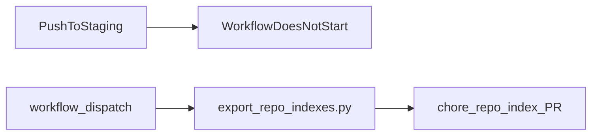

# Disable automatic repo-index refresh

Architecture is already settled. The automatic run and the pull request it opens are one GitHub Actions trigger, not a second scheduler. Removing that trigger is the whole change. The generator, the workflow file, and manual dispatch stay.



## Change

In [`.github/workflows/repo-index.yml`](.github/workflows/repo-index.yml), delete the `push` event (lines 7–9) and rewrite the header so it no longer says the workflow runs after every merge. Leave `workflow_dispatch`, the generator step, the `chore/repo-index` publish step, and the `ci.yml` dispatch.

```yaml
on:
  workflow_dispatch:
```

A push to `Staging` then does not regenerate `docs/reports/repo-index/` and does not open or update the pull request. A manual run from the Actions tab still can.

## Docs and lock

- [`ARCHITECTURE.md`](ARCHITECTURE.md) is `managed` in [`ops/config/root-file-protection.json`](ops/config/root-file-protection.json), so the workflow table row may be edited. Change `push → Staging + manual` to manual only.
- Extend [`tests/test_repo_index_location.py`](tests/test_repo_index_location.py) so the `on:` block (the text before `jobs:`) contains `workflow_dispatch` and does not contain a `push:` key. The publish script still says `git push`; the assertion must not ban that string.

## Leave unchanged

- [`scripts/repo_generators/export_repo_indexes.py`](scripts/repo_generators/export_repo_indexes.py) and local `python3 scripts/repo_generators/export_repo_indexes.py`.
- [`ci.yml`](.github/workflows/ci.yml) `workflow_dispatch`. [`tests/test_ci_event_triggers.py`](tests/test_ci_event_triggers.py) requires it, and a manual index run still dispatches that gate when `REPO_INDEX_PAT` is unset.
- [`AGENTS.md`](AGENTS.md). It is additive-only, and its note that `workflow_dispatch` remains for the repo-index bot stays true.
- Historical campaign notes and plans that mention old `chore/repo-index` pull requests.
- No addon version bump. No `make update`.

An already-open `chore/repo-index` pull request is GitHub state. This diff does not close it.

## Proof

`pytest tests/test_repo_index_location.py tests/test_ci_event_triggers.py` passes, and the workflow `on:` block has no `push` key.

## Execute via Cursor Build

Press Build. After the edits: scoped commit, then `make pr` (the only publication command). The finish reply shows the pull request URL. Do not run `make campaign`.

## Build evidence (auto)

- detected_at: `2026-11-05T17:10:12Z`
- conversation_id: `c07674ed-cecd-4c92-97f8-f32a6bc599d1`
- generation_id: `da1232bc-eb95-49b9-8322-0fbb8fee6fbb`
- transcript: `/Users/ib-mac/.cursor/projects/Users-ib-mac-IB-Odoo-19-LOCAL-IB-Odoo-19/agent-transcripts/c07674ed-cecd-4c92-97f8-f32a6bc599d1/c07674ed-cecd-4c92-97f8-f32a6bc599d1.jsonl`
- todos at build time:
- `drop-push-trigger`: completed
- `update-architecture-row`: completed
- `lock-trigger-test`: completed
