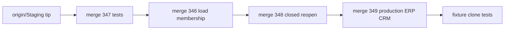

---
kind: simple
execute_via: cursor-build
status: current
---

# Disposable integration test for PRs 346, 347, 348 and 349

## 1. Objective

Prove that the four open product pull requests work together before any of them merges. The pull requests are [#347](https://github.com/cryptoxdog/IB-Odoo_19/pull/347), [#346](https://github.com/cryptoxdog/IB-Odoo_19/pull/346), [#348](https://github.com/cryptoxdog/IB-Odoo_19/pull/348) and [#349](https://github.com/cryptoxdog/IB-Odoo_19/pull/349). "Together" means one tree that upgrades cleanly and passes Odoo runtime tests on the Enterprise fixture.

[#345](https://github.com/cryptoxdog/IB-Odoo_19/pull/345) is excluded because it is a generated repo-index refresh.

## 2. Scope

The following are in scope:

- A throwaway worktree and a local integration branch.
- Conflict resolution on that branch only.
- Docker runtime tests on that worktree's clone of the fixture.
- Cleanup of the worktree, the clone and the branch.

The following are out of scope:

- Pushing anything, running `make pr`, or opening a pull request.
- Editing the four source branches.
- Touching `Staging`, the business `odoo` database, `odoo_install_smoke`, or the template `odoo_test_tpl_ee_c9e8a81f52f23680`.
- Building any new template.

## 3. Ground truth (verified 2026-10-30)

**Pull request status.** All four target `Staging` and report `MERGEABLE`. #348 still has CI checks in progress. #349 is titled "docs(campaigns): name the rehearsal ERP database neutrally", but it carries the full `feat/production-erp-crm-bootstrap` change.

**File overlap.**

- #346 and #348 both edit [plasticos_transaction/__manifest__.py](plasticos_transaction/__manifest__.py) and [plasticos_transaction/models/transaction.py](plasticos_transaction/models/transaction.py).
- #348 and #349 both edit [plasticos_partner_import/__manifest__.py](plasticos_partner_import/__manifest__.py).
- #347 shares no file with the others.
- No pull request adds a `migrations/<version>/` folder, so a version collision does not strand a migration script.

**Fixture inputs.** No pull request touches the inputs that would make the fixture refuse the run:

- `docker-compose.yml`
- `Dockerfile`
- `requirements.txt`
- `constraints.txt`
- `config/odoo.conf`
- `config/odoo_module_order.yaml`
- `scripts/get_odoo_module_order.py`

#349 edits only the `Makefile`, which is not a fingerprint input. The full list is at [scripts/test_env.sh](scripts/test_env.sh) line 411.

**Test runner behaviour.** [scripts/test_env.sh](scripts/test_env.sh) behaves as follows:

- It accepts a worktree of this repository as the compose working directory (lines 225-229).
- It names the clone from the worktree path, as `odoo_test_w<hash>` (lines 131-140).
- It reads `.env` from the worktree root (line 65).
- It defaults `ODOO_ENTERPRISE_PATH` to `./odoo-enterprise` (line 78). That path is gitignored, so a fresh worktree does not have it.
- It accepts a comma list in `-u` (lines 1069-1084), so `make test-module m=a,b,c` is a single run.

**Receipt path.** `make test-module` and `make test-odoo` both write `.l9/runtime/test-env/<db>.test-receipt.json` with the same name. The second run overwrites the first, so each receipt has to be copied off before the next run starts.

## 4. Merge order and conflict policy



**Manifest version conflicts.** Take the higher `19.0.X.Y.Z` of the two sides. This is an integration build only; the real fix belongs on whichever pull request merges second.

**`transaction.py` conflict.** Keep both behaviours. #346 keeps the optional load lookup next to its guard. #348 adds the closed and reopen state handling. Reading the conflicting section from both PRs comes before resolving it. If the two changes cannot both stand, stop and report. Do not pick a side.

**Already merged.** Any pull request that has landed in `Staging` before the run is skipped, because `origin/Staging` already contains it.

## 5. Tasks

1. **preflight.** Run these checks:
   - `git fetch origin`.
   - Record the `origin/Staging` SHA and the four head SHAs (`gh pr view <n> --json headRefOid,state`).
   - `docker info`.
   - `bash scripts/test_env.sh status` from the main checkout, to confirm the template exists and no other run holds its lease.
2. **worktree.** Create the worktree and its local setup:
   - `git worktree add -b integration/prs-346-349 "../wt-integration-346-349" origin/Staging`.
   - Copy the main checkout's `.env` into the worktree. The file is gitignored and holds `POSTGRES_PASSWORD`.
   - Export `ODOO_ENTERPRISE_PATH` as the realpath of the main checkout's `odoo-enterprise`. Pointing at the same Enterprise checkout keeps the fixture's Enterprise input unchanged.
3. **merge.** Fetch and merge each head SHA in the order 347, 346, 348, 349 with `git merge --no-ff`. Apply the conflict policy in section 4 and commit each merge locally. After the last merge:
   - `ruff check .` and `ruff format --check .`.
   - `python3 scripts/check_module_wiring.py`.
   - `python3 ci/check_circular_deps.py`.
   - `python3 ci/check_odoo19_xml.py`.
   - `python3 ci/check_xml_module_ref_deps.py`.
4. **pure-pytest.** From the worktree, using the main checkout's `.venv`, run:

   `python -m pytest tests/test_erp_production_permit.py tests/test_crm_history_cohort.py tests/test_erp_native_orders.py -q`

   `tests/test_erp_native_orders.py` is added because #348 changes it.
5. **scoped-runtime.** Run one fresh clone and one runner pass:

   ```bash
   make test-module m=plasticos_transaction,plasticos_logistics,plasticos_claims,plasticos_security_base,plasticos_commission,plasticos_partner_import,plasticos_documents,plasticos_automation,plasticos_admin_dashboard,plasticos_crm_sync
   ```

   Then copy the receipt to `<db>.scoped.test-receipt.json`.
6. **full-runtime.** Run `make test-odoo fresh=0` on the same clone. It upgrades the full PlasticOS roster and runs the roster's tests. Then copy the receipt to `<db>.full.test-receipt.json`.
7. **report.** Write a short result into the chat. It covers:
   - The base SHA and the four head SHAs.
   - Each conflict and how it was resolved.
   - The pytest counts.
   - Both receipts: tests, failed, errors, source digest, head, and dirty flag.
   - Any failure, with the module and test name.

   Nothing is committed to the main checkout.
8. **cleanup.** Run these from the worktree, then remove it:
   - `make test-db-drop` from the worktree, which drops only that worktree's own clone.
   - `git worktree remove ../wt-integration-346-349`.
   - `git branch -D integration/prs-346-349`.
   - Confirm `bash scripts/test_env.sh status` shows the template unchanged and no leftover clone.

## 6. Success criteria

The run passes only if all of these hold:

- All four merges complete without dropping either side of a conflict.
- The static checks in task 3 pass.
- The three pytest files pass.
- The scoped receipt and the full receipt each show `failed = 0`, `errors = 0`, `tests > 0`, and `dirty = false`, with `head` equal to the integration merge commit.
- The template's database comment and fingerprint are unchanged afterward.

## 7. Stop conditions

Stop and report, without working around the problem, if any of these happens:

- The fixture is refused for changed inputs.
- The Enterprise checkout is missing.
- Another run holds the fixture lease.
- A `transaction.py` conflict cannot keep both behaviours.
- A test fails. Report the failure and do not patch source on the integration branch.

Do not set `TEST_ENV_ALLOW_NEW_TEMPLATE` or `TEST_ENV_PARITY`. Do not use a second compose project or `make test-odoo-local`.

## 8. Risks

- **#348 changes after this run.** Its CI checks were still running, so new commits could invalidate the result. Task 1 records head SHAs so the report names exactly what was tested.
- **Version bumps.** Taking the higher manifest version proves the code works together. It does not settle which pull request owns the final bump; whichever merges second still needs its own bump.
- **Run time.** The full roster run is long. Lease timeout is 3600 seconds by default (`TEST_ENV_LOCK_TIMEOUT`).

## 9. Doc and root surface impact

None. No `AGENTS.md`, ADR, or GMP report changes. The result is reported in chat only.

## Execute via Cursor Build

Press Build after the four pull requests are in the state you want combined. Build runs tasks 1 through 8 above. The usual plan-simple publication step (`PR_STACK=auto PR_REMEDIATE=0 make pr`) does not apply here: this plan publishes nothing, by your instruction, so there is no PR URL at the end.

## Build evidence (auto)

- detected_at: `2026-10-30T16:01:53Z`
- conversation_id: `4c1cd8c5-9021-4cd7-8cf7-3ede63f0102f`
- generation_id: `934da8c7-8e90-4fe9-a1db-fd60348a9312`
- transcript: `/Users/ib-mac/.cursor/projects/Users-ib-mac-IB-Odoo-19-LOCAL-IB-Odoo-19/agent-transcripts/4c1cd8c5-9021-4cd7-8cf7-3ede63f0102f/4c1cd8c5-9021-4cd7-8cf7-3ede63f0102f.jsonl`
- todos at build time:
- `preflight`: completed
- `worktree`: completed
- `merge`: completed
- `pure-pytest`: completed
- `scoped-runtime`: completed
- `full-runtime`: completed
- `report`: completed
- `cleanup`: completed

