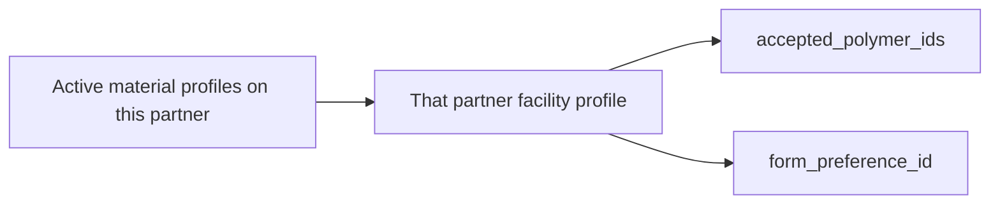

# Facility acceptance projection

Material profiles remain the material source for buyers and suppliers. A facility profile that already belongs to that same partner stores the acceptance projection. L9 architecture-profile law does not apply to this PlasticOS contact model. CRM lead ownership is out of scope.

## Boundary

- Edit only [plasticos_facility_profile](plasticos_facility_profile). Do not edit [plasticos_material_profile](plasticos_material_profile).
- The partner form domain on `plasticos.material.profile.partner_id` still requires a parent. A standalone company can be a facility, but adding a material profile to it through that form stays a material-profile change and is not part of this work. The projection still runs for any partner that already has both records.
- Do not roll child locations up to a parent. A parent with locations has no facility profile, and that stays as designed.

## Projection

For one partner that has its single `plasticos.facility.profile`:

- `accepted_polymer_ids` is the distinct `polymer_id` of that partner’s active material profiles.
- `form_preference_id` is set when every active row has the same non-empty form. Any missing form, or more than one form, clears it. Empty already means any form is accepted.
- Archived rows stay out. Removal already archives a profile that an approved lot still references, and deletes it otherwise.
- A partner with no facility profile is left alone. Lead-owned material rows with no `partner_id` are left alone.

Recompute after a material profile is created, after `polymer_id`, `form_id`, `partner_id`, or `active` changes, and after unlink. A partner move refreshes the old partner and the new partner. Creating a facility profile, or moving it onto a partner, projects that partner’s current rows immediately. The upgrade backfill does the same for facility profiles already stored.

Those two fields remain stored. This projection is the writer. The Capability page shows them read-only. [plasticos_facility_profile/models/facility_template.py](plasticos_facility_profile/models/facility_template.py) `get_template_values` stops copying `form_preference_id`. The template record and its seed data stay.

## Code

- Add [plasticos_facility_profile/models/material_acceptance.py](plasticos_facility_profile/models/material_acceptance.py), inherit `plasticos.material.profile`, and call the projector from `create`, `write`, and `unlink` after `super()`. Import it from [plasticos_facility_profile/models/__init__.py](plasticos_facility_profile/models/__init__.py). This uses the existing dependency on `plasticos_material_profile` and does not change that module.
- Call the same projector from `create` and partner `write` in [plasticos_facility_profile/models/facility_profile.py](plasticos_facility_profile/models/facility_profile.py).
- Widen `plasticos.facility.profile.partner_id` domain from `parent_id != False` to companies. [_check_partner_is_facility](plasticos_facility_profile/models/facility_profile.py) remains the gate, so a standalone company with no children can hold the profile and a parent with locations still cannot.
- Set `readonly="1"` on `form_preference_id` and `accepted_polymer_ids` in [plasticos_facility_profile/views/facility_profile_views.xml](plasticos_facility_profile/views/facility_profile_views.xml). Leave the search field in [plasticos_facility_profile/views/facility_profile_ux.xml](plasticos_facility_profile/views/facility_profile_ux.xml).
- Update the field help so the two fields describe the projection.
- Bump the module to `19.0.5.4.13` in [plasticos_facility_profile/__manifest__.py](plasticos_facility_profile/__manifest__.py) and [plasticos_facility_profile/README.md](plasticos_facility_profile/README.md). Add [plasticos_facility_profile/migrations/19.0.5.4.13/post-migrate.py](plasticos_facility_profile/migrations/19.0.5.4.13/post-migrate.py) to project every existing facility profile.

## Tests

Add `plasticos_facility_profile/tests/test_material_acceptance_projection.py` and register it in the tests package. No ad hoc `make test-module`. `ruff check` and `ruff format` cover the edited Python.

The TransactionCase keeps one location with its own facility profile, a sibling location, a parent with children, and a standalone company. Each case changes one fact:

- One shared form sets that form. Two polymers land once each. Two grades of the same polymer and form still count as one polymer and keep the form.
- Two different forms clear the preference. One empty form beside a filled form clears it. Every form empty leaves the polymers and clears the preference.
- `create` of two rows in one call projects both. A later `polymer_id` write drops the old polymer. A `form_id` write sets the preference when the rows meet and clears it when they stop meeting.
- Unlink of the only row for a polymer drops that polymer. Unlink of one of two rows with the same polymer keeps it. Unlink of the last row clears both fields.
- `active=False` drops the row even when the write context has `active_test=False`. Setting `active=True` brings it back.
- A `freeform_notes` or grade write leaves both fields unchanged.
- Moving `partner_id` removes the row from the old facility and adds it to the new one. A sibling location never receives it. Rows on the parent company do not appear on a child facility.
- A partner with no facility profile accepts the material row and writes no facility fields. A standalone company with no children projects. A parent with child locations still cannot take a facility profile.
- Creating the facility after the material rows projects those rows. Create values that already set `accepted_polymer_ids` or `form_preference_id` are replaced. A later manual write of either field is replaced by the next material create. Moving the facility onto another partner replaces its fields with that partner's rows.
- `form_preference` follows the projected form and clears with it. `embedding_ready` follows the projected polymers together with the existing process and state requirements.
- `get_template_values` does not return `form_preference_id`.
- The Capability fields are `readonly="1"` in `facility_profile_views.xml`. The search view still searches `accepted_polymer_ids`.
- The 19.0.5.4.13 post-migrate replaces stale stored values, and calling it again leaves the same values.

## Build evidence (auto)

- detected_at: `2026-11-12T20:58:51Z`
- conversation_id: `b7006729-80ae-4536-a563-eca059b76b79`
- generation_id: `c6b05a02-feac-4cac-b582-1e8d017875d3`
- transcript: `/Users/ib-mac/.cursor/projects/Users-ib-mac-IB-Odoo-19-LOCAL-IB-Odoo-19/agent-transcripts/b7006729-80ae-4536-a563-eca059b76b79/b7006729-80ae-4536-a563-eca059b76b79.jsonl`
- todos at build time:
- `project-hook`: completed
- `facility-create`: completed
- `views-domain`: completed
- `upgrade`: completed
- `tests`: completed

