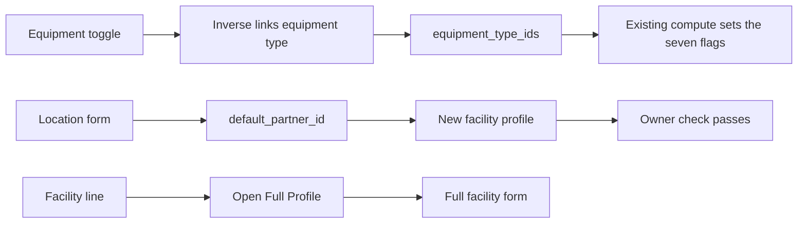

# Facility profile form fixes

Three screenshot bugs. Behavior stays inside [`plasticos_facility_profile`](plasticos_facility_profile). The CRM owner constraint, equipment seed, facility templates, and material profiles stay as they are.

## File whitelist

Only these paths may be created or modified. A `git diff --name-only` path outside this list is a failed change: restore it before commit. Do not format, import-sort, or “clean up” any other file.

- [`plasticos_facility_profile/models/facility_profile.py`](plasticos_facility_profile/models/facility_profile.py) — inverse, flag wiring, `action_open_profile_form`
- [`plasticos_facility_profile/views/facility_profile_views.xml`](plasticos_facility_profile/views/facility_profile_views.xml) — form equipment group, location one2many context, location-line button
- [`plasticos_facility_profile/views/facility_profile_ux.xml`](plasticos_facility_profile/views/facility_profile_ux.xml) — `force_save="1"` on the existing title `partner_id` only
- [`plasticos_facility_profile/__manifest__.py`](plasticos_facility_profile/__manifest__.py) — version string `19.0.5.4.4` to `19.0.5.4.5` only
- [`plasticos_facility_profile/tests/__init__.py`](plasticos_facility_profile/tests/__init__.py) — one import of the new test module
- `plasticos_facility_profile/tests/test_facility_form_edits.py` — new regression test, created by this change

Read-only references, not edit targets: [`plasticos_crm_bridge/models/facility_profile.py`](plasticos_crm_bridge/models/facility_profile.py), [`plasticos_material_profile/models/material_profile.py`](plasticos_material_profile/models/material_profile.py) (`action_open_profile_form`), [`plasticos_material_profile/views/partner_material_ux.xml`](plasticos_material_profile/views/partner_material_ux.xml), [`plasticos_facility_profile/data/equipment_type_data.xml`](plasticos_facility_profile/data/equipment_type_data.xml).

Forbidden even if a nearby edit looks helpful: `plasticos_crm_bridge/**`, `plasticos_material_profile/**`, `plasticos_facility_profile/models/res_partner.py`, `plasticos_facility_profile/models/equipment_type.py`, `plasticos_facility_profile/models/facility_template.py`, `plasticos_facility_profile/views/partner_ux.xml`, `plasticos_facility_profile/views/facility_template_views.xml`, `plasticos_facility_profile/data/**`, `plasticos_facility_profile/migrations/**`, `plasticos_facility_profile/security/**`, manifests other than the one version string, `AGENTS.md`, and docs.

## What is broken

**Equipment.** [`facility_profile.py`](plasticos_facility_profile/models/facility_profile.py) stores equipment on `equipment_type_ids` and derives seven booleans in `_compute_equipment_flags`. The form in [`facility_profile_views.xml`](plasticos_facility_profile/views/facility_profile_views.xml) shows that many2many as tags and locks the booleans with `readonly="1"`. Toggling them does nothing.

**Quality-tab error.** The CRM-bridge constraint rejects a profile that has neither `partner_id` nor `crm_lead_id`. The Create dialog in the screenshots has an empty partner title and an empty CRM lead, so the first save raises `A facility profile needs a facility partner or a CRM lead.` The Quality toggle is that save. The location one2many context is only `form_view_ref` and never passes `default_partner_id`. `partner_id` is readonly in the title, so the dialog cannot fill it.

**Location line.** The Facility Profile tab list has no object button. Material profiles open the full form from `action_open_profile_form` via the external-link button.

## Equipment toggles

In `facility_profile.py`, add one inverse, `_inverse_equipment_flags`, on the seven existing flags only: `has_horizontal_baler`, `has_downstroke_baler`, `has_shredder`, `has_granulator`, `has_wash_line`, `has_extruder`, `has_sorting_line`. Map each flag to the existing seed code (`horizontal_baler`, `downstroke_baler`, `shredder`, `granulator`, `wash_line`, `extruder`, `sorting_line`).

Inverse contract:

- Link a type when its flag is true and it is missing. Unlink it when its flag is false and it is present.
- Use `Command.link` / `Command.unlink` for those codes only. Do not use `Command.set` or a `(6, 0, ids)` replace. Pelletizer, compounder, handling types, and quality types that are already linked must stay linked.
- Assign `equipment_type_ids` only when one of those seven memberships actually changes.
- Do not write the boolean fields inside the inverse.
- Leave `_compute_equipment_flags` and its `"code" in codes` comparisons unchanged so `tests/test_phantom_enum_values.py` still matches the seed file.
- Do not add fields. Do not add pelletizer or compounder toggles.

Form contract in `facility_profile_views.xml`, and nowhere else in that file except the location context and button below:

- Delete the `Equipment Types` group that contains `equipment_type_ids` widget `many2many_tags` (the form page only).
- Remove `readonly="1"` from the seven flag fields.
- Rename that group string from `Equipment (computed)` to `Equipment`.
- Do not edit Material Handling, Quality, Certifications, the standalone list, or the search view.

`facility_profile_ux.xml` already applies `boolean_toggle` to those flags. Do not retouch those xpaths. After the inverse exists, the same two flags already shown on the location line (`has_horizontal_baler`, `has_wash_line`) become editable because they are no longer compute-only. Do not add toggle widgets to that line.

## Owner check on the quality tab

Do not edit the CRM-bridge constraint, its message, `required=False`, or `crm_lead_id`. A profile with no location and no lead is still rejected.

In the partner-page `facility_profile_ids` field only, extend the existing context with `default_partner_id: id` and keep `form_view_ref`. Do not add the default on `action_view_facility_profiles` (it already has it) and do not change `res_partner.py`.

On the existing readonly title `partner_id` in `facility_profile_ux.xml`, add `force_save="1"` and change nothing else on that field (it stays readonly, `no_open` stays). The Create dialog opened from a location then writes the location id before Can Remove Metal, or any other field, is saved.

## Open Full Profile

Add `action_open_profile_form` on `plasticos.facility.profile` with the same return shape as the material-profile method: `ir.actions.act_window`, `res_model` `plasticos.facility.profile`, `res_id` of that record, `view_mode` `form`, `target` `current`. No new view id. No dialog target.

Put one button on the inline `facility_profile_ids` list inside the partner page: `name="action_open_profile_form"`, `type="object"`, `icon="fa-external-link"`, `title="Open Full Profile"`, `class="btn-link p-0"`. Do not add it to `view_facility_profile_list` or `facility_profile_list_ux`. Do not copy the material-profile camera button.

## Version and check

In `__manifest__.py`, change only the version string from `19.0.5.4.4` to `19.0.5.4.5`. No `depends` edit. No migration folder. The flag columns already exist.

New test module `tests/test_facility_form_edits.py`, imported from `tests/__init__.py` with one line. `TransactionCase`, same style as `test_facility_uniqueness.py`. Create a child-company partner in the test. Search equipment types by code. Do not create or write `plasticos.equipment.type` rows.

Assert only:

- `has_shredder = True` links `shredder` and leaves a pre-linked unrelated type linked.
- `has_shredder = False` unlinks `shredder` and leaves that unrelated type linked.
- Writing `equipment_type_ids` to include `horizontal_baler` still sets `has_horizontal_baler`.
- `action_open_profile_form` returns `res_model` `plasticos.facility.profile`, `res_id` of that profile, and `target` `current`.

Do not add a test that expects the CRM-bridge message to change. Do not run `make test-module`, `make test-odoo`, or `make update`.

Before commit, `git diff --name-only` and untracked paths must be a subset of the whitelist. `ruff check` and `ruff format` apply only to the two Python files on the whitelist (`facility_profile.py` and the new test).

## Publish

After the whitelist commit, publish to Staging with:

`make pr-nosmoke reason="Facility profile form only: equipment toggles, location owner on create, open full profile."`

That runs `make pr` into Staging and skips Docker smoke. No other module version changes, so no other module is upgraded.

## Build evidence (auto)

- detected_at: `2026-11-09T21:18:16Z`
- conversation_id: `e543e925-a334-4e91-9eae-9759e10edf14`
- generation_id: `8a938831-529d-45c3-8807-e698402b6e88`
- transcript: `/Users/ib-mac/.cursor/projects/Users-ib-mac-IB-Odoo-19-LOCAL-IB-Odoo-19/agent-transcripts/e543e925-a334-4e91-9eae-9759e10edf14/e543e925-a334-4e91-9eae-9759e10edf14.jsonl`
- todos at build time:
- `equipment-inverse`: completed
- `owner-default`: completed
- `open-full-profile`: completed
- `version-test-publish`: completed

