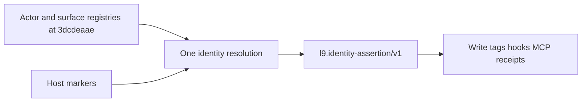

# One evidence-bound identity assertion

## Authority

Identity values come from GitHub `Quantum-L9/.github` **main** `3dcdeaae355b6de08562993f705084d7a3714bfd`. These blobs are the catalogs:

- [semantics/actor_registry.yaml](https://github.com/Quantum-L9/.github/blob/3dcdeaae355b6de08562993f705084d7a3714bfd/semantics/actor_registry.yaml) `l9.actor-registry/global@1` blob `ca97630c46ff`
- [semantics/surface_registry.yaml](https://github.com/Quantum-L9/.github/blob/3dcdeaae355b6de08562993f705084d7a3714bfd/semantics/surface_registry.yaml) `l9.surface-registry/global@1` blob `fce0f73993a1`
- [semantics/identity_model.yaml](https://github.com/Quantum-L9/.github/blob/3dcdeaae355b6de08562993f705084d7a3714bfd/semantics/identity_model.yaml) blob `5ee70e13b7ad`
- [semantics/identity_assertion.schema.yaml](https://github.com/Quantum-L9/.github/blob/3dcdeaae355b6de08562993f705084d7a3714bfd/semantics/identity_assertion.schema.yaml) blob `fad920d356cb`
- [semantics/product_kinds.yaml](https://github.com/Quantum-L9/.github/blob/3dcdeaae355b6de08562993f705084d7a3714bfd/semantics/product_kinds.yaml) blob `7f68d961e5f4`
- [semantics/contracts.yaml](https://github.com/Quantum-L9/.github/blob/3dcdeaae355b6de08562993f705084d7a3714bfd/semantics/contracts.yaml) `l9.contract/identity-resolution@1`, `l9.contract/identity-assertion@1`, `l9.contract/unknown-and-degradation@1`

Actor and surface blobs are the same at the projection’s recorded source revision `9b27869`. `product_kinds.yaml` is not: the hosted-service exception exists only in the later file. Resolution cites `3dcdeaae` for kind law and the registry blobs above for names.

Legal assertion dimension values are a semantic ref or the string `unknown`. Legal `result` values are `resolved`, `unknown`, `ambiguous`, and `invalid`. `l9.contract/unknown-and-degradation@1` forbids coercing unknown to a default. This plan adds no new token.

## Canonical identity values

Actor refs are `l9.actor-registry/global@1#<id>`. Current actors:

- `cursor`
- `claude-code`
- `codex`
- `gemini`
- `manus`
- `human`

Historical actor aliases, meaningful only when the value is read as an ActorIdentity: `claude-code-desktop` and `claude-code-mobile` both canonicalize to `claude-code`. The same strings are current SurfaceIdentity ids. Equal strings are different dimensions.

Surface refs are `l9.surface-registry/global@1#<id>`. Current surfaces:

- `cursor-ide`
- `claude-code-desktop`
- `claude-code-cli`
- `claude-code-ide`
- `claude-code-web`
- `claude-code-mobile`
- `codex-cloud`
- `codex-cli`
- `gemini-cli`
- `manus-cloud`
- `operator-shell`

Historical surface aliases: `claude-desktop`, `claude-cli`, `claude-ide`, `claude-web`, `claude-mobile`.

Product ref for this assertion, taken from the admitted exception subject: `l9-graphiti-memory:product/l9-graphite-memory`.

Names this repository currently treats as actors that are absent from `actor_registry.yaml`: `perplexity`, `perplexity-computer`, `l-cto`, `igorbot`. The resolver does not emit refs for them. `human` is canonical and is absent from [environment/agents/agent_registry.yaml](environment/agents/agent_registry.yaml); the agent-env exporter keeps refusing the human door. This PR does not add a human binding.

`generated/governance/canonical_identity.yaml` is the subset of those catalogs referenced by local `actor_ref` and `surface_refs`. Profile `l9.projection/cursor-governance-identity@1` selects `$.actors` and `$.surfaces`, while [tools/authority/project_canonical_identity.py](tools/authority/project_canonical_identity.py) keeps only ids the operating plane assigns. The filtered file therefore omits actor `human` and surfaces `claude-code-desktop`, `claude-code-ide`, and `operator-shell`. Those ids remain canonical. This PR does not widen the projection. An emitted ref must be a current canonical id and assigned on that actor’s binding. An unassigned canonical surface stays `unknown` in this plane.

Local assignments today:

- `cursor` → `cursor-ide`
- `claude-code` → `claude-code-cli`, `claude-code-web`, `claude-code-mobile`
- `manus` → `manus-cloud`
- `codex` → `codex-cloud`, `codex-cli`
- `gemini` → `gemini-cli`

`claude-code-desktop` and `claude-code-ide` stay canonical and unassigned. Missing evidence does not select them.

## Applicability for this binding

[ops/config/memory-binding.json](ops/config/memory-binding.json) pins `l9-graphite-memory` 2.6.0. The dependency kind’s `identity_dimensions` are `product_identity` and `release_identity`. Its runtime rule is `RuntimeIdentity(dependency_instance) = RuntimeIdentity(consumer)`. It forbids `independent_constellation_identity_as_dependency`. Actor and surface apply when local authorship or surface is material (`actor_identity_when_local_authorship_is_material`, `surface_identity_when_local_surface_affects_governance_or_projection`).

`l9.product-kind-exception/memory-hosted-service@1` applies from release 3.0.0. Its `identity_dimensions` are `product_identity`, `release_identity`, and `runtime_identity`, and its runtime rule is the admitted Memory service deployment. It never grants ConstellationIdentity. That exception does not apply to the 2.6.0 consumer assertion.

For this assertion:

- **ProductIdentity** is `l9-graphiti-memory:product/l9-graphite-memory` on `product_ref`.
- **ReleaseIdentity** is applicable and stays `unknown`. Authority is `release_provenance_and_admission` under `l9.contract/product-release@1`. The consumer pin’s version, git SHA, and wheel digest are examined in provenance and are not a release ref.
- **RuntimeIdentity** stays `unknown`. The 2.6.0 rule points at the consumer runtime, and this process has no admitted runtime ref. The 3.0.0 service-deployment rule is not applied here. Package version, actor, surface, and hostname are not runtime identity.
- **ConstellationIdentity** is outside both `identity_dimensions` lists. The key is omitted. No ref is minted, and the string `unknown` is reserved for an applicable dimension with insufficient evidence. `governing_coordinates` cites the dependency dimension list and the exception id with `applies_from_release: 3.0.0` so a reader can see why the key is absent.
- **ActorIdentity** and **SurfaceIdentity** resolve independently under `l9.contract/identity-resolution@1`. Registries name coordinates. Downstream code interprets runtime markers and leaves unrecognized evidence `unknown`.

## Downstream evidence map

One resolver in [ops/memory/agent_identity.py](ops/memory/agent_identity.py) and [ops/memory/print_agent_assertion_env.py](ops/memory/print_agent_assertion_env.py) produces the assertion. Consumers read it.

Actor evidence:

- `CURSOR_AGENT` resolves `l9.actor-registry/global@1#cursor`. When Cursor and Claude markers are both present, Cursor wins. That precedence is downstream evidence handling.
- `CLAUDECODE`, `CLAUDE_CODE_ENTRYPOINT`, or `CLAUDE_CODE_SESSION_ID` resolves `l9.actor-registry/global@1#claude-code`, including when the entrypoint is empty, `remote_web`, or `remote_unknown`.
- With no host markers, `L9_MEMORY_AGENT_ID` resolves only `codex`, `gemini`, or `manus` to the matching canonical actor ref.
- Any other explicit id, including the historical aliases and the four local reserved names, yields no actor. A consequential assertion is then refused (`result` is not `resolved`).

Surface evidence, only when the resulting ref is on that actor’s `surface_refs`:

- `CURSOR_AGENT` → `l9.surface-registry/global@1#cursor-ide`
- local `CLAUDE_CODE_ENTRYPOINT=cli` → `l9.surface-registry/global@1#claude-code-cli`
- `CLAUDE_CODE_REMOTE=true` and `CLAUDE_CODE_ENTRYPOINT=remote_mobile` → `l9.surface-registry/global@1#claude-code-mobile`

Every other entrypoint, including empty, stays `surface_identity: unknown`. `claude-code-web` is canonical and assigned, and this map has no host marker that selects it, so it is not filled in by default. Codex, Gemini, and Manus stay `surface_identity: unknown` when the only evidence is `L9_MEMORY_AGENT_ID`, even though their bindings list surfaces. Unknown surface leaves a resolved actor in place and omits the `surface:` write tag.

A configured `L9_MEMORY_AGENT_ID`, a caller surface string, an OAuth client id, an adapter name, and a governance profile do not override host evidence. Hook-envelope names stay hook-lane capability names. `detect_surface` stays the coarse governance-profile domain.

## What the current code diverges from

[ops/memory/agent_identity.py](ops/memory/agent_identity.py) maps an unrecognized local Claude entrypoint to `claude-code-desktop`. That coerces unknown to a canonical surface this plane does not assign. The assertion then stores `unknown` while [ops/memory/agent_write.py](ops/memory/agent_write.py) stamps `surface:claude-code-desktop`.

The same function returns no actor when a Claude remote entrypoint is unrecognized. Surface evidence is insufficient; actor evidence is still `claude-code`.

`build_runtime_identity_assertion` writes `unknown` for release, runtime, and constellation together. Release and runtime are applicable and unknown. Constellation is outside the applicable lists, so it does not share that value.

[ops/graphiti/hydration/identity.py](ops/graphiti/hydration/identity.py) defaults `surface="cursor"`, which is neither `cursor-ide` nor `unknown`. [environment/agents/adapters/claude-code/memory/memory_state.py](environment/agents/adapters/claude-code/memory/memory_state.py) prefers a caller event `agent_id`. The prefetch guard asserts an empty actor for an unrecognized remote entrypoint.

`principal_id`, `user_id`, `tenant_id`, `organization_id`, `workspace_id`, roles, and namespace grants stay server-owned authorization fields.

## Consumers

- [ops/memory/agent_write.py](ops/memory/agent_write.py) stamps `agent:` and `surface:` from the assertion. The surface tag uses the canonical surface id fragment. A caller tag that disagrees is drift.
- [ops/memory/print_agent_assertion_env.py](ops/memory/print_agent_assertion_env.py) is the only mint path for `L9_MEMORY_IDENTITY_ASSERTION_JSON`.
- [environment/agents/adapters/claude-code/hooks/memory_prefetch.py](environment/agents/adapters/claude-code/hooks/memory_prefetch.py) and `writer_identity` report the resolved canonical actor id. Receipt identity uses that actor. An event `agent_id` that disagrees is drift.
- [ops/graphiti/hydration/identity.py](ops/graphiti/hydration/identity.py) uses the resolved surface id or no surface.
- [ops/memory/agent_assertion.py](ops/memory/agent_assertion.py) keeps door grants separate from identity dimensions.

## Tests

Extend [tests/ops/memory/test_agent_identity.py](tests/ops/memory/test_agent_identity.py), [tests/ops/memory/test_agent_assertion.py](tests/ops/memory/test_agent_assertion.py), [tests/ops/memory/test_agent_write.py](tests/ops/memory/test_agent_write.py), and the Claude prefetch guard. Assertion cases check full refs, `result`, release, runtime, absence of `constellation_identity`, and `runtime_evidence_digest`.

- `CLAUDECODE=1` and no entrypoint: actor `l9.actor-registry/global@1#claude-code`, `surface_identity: unknown`, no `surface:` tag.
- `CLAUDE_CODE_ENTRYPOINT=cli`: actor `claude-code`, surface `l9.surface-registry/global@1#claude-code-cli`.
- `CLAUDE_CODE_REMOTE=true` and `CLAUDE_CODE_ENTRYPOINT=remote_mobile`: actor `claude-code`, surface `l9.surface-registry/global@1#claude-code-mobile`.
- `CURSOR_AGENT=1`: actor `l9.actor-registry/global@1#cursor`, surface `l9.surface-registry/global@1#cursor-ide`.
- Unrecognized remote entrypoint: actor `claude-code`, surface `unknown`.
- `L9_MEMORY_AGENT_ID=codex` alone: actor `l9.actor-registry/global@1#codex`, surface `unknown`, `result: resolved`.
- `L9_MEMORY_AGENT_ID` in `perplexity`, `l-cto`, `igorbot`, `claude-code-desktop`: no resolved actor.
- Forged caller surface or agent id against host markers: host evidence wins; disagreement is drift.
- Projection receipt `source_revision` disagreeing with the projection: mint refused.
- Partial knowledge: actor and surface resolved, `release_identity` and `runtime_identity` are `unknown`, `constellation_identity` is absent.

Recompute the golden digest in `test_agent_assertion.py` from that body.

## Docs and the blocking dependency

[ops/memory/AGENT_WRITE_CONTRACT.md](ops/memory/AGENT_WRITE_CONTRACT.md) currently pairs `claude-code` with `claude-code-desktop` when the entrypoint is absent, and pairs adapter actors with a single surface without surface evidence. Replace that table with the canonical ids and the evidence map above. Correct the same author wording in [rules/03-graphiti-memory.mdc](rules/03-graphiti-memory.mdc) and [rules/87-cursor-memory-kernel.mdc](rules/87-cursor-memory-kernel.mdc). Regenerate `environment/generated/llm-rules/` when a projector owns those copies.

PR body records the blocking dependency: Memory publishes a digest-verified ReleaseIdentity under `l9.contract/product-release@1` before `release_identity` can leave `unknown`. A service RuntimeIdentity exists only for an admitted deployment at or after 3.0.0 under `l9.product-kind-exception/memory-hosted-service@1`. This PR keeps `expected_package_version` at 2.6.0, leaves `claude-code-desktop` unassigned, and leaves OAuth client ids out of identity.

Build continues PR #784 at head `e9c4259`. Workspace HEAD at planning time was `da5c9a42`. Confirm the PR branch before editing.

Memory prefetch was not run in planning because it writes a receipt. Build runs `python3 ops/hooks/plan_memory_prefetch.py` and cites `.l9/memory/plan-prefetch.json`.

## Acceptance

The suite shows canonical refs for Cursor, Claude CLI, and Claude Mobile; unknown surface where the entrypoint does not select an assigned surface; `release_identity` and `runtime_identity` as `unknown` on this 2.6.0 binding; no `constellation_identity` key; and one assertion consumed by write tags, prefetch, MCP env, and receipts. Forged, conflicting, stale, missing, and partial evidence are covered. Release admission remains an upstream dependency.

## Build evidence (auto)

- detected_at: `2026-10-27T19:54:44Z`
- conversation_id: `5e2b2b14-e690-42ae-8422-c85c8e189089`
- generation_id: `af589569-3b24-45a9-b151-ecc38f00b77a`
- transcript: `/Users/ib-mac/.cursor/projects/Users-ib-mac-l9-graphiti-memory-1/agent-transcripts/5e2b2b14-e690-42ae-8422-c85c8e189089/5e2b2b14-e690-42ae-8422-c85c8e189089.jsonl`
- todos at build time:
- `resolver`: completed
- `consumers`: completed
- `tests`: completed
- `docs-dependency`: completed
