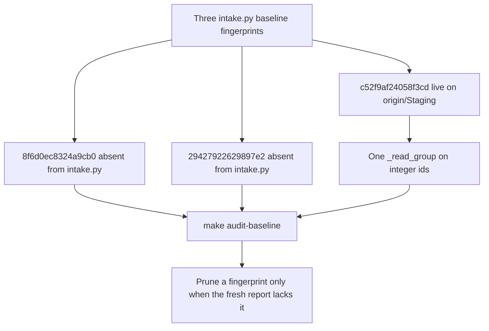

# Fix the three intake.py audit-baseline N+1s

Alignment against `.cursor-commands/kernels/Recursive Alignment.md`, then gap-fill against `.cursor-commands/kernels/Validate & Fill Gaps.md` (which applies `.cursor-commands/kernels/Validate & Repair.md` to confirmed gaps only). The code is not changed yet. Base inspected: `origin/Staging` at `886194a71f49e486f58e66cb6d6b124a33ce1cdd`. Re-resolve that SHA at execution. The checkout at inspection was `feat/native-opportunity-matching` at `afb2f78a`, which is not the base.

## What the alignment changed

- Do not copy [`plasticos_logistics/models/load.py`](plasticos_logistics/models/load.py). On `origin/Staging`, `_compute_freight_evidence_counts` is still a per-record `search_count`. A `_read_group` version exists only in the dirty worktree. The contract is Odoo 19 `BaseModel._read_group` in `odoo/orm/models.py`.
- Do not look up `rec._origin`. Odoo 19 `DomainCondition` rewrites a `NewId` comparison to `in []` (`odoo/orm/domains.py`), so today's compute returns 0 for an unsaved record. Reading the origin would start returning the stored intake's count.
- [`extended_audit_report.json`](extended_audit_report.json) is gitignored. It is a scanner output, not the gate. [`scripts/audit/run_baseline_gate.sh`](scripts/audit/run_baseline_gate.sh) deletes it, reruns the scanner, and passes the fresh file to `check_baseline.py`.
- Do not use `assertQueryCount`. Odoo 19 fails that helper only when the count is higher, and only on the warm run. This repo has no caller.

## Gaps filled in this revision

These are broken instructions in the previous plan. They are now the commands to run.

- `make commit` with no `m=` uses `wip: snapshot local changes`. The commit-msg hook allows only `feat`, `fix`, `docs`, `style`, `refactor`, `perf`, `test`, `build`, `ci`, `chore`, and `revert`. `wip` is not in that list. The message is `perf(intake): count intake images in one query`.
- `make commit` runs `git add -u` and adds every untracked file outside the governance exclude ([`Makefile`](Makefile) `commit` target). It cannot limit itself to intake files. Before that command, `git status` must show only this change: `plasticos_intake/models/intake.py`, `plasticos_intake/__manifest__.py`, `plasticos_intake/tests/test_intake_image_count.py`, `plasticos_intake/tests/__init__.py`, and `ci/baselines/extended_audit_baseline.json`. If anything else is modified or untracked, set it aside first. Do not run `make commit` on a mixed tree.
- A bare `python3 scripts/audit/check_baseline.py` exits 1. Without `--dump-new` it requires `--scanner-rc` and `--newer-than` ([`scripts/audit/check_baseline.py`](scripts/audit/check_baseline.py)). The local command that already supplies those is `make audit-baseline`. It also runs the comprehensive audit. A new HIGH outside `plasticos_intake/models/intake.py` stops this PR. Do not fix that other finding here.
- The gate prints a stale count. It does not print fingerprint ids. After a green `make audit-baseline`, compare the three ids below with fingerprints computed from the fresh `extended_audit_report.json` via `scripts/audit/baseline_utils.py` `compute_fingerprint`. Delete a baseline object only when its fingerprint is absent from that report. If `8f6d0ec8324a9cb0` or `29427922629897e2` is present, stop and do not call that finding already fixed.
- `like` wraps the value in `%...%` (`odoo/orm/fields.py`, `need_wildcard` when the operator has no `=`). `("mimetype", "like", "image/")` matches `image/png`. The test must set `mimetype` to `image/png` for counted rows and `application/pdf` for the excluded row. Do not switch the domain to `=like`.
- `image_count` is not stored. A value read before the attachments exist can stay cached. Create the attachments, call `invalidate_recordset(["image_count"])` on the two stored intakes, then read both counts from that one recordset.
- No migration folder. The field is non-stored and this change adds no column.
- Do not commit `extended_audit_report.json` or `odoo_audit_report.json`. Both are gitignored scanner output.

## Still live: image count

On `origin/Staging`, [`plasticos_intake/models/intake.py`](plasticos_intake/models/intake.py) `_compute_image_count` calls `ir.attachment.search_count` inside `for rec in self` (line 406, fingerprint `c52f9af24058f3cd`).

Replace that with one `_read_group` before the assignment loop:

- Domain stays `res_model = plasticos.intake`, `res_id in` the positive integer ids, `mimetype like image/`.
- Group by `res_id` with aggregate `__count`.
- `ir.attachment.res_id` is a `Many2oneReference`, which subclasses `Integer` and does not set `relational`. `_read_group_postprocess_groupby` therefore returns the raw id, not a recordset. Map `int` keys only.
- Call it only when that id list is non-empty.
- For each record, if `rec.id` is an `int`, assign the mapped count or 0. Otherwise assign 0.

`_read_group` checks read access the same way `search_count` does. Do not add `sudo()`.

Do not switch the count to `len(image_ids)`. The compute owns the attachment domain. The One2many domain on `image_ids` is a second copy of the static filters. Leave that field alone. The test locks the compute.

## Already fixed: do not move them back

Verified on `origin/Staging` in [`plasticos_offer/models/intake_offers_bridge.py`](plasticos_offer/models/intake_offers_bridge.py):

- `8f6d0ec8324a9cb0` was `plasticos.offer.search_count` per intake. The bridge sets `offer_count` from `len(rec.offer_ids)` and depends on `offer_ids`.
- `29427922629897e2` was `Offer.create` inside the selected-match loop. The bridge appends dicts in the loop and calls `create(offer_vals)` once.

Leave the bridge unchanged. Putting either method back on `plasticos_intake` would make Layer 2 depend on Layer 3.

## Tests and version

Add [`plasticos_intake/tests/test_intake_image_count.py`](plasticos_intake/tests/test_intake_image_count.py) and add `from . import test_intake_image_count` to [`plasticos_intake/tests/__init__.py`](plasticos_intake/tests/__init__.py). Odoo loads that package when tests run. A file that is not imported does not run. [`plasticos_intake/__init__.py`](plasticos_intake/__init__.py) stays `from . import models` only.

Subclass `PlasticosTestCase` from [`plasticos_base/test_common.py`](plasticos_base/test_common.py). Tag `post_install` and `-at_install`, as [`plasticos_intake/tests/test_intake_onchange_cascade.py`](plasticos_intake/tests/test_intake_onchange_cascade.py) does. Use `_create_intake`.

Attachment rows, created before the count is read:

- two on the first intake with `res_model` `plasticos.intake`, that intake's id, `mimetype` `image/png`, a `name`, and small `datas`
- one on the first intake with `mimetype` `application/pdf`
- one with `mimetype` `image/png`, the same `res_id` as the first intake, and `res_model` `res.partner`

Then `invalidate_recordset(["image_count"])` and read `(first | second).mapped("image_count")`. Assert `[2, 0]`. Separately, `plasticos.intake.new({}).image_count` is 0.

Re-read [`plasticos_intake/__manifest__.py`](plasticos_intake/__manifest__.py) on the new branch. On the inspected `origin/Staging` it is `19.0.5.4.0`. Bump that patch segment by one, then `ruff format` the manifest. No offer version bump.

## Branch and publish

Cut `fix/intake-image-count-n-plus-one` from `origin/Staging`, not from the current checkout and not from a local `Staging` that is ahead of origin.

Proof, in order, each classified only after it actually runs:

- `ruff check` and `ruff format` on the touched Python. Status now: Unknown.
- `make test-module m=plasticos_intake`, which is the Makefile target that clones `config/test_env_fixture.conf` and upgrades that module under `--test-enable`. Status now: Unknown.
- `make audit-baseline`. Status now: Unknown. Prune baseline rows only from a green run, and only for fingerprints absent from the fresh report.
- `make commit m="perf(intake): count intake images in one query"` after `git status` shows only this change.
- `make pr` with no `base=` argument. [`Makefile`](Makefile) `pr` publishes the current branch into `Staging` and refuses a dirty tree. Do not `git push`.

Runtime proof has not been run. This plan is not release-ready until `make test-module` and `make audit-baseline` have both completed with exit 0 on the committed tree.

## Build evidence (auto)

- detected_at: `2026-11-05T13:26:20Z`
- conversation_id: `43a06dfe-fae9-4777-a583-0aece7bbc98a`
- generation_id: `deba364e-40ff-423c-93b8-bae30a87be3f`
- transcript: `/Users/ib-mac/.cursor/projects/Users-ib-mac-IB-Odoo-19-LOCAL-IB-Odoo-19/agent-transcripts/43a06dfe-fae9-4777-a583-0aece7bbc98a/43a06dfe-fae9-4777-a583-0aece7bbc98a.jsonl`
- todos at build time:
- `branch`: completed
- `image-count`: completed
- `test-bump`: completed
- `baseline`: completed
- `publish`: completed
