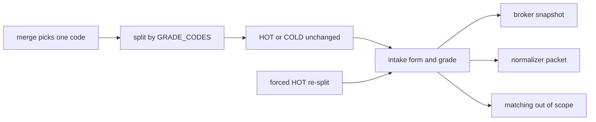

# Form and grade stay apart through classification

Recursive Alignment, third pass. The target is this plan against `origin/Staging` at `4a6af0b2` (PRs 361, 362, and 364 merged) plus open [PR 365](https://github.com/cryptoxdog/IB-Odoo_19/pull/365) (`fix/material-ledger-normalizer` at `869a0abd`, base `Staging`). Inspected: [`material_normalizer.py`](plasticos_material_profile/models/material_normalizer.py) at PR 365, [`grade_codes.py`](plasticos_material_profile/grade_codes.py), [`form_codes.py`](plasticos_material_profile/form_codes.py), the web-lead merge, AI prompt, vision prompt, policy, snapshot, and config, the intake model, and the intake normalizer. None of the `plasticos_web_leads`, `plasticos_intake_normalizer`, `plasticos_intake`, or `plasticos_crm_bridge` files this plan touches changed between PR 361 and PR 365.

Adapters applied: `AGENTS.md`, rule `50-plasticos-web-lead-guard`, rule `88-plasticos-odoo-python-tooling`, and rule `89-plasticos-odoo-version-bump`. GAR: L9 architecture profile is not applicable. Depth: standard.

## Invariant

Every lead gets the HOT/COLD decision it gets today. Merge still picks one material code, in the same order: the AI `form` value, then the seller-text hint, then vision. Only after that does the split put the code on form or grade. The lower threshold applies when that code, or the polymer, is on the allow-list, whether the code ends up on form or on grade. A pure test checks this for every code merge can produce.

One lead yields a form or a grade, never both. "Regrind from drums" stays one code. Capturing both needs a second AI slot, which this plan does not add.

## Where web-lead codes come from

Three sources feed merge. The AI system prompt in [`ai_normalizer.py`](plasticos_web_leads/models/ai_normalizer.py) does not ask for `form`. `validate_ai_output` passes the key through when the model adds it, so `_FORM_NORMALIZE` on the AI value is reached rarely. The seller-text loop (lines 980-993) is the dependable source, but it knows only pallet, tote, and crate. The vision prompt in [`image_analyzer.py`](plasticos_web_leads/models/image_analyzer.py) returns `observed_form` as one of Bale, Pellet, Regrind, Flake, Film, or Other.

## Findings

Open from earlier passes:

- `RA-1` (High). The policy reads `PALLETS`, `TOTES`, and `CRATES` only as form codes. Moving them onto the grade would make a pallet lead go cold.
- `RA-2` (High). `_create_intake` searches grades with the form code it just used for the form.
- `RA-3` (Medium). The broker snapshot has no grade.
- `RA-4` (High). The force-HOT and force-intake buttons (lines 1302-1324) rebuild the intake from stored `ai_analysis`. Leads stored before this change have `form: PALLETS` and no `material_grade` key.
- `RA-5` (Low). The allow-list help text (`web_lead_config.py` line 306) and the policy docstring call the codes polymer or form codes.
- `VS-1` (High). CI has no Odoo job ([`ci.yml`](.github/workflows/ci.yml) line 461). Odoo tests count only when the pinned fixture runs them.
- `VS-2` (High). The split must be pure so CI tests it.
- `VS-4` (Low). The normalizer README says version `19.0.2.0.0`, names `assemble_packet()`, and shows `volume`, `condition`, and `target_price`, none of which the code emits.

New against Staging and PR 365:

- `RA-7` (High, wrong registry). Staging removed `SHEET` from `GRADE_CODES` (PR 362, migration `19.0.5.11.1` unlinks or archives the Sheet grade). No code is in both `GRADE_CODES` and `FORM_CODES`. The split uses `GRADE_CODES`, the registry, instead of `FORMER_FORM_CODES`, which records a migration. The pure test asserts the two registries are disjoint, so a code later added to both fails CI instead of silently going to the grade.
- `RA-8` (High, wrong form). `_FORM_NORMALIZE` maps `film` to `ROLLSTOCK`. The form master has `FILM`, and the shared material normalizer maps every film phrase to `FILM`. `ROLLSTOCK` is equipment-gated in `EQUIPMENT_GATED_FORMS` (`f.handles_rollstock`), so a web-lead film intake is held to rollstock equipment that an importer film profile is not. Map `film` to `FILM`. `roll`, `rolls`, and `rollstock` stay `ROLLSTOCK`. Neither code is on the allow-list, so no decision changes.
- `RA-9` (Medium, grade never reached). Drums and buckets reach merge only through an AI `form` value the prompt never asks for. Add `drum`, `drums`, `bucket`, `buckets`, `pail`, and `pails` to `_FORM_NORMALIZE`, and add `drum` to `DRUMS` and `bucket` and `pail` to `BUCKETS` to the seller-text loop after the existing three terms. Pallet, tote, and crate are still checked first, so a lead that names both keeps today's code. Add `fluff` to `FLUFF`, the form PR 362 added. None of these codes is on the allow-list.
- `RA-10` (Medium, identity divergence, recorded). The shared [`normalize_material`](plasticos_material_profile/models/material_normalizer.py) owns importer identity and matches whole catalog phrases. Web-lead text is free-form, so the web lead keeps its own word maps. The codes it emits must exist in the same masters, and the pure test asserts every `_FORM_NORMALIZE` value is in `FORM_CODES` or `GRADE_CODES`. One divergence stays: the shared normalizer maps the phrase `pallets` to polymer `PLASTIC_PALLETS` with no grade, while a web lead keeps its AI polymer and gets grade `PALLETS`. Both are on the allow-list, so HOT/COLD agrees. Which one matching should see is an operator decision outside this plan.

Found, not fixed here:

- `RA-6` (Medium, crm_bridge). [`action_convert_to_intake`](plasticos_crm_bridge/models/crm_lead.py) (lines 364-367) still links a profile when polymer and form match, and ignores the grade.
- `U-1` (Unknown). [`gate_mappers.py`](plasticos_gate/services/gate_mappers.py) (line 268) writes the Gate response into `ai_analysis`. Gate web-lead triage is Phase 3 and deferred.



## Split helper

New file [`plasticos_web_leads/models/material_identity.py`](plasticos_web_leads/models/material_identity.py), with no Odoo or cross-addon import:

```python
def split_material_code(code, grade_codes):
    """Return (form_code, material_grade_code) for one material code."""
```

It strips and upper-cases the code. A code in `grade_codes` returns `(None, code)`. Any other non-empty code returns `(code, None)`. An empty value returns `(None, None)`. Add `from . import material_identity` to [`models/__init__.py`](plasticos_web_leads/models/__init__.py).

As the last statement before `return merged` in `_merge_ai_and_vision`, import `GRADE_CODES` from `odoo.addons.plasticos_material_profile.grade_codes` inside the method, then set `merged["form"], merged["material_grade"] = split_material_code(merged["form"], GRADE_CODES)`. `plasticos_material_profile` is already in the manifest `depends`.

## Intake creation

In `_create_intake`:

- If `merged` has a `material_grade` key, use `merged["form"]` and `merged["material_grade"]`. If it does not, apply the same split to `merged.get("form")`. The helper upper-cases, which also covers the raw AI words in the `ai_normalized` fallback.
- Look up the form on the form master, falling back to `OTHER`, because `form_id` is required on `plasticos.intake`. Look up the grade on the grade master with no fallback; `material_grade_id` is optional.
- Remove the grade search by form code.

Partner creation, the write guard, and the unlink guard stay untouched (rule 50).

## HOT/COLD

`evaluate_economic_eligibility` gains `material_grade_code: str | None = None`. The lower threshold applies when the polymer, the form, or the grade is on the allow-list. The triage call at line 813 passes `merged.get("form")` and `merged.get("material_grade")`. `classify_lead` is unchanged, and the allow-list default and `policy_version` stay.

## Snapshot

Add `KEY_MATERIAL_GRADE_ID = "material_grade_id"` and `KEY_MATERIAL_GRADE_CODE = "material_grade_code"` to [`evidence_keys.py`](plasticos_web_leads/models/evidence_keys.py). [`build_snapshot_payload`](plasticos_web_leads/models/review_snapshot.py) writes them after the form keys. Stored snapshots keep their own hash, and only new snapshots carry the keys. The snapshot schema version stays.

## Intake packet

In [`_assemble_packet`](plasticos_intake_normalizer/models/intake_normalizer.py), add `polymer`, `form`, and `material_grade` from the intake record, each the related code or null. An intake that still points at the archived Sheet grade copies it unchanged.

In `_assemble_material_profile_block`, remove `grade` from the probed names; the profile has no such field. Add `material_grade` from `mp.material_grade_id.code`. Keep the `form`, `color`, and `source_type` probes, which read the profile's stored code fields.

## Editor tooling

In [`pyproject.toml`](pyproject.toml), `[tool.pyright]` `exclude` ends with `"Current Work - IGNORE",`. Insert immediately after it, before the closing bracket:

```toml
    "Current Work - IGNORE",
    # Governance checkout, symlinked at .cursor-commands. Editor exclude is ignored
    # while [tool.pyright] exists; without this the server indexes that tree.
    "**/.cursor-commands",
]
```

Pyright is editor-only (rule 88). This needs no version bump. Because `pyproject.toml` changed, `make pr-check` runs the whole pytest suite instead of the scoped set.

## Version and README

Bump [`plasticos_web_leads/__manifest__.py`](plasticos_web_leads/__manifest__.py) from `19.0.2.8.6` to `19.0.2.8.7`, and [`plasticos_intake_normalizer/__manifest__.py`](plasticos_intake_normalizer/__manifest__.py) from `19.0.1.0.4` to `19.0.1.0.5`. Neither version changed on Staging or PR 365. In the normalizer README, set the version line to `19.0.1.0.5`, name `_assemble_packet()`, and replace the packet example with the keys it emits.

## Proof

Pure, run by `make pr-check` and GitHub CI. A new file, [`tests/test_web_lead_material_identity.py`](tests/test_web_lead_material_identity.py), loads `grade_codes.py`, `form_codes.py`, `material_identity.py`, `economic_policy.py`, `evidence_keys.py`, and `review_snapshot.py` by file path, the way [`tests/test_triage_pipeline.py`](tests/test_triage_pipeline.py) and [`tests/test_material_grade_codes.py`](tests/test_material_grade_codes.py) do. It checks:

- **Registries.** `GRADE_CODES` and `FORM_CODES` are disjoint. Every `_FORM_NORMALIZE` value is in one of them. `_FORM_NORMALIZE` is read from `web_lead.py` source with `ast`, because that file imports Odoo.
- **Split.** Every `GRADE_CODES` entry becomes a grade with no form. `SHEET`, `FILM`, and `REGRIND` stay forms. Lowercase `pallets` becomes grade `PALLETS`. None becomes `(None, None)`.
- **Equivalence.** For every `_FORM_NORMALIZE` value before this change plus None, at 7,900, 8,500, and 10,500 lb, the eligibility for `form_code=code` equals the eligibility for the split pair. The `ROLLSTOCK` to `FILM` change is checked separately: both give the standard threshold.
- **Spot cases.** 8,500 lb with grade `PALLETS` and no form is HOT at 8,000. LDPE film stays at 10,000. Grade `DRUMS` stays at 10,000.
- **Snapshot.** `build_snapshot_payload` on a stand-in intake with a grade writes both grade keys.

The existing `TestEconomicPolicy` cases pass unchanged, because the form path stays. Rule 50 asks for web-lead tests before and after: run `tests/test_triage_pipeline.py` and `tests/test_web_lead_*.py` before editing `web_lead.py` and again after.

Odoo runtime:

- [`plasticos_web_leads/tests/test_web_lead_material_grade.py`](plasticos_web_leads/tests/test_web_lead_material_grade.py), registered in its `tests/__init__.py`. It checks that a pallet merge creates an intake with form `OTHER` and grade `PALLETS`, that a forced HOT on stored `{"form": "PALLETS"}` with no grade key does the same, and that a film lead gets form `FILM`.
- [`plasticos_intake_normalizer/tests/test_packet_material_grade.py`](plasticos_intake_normalizer/tests/test_packet_material_grade.py), registered in [`tests/__init__.py`](plasticos_intake_normalizer/tests/__init__.py). It checks an HDPE / OTHER / DRUMS packet, a SHEET-form packet with no grade, and a profile block with a grade.

PR 364 changed `scripts/test_env.sh` to clone the pinned Enterprise fixture. Run `make test-module m=plasticos_web_leads` and `make test-module m=plasticos_intake_normalizer`. If the fixture is refused, report both files as written and not run. Do not rebuild or re-admit the template (rule 36). Run `ruff check`, `ruff format`, and `python3 scripts/check_module_wiring.py` on the touched files.

## Out of scope

- Matching, buyer search, and how a match reads an intake
- Any grade, form, or polymer seed, and `material_normalizer.py` (PR 365 owns it)
- Partner creation, write guards, and unlink guards in `web_lead.py`
- A second AI slot to capture both a form and a grade, or a `form` field in the AI prompt
- `RA-6` in crm_bridge, the `RA-10` pallets polymer decision, and the deferred Gate triage path (`U-1`)
- A normalizer warning when the profile and the intake disagree on form or grade

## Execute

Stack on [PR 365](https://github.com/cryptoxdog/IB-Odoo_19/pull/365). Its base is `Staging`, so `scripts/pr_stack_parent.sh prove` accepts it. Create the branch from `origin/fix/material-ledger-normalizer` (`869a0abd`) in this checkout. Do not use the `IB-Odoo_19-masters` or `IB-Odoo_19-material-mapping-pr` worktrees.

The PR must include the docs-only commit `146af9c6` ("docs: record the worksheet blob to transaction match"). It adds `docs/reports/evidence/blob-matching-to-transactions/BRIEF.md` and `receipt.json`. It is on local `feat/material-grade-catalog` only, above unpushed code commit `60282368`, and neither commit is on Staging or PR 365. Bring in the docs commit with `git cherry-pick 146af9c6` only; both files are new, so it applies cleanly. Before publishing, `git log --oneline origin/fix/material-ledger-normalizer..HEAD` must show only that docs commit and this plan's scoped commit.

After the todos, make the scoped commit. Run `l4_local.py begin`, then `authorize-release`, for the stacked base. Then publish:

```bash
make pr-nosmoke reason="web-lead normalization and editor exclude; install-smoke skipped by operator" base=fix/material-ledger-normalizer
```

Show the PR URL. The PR body notes that PR 365 merges into Staging first.

## Build evidence (auto)

- detected_at: `2026-11-04T20:45:20Z`
- conversation_id: `c21acc32-1a0d-4aa2-95ac-a971a09d88b3`
- generation_id: `1322413b-8c96-4467-8828-0001350e8f25`
- transcript: `/Users/ib-mac/.cursor/projects/Users-ib-mac-IB-Odoo-19-LOCAL-IB-Odoo-19/agent-transcripts/c21acc32-1a0d-4aa2-95ac-a971a09d88b3/c21acc32-1a0d-4aa2-95ac-a971a09d88b3.jsonl`
- todos at build time:
- `split-helper`: completed
- `word-maps`: completed
- `create-intake`: completed
- `hot-cold`: completed
- `snapshot-grade`: completed
- `packet-identity`: completed
- `pyright-exclude`: completed
- `version-readme`: completed
- `pure-tests`: completed
- `odoo-tests`: completed
- `publish`: completed
