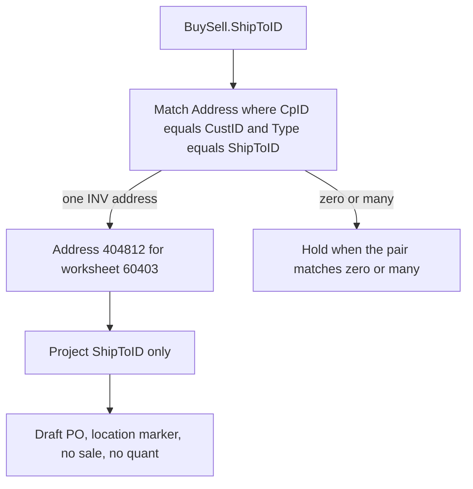

# Inventory inbound only

## Aligned to Staging

Verified 2026-10-22. Local `Staging` equals `origin/Staging` at `6036b79` (0 ahead, 0 behind). Merged into that tip: #270, #271, #272, #277, #278, and #279. `24_buysell.sql` on that tip still has no `ShipToID`.

The checked-out worktree is still `feat/crm-lead-material-identity` at `ab6bb692`, 15 commits ahead of Staging and 21 behind, with unrelated dirty files. Its `plasticos_partner_import` version `19.0.2.10.28` is the feature branch, not Staging. Do not build there. Do not reset those files. Cut the implementation branch from `Staging` `6036b79`.

Still open, and outside this change because their diffs do not touch `native_document_import.py`, `source_index.py`, `24_buysell.sql`, or `10_counterparty.sql`: #273, #274, #282.

On `6036b79` the defect is unchanged:

- `_realize_one` still emits `no sale order link: purchase documents realized, no transaction compiled` when `sale_groups` is empty, then `report.reject("transactions")`.
- `10_counterparty.sql` still excludes `CpID NOT LIKE '(%'`, and `_link_children` still records those addresses as `unresolved_counterparty`.
- Manifests to bump from this tip: `plasticos_partner_import` `19.0.2.10.26` to `19.0.2.10.27`, `plasticos_transaction` `19.0.2.3.37` to `19.0.2.3.38`.

Leave the overnight database as evidence. Do not run `make pr` from the dirty worktree. Tests use the pinned Enterprise clone from `config/test_env_fixture.conf` only.

## Resolved source gap

The tracked projections omit the selector. The full backup contains it.

Source read on 2026-10-22, SELECT only, from container `cie-sql-proof`, database `cieTrade_SM` (`is_read_only=1`, restored 2026-10-18 from `/var/opt/mssql/backup/cieTrade_SM_2026-10-03.bak`, backup start 2026-10-03 16:35).

The second Sold To value is `BuySell.ShipToID` (`char(45)`). It stores the Address `Type` label, not an `AddressID`. The join is:

`RTRIM(Address.CpID) = RTRIM(BuySell.CustID) AND RTRIM(Address.Type) = RTRIM(BuySell.ShipToID)`

Worksheet 60403:

- `CustID=(INV)`, `VendorID=2106`, `status=I`, `ShipToID=GREENVIEW WASHINGTON WAREHOUSE`
- That pair matches exactly one address: `AddressID=404812`, `CpID=(INV)`, `Type=GREENVIEW WASHINGTON WAREHOUSE`
- The same `Type` string exists on no other Address row
- `WKSDetail` `13303`: `SPO_ID` null, `PPO_ID=19339` → `PODetail.PO_ID` → `PONumber=33498`, `Source=PO`, `CpID=2106` (`POID=15168`)
- `WarehouseLocation` and `WarehouseBin` are blank. `DBAAddrID=0`. `cieWhseType=P`. None of those is the site key
- Address `404812.WarehouseID=2331` points at the operating company. Address `404811` is that company's `Type=INVOICE` row. Neither value is the worksheet selector

Controls from the same backup:

- `58868`: `ShipToID=JEI DALLAS WAREHOUSE` → Address `405026` only; `PPO_ID=16639` → PO `10442`, vendor `1292`
- `58975`: same destination `405026`; `PPO_ID` is null, so the purchase link stays held
- All 41 `(INV)` addresses have 41 distinct `Type` values
- All 373 `CustID=(INV)` worksheets match exactly one address: 0 blank `ShipToID`, 0 unmatched, 0 multi-match; 34 are `status=X` across all years
- 2025–2026 `(INV)` source rows: 119 with a PO-source line, 16 without, 6 `status=X`. The rejection diagnostic's 138 / 3-cancelled figures stay the import-side baseline. This change does not reimport those 119

`ShipFromID` on 60403 is `FORT SMITH, AR - N 4th St`, the vendor address under Purchased From. Leave it unprojected.

## Commercial rejection, same worksheets

[`_realize_one`](plasticos_transaction/models/native_document_import.py) records a sale-link anomaly whenever `SPO_ID` does not resolve, then `report.reject("transactions")` when `sale_groups` is empty, even after the purchase order is written. Worksheet 60403 is that case: `CustID=(INV)`, vendor JEI INC, PO 33498, 38,580 lb, no customer SO. `(INV)` is excluded from partners by [`10_counterparty.sql`](plasticos_partner_import/erp_extracted_data/10_counterparty.sql) (`CpID NOT LIKE '(%'`), and [`_link_children`](plasticos_partner_import/erp/source_index.py) then drops those Address rows as `unresolved_counterparty`.

Architecture is already settled by [CURSOR_EXECUTION_CONTRACT.md](docs/campaigns/PlasticOS_Inventory_Inbound_Only_Cursor_2026-10-22/CURSOR_EXECUTION_CONTRACT.md): same projection, same source index, same document importer. No new importer, model, partner, sale, invoice, or `plasticos.transaction`. No vendor-bill, invoice, terms, salesperson, CRM, or `VendorID=(INV)` outbound change.

Build base is `Staging` `6036b79`. The `ShipToID` join from the backup is unchanged, and Staging does not project it yet.

## 1. Selector is proved; do not reopen it by guessing

The join above is the implementation key. Project `RTRIM(ShipToID) AS ShipToID` and resolve the destination only by `(CustID, ShipToID) = (Address.CpID, Address.Type)`.

Forbidden substitutes, each disproved on 60403:

- `WKSDetail.WarehouseLocation` and `WarehouseBin` are blank
- `BuySell.DBAAddrID` is `0`
- `BuySell.cieWhseType` is `P`
- `Address.WarehouseID` `2331` and Address `404811` are the operating company, not the selected site
- A name match that ignores `CpID`

If a later row makes `(CpID, Type)` match zero or many addresses, hold that worksheet. The 2026-10-03 backup has no such `(INV)` row. Do not query the backup again as a prerequisite, and do not restore it a second time.

## 2. Project `ShipToID` and keep `(INV)` out of partners

Add `RTRIM(ShipToID) AS ShipToID` to [`24_buysell.sql`](plasticos_partner_import/erp_extracted_data/24_buysell.sql). Do not add `ShipFromID`, `WarehouseLocation`, `DBAAddrID`, or `Address.WarehouseID`.

In [`source_index.py`](plasticos_partner_import/erp/source_index.py), when `CpID` is exactly `(INV)`, store the Address row on an inventory-destination index keyed by `AddressID`, and resolve a worksheet by `(CustID, ShipToID)` against `(CpID, Type)`. Do not attach those rows to `addresses_by_cp` and do not emit `unresolved_counterparty` for them. Every other placeholder `CpID` stays an unresolved violation. Update [`test_placeholder_counterparty_rows_stay_in_the_extract_and_are_reported`](tests/test_erp_source_layer.py) and the direct-read assertion at the `(INV)` staging address so only non-`(INV)` placeholders remain violations. No `res.partner` is created for `(INV)`.

## 3. Branch inventory inbound before the missing-sale rejection

In `_realize_one`, after the line headers are grouped and before the `if not sale_groups` anomaly, take a separate path when `BuySell.CustID` is exactly `(INV)`:

- Status `X`: no destination marker and no stock event. A purchase order that already exists is left in place. Census outcome `cancelled`.
- No resolvable PO: no fabricated PO, sale, or customer. Keep the proved destination. Census `held_missing_purchase`. Worksheet 58975 keeps Address `405026` and gets no PO.
- PO resolves and `(CustID, ShipToID)` matches exactly one `(INV)` address: upsert the draft purchase order and its lines exactly as today (vendor, PO number, grade, quantity). Do not call `_upsert_order` for `sale.order`, `_customer_invoice`, or `pending_transactions`. Census `recognized`. Worksheet 60403 must land on Address `404812`. Worksheet 58868 must land on Address `405026` (`JEI DALLAS WAREHOUSE`), not Greenview.
- `ShipToID` blank or not a single `(INV)` address: realize a valid PO, invent no warehouse. Census `held_missing_destination`. The current backup has no `(INV)` worksheet in this class; the branch still exists.

Destination record: one `stock.location` per `(INV)` AddressID, xmlid `legacy_erp_inv_addr_<AddressID>`, plus one worksheet marker xmlid. Replay finds those xmlids and writes nothing new. Do not set `picking_type_id`, do not call `button_confirm`, and do not create `stock.move` or `stock.quant`. A later confirm of a historical PO must not be given a receipt type by this change. On-hand and valuation stay at the pre-run snapshot.

`VendorID=(INV)` with a real customer stays on the current sale path. A normal external `CustID` stays on the current sale path, including the existing purchase-only rejection in `test_worksheet_without_a_sale_link_keeps_its_purchase_documents_and_is_censused`.

Accounting without a schema edit: recognized inbound is `transactions.skipped`, because no `plasticos.transaction` is the correct document and `created` means that record exists. Held and cancelled inbound stay `transactions.rejected`, with the held or cancelled census reason instead of `no sale order link: purchase documents realized, no transaction compiled`. `report.census["inventory_inbound"]` is the positive and held class. [`import-run-summary.schema.json`](contracts/schemas/draft/import-run-summary.schema.json) is not modified. `records_seen` must still equal created + updated + unchanged + rejected. Payables reconciliation is unchanged.

Version bumps from Staging `6036b79` only if those runtime files change: `plasticos_partner_import` `19.0.2.10.26` to `19.0.2.10.27`, `plasticos_transaction` `19.0.2.3.37` to `19.0.2.3.38`. Upgrade those modules only on the disposable test clone.

## 4. Focused tests and a local receipt

Pure tests: source-index `(INV)` destination versus other placeholders; 60403, 58868, 58975, one status `X`, one `VendorID=(INV)` outbound control, one ordinary sale; replay creates zero PO lines, locations, markers, sales, invoices, transactions, and quants; summary equation still closes.

Enterprise: `make test-module m=plasticos_transaction` on the fixture clone named in `config/test_env_fixture.conf`. Not the overnight database. Not `make import-erp`.

Write the filled [RECEIPT_TEMPLATE.json](docs/campaigns/PlasticOS_Inventory_Inbound_Only_Cursor_2026-10-22/RECEIPT_TEMPLATE.json) under `docs/reports/evidence/erp-inventory-inbound-2026-10-22/` with the proved column, 60403 value, AddressID, Odoo location xmlid, before/after census for the fixtures actually run, on-hand delta `0`, and outbound/ordinary-sale results. Do not claim the other 119 linked inbound worksheets are imported. Stop. No GitHub publication.

## Build evidence (auto)

- detected_at: `2026-10-22T22:31:16Z`
- conversation_id: `f1adf817-40d1-431c-9886-4e4b490ab0f5`
- generation_id: `1951c8d2-4189-4af3-9bb3-358d01225bd1`
- transcript: `/Users/ib-mac/.cursor/projects/Users-ib-mac-Cursor-Governance/agent-transcripts/f1adf817-40d1-431c-9886-4e4b490ab0f5/f1adf817-40d1-431c-9886-4e4b490ab0f5.jsonl`
- todos at build time:
- `wait-for-staging`: completed
- `probe-join`: completed
- `project-and-index`: completed
- `inbound-branch`: completed
- `focused-tests`: completed
- `receipt`: completed
