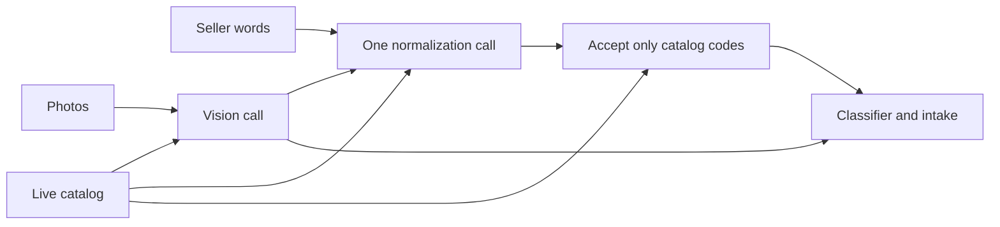

# Joint web-lead reading

The text model currently commits the material reading before any photo exists. Vision can only fill a hole the text left empty, and `classify_lead` still classifies the original seller sentence plus a polymer hint. That is why "ld film", "baled film", and "plastic" plus a photo of sheets on pallets never become one catalog reading.

The governing change is the order and the input of the one normalization call. Informal words are the model's job while AI is on. The catalog remains the only vocabulary that may be stored. The phrase-sheet bridge in [plasticos_material_profile/models/material_normalizer.py](plasticos_material_profile/models/material_normalizer.py) stays untouched.

## Order

In [plasticos_web_leads/models/web_lead.py](plasticos_web_leads/models/web_lead.py) `_run_triage_pipeline`, run attachment vision before `normalize_with_provider`. The text call receives the seller packet and the successful vision rows. There is no earlier text-only material reading to protect.

Weight parsing stays where it is. It does not wait on the model.

## What each specialist may say

The vision prompt in [plasticos_web_leads/models/image_analyzer.py](plasticos_web_leads/models/image_analyzer.py) lists the same live codes the normalizer may store, including packaging and attributes. Add `observed_packaging` and `observed_attributes` beside form, grade, color, and polymer. A photo of sheets on pallets can return form `SHEET` and packaging `palletized`. A photo of printed film stored outside can return attribute `printed` and `with_moisture`. Those codes already exist on the masters. Form `BALES` stays out because that row is inactive. Packaging `bales` is the bale fact.

The system prompt in [plasticos_web_leads/models/ai_normalizer.py](plasticos_web_leads/models/ai_normalizer.py) shows each catalog code with its name, and a polymer also shows `full_name`, so "Polycarbonate" and "ld film" can be chosen as `PC` and `LDPE` plus `FILM`. `build_user_prompt` gains a vision section: the catalog codes the photos returned, plus cleanliness and contamination notes as evidence text. The instruction is that seller words and photos are one case. A photo fills a slot the seller left blank. The model returns a listed code or null. It does not invent a code, and it does not replace a polymer the seller named just because of color.

`restrict_to_catalog` remains the gate after the reply. `full_name` is prompt context only. It does not become a word-match alias, so `rpet`, `vinyl`, `acetal`, and `pail` still match only when the master already uses that word.

## One reading after the call

`_merge_ai_and_vision` stops treating text as the winner and vision as a patch. The joint reply is the material reading. A photo code fills a slot the reply left empty when the seller did not name a different code for that slot. A seller-named polymer that disagrees with a confident photo stays the seller code, and [plasticos_web_leads/models/evidence_reconciler.py](plasticos_web_leads/models/evidence_reconciler.py) still records the conflict so the lead goes to review. The examples then land as slots, not a prose sentence:

- "LDPE stretch film" plus clear printed outdoor bales: polymer `LDPE`, grade `STRETCH_FILM`, form `FILM`, color clear, packaging `bales`, attributes `printed` and `with_moisture`.
- "Polycarbonate" / "plastic" plus sheets on pallets: polymer `PC`, form `SHEET`, packaging `palletized`.

`_create_intake` already writes those fields. Empty slots stay empty. No material profile is created during triage.

## Classifier

`classify_lead` in [plasticos_web_leads/models/classification_engine.py](plasticos_web_leads/models/classification_engine.py) receives the joint slots and the vision rows together. Polymer, form, and grade on that call are the joint reading, so the 20,000 lb polycarbonate sheet is classified as PC sheet, not as the word "plastic". The original seller sentence remains the reject-list text. Vision is no longer only a polymer hint used when the text polymer is empty. The stored `ai_analysis` is this same slot set.

## Proof

Retarget the pipeline-order expectation in the web-lead tests. Add one pure case that a user prompt built with a vision row contains the photo's form and packaging codes, and that an invented code is still dropped. Keep the existing exact-name grade cases. Bump `plasticos_web_leads` from `19.0.2.11.2` to `19.0.2.11.3` in the manifest and the README `module_version`. No `plasticos_material_profile` bump.

## Build evidence (auto)

- detected_at: `2026-11-12T17:42:20Z`
- conversation_id: `24515ea1-fd20-49bc-87d9-9898de8ab129`
- generation_id: `82023eb8-0160-4f78-804f-91ceb541c03c`
- transcript: `/Users/ib-mac/.cursor/projects/Users-ib-mac-IB-Odoo-19-LOCAL-IB-Odoo-19/agent-transcripts/24515ea1-fd20-49bc-87d9-9898de8ab129/24515ea1-fd20-49bc-87d9-9898de8ab129.jsonl`
- todos at build time:
- `reorder`: completed
- `vision-codes`: completed
- `joint-prompt`: completed
- `classifier`: completed
- `proof`: completed

