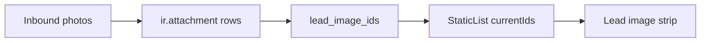

# Lead images and Assigned To

Two gaps on the same web lead form. Image acquisition and vision stay as they are. Assigned To is a queue field on the web lead until an opportunity exists. After that, the salesperson is the opportunity.

## Show every lead image

`lead_image_ids` already returns every image `ir.attachment` on the lead, and vision already analyzes each acquired image. The form paints one thumbnail because `lead_image_strip` declares no `relatedFields`, so Odoo 19 builds that many2many with `StaticList` limit 1 and the widget reads the paged `records` array.



### Widget registration

In [plasticos_web_leads/static/src/lead_image_strip/lead_image_strip.js](plasticos_web_leads/static/src/lead_image_strip/lead_image_strip.js), register `relatedFields` the same way Odoo’s `many2many_binary` does:

- `{ name: "name", type: "char" }`
- `{ name: "mimetype", type: "char" }`

A non-empty related-field set makes the list limit every id (`Number.MAX_SAFE_INTEGER`) and loads `name` for triage filename matching.

### Id readers

In `images` and in `attachmentEntries` in [plasticos_web_leads/static/src/lead_evidence/format.js](plasticos_web_leads/static/src/lead_evidence/format.js):

- Take ids from `currentIds`, then `resIds`.
- Keep only positive numeric ids so a virtual id is never requested as `/web/image/...`.
- Use `records` only to look up `display_name` or `name` for those ids.

Do not fall back to `records` for the id list. That page is what hides the second photo today.

## Assigned To

The commercial pursuit owner is the native `crm.lead` opportunity (`type = opportunity`). Its salesperson is `crm.lead.user_id`. A web lead is the queue record that exists before that opportunity. CG-4-9258 is cold, so it has neither an intake nor an opportunity, and the intake "Assign To" field cannot appear there.

Quantum-L9/.github architecture intelligence is the L9 platform bundle. It does not name this salesperson. The owner above is the repo rule recorded on 2026-11-05.

Do not keep two live assignees. A helper that copies `plasticos.web.lead.assigned_user_id` onto the opportunity on every later write is a second owner. Reject that.

The dropdown is every internal user (`share` is false). Tiffany White, Ricardo Pereira, Arthur Akopyan, Lindsey Malyavko, and Mack McMurray are that list today. Do not hardcode those names.

### Before an opportunity

On `plasticos.web.lead` in [plasticos_web_leads/models/web_lead.py](plasticos_web_leads/models/web_lead.py):

- `assigned_user_id = fields.Many2one("res.users", ...)`
- `string="Assigned To"`
- `help` stating this is the queue assignee until an opportunity exists
- `tracking=True`, `index=True`, `ondelete="set null"`
- `domain=[("share", "=", False)]`
- no default. Admission does not set it.

`res.users` is already available through `base`. No new manifest dependency.

In `view_web_lead_form`, under the submission date, the queue field is editable only while the lead is not `intake_created`:

```xml
<div class="oe_title">
    <h1><field name="lead_id" readonly="1"/></h1>
    <h2><field name="submitted_at" readonly="1"/></h2>
    <field name="assigned_user_id" widget="many2one_avatar_user" readonly="state == 'intake_created'"/>
</div>
```

Add it to `view_web_lead_list` with `widget="many2one_avatar_user"` and `optional="show"`, immediately after `lead_id`. That column is the queue assignee, which is what the Airtable grid shows for a lead that is not yet a pursuit.

Do not add `assigned_user_id` to `_STATE_ONLY_FIELDS`. After an intake exists, `write()` keeps rejecting it. Cold and skipped leads can already be written.

When `_create_intake` runs, set the intake's existing `assigned_user_id` from the web lead when one is chosen. That is a one-time copy so Force HOT after a cold assignment shows the same rep on the intake. Do not sync the intake again later. The intake field's `ondelete="restrict"` stays.

### When the opportunity is born

Inheritance belongs in [plasticos_crm_bridge/models/web_lead.py](plasticos_crm_bridge/models/web_lead.py) `_create_crm_lead`, which already decides `user_id`. Replace the hardcoded `False` with the web lead assignee when it is set, and `False` when it is empty. An unassigned hot lead still creates an opportunity with no salesperson. A hot lead that already has a rep, including Force HOT on CG-4-9258 after Arthur assigns it, gives that rep to `crm.lead.user_id` at creation. One write. No later listener.

### After the opportunity exists

The salesperson is `crm.lead.user_id`. The bridge adds a non-stored related field, `readonly=False`, from `crm_lead_id.user_id`, labeled "Assigned To", same avatar widget and internal-user domain. In [plasticos_crm_bridge/views/crm_lead_views.xml](plasticos_crm_bridge/views/crm_lead_views.xml) `web_lead_crm_bridge_form`, show that related field in the title when `crm_lead_id` is set, and hide the queue field. Changing it writes the opportunity, not the web lead. The bridge `write()` applies that value to `crm.lead` before the processed-lead guard sees it, and does not write `assigned_user_id`.

The queue value is left as the person inherited at birth. Changing the opportunity salesperson later does not write back to the web lead, and changing the hidden queue field is refused. The list column can therefore lag the opportunity after a later salesperson change. That lag is accepted. Do not add a sync.

### Access

Leave [plasticos_web_leads/security/ir.model.access.csv](plasticos_web_leads/security/ir.model.access.csv) as it is. `base.group_user` can read and cannot write. `base.group_system` can write, so an administrator can assign. Do not add a record rule on the assignee.

## Version

Bump [plasticos_web_leads/__manifest__.py](plasticos_web_leads/__manifest__.py) from `19.0.2.9.2` to `19.0.2.10.0`, and the same `module_version` in [plasticos_web_leads/README.md](plasticos_web_leads/README.md). The stored queue field is a minor. The image-strip assets ride in that bump.

Bump [plasticos_crm_bridge/__manifest__.py](plasticos_crm_bridge/__manifest__.py) from `19.0.3.4.25` to `19.0.3.5.0`, and its README `module_version` if that front matter exists. The related field is a minor. No migration in either module. Upgrade only those two.

## Tests

In `plasticos_web_leads` tests:

- Admission leaves `assigned_user_id` empty, and an intake created with nobody chosen stays empty.
- Set the assignee, run `_create_intake`, and assert the intake receives that user.
- An `intake_created` lead still rejects a write of `assigned_user_id`.

In [plasticos_crm_bridge/tests/test_web_lead_opportunity.py](plasticos_crm_bridge/tests/test_web_lead_opportunity.py):

- Keep `assertFalse(opportunity.user_id)` for an unassigned admission.
- Assign the web lead, run the hot path, and assert `crm.lead.user_id` is that user.
- A later write of the related opportunity user changes `crm.lead.user_id` and leaves `assigned_user_id` unchanged.

## Out of scope

Attachment download, vision, the `lead_image_ids` compute, and file copy onto the intake stay as they are. A second file that failed acquisition still will not appear. Do not mirror later salesperson edits back onto the web lead or the intake.

## Check

Upgrade `plasticos_web_leads` and `plasticos_crm_bridge` only. On a lead with two stored image attachments, the strip shows both thumbnails and each AI Triage vision card can match its file by name. On CG-4-9258, Assigned To sits under Nov 10, 11:02 AM and the dropdown is internal users. Assign that cold lead, then Force HOT: the new opportunity's salesperson is that rep, and the intake's Assign To is the same person. An unassigned hot lead still has an opportunity with no salesperson. After that, changing Assigned To on the web lead changes the opportunity user and does not change the queue field.

## Build evidence (auto)

- detected_at: `2026-11-10T20:43:30Z`
- conversation_id: `6d9e8ccf-a5b6-41a1-836e-9e088e5e758e`
- generation_id: `eb905377-2f08-4f8b-895f-586530a5d278`
- transcript: `/Users/ib-mac/.cursor/projects/Users-ib-mac-IB-Odoo-19-LOCAL-IB-Odoo-19/agent-transcripts/6d9e8ccf-a5b6-41a1-836e-9e088e5e758e/6d9e8ccf-a5b6-41a1-836e-9e088e5e758e.jsonl`
- todos at build time:
- `related-fields`: completed
- `id-readers`: completed
- `assigned-field`: completed
- `assignee-inherit`: completed
- `version-bump`: completed

