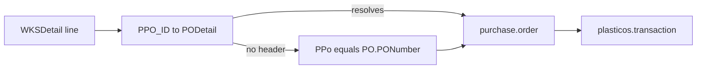

# Link worksheet purchase orders onto transactions

The compiler already links a purchase order when `WKSDetail.PPO_ID` resolves through `PODetail` to one `PO` header (`Source=PO`). It never reads `WKSDetail.PPo`, the purchase-order number the worksheet was opened from. [`mapping_status.py`](plasticos_partner_import/erp/mapping_status.py) already targets that column at `purchase.order.name`. A later import then skips any worksheet whose transaction name already exists, so the missing relation is never filled. Same As Last fails because that relation is empty.

## Resolve `PPo` only when `PPO_ID` does not

In [`plasticos_transaction/models/native_document_import.py`](plasticos_transaction/models/native_document_import.py) `_realize_one`, after `header_for_line` returns no purchase header, look up one `PO` header with `Source=PO` and `PONumber` equal to the stripped `PPo`. Use the same `orders_by_source_number` index `header_for_line` uses. Zero or several headers stay unresolved and keep today's link-failure anomaly.

A resolved `PPo` header joins `purchase_groups` the same way a resolved `PPO_ID` does, so `_realize_purchase_groups` creates or reuses the `purchase.order` and puts its id in `documents["purchases"]`. Do not record a purchase link failure for that line. A line whose `PPO_ID` already resolved keeps that header; a different `PPo` does not add a second order.

## Fill the relation on a transaction that already exists

In [`plasticos_transaction/models/sale_inherit.py`](plasticos_transaction/models/sale_inherit.py) `_compile_worksheet_transactions`, the `worksheet in compiled` branch currently `continue`s. Before continuing, link purchase orders from `erp_documents_by_origin` that are not already on that transaction (`Command.link` only). If `supplier_id` is empty, set it from the first newly linked purchase partner.

Do not change `state`, `sale_order_id`, commission, or any other field. The reopen replay in `test_commercial_source_cancellation_creates_a_closed_transaction_and_replay_keeps_reopen` must still leave the reopened transaction `active`.

## Tests and version

Extend [`plasticos_transaction/tests/test_erp_worksheet_import.py`](plasticos_transaction/tests/test_erp_worksheet_import.py):

- A line with a blank `PPO_ID` and `PPo` equal to a `Source=PO` number creates that purchase order and sets `purchase_order_ids`.
- Import the worksheet once with no purchase header, then again with `PPo` and the PO header. One transaction remains, its state is unchanged, and `purchase_order_ids` gains that order.

Bump [`plasticos_transaction/__manifest__.py`](plasticos_transaction/__manifest__.py) from `19.0.2.3.64` to `19.0.2.3.65`. No Same As Last change and no CSV `purchase_po` text field change.

## Build evidence (auto)

- detected_at: `2026-11-10T21:49:31Z`
- conversation_id: `2841f5af-04fd-4f8a-a218-dfac5a8c2627`
- generation_id: `234bc9bf-743a-40e9-a43c-891eb14ac853`
- transcript: `/Users/ib-mac/.cursor/projects/Users-ib-mac-IB-Odoo-19-LOCAL-IB-Odoo-19/agent-transcripts/2841f5af-04fd-4f8a-a218-dfac5a8c2627/2841f5af-04fd-4f8a-a218-dfac5a8c2627.jsonl`
- todos at build time:
- `resolve-ppo`: completed
- `link-existing`: completed
- `tests-version`: completed

