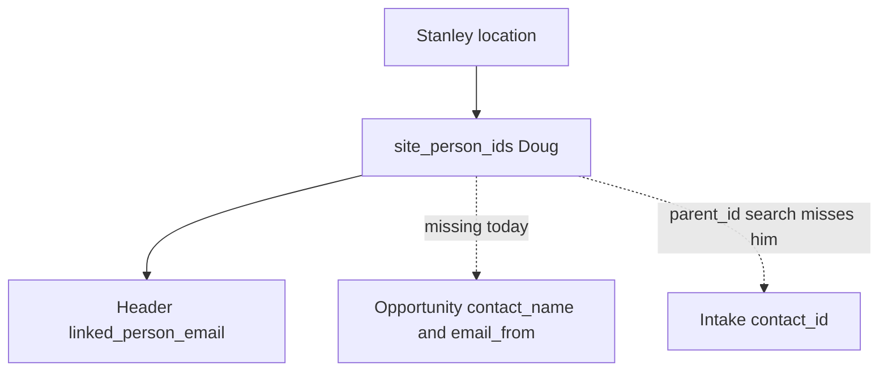

# Location contact reaches the opportunity and the intake

## Validation of the earlier findings

The earlier account is right about the break, and wrong about the location window being empty.

Confirmed in code:

- Doug is a person. The ERP importer sets his `parent_id` to the company and links him to Stanley through `location_partner_ids` ([plasticos_partner_import/models/erp_import_service.py](plasticos_partner_import/models/erp_import_service.py) `_import_person`). That is the People list, `site_person_ids`, not a child of the location.
- The company Locations list and the Stanley header both read the computed `linked_person_email` / `contact_header_name`. Stanley’s own `email` row is hidden, and the header value is read-only ([plasticos_facility_profile/views/facility_profile_views.xml](plasticos_facility_profile/views/facility_profile_views.xml), [plasticos_facility_profile/models/res_partner.py](plasticos_facility_profile/models/res_partner.py) `_compute_linked_person_channels`). The header email is the first linked person who has an email, which is the value on screen: `dnoz2004@bellsouth.net`.
- Create Intake on that location opens a native opportunity with only `default_partner_id` set to Stanley ([plasticos_crm_bridge/models/crm_lead.py](plasticos_crm_bridge/models/crm_lead.py) `_plasticos_manual_opportunity_action`). Odoo then copies the parent name into Company Name and Stanley’s street into the address. Contact Name stays empty because Stanley `is_company`. Email is copied only from `partner_id.email`, and Stanley’s email is empty (`crm.lead._compute_email_from` / `_prepare_contact_name_from_partner` in Odoo 19 `crm`).
- Intake email is `contact_email`, a related field of `contact_id.email` only. The facility onchange searches people whose `parent_id` is the location ([plasticos_intake/models/intake.py](plasticos_intake/models/intake.py) `_onchange_facility_id`). Doug fails that search. The same onchange does not run on `create()`. `action_convert_to_intake` never writes `contact_id` or `facility_id`.
- The contact dropdown domain is `parent_id` of the facility or of the intake’s partner. With the intake partner left as Stanley, Doug is not a legal choice even by hand.

Corrections, so the fix does not chase the wrong field:

- Do not unhide Stanley’s email, and do not write Doug’s email onto Stanley. Saving an opportunity whose `email_from` differs from `partner_id.email` inverse-writes the location email. That guard is part of the fix.
- Do not point the opportunity’s `partner_id` at Doug. Gate matching and the street copy use the location. The person is contact data on that location.
- Do not point the intake’s `partner_id` at Sky Recycling. The material profile belongs to Stanley, and `_reject_foreign_material_profile` rejects a different partner. Company on that intake stays the location. Contact and email are what change.
- Match via Gate does not create an intake. The intake that must receive Doug is the one `action_convert_to_intake` creates, plus any intake form opened for that facility.
- A stored opportunity does not recompute Contact Name just because the method changes. Existing blank rows need a one-time fill.



## Resolver

Add `res.partner._plasticos_reach_person()` on [plasticos_facility_profile/models/res_partner.py](plasticos_facility_profile/models/res_partner.py). One method, used by the opportunity and the intake.

For a location (`is_company` and `parent_id`):

1. If `site_person_ids` is not empty, use the first linked person who has an email, otherwise the first linked person. This is the same record the header email already shows. Do not continue to the parent while any person is linked, even if that person has no email.
2. If nobody is linked and the location has exactly one non-company child with `parent_id` equal to the location, use that child. This keeps today’s intake cascade. If it has several such children, do not guess.
3. If nobody is linked and there is no single location child, use the parent company’s people: non-company `child_ids`, first one with an email, otherwise the first. That is the parent contact.

For a person, return that person. For a company with no parent, keep the current rule: auto-pick only when there is exactly one non-company child. Do not invent a contact, and do not copy a company email into Contact Name.

`preferred_contact_id` wins only when it is already inside the set chosen above. A stale preferred person must not hide Doug.

## Opportunity

In [plasticos_crm_bridge/models/crm_lead.py](plasticos_crm_bridge/models/crm_lead.py), after the native computes:

- Contact Name: keep a name that is already stored (web lead, VanillaSoft, or a broker). When it is empty and the partner is a company, set it from `_plasticos_reach_person().name`.
- Email: keep `email_from` when it is already stored, and keep a location email when Stanley’s own `email` is set (native copy). When `email_from` is still empty, set it from the resolved person’s email.
- Job position: when `function` is empty, copy the person’s `function`.
- Phone: leave a location phone in place. Copy the person’s phone only when the lead phone is empty.
- Mobile: `crm.lead.mobile` is a plain field with a 10-digit US constraint. Copy the person’s mobile only when the lead mobile is empty and the number already satisfies that constraint. A bad mobile must not block Create Intake.

Depends must include the person’s email, phone, mobile, name, and `site_person_ids`, or a later link change will not refresh an open opportunity.

Inverse guard on email and phone: if the lead value equals the resolved person’s value and the location’s own field is empty, do not write it back onto the location. A broker who then edits the lead email to a different address still follows native inverse and may store that new address on the location.

`partner_id` stays the location. Address and Company Name stay on the native path.

## Intake

In [plasticos_intake/models/intake.py](plasticos_intake/models/intake.py):

- `_onchange_facility_id` selects `_plasticos_reach_person()` instead of only `parent_id = facility`.
- `create()` applies the same choice when `contact_id` was not passed and a facility or a location partner is present. Onchange does not run on `action_convert_to_intake`.
- `action_convert_to_intake` sets `facility_id` to the location when the opportunity partner is a location, and sets `contact_id` from the resolver. `partner_id` stays the opportunity partner.
- Widen `contact_id`’s domain with `('location_partner_ids', 'in', facility_id)` so Doug remains selectable. The domain is a UI filter; the resolver still writes the id.

Intake email, phone, and the contact name then come from `contact_id`. No second email field.

## Existing rows

Odoo will not refill stored blanks on upgrade alone.

- `plasticos_crm_bridge` post-migrate: for opportunities whose `contact_name` or `email_from` is empty and whose partner resolves a person, fill only the empty field. Do not overwrite a stored name or email.
- `plasticos_intake` post-migrate: where `contact_id` is empty and the facility or partner resolves a person, set `contact_id`. Skip rows that already have a contact. This write may refresh `preferred_contact_id` through the existing sync; that is the same person.

## Versions

Bump patch versions in the same change, from the versions already on PR 462. No schema field is added. The parent-branch numbers are already taken on `feat/location-row-removal`.

- [plasticos_facility_profile/__manifest__.py](plasticos_facility_profile/__manifest__.py) `19.0.5.4.10` to `19.0.5.4.11`, and the same `module_version` in its README
- [plasticos_intake/__manifest__.py](plasticos_intake/__manifest__.py) `19.0.5.4.3` to `19.0.5.4.4`, plus `migrations/19.0.5.4.4/post-migrate.py`, and the README `module_version`
- [plasticos_crm_bridge/__manifest__.py](plasticos_crm_bridge/__manifest__.py) `19.0.3.4.27` to `19.0.3.4.28`, plus `migrations/19.0.3.4.28/post-migrate.py`, and the README `module_version`

Upgrade only those three: `make update m=plasticos_facility_profile,plasticos_intake,plasticos_crm_bridge`.

## Worktree and publication

Build in a new worktree cut from `origin/feat/location-row-removal` (`aca17bef`), the head of PR 462. Leave the current checkout `feat/opportunity-supplier-offer` and the existing PR 462 worktree untouched. The new worktree starts clean, on `feat/location-contact-flow`.

Publish from that worktree, stacked on PR 462, without install-smoke:

```bash
make pr-nosmoke reason="Stacked on PR 462. Contact resolution is ORM-only; install-smoke is skipped at the operator's request." base=feat/location-row-removal
```

HEAD must contain `origin/feat/location-row-removal`. Do not commit on `feat/location-row-removal` itself.

## Tests

Odoo `TransactionCase` tests, not a live-database probe.

- Facility: location plus M2M person with email resolves that person; location with no People list resolves the parent’s person; a linked person with no email does not jump to the parent; a person partner resolves itself; several location children and no People list resolve nobody.
- Intake onchange and `create()`: Doug’s shape (parent is the company, `location_partner_ids` is Stanley) sets `contact_id` and `contact_email`. The existing single child-contact cascade in [plasticos_intake/tests/test_intake_onchange_cascade.py](plasticos_intake/tests/test_intake_onchange_cascade.py) still passes.
- Opportunity create with `partner_id` Stanley: Company Name stays the parent, street stays Stanley, Contact Name and `email_from` become Doug. A lead that already has `contact_name` and `email_from` keeps them. Saving does not write Doug’s email onto Stanley.
- `action_convert_to_intake` on that opportunity sets `contact_id` to Doug and leaves `partner_id` as Stanley.

## Whitelist

May change:

- [plasticos_facility_profile/models/res_partner.py](plasticos_facility_profile/models/res_partner.py)
- [plasticos_facility_profile/__manifest__.py](plasticos_facility_profile/__manifest__.py)
- [plasticos_facility_profile/tests/](plasticos_facility_profile/tests/) new reach-person test module and its import in `tests/__init__.py`
- [plasticos_intake/models/intake.py](plasticos_intake/models/intake.py)
- [plasticos_intake/__manifest__.py](plasticos_intake/__manifest__.py)
- [plasticos_intake/migrations/19.0.5.4.4/post-migrate.py](plasticos_intake/migrations/19.0.5.4.4/post-migrate.py)
- [plasticos_facility_profile/README.md](plasticos_facility_profile/README.md), [plasticos_intake/README.md](plasticos_intake/README.md), and [plasticos_crm_bridge/README.md](plasticos_crm_bridge/README.md) `module_version` only
- [plasticos_intake/tests/test_intake_onchange_cascade.py](plasticos_intake/tests/test_intake_onchange_cascade.py) or a sibling test module
- [plasticos_crm_bridge/models/crm_lead.py](plasticos_crm_bridge/models/crm_lead.py)
- [plasticos_crm_bridge/__manifest__.py](plasticos_crm_bridge/__manifest__.py)
- [plasticos_crm_bridge/migrations/19.0.3.4.28/post-migrate.py](plasticos_crm_bridge/migrations/19.0.3.4.28/post-migrate.py)
- [plasticos_crm_bridge/tests/](plasticos_crm_bridge/tests/) new or extended opportunity contact test

Must not change:

- The importer, `location_partner_ids` data, or any partner email already stored
- Location form XML: hidden email, read-only header, People list columns
- Opportunity `partner_id`, address copy, or Gate lot identity
- Intake `partner_id` assignment away from the opportunity partner
- Web-lead and VanillaSoft writes that already set `contact_name` and `email_from`
- Unrelated modules, `pipeline_v2.py`, and publication

## Checklist

- Resolver order is People list, then exactly one location child, then parent people
- Header email and opportunity email are the same person when the location email is empty
- A linked person with no email does not fall through to the parent
- Several direct location children are not auto-picked
- `preferred_contact_id` applies only when it is inside the chosen set
- Empty Contact Name and `email_from` fill; stored values stay
- Location `email` and `phone` stay empty when the lead only mirrored the person
- Mobile copy cannot raise the 10-digit constraint
- Intake `create()` and the facility onchange both set `contact_id`
- Contact domain includes `location_partner_ids`
- Convert-to-intake writes `facility_id` and `contact_id` and does not retarget `partner_id`
- Migrations fill blanks only
- Three patch bumps, and the migrate folders match those versions
- New tests cover the M2M shape, the parent fallback, the non-overwrite, and the inverse guard
- `ruff check` and `ruff format` on the edited Python

## Definition of done

- Opening Create Intake on a location like Stanley shows Contact Name `Doug Noznesky` and email `dnoz2004@bellsouth.net`, with Company Name still Sky Recycling and the street still 1250 Mac Lane.
- Stanley’s own `email` is still empty, and the header is still the read-only linked-person email.
- An intake created from that opportunity has `contact_id` Doug, and Contact Email is `dnoz2004@bellsouth.net`.
- A location with an empty People list and no single child contact gets the parent company’s person on the opportunity and the intake.
- A web lead or VanillaSoft opportunity that already has a contact name and email keeps both after this change.
- The new Odoo tests assert each of those cases.
- The three modules are version-bumped from the PR 462 versions, and their upgrades are the only `-u` list.
- The branch is published with `make pr-nosmoke` and `base=feat/location-row-removal`, from the clean `feat/location-contact-flow` worktree.

## Build evidence (auto)

- detected_at: `2026-11-11T00:23:39Z`
- conversation_id: `94858cf3-fdde-4fba-872b-1c273ec47b7e`
- generation_id: `6843d429-fa72-4ccc-8cba-c1f8fca9330d`
- transcript: `/Users/ib-mac/.cursor/projects/Users-ib-mac-IB-Odoo-19-LOCAL-IB-Odoo-19/agent-transcripts/94858cf3-fdde-4fba-872b-1c273ec47b7e/94858cf3-fdde-4fba-872b-1c273ec47b7e.jsonl`
- todos at build time:
- `resolver`: completed
- `opportunity`: completed
- `intake`: completed
- `backfill`: completed
- `tests`: completed
