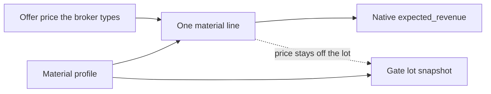

# The new opportunity is the supplier offer

Create Intake opens a new `crm.lead` ([`plasticos_intake/models/material_profile_intake.py`](plasticos_intake/models/material_profile_intake.py) calls [`_plasticos_manual_opportunity_action`](plasticos_crm_bridge/models/crm_lead.py)) and presets the partner, the material profile, and the title. The material line is created only on save, and the form hides it until then. No price exists yet. The first price the system stores today is `plasticos.offer.price_per_lb`, created after Gate as a buyer draft at `0.0`.

On this screen the offer price is the record. Weight comes from the material. Expected Revenue is weight per load times that price, for one load. Until the broker enters a price, the pursuit has not started and the form does not save.

The same form is used for manual, HOT, and VanillaSoft opportunities. Change that form and the one material line. Do not change the material profile, the Gate lot, or Submit.



## Ownership that must not move

- One `plasticos.opportunity.material` row per opportunity. That row stores the price and the weight. Edits do not write `plasticos.material.profile`. [`copy_from_profile`](plasticos_crm_bridge/models/opportunity_material.py) still copies once and does not read a price from the profile. On the parent branch it also fills coordinates from the intake when the profile coordinates are zero, and it can fill a blank street, city, and zip. Keep that. Do not replace it with a copy that only copies specification fields.
- Monthly volume on the profile is quantity per load times loads per month. Expected Revenue stays one load times the offer price. Do not use monthly volume for it.
- Gate still freezes the linked profile in [`_material_snapshot`](plasticos_crm_bridge/models/opportunity_approval.py). Do not add the buy price to `SNAPSHOT_SCALAR_FIELDS`. Matching still carries no price. A later edit of the sheet's weight does not change the next lot.
- `expected_revenue` stays the native stored Monetary field on `crm.lead`. Do not redefine it with `compute=`. A stored compute would recompute every opportunity on upgrade.
- Submit still prices the draft purchase order from the accepted `plasticos.offer.price_per_lb` in [`action_submit_release`](plasticos_crm_bridge/models/crm_lead.py). This plan does not make the supplier price the purchase-order price.

## Price and revenue

Add `buy_price_per_lb` on `plasticos.opportunity.material`: `Float`, `digits=(10, 4)`, string "Offer Price", help text that it is the supplier price per pound for this pursuit. Same type as `plasticos.offer.price_per_lb`. Add `models.Constraint` `check(buy_price_per_lb >= 0)`. Do not set `required=True` on the model. HOT and VanillaSoft opportunities are created in code with no price, and those creates must keep working.

Sync revenue only when a material line exists: `expected_revenue = quantity_per_load_lbs * buy_price_per_lb`. Do not multiply by loads per month. Call the sync from the line's create and write, and from an onchange so the unsaved header updates. An opportunity with no material line keeps whatever Expected Revenue it already has.

The stored price lives only on that line. The header editor is the editable face of the same value: a non-stored field on `crm.lead` with an inverse that writes the line. The line stays in the form arch so save persists it. Do not store the price a second time on `crm.lead`.

## Form

All view edits stay in [`plasticos_crm_bridge/views/crm_lead_views.xml`](plasticos_crm_bridge/views/crm_lead_views.xml). A field name may appear once. `partner_id`, `email_from`, and `phone` stay in the arch because `crm_form.js` force-saves email and phone.

- Header, in the flex div that contains `expected_revenue`: readonly weight from the line, the text `lbs at`, the editable offer price in `$ /lb`, `=`, then `expected_revenue`. Hide the sibling span `groups="!crm.group_use_recurring_revenues"`. Leave the recurring-revenue nodes. `expected_revenue` is readonly when a material line exists. The offer price editor is required when `material_profile_id` is set, so a profile-backed opportunity cannot be saved at `0`.
- Remove the Opportunity Material group after `div[@name='button_box']`. Replace the top contact block with the material specification as context under that header: polymer, material type, form, color, packaging, source, filler, weight per load, loads per month, MFI, density, moisture, contamination, filler percent, attributes, notes, and pictures. Do not repeat the offer price in that block.
- Move `partner_id`, the email row, the phone row, and `mobile` onto `page[@name='lead']`. Leave the blacklist flags and `lost_reason_id` in `opportunity_partner`, and hide that group on an opportunity after the move so those names are not duplicated.
- On the opportunity `date_deadline`, set `widget="date"` and remove the placeholder `No closing estimate`. Leave the priority stars. Do not require the date.
- Leave Notes as it is.

Prefill the line before the first save with the profile's specification and weight, and with no price. `default_get` adds one `(0, 0, vals)` command when `default_material_profile_id` is in context. An onchange on `material_profile_id` does the same only when the line is missing. [`_plasticos_ensure_opportunity_material`](plasticos_crm_bridge/models/crm_lead.py) still copies only once and does nothing when a line already exists. Changing the profile later does not recopy.

## Module and proof

Branch from `feat/profile-derived-fields`, not from `Staging`. That branch is open [PR 460](https://github.com/cryptoxdog/IB-Odoo_19/pull/460), stacked on [PR 459](https://github.com/cryptoxdog/IB-Odoo_19/pull/459). It already edits [`plasticos_crm_bridge/models/opportunity_material.py`](plasticos_crm_bridge/models/opportunity_material.py), [`plasticos_crm_bridge/models/crm_lead.py`](plasticos_crm_bridge/models/crm_lead.py), [`plasticos_crm_bridge/models/opportunity_approval.py`](plasticos_crm_bridge/models/opportunity_approval.py), and the CRM bridge manifest. [PR 456](https://github.com/cryptoxdog/IB-Odoo_19/pull/456) also edits `crm_lead_views.xml`, but only to show the web-lead assignee, and it does not own these models. Stack on 460. Anchor the new view xpaths on field names so a later merge with 456 stays limited to that assignee block.

On that parent the module version is `19.0.3.4.26`. Bump it to `19.0.3.4.27`. No migration. The README `module_version` follows the manifest through the existing commit hook.

Extend [`plasticos_crm_bridge/tests/test_opportunity_material_copy.py`](plasticos_crm_bridge/tests/test_opportunity_material_copy.py):

- `default_get` for a profile returns one material command with that profile's polymer and `quantity_per_load_lbs`, and no buy price.
- Saving through the form with a material profile and a price of `0` is refused. Saving with a positive price writes one line, does not change the profile, and a second save does not add a line.
- An ORM create with no price still succeeds, including a web-lead opportunity on the parent branch, and leaves Expected Revenue empty. Setting weight and buy price stores `expected_revenue` as their product. An opportunity with no material line keeps a manually stored Expected Revenue. The parent assertions in `test_web_lead_opportunity.py` stay green.
- Editing the line's weight and then minting a lot still snapshots the profile's quantity. The snapshot has no buy-price key.

## Publish

Publish only after those proofs pass:

```bash
make pr-nosmoke reason="Supplier offer price on the opportunity form; install-smoke stays with PR 460, which already changes the material copy this price is stored on." base=feat/profile-derived-fields
```

`make pr-nosmoke` runs `make pr` with install-smoke skipped and posts that reason. `base=` stacks the new pull request onto PR 460. That chain runs through PR 459 and ends at `Staging`. Do not publish onto `Staging` directly, and do not use `make push`.

## Build evidence (auto)

- detected_at: `2026-11-10T23:51:40Z`
- conversation_id: `f89383e0-020c-453f-8077-b61d9e5f935d`
- generation_id: `02fc57aa-1c21-47de-98dd-76db21d420f6`
- transcript: `/Users/ib-mac/.cursor/projects/Users-ib-mac-IB-Odoo-19-LOCAL-IB-Odoo-19/agent-transcripts/f89383e0-020c-453f-8077-b61d9e5f935d/f89383e0-020c-453f-8077-b61d9e5f935d.jsonl`
- todos at build time:
- `buy-price-revenue`: completed
- `prefill-material`: completed
- `opportunity-form`: completed
- `tests-version`: completed
- `publish-stacked`: completed

