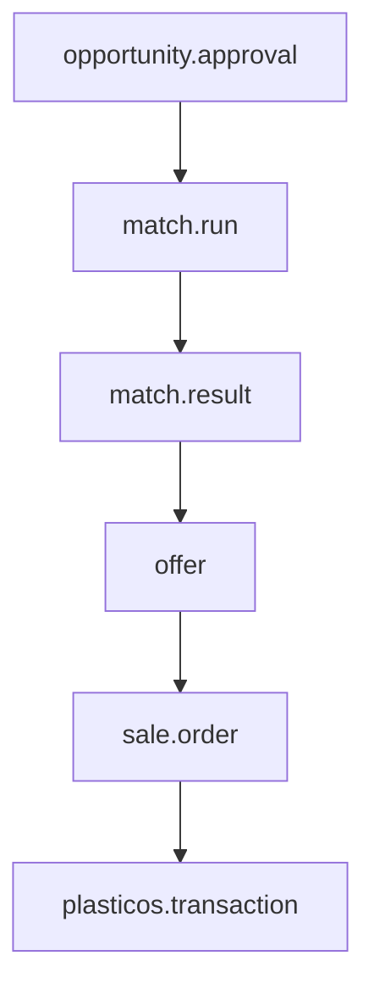

# Executable revision of the Opportunity matching plan

The current plan at [docs/campaigns/11-03-26/PLAN Partners First Native Opportunity Matching Canonical Revision.md](docs/campaigns/11-03-26/PLAN%20Partners%20First%20Native%20Opportunity%20Matching%20Canonical%20Revision.md) stays `preflight_blocked` and is bound to `Staging@9ee917e` on `/home/ubuntu/opportunity_canonical_revision_20261102/baseline`. Architecture stays as settled on 2026-11-02: native `crm.lead` `type='opportunity'` is the pursuit, Facility is optional, Gate is the only matcher, and existing Sales / Purchase / Transaction / Mail / Linda owners stay the order and mail writers. Accepting this revision is the S1–S5 approval. No addon code is written in this pass.

## Probe results

- `build_match_request` in [plasticos_gate/services/gate_builders.py](plasticos_gate/services/gate_builders.py) requires an intake or a supplier. It never reads a facility. [MatchCandidate.facility_profile_id](plasticos_gate/services/gate_contracts.py) is already optional. Direction stays `supply_opportunity_to_buyer_facility`. Demand is unsupported and stays out of scope.
- [plasticos.web.lead.review.snapshot](plasticos_web_leads/models/web_lead_review_snapshot.py) requires both a web lead and an intake, and it is minted only by the web-lead approval token. It cannot be the manual Opportunity snapshot. [plasticos_web_leads/models/web_lead.py](plasticos_web_leads/models/web_lead.py) stays out of the write envelope.
- `plasticos.match.run.intake_id` and `plasticos.offer.intake_id` are required with `ondelete="cascade"`. Result uniqueness is `unique(intake_id, buyer_partner_id, run_id)`. `match_result_id` on the offer is commented out. `plasticos.match.result.match_run_id` exists and is not required.
- `sale_crm` is Community Odoo 19 (`~/dev/odoo-19/addons/sale_crm`), `auto_install` when `sale` and `crm` are installed. It already owns `sale.order.opportunity_id` and `crm.lead.order_ids` / `action_new_quotation`. PlasticOS installs both parents (`plasticos_intake` depends on `crm`; `plasticos_transaction` depends on `sale_management`). No custom offer-to-order field is added. `offer.transaction_id` remains the compiled `plasticos.transaction` back-link, written only by [sale.order.action_confirm](plasticos_transaction/models/sale_inherit.py).
- Runtime authority is the pinned Enterprise fixture in [config/test_env_fixture.conf](config/test_env_fixture.conf) (`odoo_test_tpl_ee_c9e8a81f52f23680`), cloned by `make test-module` / `scripts/test_env.sh`. Community parity is refused by repo rule 36, so the old Community half of V6 is dropped. Gate, mail, and orders stay on that disposable clone. No production database, live mail, or Gate repository write.
- Identity already has an approved VanillaSoft ContactID → ERP CT_ID crosswalk in [plasticos_crm_sync/services/approved_identity.py](plasticos_crm_sync/services/approved_identity.py). Manual entry is the selected partner plus material profile. A HOT label or a name match does not verify a partner.

## Approved delta

Own every new field in `plasticos_crm_bridge`, which already sits above intake, transaction, and logistics. Add `plasticos_matching`, `plasticos_offer`, and `sale_crm` to its `depends`. Do not make Matching depend on CRM Bridge, and do not make Offer depend on Matching.

- **S1.** On `plasticos.match.run`, from CRM Bridge: `opportunity_id` Many2one `crm.lead`, indexed, `ondelete="restrict"`, not SQL-required. `approval_id` Many2one `plasticos.opportunity.approval`, indexed, `ondelete="restrict"`, not SQL-required. New canonical runs are refused in Python unless both are set and `type='opportunity'`. Historical rows stay readable with a null opportunity.
- **S2.** On `plasticos.offer`, from CRM Bridge: `match_result_id` Many2one `plasticos.match.result`, indexed, `ondelete="restrict"`, not SQL-required. No second raw id. No `sale_order_id`.
- **S3.** New model `plasticos.opportunity.approval` in CRM Bridge, with ACL for manager and user. Fields: `opportunity_id` required `ondelete="restrict"`; `revision`; `partner_id` and `material_profile_id` required `ondelete="restrict"`; `facility_profile_id` optional `ondelete="set null"`; `source_intake_id` optional `ondelete="set null"`; `quantity_lbs` copied from `material_profile.quantity_per_load_lbs` at approval; immutable `request_query` Json whose keys are only the keys `build_match_request` already emits; `content_hash`; `approved_by_id`; `approved_at`. Server-minted with the same non-RPC context token pattern as the web snapshot. `unique(opportunity_id, revision)`. A later profile edit does not rewrite the row.
- **S4.** Override `intake_id` on run, result, and offer to `required=False` and `ondelete="restrict"` so an intake unlink cannot erase receipts or offers. Add partial uniqueness `UNIQUE (match_run_id, buyer_partner_id) WHERE match_run_id IS NOT NULL`. Keep historical intake uniqueness. Add `UNIQUE (source_intake_id) WHERE source_intake_id IS NOT NULL` on `crm.lead` so one source intake admits one Opportunity; manual lots stay unconstrained on `(partner_id, material_profile_id)`.
- **S5.** Accepted offer creates or reuses one draft `sale.order` with native `opportunity_id`, the opportunity partner, and the offer sell terms. Confirmation keeps the existing compiler. Purchase orders stay an independent buy-side document. No Won flag is set from acceptance alone.

`plasticos_crm_bridge`, and `plasticos_matching` only if a constraint cannot be inherited, get a `19.0.X.Y.Z` bump and a matching `migrations/` folder. Upgrade later with `make update` on those modules only.

## Envelope the rendered plan must carry

Writable paths are the CRM Bridge model, view, manifest, ACL, migration, and tests; Matching orchestrator, writer, run/result constraints, manifest, and tests; [plasticos_gate/services/gate_builders.py](plasticos_gate/services/gate_builders.py) and [gate_mappers.py](plasticos_gate/services/gate_mappers.py); CRM sync orchestrator; offer and transaction bridges only where the native quotation call and the existing compiler meet. Denied: `plasticos_web_leads/models/web_lead.py`, Gate/CEG/EIE repos, production and deployed Staging databases, live mail, secrets, and any field not listed above.

Commands are real: `ruff check` / `ruff format` on touched paths, `python3 scripts/check_module_wiring.py`, `python3 ci/check_circular_deps.py`, and `make test-module` for `plasticos_crm_bridge`, `plasticos_matching`, `plasticos_offer`, and `plasticos_transaction` on the pinned fixture. Network mode is local Docker only. Secrets stay in the existing test environment and are redacted.

T02 and T03 are filesystem mutations with scoped `git restore` compensation. T08 is a disposable-database migration rehearsal, not `side_effects: none`. The retire/migrate inventory is activated for the separate Lead prospect lifecycle and for synthetic intake admission.

## What this pass writes

Re-render from a new PLAN_DOCUMENT JSON with `validate_plan_document.py` and `render_plan_pe_autonomy.py --execute-via=cursor-build --workspace .`, so the baseline becomes this checkout’s HEAD rather than `9ee917e`. Status becomes `executable` only if the validator reports no blocking unknowns. Record the probe answers in the campaign pack beside the existing ledger. Stop after the rendered plan and its section receipt. Module implementation waits for Build.

## Build evidence (auto)

- detected_at: `2026-11-04T22:29:57Z`
- conversation_id: `f28a72fd-1e5a-4f18-abf2-ff9fe741d94c`
- generation_id: `2749e40a-268b-4892-9021-4e6eae40b217`
- transcript: `/Users/ib-mac/.cursor/projects/Users-ib-mac-IB-Odoo-19-LOCAL-IB-Odoo-19/agent-transcripts/f28a72fd-1e5a-4f18-abf2-ff9fe741d94c/f28a72fd-1e5a-4f18-abf2-ff9fe741d94c.jsonl`
- todos at build time:
- `bind-staging`: completed
- `plan-json`: completed
- `render-validate`: completed
