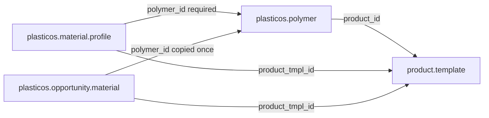

# Polymer product on profiles and opportunities

The polymer stays the identity. `product.template` stays the one commercial product per polymer, already created by [`plasticos_product/models/product_template.py`](plasticos_product/models/product_template.py). Profiles and opportunity rows gain a Product field that reads and writes that same link.

## Field

Name it `product_tmpl_id`, string **Product**, Many2one to `product.template`, domain `[("is_polymer_product", "=", True)]`. Order lines keep using `product.product` under the name `product_id`; this name keeps the template distinct.

Stored compute from `polymer_id.product_id`, `readonly=False`, with an inverse:

- Setting the polymer updates the product from that polymer’s template. The compute does not create products; polymer create and `post_init_hook` already do.
- Setting the product sets `polymer_id` from `product.polymer_id`. A product with no polymer, or with `is_polymer_product` false, is rejected.
- Clearing the product does not clear `polymer_id`. The compute puts the polymer’s product back. On a profile, polymer stays required.

Grade, form, color, packaging, source, filler, and attributes are unchanged.

## Material profile

Add the field in a new inherit of `plasticos.material.profile` inside [`plasticos_product`](plasticos_product), which already depends on `plasticos_material_profile` and already owns `polymer.product_id`. Wire it from [`plasticos_product/models/__init__.py`](plasticos_product/models/__init__.py).

Inherit these views from `plasticos_product` and place Product immediately after Polymer:

- [`plasticos_material_profile/views/material_profile_views.xml`](plasticos_material_profile/views/material_profile_views.xml) `view_material_profile_form` and `view_material_profile_list`
- [`plasticos_material_profile/views/partner_material_ux.xml`](plasticos_material_profile/views/partner_material_ux.xml) `view_partner_form_material_tab` (the partner tab has its own inline list, so the standalone list inherit does not cover it)

No new ACL. The model already has access.

## Opportunity

Add the same field on `plasticos.opportunity.material` in [`plasticos_crm_bridge/models/opportunity_material.py`](plasticos_crm_bridge/models/opportunity_material.py). Add `plasticos_product` to [`plasticos_crm_bridge/__manifest__.py`](plasticos_crm_bridge/__manifest__.py) `depends`. That is safe: `plasticos_transaction` already depends on `plasticos_product`, and `plasticos_product` does not depend on CRM Bridge.

Leave `_vals_from_profile` as it is. It already copies `polymer_id` once, and the compute fills `product_tmpl_id`. Later edits of the polymer on the opportunity move the product with it and do not write `plasticos.material.profile`.

Show the column after Polymer in the opportunity Material list in [`plasticos_crm_bridge/views/crm_lead_views.xml`](plasticos_crm_bridge/views/crm_lead_views.xml).

## Versions and tests

Bump [`plasticos_product`](plasticos_product/__manifest__.py) from `19.0.1.0.3` to `19.0.1.0.4` and [`plasticos_crm_bridge`](plasticos_crm_bridge/__manifest__.py) from `19.0.3.4.27` to `19.0.3.4.28`, including each README `module_version` front matter. One sentence in [`plasticos_product/README.md`](plasticos_product/README.md) that the profile and the opportunity show this product.

Tests:

- In `plasticos_product`: a profile’s product matches its polymer; changing the polymer changes the product; choosing another polymer’s product changes `polymer_id`; a non-polymer product is rejected.
- In `plasticos_crm_bridge`, extending [`plasticos_crm_bridge/tests/test_opportunity_material_copy.py`](plasticos_crm_bridge/tests/test_opportunity_material_copy.py): the copy shows the profile’s product; changing the copy’s polymer changes its product and leaves the source profile’s polymer unchanged.

## Build evidence (auto)

- detected_at: `2026-11-11T19:37:06Z`
- conversation_id: `c8c67d5a-a232-412e-bc61-417d49f9b763`
- generation_id: `014afe10-1451-4f93-b124-1a133103d7cf`
- transcript: `/Users/ib-mac/.cursor/projects/Users-ib-mac-IB-Odoo-19-LOCAL-IB-Odoo-19/agent-transcripts/c8c67d5a-a232-412e-bc61-417d49f9b763/c8c67d5a-a232-412e-bc61-417d49f9b763.jsonl`
- todos at build time:
- `profile-field`: completed
- `opportunity-field`: completed
- `versions-tests`: completed

