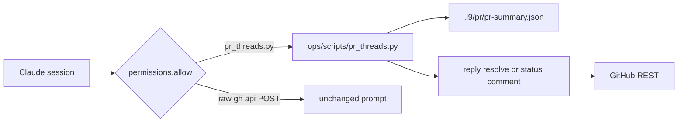

# Standing review permission and pr_threads

Architecture is already settled: Claude’s permission list is a prefix allow ([environment/agents/adapters/claude-code/settings.template.json](environment/agents/adapters/claude-code/settings.template.json), projected to [.claude/settings.json](.claude/settings.json)), and GitHub effect classification stays in [ops/autonomy/git_guardrails.py](ops/autonomy/git_guardrails.py). This change adds one recognizable command for author review activity. It does not add a broad `gh api` POST allow, and it does not put any `Bash(gh …)` rule in `permissions.deny` — [validate_claude_env.py](environment/agents/adapters/claude-code/validate_claude_env.py) rejects that.

`#1` and `#2` in the proposal are the two stalls this removes: the permission prompt on a review write, and the REST-only dead end where `ccr/review_threads` has no GraphQL thread id (`PRRT_…`). Both are already documented in [docs/DEGRADED_MODE_CONTRACT.md](docs/DEGRADED_MODE_CONTRACT.md) and [skills/l9-pr-remediation/references/review-replies.md](skills/l9-pr-remediation/references/review-replies.md). The batch remediator [skills/l9-pr-remediation/scripts/reply_threads.py](skills/l9-pr-remediation/scripts/reply_threads.py) already calls the same three REST routes; it is not a permission atom, because its argv is a JSON ledger, not one comment.



## P1 — standing permission, own PR only

Edit the template, then regenerate the projection. Do not hand-edit [.claude/settings.json](.claude/settings.json).

Allow only these prefixes, from the repo root:

- `Bash(python3 ops/scripts/pr_threads.py:*)`
- `Bash(python3 -u ops/scripts/pr_threads.py:*)`

Leave `Bash(gh api --method POST:*)` and `Bash(gh api -X POST:*)` off the allow list. Merge (`gh pr merge`), approve (`gh pr review --approve`), and force-push stay ungranted. `git_guardrails` keeps treating a raw `gh api` POST as `GUARD_THEN_ALLOW`; the inner `gh` spawned by the helper is outside that hook, so the helper is the write boundary.

Record the contract on [ops/autonomy/surface_profile.yaml](ops/autonomy/surface_profile.yaml) under `surface_capabilities.github.review_activity`:

- Routes: `POST /repos/{o}/{r}/pulls/{n}/comments/{cid}/replies`, `POST /repos/{o}/{r}/pulls/{n}/ccr/comments/{cid}/resolve`, `POST /repos/{o}/{r}/issues/{n}/comments`
- Subject: the open PR named by this workspace’s [.l9/pr/pr-summary.json](ops/scripts/write_pr_summary.py) (`schema: l9.pr_summary.v1`), written by `make pr` for both a new PR and an already-open update. `--pr` must equal `number`, and `repo` must equal the checkout remote. A missing receipt, a mismatched number, or a non-open PR is a refusal.
- Still denied: merge, approve, force-push, unresolve, auto-merge, ready-for-review, convert-to-draft

“This session’s PR” is that receipt. A checkout that has not published has no review grant.

## P2 — one helper

Add [ops/scripts/lib/pr_thread_routes.py](ops/scripts/lib/pr_thread_routes.py) and the CLI [ops/scripts/pr_threads.py](ops/scripts/pr_threads.py):

- `reply --pr N --comment-id C` reads the body on stdin and POSTs the replies route
- `resolve --pr N --comment-id C` POSTs the ccr resolve route and fails unless the JSON says `resolved: true`
- `comment --pr N` reads the body on stdin and POSTs the issue-comment route (P1’s status comment; it has no comment id)

Every body gets a fixed footer appended by the helper, not by the caller:

```text
---
_Posted by the PR author via ops/scripts/pr_threads.py._
```

Repo comes from `origin`. `gh` is spawned with a 30s timeout, same as `reply_threads.py`. The CLI builds only those three paths. Point `_reply_rest`, `_resolve_rest`, and `_post_summary` in [reply_threads.py](skills/l9-pr-remediation/scripts/reply_threads.py) at the lib so the batch path and the allowlisted command share one writer. Replace the raw `gh api --method POST` examples in the single-thread section of [review-replies.md](skills/l9-pr-remediation/references/review-replies.md) with this CLI. GraphQL batching in `reply_threads.py` stays for local CLI.

## Proof

- Unit tests with a fake `gh`: own-PR match posts the right path and footer; wrong number, wrong repo, missing receipt, and `resolved != true` refuse; no argv reaches merge, unresolve, or GraphQL.
- Template allow contains the two helper prefixes and does not contain a `gh api` POST allow. `validate_claude_env.py` still passes.
- Existing `tests/skills/l9_pr_remediation/test_reply_threads_transport.py` still passes after the lib wiring.

Protected root files stay untouched. After the template edit, regenerate [.claude/settings.json](.claude/settings.json) with the existing projection path (`sync_generated_artifacts.py` / `claude_projection.py`), and commit the template and the projection together.

## P3 — Context7 bridge identity

Rule 22 ([rules/22-context7-auto-invoke.mdc](rules/22-context7-auto-invoke.mdc)) requires the hosted Context7 server. On Web/Mobile the marketplace plugin does not install. The governed server is the stdio bridge `ops/secrets/run_vault_mcp_bridge.sh context7`, which binds `CONTEXT7_API_KEY` from Infisical as this surface’s machine identity. When that identity is absent the bridge refuses to start and names the fix.

Set both variables in the Claude Code cloud environment settings (the account variables field), for a Universal Auth machine identity dedicated to this surface:

- `L9_INFISICAL_CLIENT_ID` — client id, not a secret
- `L9_INFISICAL_CLIENT_SECRET` — the one bootstrap secret

That pair is already the prescribed shape in [environment/agents/adapters/claude-code/web/environment.env.example](environment/agents/adapters/claude-code/web/environment.env.example) and [environment/agents/adapters/claude-code/web/README.md](environment/agents/adapters/claude-code/web/README.md). The example file stays commented: it is committed and carries no value. Do not write either value into git, `settings.template.json`, `mcp.template.json`, or `.mcp.json`, and do not paste `CONTEXT7_API_KEY` into the variables field. The bridge binds that key in-process after the identity logs in.

This step is account configuration, not a repository diff. Confirm with names and sources only:

```bash
"$HOME/.cursor-governance/.venv/bin/python" \
  "$HOME/.cursor-governance/ops/secrets/capability_bind.py" --check CONTEXT7_API_KEY
```

A bound `CONTEXT7_API_KEY` means the docs check rule 22 requires is restored. An unbound name is fixed by the identity (or by the Infisical secret behind it), and SessionStart keeps reporting the bind by name and source.

## Build evidence (auto)

- detected_at: `2026-11-06T17:31:20Z`
- conversation_id: `0d6a9532-ef78-4c6d-b0e8-84517b680b7d`
- generation_id: `2642211a-5643-47aa-8a95-88cd7c38b355`
- transcript: `/Users/ib-mac/.cursor/projects/Users-ib-mac-Cursor-Governance/agent-transcripts/0d6a9532-ef78-4c6d-b0e8-84517b680b7d/0d6a9532-ef78-4c6d-b0e8-84517b680b7d.jsonl`
- todos at build time:
- `routes`: completed
- `wire-batch`: completed
- `allow`: completed
- `tests`: completed
- `context7-identity`: completed
