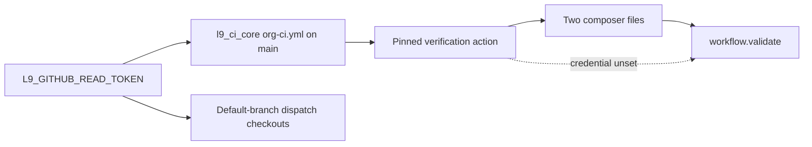

# Private-repo CI reads L9_GITHUB_READ_TOKEN

This is a `/l9-plan-simple` cursor-build plan. It is not a Program Execution campaign: no `make campaign`, no Program Lock, and `.github` stays public.

Kernel applied: [`kernels/Recursive Alignment.md`](/Users/ib-mac/.cursor-governance/kernels/Recursive%20Alignment.md) from the live SSOT. The revision below is the correction. No workflow file has been edited.

## Workspaces

Build does not edit `/Users/ib-mac/Cursor-Governance`. That checkout is `feat/pr-review-permission` and is dirty. `Cursor-Governance` is the private repository the workflows read.

Each lane starts from inside that repository, with `PR_STACK` empty, through [`ops/scripts/agent_worktree_start.sh`](/Users/ib-mac/.cursor-governance/ops/scripts/agent_worktree_start.sh). The script fetches `origin/main`, branches `agent/<agent-id>/<task-id>` from that SHA, and creates a wired worktree. The launch checkout is not the edit tree. `PR_STACK` empty keeps the base on `origin/main`.

- **`Quantum-L9/l9-ci-core`** — https://github.com/Quantum-L9/l9-ci-core. Launch from `/Users/ib-mac/l9-ci-core` only to run the script. That checkout is `main` and 74 commits behind `origin/main`, so its `org-ci.yml` is not the file to edit. Task `org-ci-read-token`. Re-read `.github/workflows/org-ci.yml` and `.github/actions/run-repository-verification/` on the new worktree before editing. This pull request is published first. The ruleset runs `org-ci.yml` from `l9-ci-core` `main`, so `Analyze (central Core)` stays on the old action until that pull request is on `main`.
- **`Quantum-L9/.github`** — https://github.com/Quantum-L9/.github. Launch from `/Users/ib-mac/.l9/authority/Quantum-L9-.github` (`main` at `dd780b9`, clean). Do not commit there. Do not use `/Users/ib-mac/.l9/worktrees/github-pr255` or `github-strategy-root`. Task `private-repo-read-token`.

Finish each lane with `l4_local.py begin` if the worktree has no release, then `l4_local.py authorize-release`, then `PR_REMEDIATE=0 make -C "$HOME/.cursor-governance" pr WS="<worktree>"`. This plan publishes. It does not merge.

## Why the secret does not work today

`L9_GITHUB_READ_TOKEN` is an organization secret. Git uses it only where a workflow passes it. The failing path never does.

- Five workflows check out the same two files at the pin in `COMPOSER`: [governance-pr.yml](/Users/ib-mac/.l9/authority/Quantum-L9-.github/.github/workflows/governance-pr.yml), [validate-starters.yml](/Users/ib-mac/.l9/authority/Quantum-L9-.github/.github/workflows/validate-starters.yml), [seed-governance.yml](/Users/ib-mac/.l9/authority/Quantum-L9-.github/.github/workflows/seed-governance.yml), [continuous-sync.yml](/Users/ib-mac/.l9/authority/Quantum-L9-.github/.github/workflows/continuous-sync.yml), and [auto-seed-new-repo.yml](/Users/ib-mac/.l9/authority/Quantum-L9-.github/.github/workflows/auto-seed-new-repo.yml). The pin is `5039c379d8ba1263f504cfa527487386205e056c`. The files are `ops/scripts/compose_pr_body.py` and `ops/scripts/org_dotgithub.py`. None of these checkouts sets `token`.
- [secret-drift.yml](/Users/ib-mac/.l9/authority/Quantum-L9-.github/.github/workflows/secret-drift.yml) is a different checkout: `ref: main`, path `governance`, no sparse-checkout. It runs `workflow_dispatch` and `schedule` only.
- [ops/fetch-composer.sh](/Users/ib-mac/.l9/authority/Quantum-L9-.github/ops/fetch-composer.sh) runs `git fetch https://github.com/Quantum-L9/Cursor-Governance.git` with no credential. `make validate` calls it when `SEED_COMPOSER_ROOT` is unset. That is the required `Analyze (central Core)` failure on [#255](https://github.com/Quantum-L9/.github/pull/255) and [#256](https://github.com/Quantum-L9/.github/pull/256).
- [policies/governance-caller.yml](/Users/ib-mac/.l9/authority/Quantum-L9-.github/policies/governance-caller.yml) forbids blank `secrets: inherit`. A callee receives a secret only through a named `secrets:` entry, and that entry would live in the caller file.
- The required check is [l9-ci-core `.github/workflows/org-ci.yml`](https://github.com/Quantum-L9/l9-ci-core). The organization ruleset `L9 canonical CI required` in the WIP copy targets `repository_name: ~ALL` and workflow path `.github/workflows/org-ci.yml` at repository id `1285564308` (`l9-ci-core`). Live enforcement mode is Unknown: the WIP copy says `evaluate`, while the `.github` pull requests showed `Analyze (central Core)` as required. Build re-reads the live ruleset and does not treat the WIP copy as deployed state.

## Where the secret is allowed

A same-repository `pull_request` workflow runs from the merge ref. A pull request can change that file and print any secret the file names. `governance-pr.yml` is `workflow_call`. `validate-starters.yml` is `pull_request`. The seeded [governance-caller.yml](/Users/ib-mac/.l9/authority/Quantum-L9-.github/policies/governance-caller.yml) is the caller every consumer copies, and consumers run it from their pull-request ref. Those files do not gain `L9_GITHUB_READ_TOKEN`.

The secret is named in two places:

- **`Quantum-L9/l9-ci-core` `org-ci.yml` on `main`.** The ruleset runs this file. A pull request in another repository cannot edit it. The named secret goes only to `run-repository-verification`. `provision-sdk` keeps cloning public `l9-ci-sdk` with no token.
- **Four `.github` workflows that run from the default branch:** `seed-governance.yml`, `continuous-sync.yml`, and `auto-seed-new-repo.yml` (`workflow_dispatch`), and `secret-drift.yml` (`workflow_dispatch` and `schedule`). The token input is only on the `actions/checkout` of `Quantum-L9/Cursor-Governance`. Later steps do not receive it.

`fetch-composer.sh` stays the local unauthenticated helper. CI sets `SEED_COMPOSER_ROOT` so the helper does not run. The shell script does not read the organization secret.

## Design

The pinned `l9-ci-core` action reads `governance-pr.yml` as data. When that file contains exactly one `COMPOSER: Quantum-L9/Cursor-Governance@<40-hex>` line, the action fetches only the two files with `L9_GITHUB_READ_TOKEN`, writes `SEED_COMPOSER_ROOT`, and unsets the token before `workflow.validate()`. A workspace with no such line does not fetch. A fetch failure when the line is present fails the action. The inspected `run.py` on the stale local `l9-ci-core` calls `workflow.validate()`; the worktree copy wins if `origin/main` has moved.

The three dispatch seed workflows keep the two-file sparse checkout and the existing pin. `secret-drift.yml` keeps the full `main` checkout. They share the secret and the checkout-step boundary. They do not share one reusable workflow: a reusable workflow still needs the caller to pass the secret, and the pull-request callers must not pass it.

Do not change repository visibility. Do not rotate or print the token. Do not use `GH_TOKEN` for this path.

## Later, when `.github` becomes private

Record this in [docs/DISTRIBUTION.md](/Users/ib-mac/.l9/authority/Quantum-L9-.github/docs/DISTRIBUTION.md) Appendix B. Do not perform it.

- `uses: Quantum-L9/.github/...` is resolved with the caller's `GITHUB_TOKEN` before secrets exist. Private reusable workflows need `.github` Actions access set to repositories in the `Quantum-L9` organization.
- A full git clone of private `.github` uses the same `L9_GITHUB_READ_TOKEN`, and only if that credential is allowed to read `.github`. A selected-repository token does not gain `.github` automatically.
- Repository access of the secret is Unknown until the GitHub UI is read. Access has to include `l9-ci-core` and public `.github`. "Private repositories" alone leaves the public caller without the secret.

## Out of scope

Any edit under `/Users/ib-mac/Cursor-Governance`. Passing this secret through `governance-caller.yml`, `governance-pr.yml`, or `validate-starters.yml`. A new `pull_request_target` producer. Merging either pull request. Projection trusted-replay credentials. Making `.github` private. Merging [#255](https://github.com/Quantum-L9/.github/pull/255) or [#256](https://github.com/Quantum-L9/.github/pull/256). Any other organization secret.

`validate-starters.yml` and the `governance-pr.yml` composer checkout keep using `GITHUB_TOKEN`. They stay unable to clone private `Cursor-Governance`. The required check is `Analyze (central Core)`, which the `l9-ci-core` prefetch covers. Those two pull-request checkouts are a separate trusted-producer decision and are not this plan.

## Proof

- A `l9-ci-core` test shows the token is unset before `workflow.validate()`, and a workspace without the COMPOSER line does not fetch.
- A `.github` test fails if `L9_GITHUB_READ_TOKEN` appears in a `pull_request` workflow, a `workflow_call` workflow, or `policies/governance-caller.yml`.
- Both pull requests are published with `PR_REMEDIATE=0 make pr`. `Analyze (central Core)` on another organization repository shows the prefetch only after `l9-ci-core` `main` contains it. This plan does not perform that merge.

## Alignment record

Target: this plan, `/Users/ib-mac/.cursor/plans/private_repo_ci_token_6331b1c2.plan.md`. Mode: audit, then revise the plan. Workflows were not modified.

- **RA-1 High, Confirmed, Resolved in this revision.** Governing rule: security, authentication at the correct boundary; a lower layer cannot widen privilege. The previous plan passed the organization read token through the seeded caller and a reusable workflow invoked from pull-request files. Evidence: `governance-caller.yml` lines 15–17, `governance-pr.yml` `on: workflow_call`, `validate-starters.yml` `on: pull_request`. A same-repo pull request executes those files. Correction: the secret stays in `l9-ci-core` `org-ci.yml` and the four default-branch workflows.
- **RA-2 High, Confirmed, Resolved in this revision.** Governing rule: ownership; do not merge distinct contracts. `secret-drift.yml` checks out `Cursor-Governance` `main` with no sparse-checkout. The other five checkouts are the two pinned composer files. Correction: `secret-drift` stays a full checkout.
- **RA-3 Medium, Confirmed, Resolved in this revision.** Governing rule: publication authority. The previous plan said the `l9-ci-core` pull request merges first and named `worktree_add_wired.sh` plus `feat/` branches. The sanctioned new-task entrance is `agent_worktree_start.sh`, which fetches `origin/main` and names `agent/<agent-id>/<task-id>`. Finish is `authorize-release` then `PR_REMEDIATE=0 make pr`. Merge is not this plan.
- **RA-4 Medium, Confirmed, Resolved in this revision.** Governing rule: source of truth. The plan cited `org-ci.yml` from `/Users/ib-mac/.l9/worktrees/l9-ci-core-artifact-fix` while `/Users/ib-mac/l9-ci-core` is 74 commits behind `origin/main`. Correction: edit only the fetched worktree, and re-read the action there.

Unknowns, still open:

- Live ruleset enforcement (`evaluate` in the WIP copy versus required on the inspected pull requests).
- Whether the secret's repository access list includes `l9-ci-core` and public `.github`.
- The exact `run-repository-verification` source on fetched `origin/main`.

Readiness of this plan as a build spec: ConditionallyReady. Convergence: Converged for the accessible plan text. Minimum safe next action, when execution is authorized: open the `l9-ci-core` worktree and re-read `org-ci.yml` and `run-repository-verification` before any edit.

## Build evidence (auto)

- detected_at: `2026-11-17T23:02:46Z`
- conversation_id: `e72b151d-0163-47f6-9863-49b7b8d4b608`
- generation_id: `ac519de2-50d7-4446-87a4-52a3b4e82137`
- transcript: `/Users/ib-mac/.cursor/projects/Users-ib-mac-Cursor-Governance/agent-transcripts/e72b151d-0163-47f6-9863-49b7b8d4b608/e72b151d-0163-47f6-9863-49b7b8d4b608.jsonl`
- todos at build time:
- `open-lanes`: completed
- `secret-access`: completed
- `trusted-prefetch`: completed
- `org-ci-wire`: completed
- `dispatch-checkout`: completed
- `deny-pr-secret`: completed
- `private-readiness`: completed
- `proof`: completed

