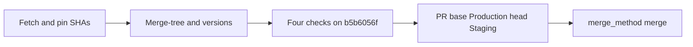

# Production promotion PR

Promote frozen `Staging` `b5b6056f01639212e722ccdec5b964b36deee9f5` onto `Production` `3318fa646a9f33aed55b9ea8f8596316e30684da` in `cryptoxdog/IB-Odoo_19`. One pull request, base `Production`, head `Staging`, then one GitHub merge commit. Staging does not move again before this promotion. If either remote ref differs from the pins below at the start of execution, stop.

Do not use `make pr`, `gh pr create`, `git push`, `git push --force`, a local merge, a checkout, a commit, a reset, or a stash. The checkout is detached at `9b3ec0a5` with a dirty `tests/production-rehearsal/evidence/latest` symlink. Leave that worktree untouched. The only git write before the GitHub merge is a fetch of the two remote-tracking refs.



## Pinned state

Recorded 2026-11-08 18:48 UTC from `git ls-remote` and the pull request API. Execution re-reads these and stops on drift.

- `Production` `3318fa646a9f33aed55b9ea8f8596316e30684da` — `Merge Staging into Production`
- `Staging` `b5b6056f01639212e722ccdec5b964b36deee9f5` — `Merge pull request #405 from cryptoxdog/test/rehearsal-evidence-20261108-152843`
- Parents of that Staging tip: `b21d3ba9e6dcddc96727676ea5d9b00073f0c671` and `6a80542f94be1d92e52df95ea38270347a928eb2`
- GitHub compare `Production...Staging`: `ahead_by` 524, `behind_by` 1, `status` diverged, merge-base `dc107f69c2116b97df34a86f19cfade04a9f3644`
- [#404](https://github.com/cryptoxdog/IB-Odoo_19/pull/404) merged `2026-11-08T18:41:11Z`, merge commit `99394de702ac1c2c2a5630ab90153a0344996827`, and that commit is in the 21 commits since `88ce4370`
- [#405](https://github.com/cryptoxdog/IB-Odoo_19/pull/405) merged `2026-11-08T18:48:30Z` and its merge commit is the Staging tip
- Open pull requests: none
- `plasticos_crm_sync` manifest at the Staging tip: `19.0.1.9.23`
- Required ruleset checks on that SHA, at plan time: `Ruff Lint & Format` success, `Secret Detection` success, `Comprehensive Audit (Baseline Regression)` success. `Static Analysis`, `Pure Python Tests`, and `Governed Semgrep Analysis` were still in progress. `CI Gate Result` had not been reported yet

The GitHub compare file list stops at 300 paths. Do not use it as the release diff. After the fetch, `git diff --name-status` is the inspection.

## 1. Pin the refs

```bash
git fetch origin \
  refs/heads/Staging:refs/remotes/origin/Staging \
  refs/heads/Production:refs/remotes/origin/Production
```

Stop unless all of these are true:

- `git rev-parse origin/Staging` is `b5b6056f01639212e722ccdec5b964b36deee9f5`
- `git rev-parse origin/Production` is `3318fa646a9f33aed55b9ea8f8596316e30684da`
- `git merge-base --is-ancestor 99394de702ac1c2c2a5630ab90153a0344996827 origin/Staging`
- `gh api repos/cryptoxdog/IB-Odoo_19/pulls?state=open&per_page=100` returns `[]`
- `git status --porcelain` is unchanged from the dirty evidence symlink, and `HEAD` is still detached

A different Staging SHA means Staging moved. Do not retarget, do not open the pull request, and do not merge.

## 2. Reconcile the Production-only commit

`3318fa64` is the GitHub merge of previous Production `1883685b` and Staging `dc107f69`. Its tree equals `dc107f69`. That parent is an ancestor of `b5b6056f`, so the commit adds no file content.

Stop unless all of these are true on the fetched refs:

- `git rev-list --left-right --count origin/Production...origin/Staging` prints `1	524`
- `git log --format=%H origin/Staging..origin/Production` prints only `3318fa646a9f33aed55b9ea8f8596316e30684da`
- `git rev-parse 3318fa646a9f33aed55b9ea8f8596316e30684da^{tree}` equals `git rev-parse dc107f69c2116b97df34a86f19cfade04a9f3644^{tree}`
- `git merge-tree --write-tree origin/Production origin/Staging` exits 0, prints one tree id, and that id equals `git rev-parse origin/Staging^{tree}`

Do not cherry-pick, rebase, or replay `3318fa64` onto Staging. The promotion merge commit's parents are `3318fa64` and `b5b6056f`, and its tree is the Staging tree.

## 3. Inspect the diff and the version bumps

Run `git diff --name-status -M origin/Production origin/Staging` and classify every path. The earlier classification against `88ce4370` was 1440 added, 341 modified, 213 deleted, 55 renamed. Recompute the counts at `b5b6056f`. The 21 commits after `88ce4370` add rehearsal evidence, Gate 6 and Gate 7 kit fixes, [scripts/git_push_with_pr.sh](scripts/git_push_with_pr.sh), [scripts/pr_check_run.sh](scripts/pr_check_run.sh), and one module runtime change: [plasticos_crm_sync/scripts/import_vanillasoft_shell.py](plasticos_crm_sync/scripts/import_vanillasoft_shell.py) with [plasticos_crm_sync/__manifest__.py](plasticos_crm_sync/__manifest__.py) at `19.0.1.9.23`.

Stop unless the recomputed classification still shows:

- no path containing `pipeline_v2` in the diff
- `plasticos_buyer_match_engine` and `plasticos_inference_engine` absent from the Staging tree, with the mothball still in [plasticos_base/migrations/19.0.1.1.6/pre-migrate.py](plasticos_base/migrations/19.0.1.1.6/pre-migrate.py)
- no installable `__manifest__.py` depending on those two names
- new modules `plasticos_crm_sync`, `plasticos_gate`, and `plasticos_semantic_kernel` present with versions
- the claim preserve-table drop and the `x_*` column drops remain the already-shipped migrations in [plasticos_claims/migrations/19.0.1.1.3/post-migrate.py](plasticos_claims/migrations/19.0.1.1.3/post-migrate.py) and [plasticos_documents/migrations/19.0.2.2.0/pre-migrate.py](plasticos_documents/migrations/19.0.2.2.0/pre-migrate.py)

Version check, integer tuples from `__manifest__.py`, rule in [skills/plasticos-odoo-version-bump/SKILL.md](skills/plasticos-odoo-version-bump/SKILL.md):

- A module with a changed `.py`, `.xml`, or `.csv` outside `tests/`, `README`, and docs must have a Staging version strictly greater than Production, or be new.
- A removed module has no Staging manifest. That is expected for the two retired modules.
- `plasticos_crm_sync` must read `19.0.1.9.23`.
- `plasticos_geolocalize` may stay `19.0.1.1.0` only when `git diff origin/Production origin/Staging -- plasticos_geolocalize/models/res_partner_geo.py` is still the sudo comment moved onto the same line. Any other hunk in that module is a stop.
- Any other unbumped or lower runtime module is a stop. Do not add a bump on Production or on a new branch.

## 4. Wait for the four required checks

Ruleset `Protect Staging & Production` (id `17291607`) requires these contexts on the head SHA. `strict_required_status_checks_policy` is false. `current_user_can_bypass` is `never`, and `bypass_actors` is empty.

- `Ruff Lint & Format`
- `Static Analysis`
- `Pure Python Tests`
- `CI Gate Result`

Poll `repos/cryptoxdog/IB-Odoo_19/commits/b5b6056f01639212e722ccdec5b964b36deee9f5/check-runs` until every run of those four names has `conclusion=success`, or 20 minutes pass. Ignore a `skipped` advisory run. If any of the four concludes `failure`, `cancelled`, or `timed_out`, stop. Do not open the pull request and do not merge.

## 5. Open one pull request

`POST repos/cryptoxdog/IB-Odoo_19/pulls` with `base=Production`, `head=Staging`, title `promote: Staging b5b6056f to Production`, and a body that records:

- both full SHAs and the `1` / `524` divergence
- `3318fa64` has the same tree as `dc107f69`, and the merge-tree id equals the Staging tree
- the version-bump verdict, including `plasticos_crm_sync` `19.0.1.9.23` and the geolocalize comment-only exception
- the retired modules and the two already-shipped schema drops
- the merge instruction: `merge_method=merge` only
- the stamp `<!-- L9_PROTECTED_ROOT_PR -->`

Stop unless the created or reused pull request has `base.ref=Production`, `head.ref=Staging`, `head.sha=b5b6056f01639212e722ccdec5b964b36deee9f5`, and `head.repo.full_name=cryptoxdog/IB-Odoo_19`. If another open pull request exists, stop.

## 6. Merge onto Production

Poll the pull request until `mergeable` is `true`. `mergeable_state` of `dirty` or `blocked` is a stop. A null `mergeable` is still computing; poll for up to 2 minutes.

Then:

```bash
gh api --method PUT repos/cryptoxdog/IB-Odoo_19/pulls/<number>/merge \
  -f merge_method=merge \
  -f sha='b5b6056f01639212e722ccdec5b964b36deee9f5' \
  -f commit_title='Merge Staging into Production' \
  -f commit_message='Promote Staging b5b6056f onto Production 3318fa64.'
```

`sha` makes GitHub reject the call if Staging moved. Do not send `squash` or `rebase`. Do not approve the pull request to get past a review. If the API refuses, leave the pull request open and report the response. Do not push `Production` from this clone.

After a successful merge, `git ls-remote origin refs/heads/Staging refs/heads/Production` must show:

- `Staging` still `b5b6056f01639212e722ccdec5b964b36deee9f5`. The repository default branch is `Staging`, so `delete_branch_on_merge` does not delete it. If that ref is absent, stop and report. Do not force-push it back.
- `Production` is a new merge commit whose first parent is `3318fa646a9f33aed55b9ea8f8596316e30684da`, whose second parent is `b5b6056f01639212e722ccdec5b964b36deee9f5`, and whose tree equals the Staging tree.

That is the promotion. Do not deploy, run `make update`, or set a production permit.

## Build evidence (auto)

- detected_at: `2026-11-08T18:59:24Z`
- conversation_id: `966c2302-21aa-4cde-b7aa-0ef5353a1c84`
- generation_id: `2b26e794-1e54-4142-b0f3-2eda0aa6771e`
- transcript: `/Users/ib-mac/.cursor/projects/Users-ib-mac-IB-Odoo-19-LOCAL-IB-Odoo-19/agent-transcripts/966c2302-21aa-4cde-b7aa-0ef5353a1c84/966c2302-21aa-4cde-b7aa-0ef5353a1c84.jsonl`
- todos at build time:
- `pin-refs`: completed
- `reconcile`: completed
- `inspect-bumps`: completed
- `wait-ci`: completed
- `open-pr`: completed
- `merge`: completed
