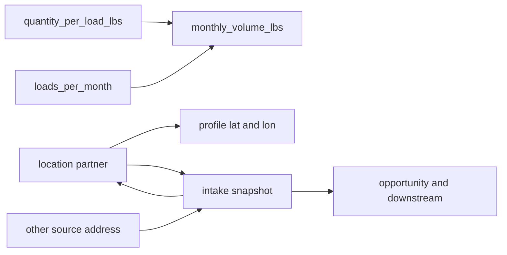

# Material profile derived fields

## Bootstrap result

GAR `load_order` is complete in this repo's governance clone: all 14 required files under `~/.cursor-governance/skills/l9-global-architect/` exist. `route_plan.py --risk medium --evidence sufficient` returned `depth=standard`, `omit_gates=[]`. Optional loads stayed off (no governance-generation, conformance, or architecture-intelligence request).

These planning writers did not run. Plan mode blocks the files they create, and one input was already missing:

- `.l9/memory/plan-prefetch.json` is absent. The route receipt for this turn is `no_route`, so the prefetch hook did not write it. `ops/hooks/plan_memory_prefetch.py` was not run.
- `write_plan_run.py`, `run_plan_pipeline.py`, and `admit_plan.py` were not run, so there is no GAR run file, no `PLAN_DOCUMENT` validator pass, and no section receipt.
- `contracts/L9_ARCHITECTURE_PROFILE.yaml`, `OUTCOME_OWNERSHIP.yaml`, `STATE_MACHINE.yaml`, and the other load-order contracts were confirmed present. They were not read end to end before this projection.

Integration mode is standalone. This is not an L9 runtime activation.

## Architect framing

Governing cause: the material profile form shows zeros for values the operator already supplied. Quantity per Load and Loads per Month are filled, and the facility partner owns the address, but `monthly_volume_lbs`, `lat`, and `lon` are independent stored numbers. Moisture renders as a progress bar because a view xpath landed on the only moisture field.

Intervention class: **USE_EXISTING**. The location already has `partner_latitude` and `partner_longitude`. Filler % already documents the percent scale this form uses (`30` means 30%). The intake's live related coordinates are the wrong holder for a foreign source, so that override is removed and the intake keeps a stored snapshot instead. No new model, map, geocoder, or percent widget.

Realization for Build: mutation of `plasticos.material.profile` and the geo override. This turn only plans it.



## Immutable baseline

- Workspace: `feat/location-profile-layout` at `c1bd4e93`, clean tree.
- Open sibling PRs into `Staging`: [#459](https://github.com/cryptoxdog/IB-Odoo_19/pull/459) `feat/location-profile-layout`, [#458](https://github.com/cryptoxdog/IB-Odoo_19/pull/458) `fix/worksheet-purchase-order-link`, [#456](https://github.com/cryptoxdog/IB-Odoo_19/pull/456) `feat/web-lead-images-assigned-to`.
- Hook catalog for the code: `.pre-commit-config.yaml`.
- No Program Lock and no `origin/main` lock.

## Objective

On the material profile form:

- Monthly Volume Lbs becomes Quantity per Load times Loads per Month. `40000 × 1 = 40000`. It changes when either input changes. Loads per Month stays the integer the user types. Avg Weight Lbs stays out of the formula.
- Latitude and Longitude stay on the profile and follow the location. A previous edit that removed these two fields is not repeated.
- An intake created from a different source keeps that source's address and coordinates, then copies them onto the opportunity and downstream. A later location fills a snapshot only while that snapshot is still zero.
- Moisture and Contamination are both plain numbers on the stored scale (`0.5` is 0.5%, `5` is 5%). The moisture progress bar goes away. Both labels present the unit as `%`.

## What the code does today

Monthly volume in [`plasticos_material_profile/models/material_profile.py`](plasticos_material_profile/models/material_profile.py) is a plain indexed float. Nothing multiplies `quantity_per_load_lbs` and `loads_per_month`. Migration `19.0.5.9.0` already converted loads from a computed float into a stored integer. That direction stays.

`lat` and `lon` are plain floats with `digits=(10, 7)`. The profile has no street or city. `partner_id` is the facility (the breadcrumb site). The company on the form is `partner_id.parent_id`. Geocoding writes `res.partner.partner_latitude` and `partner_longitude`. Intake overrides its own fields in [`plasticos_geolocalize/models/intake_geo.py`](plasticos_geolocalize/models/intake_geo.py):

```19:29:plasticos_geolocalize/models/intake_geo.py
    lat = fields.Float(
        string="Latitude",
        related="partner_id.partner_latitude",
        store=True,
        readonly=True,
    )
```

The profile never follows the location. The Contacts map pins the partner, and there is no material-profile map. A zero on this form hides a pin only when the location itself was never geocoded. If the location already has coordinates, the contact can show on the map while this form still shows zero.

That intake override also blocks the other origin. `lat` and `lon` can only show `partner_id`, and they are readonly. A HOT web lead creates an intake with no partner ([`plasticos_web_leads/models/web_lead.py`](plasticos_web_leads/models/web_lead.py) `_create_intake`), and the pickup ZIP and place stay on the lead. A CRM lead already has street, city, and ZIP, and partner creation copies that address onto the new partner, but the intake does not receive it. The opportunity material and the approval lot copy `lat` and `lon` from the profile only ([`plasticos_crm_bridge/models/opportunity_material.py`](plasticos_crm_bridge/models/opportunity_material.py), [`plasticos_crm_bridge/models/opportunity_approval.py`](plasticos_crm_bridge/models/opportunity_approval.py)). A source that is not the location never gets past the lead.

Intake `facility_street` and `facility_city` are related to `facility_id`, so they are empty until a location exists. The bridge still copies intake `lat` and `lon` into profile create values. That copy stays. It is how a foreign source reaches a location that does not yet have coordinates.

Moisture and contamination are the same kind of float. The banner in [`plasticos_material_profile/views/material_profile_ux.xml`](plasticos_material_profile/views/material_profile_ux.xml) inserts a `contamination_percent` field, then sets `widget="progressbar"` on `//field[@name='contamination_percent']`. That hits the banner field, which is hidden at 5 or below. The same file sets `progressbar` on `moisture_percent`, which exists only in Specs, so the bar in the screenshot is moisture. Specs contamination stays a normal float. The bridge copies `moisture_pct` `0.4` and `contamination_pct` `2.0` with no conversion. The banner appears when contamination is greater than 5, on that same scale.

Odoo's percentage widget stores a fraction, so a displayed 5% would be saved as `0.05`. That would break the banner and the bridge tests. Filler % is the pattern: a plain float whose help says `30` means 30%.

Enrichment maps `moisture_ppm` onto `moisture_percent` with no conversion, behind `UserError` in the mothballed local-inference path. That path is not this form. Do not treat parts per million as a percent, and do not edit that map.

## Execution envelope

- Network: `named_services_only`, GitHub only when publication runs.
- Secrets: `none`.
- Complexity: crosses `plasticos_material_profile`, `plasticos_geolocalize`, `plasticos_intake`, `plasticos_web_leads`, and `plasticos_crm_bridge`. No external geocoder call from this change. `migration_required: true` for the profile backfill and the intake field change.
- Owner: operator. Estimate: one focused change set.
- `plasticos_geolocalize` does not depend on `plasticos_material_profile` today. Intake does, and geolocalize depends on intake, so adding an explicit material-profile dependency does not cycle.

## Side effects and idempotency

- Stored compute and stored related fields recompute when their inputs change. The post-migrate SQL is the same assignment, so a second upgrade does not drift.
- Profile coordinates that were typed by hand and differ from the location are replaced by the location. That is the location origin.
- An intake snapshot that is already non-zero is left alone when a partner is linked later. Only a zero snapshot is filled from the location.
- A location whose address is present and whose `partner_latitude` is still 0 stays at 0 until the existing geocode cron or `geo_localize()` runs. Copying an address does not invent coordinates. This change does not call Nominatim.
- Web-lead triage still does not create a partner. The pickup address is stored on the intake.
- Dead enrichment code that writes `monthly_volume_lbs` stays dead. A later un-mothball would be writing a computed field and is out of scope.

## Architecture impact

- Data plane: `monthly_volume_lbs` becomes a stored compute. Profile `lat` and `lon` become a stored related readonly copy of the location, keeping `digits=(10, 7)`.
- Intake `lat` and `lon` stop being a live related field of `partner_id`. They become a stored snapshot. The intake also stores the source street, city, and ZIP, because `facility_street` and `facility_city` cannot hold an address before a location exists.
- The Contacts map is unchanged. No material-profile map is added.
- `loads_per_month` stays a non-computed integer. The contract test that asserts that stays green.
- Version bumps, same change set, PATCH only: `plasticos_material_profile` `19.0.5.11.15`, `plasticos_geolocalize` `19.0.1.1.1`, `plasticos_intake` `19.0.5.4.3`, `plasticos_web_leads` `19.0.2.9.3`, `plasticos_crm_bridge` `19.0.3.4.26`. README `module_version` lines move with them. Upgrade only those modules.

## Rollback

Revert the module commits. Existing `lat` and `lon` columns stay. New intake address columns are the only schema addition; a downgrade leaves them unused. No column drop in this change.

## Coordinate origins

A location and a foreign source are different origins. Neither one overwrites the other once a real coordinate pair is stored.

**Location.** The facility partner is the location (`material profile.partner_id`, intake `facility_id`). Its coordinates are `partner_latitude` and `partner_longitude`, already produced from that partner's address by the existing geocoder. The profile on that location follows those two fields: stored, related, readonly, `digits=(10, 7)`. The screenshot record shows the location's coordinates, including zero when the location was never geocoded.

**Intake born from that location.** Copy the location's coordinates onto the intake. While the intake snapshot is still zero, a later geocode of the location fills it. Linking a different partner does not replace a snapshot that already has coordinates.

**Intake born from another source.** The source's address and coordinates are written onto the intake at creation, then copied forward.

- Web lead: `_create_intake` copies `pickup_postal_code` and `pickup_place` (or `pickup_location_text`) onto the intake. Triage still creates no partner.
- CRM lead: conversion copies the lead street, city, and ZIP onto the intake. Partner creation may still copy that same address onto a new partner.
- VanillaSoft and any other partner-backed source: creating the intake from that partner copies the partner's address and `partner_latitude` / `partner_longitude`.

The opportunity material and the approval lot already copy profile `lat` and `lon`. They also take the intake snapshot when the profile's location is still zero. Gate keeps reading the coordinates it already reads.

**Downstream location.** When that intake later creates a profile, the location wins if it already has coordinates. If the location has none, the intake address and coordinates are written onto the location first, and the profile then follows the location. `lat` and `lon` stay in the intake-to-profile bridge for that handoff. An address with no coordinates is copied as an address. It becomes coordinates only when the existing geocoder runs on the location.

Remove the live related override in [`plasticos_geolocalize/models/intake_geo.py`](plasticos_geolocalize/models/intake_geo.py). A readonly mirror of `partner_id` cannot store a web-lead pickup, and a HOT intake has no partner.

## Execution DAG

1. Stored compute for monthly volume, help text, and `migrations/19.0.5.11.15/post-migrate.py` setting `monthly_volume_lbs = COALESCE(quantity_per_load_lbs, 0) * COALESCE(loads_per_month, 0)`.
2. Profile `lat` and `lon` follow the location in `plasticos_geolocalize/models/material_profile_geo.py`: related, stored, readonly, `digits=(10, 7)`. Add `plasticos_material_profile` to that module's `depends`. Backfill from `res_partner`. Keep `lat` and `lon` in the intake bridge. On profile create, if the location has no coordinates and the intake does, write the intake address and coordinates onto the location first.
3. Replace the intake related override with a stored snapshot plus stored source street, city, and ZIP. Seed it from the location, or from the web lead, CRM lead, or source partner. Copy a non-zero intake snapshot onto the opportunity material and the approval lot when the location is still zero. Do not create a partner in web-lead triage.
4. In `material_profile_ux.xml`, delete both `progressbar` attribute xpaths and the stale Quality-tab comment. Set `string` and `help` on `moisture_percent` and `contamination_percent` to `Moisture %` and `Contamination %`, with help stating that `0.5` means 0.5% and `5` means 5%. Do not set `widget="percentage"`. The banner keeps its existing `%` text node and its `> 5` visibility.
5. Tests, then version bumps.

## Property evidence

- V1: `40000 * 1 == 40000`, and either input at 0 yields 0. A pure test calls the same multiplication the compute uses.
- V2: source contract that profile geo fields are related, stored, and readonly on the location's `partner_latitude` and `partner_longitude`. Intake `lat` and `lon` are stored snapshots, not related to `partner_id`.
- V3: `material_profile_ux.xml` contains no `progressbar`. Field strings are `Moisture %` and `Contamination %`. Bridge tests still expect moisture `0.4` and contamination `2.0`.
- V4: the bridge pure test still expects intake `lat` and `lon` in profile create values. A location that already has coordinates wins over those values. A location at zero receives the intake address and coordinates before the profile follows it.
- V5: a web-lead intake create copies the pickup ZIP and place and does not create a partner. A non-zero intake snapshot is not replaced when a different partner is linked. A zero snapshot fills from the location.
- V6: `ruff check` and `ruff format` on the touched Python. No ad hoc `make test-module`. Web-lead tests under `tests/test_web_lead*.py` cover the intake create change.

## Stress and disconfirm

- Putting `widget="percentage"` on these fields would store 5% as `0.05` and hide the banner until the stored number exceeded 5. Disconfirmed by the banner threshold and the `0.4` / `2.0` tests.
- Putting the progress bar on Specs contamination would copy the moisture defect. Both xpaths go away.
- Deriving Loads per Month from monthly volume reverses this request. The integer stays user-typed.
- Including Avg Weight Lbs in the product contradicts the note. The formula is the two named inputs only.
- A new map, or a Nominatim call from the profile, does not fix a location that already has coordinates and a form that still shows zero. The missing link on that form is the copy from the location.
- Keeping intake `lat` and `lon` as a readonly related field of `partner_id` drops a web-lead or CRM address, because that intake often has no partner yet. The snapshot is what lets the source permeate.
- Replacing a non-zero source snapshot with whatever partner is linked later throws away the source the operator asked to keep.
- Dropping `lat` and `lon` from the intake bridge stops a foreign source from reaching a location that has no coordinates yet.

## Out of scope

- Material-profile map view, Contacts map changes, and a new geocoder call.
- Creating a partner during web-lead triage.
- `moisture_ppm`, local inference, and Gate request shapes beyond the coordinates they already read.
- Rescaling stored percents, or changing `loads_per_month` back into a computed float.
- Editing `#459`'s location-window layout.

## Doc and root surfaces

No ADR, `AGENTS.md`, or `INVARIANTS.md` change. The behavior is a bugfix of fields that already exist. README `module_version` lines move with the manifest bumps because the `readme-module-version` hook rewrites them.

## Convergence

Ready to Build the code once the publication parent below is settled. The section-receipt pipeline did not run in this turn.

## Execute via Cursor Build

Press Build to apply the DAG on a branch that is not `#459`.

Three sibling pull requests target `Staging` (`#456`, `#458`, `#459`), so there is no unique chain tip. `PR_STACK=auto` fails closed. Do not branch from `origin/main`, and do not add these commits to `feat/location-profile-layout`. Before the first commit, the operator names the parent with `make pr base=<branch>` after that parent is the only open chain, or closes the unrelated siblings. Do not run `make campaign`. Do not admit a Program Lock.

After the todos and a scoped commit: `l4_local.py authorize-release`, then `PR_STACK=auto PR_REMEDIATE=0 make pr` only when the board has one chain. The finish reply shows the opened PR URL. Upgrade with `make update m=plasticos_material_profile,plasticos_geolocalize,plasticos_intake,plasticos_web_leads,plasticos_crm_bridge` only.

## Build evidence (auto)

- detected_at: `2026-11-10T23:28:54Z`
- conversation_id: `f89383e0-020c-453f-8077-b61d9e5f935d`
- generation_id: `35f44dda-a616-4497-bb0f-44eb8e4e423c`
- transcript: `/Users/ib-mac/.cursor/projects/Users-ib-mac-IB-Odoo-19-LOCAL-IB-Odoo-19/agent-transcripts/f89383e0-020c-453f-8077-b61d9e5f935d/f89383e0-020c-453f-8077-b61d9e5f935d.jsonl`
- todos at build time:
- `monthly-volume`: completed
- `profile-geo`: completed
- `percent-fields`: completed
- `tests-bump`: completed
