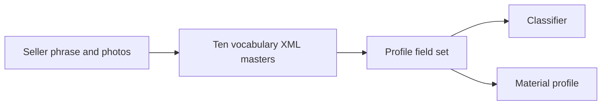

# Rich profile from every vocabulary XML

The governing change is a set of slot rules, not a product list. [plasticos_material_profile/data/ERP-Products.csv](plasticos_material_profile/data/ERP-Products.csv) is the proof corpus. Nobody adds a row for `LDPE Film - Grade A` or any other line. [plasticos_material_profile/data/material_mapping.csv](plasticos_material_profile/data/material_mapping.csv) is not read. [plasticos_material_profile/data/grade_template_data.xml](plasticos_material_profile/data/grade_template_data.xml) is not a lookup: the profile has no template field, and a phrase still normalizes when no template name matches.

The live catalog is the active rows of the other ten data files in [plasticos_material_profile/__manifest__.py](plasticos_material_profile/__manifest__.py):

- [polymer_data.xml](plasticos_material_profile/data/polymer_data.xml) → `polymer_id`
- [material_form_data.xml](plasticos_material_profile/data/material_form_data.xml) → `form_id`
- [material_grade_data.xml](plasticos_material_profile/data/material_grade_data.xml) → `material_grade_id`
- [material_quality_tier_data.xml](plasticos_material_profile/data/material_quality_tier_data.xml) → `quality_tier_id`
- [material_color_data.xml](plasticos_material_profile/data/material_color_data.xml) → `color_ids`
- [source_type_data.xml](plasticos_material_profile/data/source_type_data.xml) → `source_type_id`
- [process_type_data.xml](plasticos_material_profile/data/process_type_data.xml) → `origin_process_type`
- [filler_type_data.xml](plasticos_material_profile/data/filler_type_data.xml) → `filler_type_id`
- [packaging_type_data.xml](plasticos_material_profile/data/packaging_type_data.xml) → `packaging_type_id`
- [material_attribute_data.xml](plasticos_material_profile/data/material_attribute_data.xml) → `material_attribute_ids`

Process entries come from `plasticos.process.type`, whose codes already match `PROCESS_SELECTION`. The catalog stops using a separate hardcoded process list. Attribute code `reusable` is omitted. Inactive form `BALES` stays out.

A phrase is a pile of facts. Each fact fills at most one of those profile fields. A field the phrase does not name stays empty. The reading is that field set. Photos still fill an empty field and still reach the classifier. The intake stores the same set, and the material profile created from the intake receives every filled field. Triage still does not create a profile before a partner exists, because `partner_id` is required.

## Rules

These live in the normalizer prompt in [plasticos_web_leads/models/ai_normalizer.py](plasticos_web_leads/models/ai_normalizer.py) and, where they are mechanical, in [plasticos_web_leads/models/material_catalog.py](plasticos_web_leads/models/material_catalog.py). The prompt shows each slot as `code — name`, and a polymer full name only as prompt context.

- One phrase may fill many slots. Do not look up the whole phrase as a product.
- Inside one slot, the longest catalog code or name wins, then the earliest. A word that filled a longer label is not also a shorter label in that same slot.
- A word fills only one slot. Color `Mixed Color` beats attribute `mixed`. Packaging `bales` is the bale fact; inactive form `BALES` stays out. `Loose` is packaging when the phrase already names a form such as regrind or shred.
- Hyphens, slashes, and parentheses are separators, not part of the word. `HDPE-HMW` matches polymer `HDPE HMW`. A listed code in parentheses is that polymer: `Acrylic (PMMA)` is `PMMA`. A slash blend uses the listed blend code when one exists (`LDPE/LLDPE`, `PET/HDPE`); otherwise keep each listed polymer the phrase names and do not invent a blend code.
- Quality tier is only `Grade A`, `Grade B`, `Grade C`, `Reusable`, or `Standard`, including the spelling `reuseable`. Those words are never a material grade and never an attribute. `Crate grade`, `bottle grade`, `utility grade`, and `injection grade` are not quality tiers.
- `w/ print` and `with print` are attribute `printed`. `No metal` is attribute `no_metal`. `Post consumer` and `post industrial` are the source types even when the hyphen is missing.
- Form is the shape now (`film`, `regrind`, `purge`, `pellets`, `flake`, `sheet`, `parts`). Material grade is what the item was (`pallets`, `bottles`, `drums`, `trays`). Attributes accumulate (`clean`, `rigid`, `frac melt`, `repro`). Melt numbers, gallon counts, and resin numbers such as `#7` fill no slot.
- Do not invent packaging, clean, or dry because a grade letter is present. `LDPE Film - Grade A` is polymer `LDPE`, form `FILM`, quality tier `GRADE_A`, and nothing else.
- `Mixed Rigid Plastics` is not a stored product. Attribute `rigid` and tier `GRADE_A` come from the words. Polymer `MRP` is returned only when the model chooses that listed code from the full name in the prompt. The word matcher does not use `full_name`.

Attribute code `reusable` is dropped from the catalog the prompt and the matcher see. The seed row stays.

## Catalog and accept

- Extend `_CATALOG_MODELS` in [plasticos_web_leads/models/web_lead.py](plasticos_web_leads/models/web_lead.py) to the ten models above. Replace the intake process selection with `plasticos.process.type`. While building attributes, drop code `reusable`.
- Add `quality_tier` to `_SINGLE_FIELDS` in [plasticos_web_leads/models/material_catalog.py](plasticos_web_leads/models/material_catalog.py). Treat hyphen and slash as spaces before the word-boundary match, and accept `reuseable` as quality tier `REUSABLE`.
- Add a `quality_tier` JSON field and a `__QUALITY_TIER_CODES__` list built with `labeled_list`. The prompt lists every slot from those ten masters. The rules above are the system-prompt text. `restrict_to_catalog` still drops any code that is not listed.
- In `_merge_ai_and_vision`, fill `quality_tier` with the same slot rule as color: joint reply, then seller text, then a photo only when that slot is still empty. Do not add a vision field in this pass.
- Pass `quality_tier_code` into `classify_lead` in [plasticos_web_leads/models/classification_engine.py](plasticos_web_leads/models/classification_engine.py), beside form and material grade, and record `Quality tier identified: GRADE_A.` The HOT threshold is unchanged. The original photo rows still go in as `vision_evidence`.

## Landing

The profile write is the whole field set, not only the new tier:

- `polymer_id`, `form_id`, `material_grade_id`, `color_ids`, `source_type_id`, `origin_process_type`, `filler_type_id`, `packaging_type_id`, `material_attribute_ids`, `quality_tier_id`

[plasticos_intake/models/intake.py](plasticos_intake/models/intake.py) already has every one of those except `quality_tier_id`. Add that Many2one to `plasticos.material.quality.tier` with `ondelete="restrict"`, show it next to `packaging_type_id` in [plasticos_intake/views/intake_views.xml](plasticos_intake/views/intake_views.xml), and write every matched code from `_create_intake`. `_create_material_profile_from_intake` copies the same ten fields. Packaging and quality tier are copied beside the existing bridge values, which already carry polymer, form, grade, color, source, process, filler, and attributes. An empty slot is left empty on both records.

## Proof and versions

Pure tests, no Odoo runtime and no `make test-module`. The tests call the rules with a small fixture catalog. They do not load `ERP-Products.csv` and they do not add one case per product. The sample is:

- `LDPE Film - Grade A` → profile fields polymer `LDPE`, form `FILM`, quality tier `GRADE_A`. Packaging and attributes stay empty.
- `HDPE-HMW Drum Regrind CLEAN` → `HDPE_HMW`, `DRUMS`, `REGRIND`, attribute `clean`.
- `PET Bottles - Post Consumer Bales` → `PET`, `BOTTLES`, source `POST_CONSUMER`, packaging `bales`.
- `PP Supersacs - REUSEABLE` → `PP` and quality tier `REUSABLE`, not attribute `reusable`.
- `BOPP Film - White W/ Print` → the prompt rules name `BOPP`, `FILM`, color `WHITE`, and attribute `printed`.
- `Acrylic (PMMA)` → polymer `PMMA`.
- `Mixed Rigid Plastics - Grade A` → attribute `rigid` and `GRADE_A`.
- An invented tier code is dropped, and the classifier call still contains `vision_evidence=vision_results`.

Bump [plasticos_web_leads](plasticos_web_leads/__manifest__.py) from `19.0.2.11.4` to `19.0.2.11.5` and [plasticos_intake](plasticos_intake/__manifest__.py) from `19.0.5.4.7` to `19.0.5.4.8`, including each README `module_version`. Leave `plasticos_material_profile` at `19.0.5.13.1`.

## Build evidence (auto)

- detected_at: `2026-11-12T19:00:08Z`
- conversation_id: `24515ea1-fd20-49bc-87d9-9898de8ab129`
- generation_id: `b56ccba7-6368-4b15-86d6-1aeb2a755180`
- transcript: `/Users/ib-mac/.cursor/projects/Users-ib-mac-IB-Odoo-19-LOCAL-IB-Odoo-19/agent-transcripts/24515ea1-fd20-49bc-87d9-9898de8ab129/24515ea1-fd20-49bc-87d9-9898de8ab129.jsonl`
- todos at build time:
- `catalog-tier`: completed
- `slot-rules`: completed
- `accept-merge`: completed
- `intake-landing`: completed
- `proof-bump`: completed
