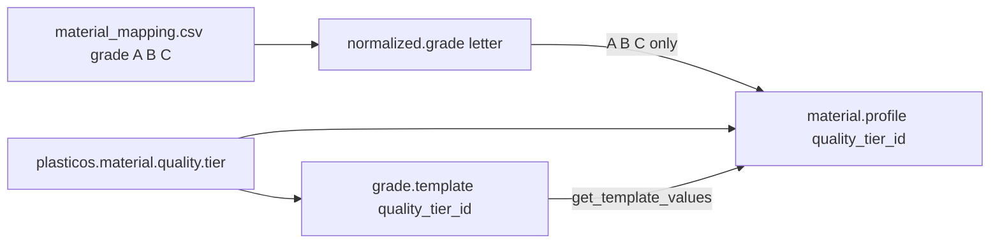

# Single quality-tier master

The label is **Reusable** (code `REUSABLE`). The one-word spelling “Reuseable” is the same value.

Gate `quality_tier` stays a free string on the converge response (`plasticos_gate/services/gate_contracts.py`, `gate_mappers.py`, `plasticos_enrichment/models/enrichment_run.py`, and the contract fixture `"high"`). The dead local-inference write in `enrichment_service.py` is left alone, including the `subgrade` dict key that never reaches the profile.

## Master

New model `plasticos.material.quality.tier` in [plasticos_material_profile/models/material_quality_tier.py](plasticos_material_profile/models/material_quality_tier.py), shaped like [material_grade.py](plasticos_material_profile/models/material_grade.py): `name`, unique `code`, `sequence`, `active`, `description`. `ondelete` is not on this model; the two callers use `ondelete="restrict"`.

Seed file [plasticos_material_profile/data/material_quality_tier_data.xml](plasticos_material_profile/data/material_quality_tier_data.xml), `noupdate="1"`, loaded before [grade_template_data.xml](plasticos_material_profile/data/grade_template_data.xml):

- Grade A / `GRADE_A`
- Grade B / `GRADE_B`
- Grade C / `GRADE_C`
- Reusable / `REUSABLE`
- Standard / `STANDARD`

A code tuple in `quality_tier_codes.py` stays equal to that file, same lock as [grade_codes.py](plasticos_material_profile/grade_codes.py). Letter map used by the CRM import: `A` → `GRADE_A`, `B` → `GRADE_B`, `C` → `GRADE_C`.

ACL matches material grade: `base.group_user` read, `base.group_system` full. Read the current [ir.model.access.csv](plasticos_material_profile/security/ir.model.access.csv) before adding rows. List view and a Configuration menu sit beside Material Grades. Import the model from [models/__init__.py](plasticos_material_profile/models/__init__.py).

## Fields

Replace both Selection fields with `quality_tier_id` → `plasticos.material.quality.tier`.

- [grade_template.py](plasticos_material_profile/models/grade_template.py): `get_template_values()` copies `quality_tier_id`.
- [material_profile.py](plasticos_material_profile/models/material_profile.py): delete `sub_grade`. Show `quality_tier_id` on the Profile page where the hidden `sub_grade` sits in [material_profile_views.xml](plasticos_material_profile/views/material_profile_views.xml).
- [grade_template_views.xml](plasticos_material_profile/views/grade_template_views.xml): list and form use the many2one. Drop the Prime filter. The Grade A filter matches `quality_tier_id.code = GRADE_A`.
- [grade_template_data.xml](plasticos_material_profile/data/grade_template_data.xml): `standard` and `grade_a` become refs to Standard and Grade A. That file is `noupdate="0"`, so upgrade rewrites the seeded templates.

The normalizer keeps returning the phrase-sheet letter. It does not resolve the master. [test_material_normalizer.py](plasticos_material_profile/tests/test_material_normalizer.py) stays on `result.grade`.

## CRM import

In [orchestrator.py](plasticos_crm_sync/services/orchestrator.py) `_write_profile_classification`:

- Empty `quality_tier_id` and letter `A`, `B`, or `C` sets the matching master record.
- A stored tier whose code disagrees with that letter is left as stored, with the same conflict error.
- Any other letter is not written.

`_preexisting_supersac_profile` stops reading `sub_grade`. The `freeform_notes` scan stays. Supersac text is not a quality tier.

[test_orchestrator_upsert.py](plasticos_crm_sync/tests/test_orchestrator_upsert.py) asserts `quality_tier_id.code` (`GRADE_A`, `GRADE_C`, or empty) instead of `sub_grade` `"A"` / `"C"`.

## Upgrade

Bump [plasticos_material_profile/__manifest__.py](plasticos_material_profile/__manifest__.py) from `19.0.5.12.1` to `19.0.5.13.0` and [plasticos_crm_sync/__manifest__.py](plasticos_crm_sync/__manifest__.py) from `19.0.1.9.28` to `19.0.1.9.29`. The commit-stage README version hook rewrites the module README it names; stage that file with the manifest.

Migration `migrations/19.0.5.13.0/`:

- pre-migrate copies `quality_tier` and, on profiles, `sub_grade` into a temporary table before Odoo drops those columns.
- post-migrate, after the seed exists:
  - Grade templates: `grade_a` → Grade A, `grade_b` → Grade B, `standard` → Standard. Prime, Economy, and anything else stay empty.
  - Profiles: letter `A`/`B`/`C` wins, because that hidden field is the letter store. If there is no letter, `grade_a` / `grade_b` / `standard` map the same way. Prime, Near Prime, Economy, and Unknown become empty.
  - Profile `sub_grade` text that is not `A`, `B`, or `C` is appended to `freeform_notes` when that note is not already there, so a preexisting supersac phrase remains visible to the notes scan.

Replace the accepted-decision paragraph in [workflow_state.md](workflow_state.md) that says no quality-tier master is added. The new paragraph names the master and the five codes.

## Left unchanged

- Gate converge `quality_tier` and its `"high"` contract test.
- `enrichment_service.py` local inference and the `subgrade` dict key.
- Phrase-sheet column `grade` and `normalized.grade`.

## Build evidence (auto)

- detected_at: `2026-11-12T17:56:07Z`
- conversation_id: `ec9b4db3-bd73-4894-9ef0-72858142aee9`
- generation_id: `1e3d50f1-1097-4559-a5b9-d59cac8da89f`
- transcript: `/Users/ib-mac/.cursor/projects/Users-ib-mac-IB-Odoo-19-LOCAL-IB-Odoo-19/agent-transcripts/ec9b4db3-bd73-4894-9ef0-72858142aee9/ec9b4db3-bd73-4894-9ef0-72858142aee9.jsonl`
- todos at build time:
- `master`: completed
- `fields`: completed
- `crm`: completed
- `migrate`: completed
