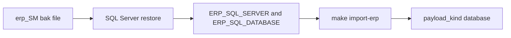

# Realign the rehearsal with the ERP import

Architecture is already settled. ADR-021 and [`plasticos_partner_import/erp/reader.py`](plasticos_partner_import/erp/reader.py) are the source contract. No new reader, no grid fallback, no direct `.bak` parser.

## Source chain

The importer never opens the `.bak`. [`12_GO_LIVE_SOURCE_CHAIN.md`](docs/campaigns/_Document%20Blob%20Imports/ERP-DOCUMENT-RECOVERY-001/12_GO_LIVE_SOURCE_CHAIN.md) already says the backup is the restore input and `make import-erp` reads the database that restore created. With `ERP_SQL_SERVER` and `ERP_SQL_DATABASE` unset, `load_payload()` falls through to the frozen grid under `erp_extracted_data/bulk/`. That grid is a regression fixture, not a rehearsal source.

## Where the kit drifted

- [`tests/production-rehearsal/erp_slice.sh`](tests/production-rehearsal/erp_slice.sh) and [`SPEC.md`](tests/production-rehearsal/SPEC.md) already refuse the gate when those two variables are unset. Today's run stopped there. That refusal stays.
- [`tests/production-rehearsal/README.md`](tests/production-rehearsal/README.md) says the variables are optional and that the gate uses the CSV grid by default, then refreshes CSVs from a new `.bak`. That paragraph is the drift. The 2026-11-05 evidence recorded a grid run as a pass after the Linux full-text restore of `erp_SM_2026-10-03.bak` failed. Leave that evidence folder as history.
- The machine summary at `ERP_REPORT_PATH` cannot gain `payload_kind`. [`scripts/validate_import_summary.py`](scripts/validate_import_summary.py) rejects extra keys. The report already carries `payload_kind` and `source_origin` ([`erp/report.py`](plasticos_partner_import/erp/report.py)), but [`_write_census`](plasticos_partner_import/scripts/run_erp_import.py) drops both when it writes the `<report>-census.json` sibling.

## Changes

1. In `_write_census`, add `payload_kind` and `source_origin` from the import result. Do not add them to the shared summary.
2. Bump [`plasticos_partner_import/__manifest__.py`](plasticos_partner_import/__manifest__.py) from `19.0.2.10.34` to `19.0.2.10.35`. The script is read from the mounted tree, so this does not need a migration or `make update-all`.
3. In `erp_slice.sh`, after the existing census math, read `
-census.json` and fail unless `payload_kind` is `database`. `grid` and `statements` are failures, not passes. Keep the existing unset-variable block. Do not set `ERP_PAYLOAD_ROOT`, `ERP_PRODUCTION_PERMIT`, `PARTNERS_ONLY`, or `ERP_REQUIRE_EMPTY=0`.
4. Rewrite the README "Optional / go-live only" paragraph so it states the restore chain: the `.bak` is restored into SQL Server, and the two variables name that database. Delete the claim that the gate uses the CSV grid or that go-live refreshes CSVs.
5. Add the same `payload_kind == database` acceptance line to [`SPEC.md`](tests/production-rehearsal/SPEC.md). [`expected/blockers.yaml`](tests/production-rehearsal/expected/blockers.yaml) stays as named stops beyond the wired end. A grid read is not added there.

## Proof

A pure pytest, next to the existing ERP summary tests, writes a temp census through `_write_census` and checks the two new fields. A second assertion fails if the README still says the gate uses the CSV grid by default, and fails if `erp_slice.sh` no longer requires `payload_kind` `database`.

## Out of scope

- Restoring a `.bak`, choosing a SQL host, or writing `ERP_SQL_*` into `.env.local`. The Linux full-text catalog failure on the October 3 backup stays an operator restore problem. This plan does not claim that restore works.
- Re-running the rehearsal. Gate 6 remains blocked until those variables name a restored database.
- The Gate 5 `odoo.tools` crash, VanillaSoft, and the 2026-11-05 evidence files.
- `AGENTS.md`. It already says the SQL database is the runtime source and the grid is a fixture.

## Build evidence (auto)

- detected_at: `2026-11-06T19:03:27Z`
- conversation_id: `844a066e-f5ef-49d9-9116-466ce9f65ea7`
- generation_id: `3f76f2e9-9cd7-45c6-983f-d49d3c234836`
- transcript: `/Users/ib-mac/.cursor/projects/Users-ib-mac-IB-Odoo-19-LOCAL-IB-Odoo-19/agent-transcripts/844a066e-f5ef-49d9-9116-466ce9f65ea7/844a066e-f5ef-49d9-9116-466ce9f65ea7.jsonl`
- todos at build time:
- `census-source`: completed
- `gate-refuse-grid`: completed
- `readme-spec`: completed
- `proof`: completed
