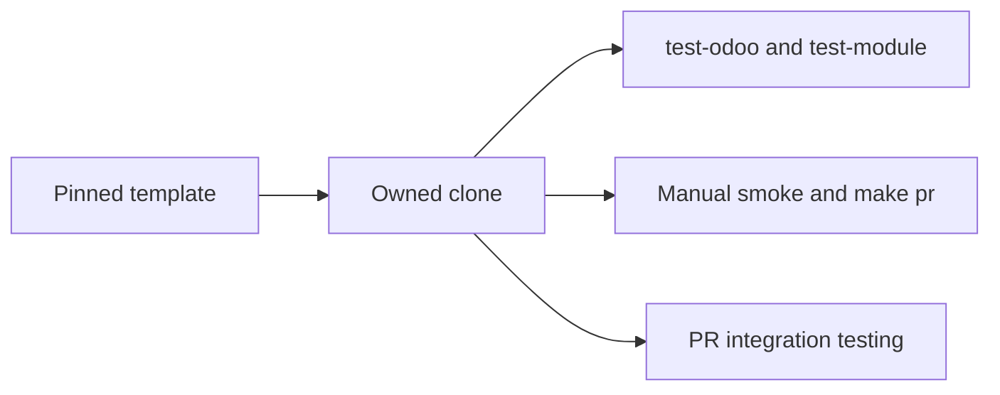

# Repair the Odoo test fixture

The template `odoo_test_tpl_ee_c9e8a81f52f23680` exists and is ready (US company, 170 modules, built 2026-10-27). Nothing that is supposed to be fast is allowed to clone it.

## What is broken

Admission and use are three different mechanisms, and only the first one is the fixture.

- [`scripts/test_env.sh`](scripts/test_env.sh) `certify_pinned_fixture` will re-stamp the template only when some checkout has an inputs file whose sha256 equals the fingerprint on the database comment. The comment is `fp=840872d079d2c0ef…`. The only file, [`.l9/runtime/test-env/odoo_test_tpl_ee_c9e8a81f52f23680.inputs.txt`](.l9/runtime/test-env/odoo_test_tpl_ee_c9e8a81f52f23680.inputs.txt), hashes to `c9e8a81f…` (the fingerprint in the database name). The script stops there, says "unproven", and never names the changed input. [`tests/test_test_env_safety.py`](tests/test_test_env_safety.py) `test_inputs_file_that_does_not_hash_to_the_fixture_fp_is_not_proof` keeps that file from being treated as proof. Do not weaken that.
- The surviving file matches current modules, config digest, and Postgres 15. The live `odoo19-odoo` image does not: recorded `content:aea60f93…`, live content hash `11597065…`, image created `2026-11-04T17:24:12Z`. Enterprise gitdir points at `/home/odoo/.repositories/enterprise/worktrees/19.0`, so every fingerprint falls through to a full tree walk. A real image change cannot be repaired in place: [`.cursor/rules/36-plasticos-docker-test-fixture.mdc`](.cursor/rules/36-plasticos-docker-test-fixture.mdc) forbids `TEST_ENV_ALLOW_NEW_TEMPLATE` for an image rebuild, and the script will not rebuild a database that is present.
- Smoke does not use the fixture. [`scripts/install_smoke.sh`](scripts/install_smoke.sh) drops `odoo_install_smoke` and runs `-i` for the full module list on every uncached run. [`scripts/pr_check_run.sh`](scripts/pr_check_run.sh) leaves that path off unless `INSTALL_SMOKE_GATE=1`, which is why `make pr` printed "full install-smoke is optional".
- [`l9-pr-integration-testing`](file:///Users/ib-mac/Cursor-Governance/skills/l9-pr-integration-testing/references/adapters.md) says no Odoo runtime adapter is claimed. Its quick path uses a no-network toolchain image that does not contain this fixture. For this repo the verified command has to be `scripts/test_env.sh` against [`config/test_env_fixture.conf`](config/test_env_fixture.conf).

Architecture is already settled: one admitted template, one clone per run. This repair does not add a database. It does not go on PR #361 or #362. Branch from `Staging`.

## Admission

In `certify_pinned_fixture`, keep the rule that only an inputs file hashing to the comment fingerprint can re-stamp. When that file is absent and the name-generation file exists, diff it against current inputs, ignore a legacy `addons=` line, and refuse with the changed keys (`image`, `postgres`, `modules`, `config`, `enterprise`) plus the rebuild command. Exit 2. No `DROP`, `CREATE`, or `COMMENT ON` on that path.

Add `make test-env-rebuild` as a new Makefile target (the Makefile is append-only; do not rewrite the `install-smoke` or `test-odoo` recipes). The target refuses when the template is already admitted for the current inputs. Otherwise it drops only `odoo_test_tpl_ee_c9e8a81f52f23680` and its build database, sets `TEST_ENV_ALLOW_NEW_TEMPLATE` to that exact name, and runs `scripts/test_env.sh template`. Update rule 36 so this target is the operator recovery for image, Postgres, roster, config, or Enterprise drift, and an ad hoc setting of the variable during a feature change stays forbidden.

Narrow `image_id()` so Compose project labels and Compose version are not part of the hash. Keep the root filesystem layers and the runtime identity (`Entrypoint`, `Cmd`, `Env`, `User`). Recompute the live hash before rebuilding. If the narrowed hash still differs from `aea60f93…`, the template is stale and the rebuild is required. If it matches the surviving file apart from the missing proof generation, stop and report that; do not rebuild a template the narrowed identity still admits only when a hash-matching proof file exists. Today that file does not exist, so a matching narrowed hash still cannot re-stamp. The rebuild remains the unlock.

Cache the Enterprise `tree:` digest in `.l9/runtime/test-env` so a broken gitdir does not walk the Enterprise checkout on every `test-odoo` and smoke. Reuse the cache only while the checkout's newest mtime is unchanged. A changed tree still changes the fingerprint and still requires `make test-env-rebuild`.

On this machine, after that code is in, run `make test-env-rebuild` once. That is the operator decision rule 36 reserves. Do not point tests at `odoo`, `odoo_install_smoke`, or any other template.

## Smoke and make pr

Change [`scripts/install_smoke.sh`](scripts/install_smoke.sh) so the load gate is a clone of the pinned template plus the roster upgrade `scripts/test_env.sh` already performs (`ensure_clone_upgraded`), then the same installed-state checks it uses now. The from-empty `-i` stays inside `test_env.sh template`, which is the slow step that runs only on first admission and on `make test-env-rebuild`.

- Clone name stays inside `test_env.sh` validation (`odoo_test_*`), owned by this worktree, never `odoo` and never the template.
- Keep the smoke lock, the loopback and compose-project checks, and the fatal-log filters.
- Recheck evidence against the template fingerprint and the addon source digest. A matching receipt skips the upgrade. `PR_CHECK_FORCE_SMOKE=1` still upgrades.
- If the template is unproven or incompatible, exit 2 and print `make test-env-rebuild`. Do not fall back to `odoo_install_smoke`.

In [`scripts/pr_check_run.sh`](scripts/pr_check_run.sh), run that smoke when `pr_check_scope.py` says an addon load input or an installer input changed. Docs-only scope, `PR_CHECK_SKIP_SMOKE=1`, and `PR_SMOKE_BYPASS` still skip it. Remove the default-off `INSTALL_SMOKE_GATE` behavior for that scoped case. `make pr` keeps its current scope decision; it does not grow a full `make test-odoo` run.

## This repo's integration testing

The governance skill is a symlink into Cursor-Governance. Change one paragraph in [`adapters.md`](file:///Users/ib-mac/Cursor-Governance/skills/l9-pr-integration-testing/references/adapters.md) under "Odoo addons and PostgreSQL": if the target repo has `config/test_env_fixture.conf`, the only Odoo runtime procedure is that repo's `scripts/test_env.sh` clone and run against the named template, on the host compose stack. Another database, `odoo_install_smoke`, a from-empty install, and the toolchain-image quick path are `BLOCKED` for that runtime. An unproven fixture is `BLOCKED` with `make test-env-rebuild`, not a substitute database.

Record the same command in [`skills/plasticos-odoo-docker-testing/SKILL.md`](skills/plasticos-odoo-docker-testing/SKILL.md) so this repo is the contract the skill is required to read. Append an `AGENTS.md` correction. Do not publish the governance sentence through `make pr`; it belongs to the governance clone.

## Proof

- Extend [`tests/test_test_env_safety.py`](tests/test_test_env_safety.py): a name-generation inputs file with a different comment fingerprint still does not re-stamp; the refusal names the drifted key when that file differs; a hash-matching file with only `addons=` extra still re-stamps; `test-env-rebuild` is refused when the template is already current.
- `make test-env-rebuild` once, then `make test-module m=plasticos_material_profile` on the clone (covers the stacked masters once this branch can see them; on a Staging branch, the module's own tests are enough).
- `make install-smoke` twice: the second run hits the receipt and does not drop or reinstall.
- `INSTALL_SMOKE_GATE` is no longer required for a scoped `make pr-check` smoke. A docs-only scope still skips it.

## Build evidence (auto)

- detected_at: `2026-11-04T18:39:08Z`
- conversation_id: `d9012a4e-3c2d-4e58-91f5-d3f3a9d8d3ff`
- generation_id: `63016b17-9d8e-4057-82ea-8db9914638f4`
- transcript: `/Users/ib-mac/.cursor/projects/Users-ib-mac-IB-Odoo-19-LOCAL-IB-Odoo-19/agent-transcripts/d9012a4e-3c2d-4e58-91f5-d3f3a9d8d3ff/d9012a4e-3c2d-4e58-91f5-d3f3a9d8d3ff.jsonl`
- todos at build time:
- `admission`: completed
- `rebuild-once`: completed
- `smoke`: completed
- `make-pr`: completed
- `integration`: completed
- `proof`: completed
