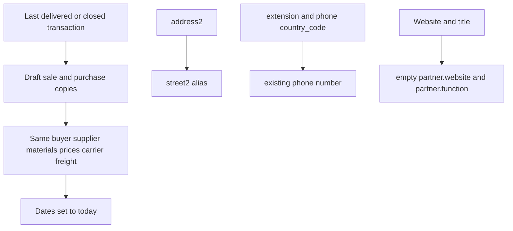

# Close #183 and #299

Both issues close on merge. Branch from current `origin/Staging`. Three open pull requests already target `Staging` independently ([#409](https://github.com/cryptoxdog/IB-Odoo_19/pull/409), [#410](https://github.com/cryptoxdog/IB-Odoo_19/pull/410), [#411](https://github.com/cryptoxdog/IB-Odoo_19/pull/411)), so this pull request does not stack on them. Publish with `make pr`.

## #183 — copy the last deal, change only the dates

Same As Last creates the next deal from the last completed one. Buyer, supplier, materials, buy price, sell price, freight carrier, and freight rate stay the same. Only the dates become today.

[`resolve_sal`](plasticos_logistics/services/sal_resolver.py) does not do this. It only reuses a carrier and a freight rate on a load that already exists, and it skips history that has no `freight_context_fingerprint`. That skip is why loads from before `19.0.1.3.0` never qualify. The new command does not use that fingerprint. The source is the latest `plasticos.transaction` in the same company whose state is `delivered`, `invoiced`, or `closed`.

Add `action_same_as_last` on the existing inherit in [`plasticos_logistics/models/transaction_inherit.py`](plasticos_logistics/models/transaction_inherit.py):

- Copy `sale_order_id` and each `purchase_order_ids` row with Odoo's `copy()`, leaving the copies in draft. Do not confirm them, post an invoice, or copy a payment.
- Set the order dates on those drafts to today. Leave partners, order lines, quantities, and prices as copied.
- Copy the source load's `carrier_id`, `rate_amount`, and `rate_currency_id` onto the new draft load when the source transaction has one load. Do not require `freight_context_fingerprint`.
- Refuse a second click that would copy the drafts just created. Refuse a source that has no sale order or no purchase order.

Leave [`tests/test_sal_resolver_service.py`](tests/test_sal_resolver_service.py) as it is, including `test_candidate_without_booking_fingerprint_is_not_rebuilt_from_live_address`. That test still forbids inventing a booking fingerprint from today's address. Add a logistics test that a delivered transaction with no fingerprint still produces draft copies with the same partners, lines, prices, and carrier, and with today's dates.

Record the operator meaning in [`plasticos_logistics/business_rules/SUPERSESSION.md`](plasticos_logistics/business_rules/SUPERSESSION.md). Do not edit [`BRS-04.md`](plasticos_logistics/business_rules/BRS-04.md). `BRS-04-R023` remains the freight-rate sentence; this command is the date-only deal copy.

Bump [`plasticos_logistics/__manifest__.py`](plasticos_logistics/__manifest__.py) from `19.0.1.14.16` to `19.0.1.14.17`. The pull request body says `Fixes #183`.

## #299 — write the five missing keys

- In [`adapter.py`](plasticos_crm_sync/adapters/vanillasoft/adapter.py), add `address2` as the last `street2` alias. `address_2`, `Address 2`, and `street2` still win when they are non-blank.
- In [`approved_identity.py`](plasticos_crm_sync/services/approved_identity.py) `read_phones`, append a separate `extension` (`x101`) when the number has none inline, so `x101` and `x102` stay distinct. Drop an entry whose separate extension contradicts an inline one. Prefix a phone `country_code` only when the number does not already start with `+` or a country digit. Leave `CanonicalLead.country_code` as the address country.
- Add `website` and `job_title` to [`CanonicalLead`](plasticos_crm_sync/adapters/base.py). Write `website` to `res.partner.website` and `job_title` to `res.partner.function` only when that value is empty. Also write `website` onto the lead when `crm.lead` has that field, and put the title in the lead description so the lead shows it. Do not write `res.partner.title`.

Approved ERP people keep their existing `street2`. This change does not write `street2` onto them. Phone lines stay on `plasticos.partner.phone` with the same columns. No new column, no new model, no crosswalk edit, no watermark move.

Bump [`plasticos_crm_sync/__manifest__.py`](plasticos_crm_sync/__manifest__.py) from `19.0.1.9.23` to `19.0.1.9.24`. Extend [`tests/test_crm_sync_vanillasoft_client.py`](tests/test_crm_sync_vanillasoft_client.py), [`tests/test_crm_sync_classification.py`](tests/test_crm_sync_classification.py), and [`tests/test_crm_sync_completeness.py`](tests/test_crm_sync_completeness.py). The pull request body says `Fixes #299`.

## Proof

- A delivered transaction with no booking fingerprint yields draft sale and purchase copies: same buyer, supplier, materials, and prices; carrier and freight copied; dates are today; nothing is confirmed or posted.
- The old fingerprint test still fails a freight candidate that has no booking fingerprint.
- `address2` fills `street2` only when the earlier aliases are blank. Extension `101` and `102` stay two numbers. A disabled number does not return. Empty `website` and `function` are filled, and a non-empty ERP value is left alone.
- The pull request body contains `Fixes #183` and `Fixes #299`.

## Build evidence (auto)

- detected_at: `2026-11-08T21:48:48Z`
- conversation_id: `827cd55a-c16a-4326-9576-84d5e44c97fd`
- generation_id: `b5ff4af5-915d-48a1-abf3-2fe56bc611d7`
- transcript: `/Users/ib-mac/.cursor/projects/Users-ib-mac-IB-Odoo-19-LOCAL-IB-Odoo-19/agent-transcripts/827cd55a-c16a-4326-9576-84d5e44c97fd/827cd55a-c16a-4326-9576-84d5e44c97fd.jsonl`
- todos at build time:
- `sal-copy`: completed
- `sal-close`: completed
- `vs-address-phone`: completed
- `vs-website-title`: completed
