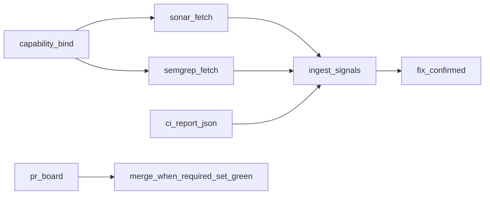

# Sonar and Semgrep as required work

PE+autonomy plan for the operator intent. Depth is **deep** (secret-resolution change plus remediator census). This confirmation plan is not validator-ready: plan mode cannot write `PLAN_DOCUMENT` or run the memory prefetch. Execution emits those artifacts first, then edits.

**MEMORY_PREFETCH:** not cited. `ops/hooks/plan_memory_prefetch.py` writes `.l9/memory/plan-prefetch.json`. First execution step runs it and records `namespace`, `snapshot_digest`, `checked_record_count`, `conflicts`, `policy_version`. A conflict stops the edit.

**Branch:** new branch from fetched `origin/main` (`rules/46-kernel-pack-new-branch.mdc`). Do not mix this onto the current checkout. Entrance is `ops/scripts/worktree_add_wired.sh`, not raw `git worktree add`. Suggested name: `feat/sonar-semgrep-required-work`.

**Execute via** `@environment/program-execution` then subordinate autonomy. `autonomous_merge: false`. Hook catalog for the code change is [`.pre-commit-config.yaml`](.pre-commit-config.yaml).

## What changes

### 1. Refuse the AWS Sonar ref

[`ops/secrets/legacy_refs.py`](ops/secrets/legacy_refs.py) maps `("sonarcloud", "token")` to `SONAR_TOKEN`. Removing only that row is wrong: `env_name()` would then fall through to `SONARCLOUD_TOKEN`, which is not a vault key.

- Add an explicit retired pair. `infisical_name("openclaw-igorbot/sonarcloud#token")` does not return `SONAR_TOKEN` or `SONARCLOUD_TOKEN`.
- [`ops/secrets/capability_bind.py`](ops/secrets/capability_bind.py) `--check` on that ref prints the replacement name `SONAR_TOKEN` with a retired source and exits 1. It does not fetch.
- [`ops/secrets/port_aws_to_infisical.py`](ops/secrets/port_aws_to_infisical.py) skips that pair with a notice and does not create a secret. The AWS object `openclaw-igorbot/sonarcloud` stays. Do not delete it and do not set `enabled: false`.
- Update the registry note in [`ops/secrets/openclaw-igorbot.registry.yaml`](ops/secrets/openclaw-igorbot.registry.yaml) to say agents bind `SONAR_TOKEN` and do not resolve the AWS ref.
- Replace the equality in [`tests/ops/secrets/test_capability_bind.py`](tests/ops/secrets/test_capability_bind.py) line 234. Keep the `SONARCLOUD_TOKEN` environment alias. That alias is an already-present env name, not the AWS ref.

### 2. Census work, not a required check

Today Sonar is already a hard census when [`sonar-project.properties`](sonar-project.properties) exists (`resolve_sonar_snapshot` in [`skills/l9-pr-remediation/scripts/ingest_signals.py`](skills/l9-pr-remediation/scripts/ingest_signals.py)). Semgrep is lazy: only when the check is red ([`skills/l9-pr-remediation/SKILL.md`](skills/l9-pr-remediation/SKILL.md) `semgrep.when`, [`references/semgrep-remediation.md`](skills/l9-pr-remediation/references/semgrep-remediation.md), [`references/remediation-plan.md`](skills/l9-pr-remediation/references/remediation-plan.md)).

- Semgrep is in the census when `.semgrep/` exists or a workflow runs `semgrep scan` (this repo: [`.github/workflows/l9-analysis.yml`](.github/workflows/l9-analysis.yml)).
- `merge_blocking` stays `false`. Do not add either check to branch protection or [`ops/autonomy/pr_board.py`](ops/autonomy/pr_board.py). A green required set can still merge. The agent still fixes every confirmed finding on that head, or writes an explicit deferral. Silence is not done.
- CodeQL and debt stay lazy.
- [`AGENTS.md`](AGENTS.md) §6 stays true: `make pr` does not require `SONAR_TOKEN` or `SEMGREP_APP_TOKEN`. Append one fragment that states the census obligation. Do not rewrite the existing "Not required" sentence. [`INVARIANTS.md`](INVARIANTS.md) row for that sentence stays.

### 3. Detail from the token or the report, not the log

- Sonar check or a configured project: `sonar_fetch.py` via `capability_bind` `SONAR_TOKEN` before `gh run view --log-failed`. Unbound stays the existing unauthenticated public read.
- This repo's L9 Analysis job does not upload to Semgrep Cloud. It writes `artifacts/raw/semgrep/pr-semgrep/report.json`. A red L9 Analysis / Semgrep check is diagnosed from that artifact (`gh run download`, prefix `l9-semgrep-`), not from the log text.
- `SEMGREP_APP_TOKEN`, when bound, is the Cloud findings GET (`semgrep_fetch.py`). It does not replace the CI `report.json`. No `semgrep ci` upload. The child CE scan still unsets the token.
- Unbound Semgrep must not look like a clean pass. `semgrep_fetch.py` writes a receipt with `authenticated: false` and `status: BLOCKED` (findings empty, gap explicit). `ingest_signals.py` requires that receipt, or a PR-bound findings file, the same way Sonar requires a snapshot, and rejects a stale PR binding. `BLOCKED` is a recorded gap, not zero findings to fix. A red check still requires the CI artifact. A network miss is recorded and does not stop the merge train.

## Out of scope

- Flipping Sonar or Semgrep to required checks.
- Making `make pr` fail when either token is unbound.
- Deleting the AWS Secrets Manager object.
- Rewriting historical plans that mention `openclaw-igorbot/sonarcloud#token`.
- Authenticated Semgrep scans.

## Stress

- A `BLOCKED` receipt with `findings: []` must not count as clean. Ingest keeps `status` and a red check still pulls `report.json`.
- Refusing the map row without a retired-pair guard recreates `SONARCLOUD_TOKEN` on the next port. The port skip is part of the same change.
- Semgrep Cloud being down must not stall `open_prs=0`. Record unavailable and continue; do not paste a token.
- Rollback is reverting the branch. No vault write, no protection change, no AWS delete.

## Validation

- `tests/ops/secrets/test_capability_bind.py` for the retired ref.
- `skills/l9-pr-remediation/scripts/self_test.py` after the lazy wording moves.
- Focused pytest for the ingest census and the blocked Semgrep receipt.
- `.pre-commit-config.yaml` hooks on the changed files via the finish path. Do not weaken a scanner to pass.

## Build evidence (auto)

- detected_at: `2026-11-17T22:47:30Z`
- conversation_id: `ad6ae426-8ddd-453a-92f6-5603d9ded6a2`
- generation_id: `7bcab899-7b64-463e-8c9d-83b0289d50cd`
- transcript: `/Users/ib-mac/.cursor/projects/Users-ib-mac-Cursor-Governance/agent-transcripts/ad6ae426-8ddd-453a-92f6-5603d9ded6a2/ad6ae426-8ddd-453a-92f6-5603d9ded6a2.jsonl`
- todos at build time:
- `prefetch-branch`: completed
- `retire-aws-ref`: completed
- `semgrep-census`: completed
- `ci-detail-path`: completed
- `validate`: completed

