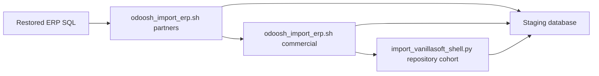

# Staging ERP and CRM import

No edits to [Makefile](Makefile), [plasticos_partner_import/scripts/odoosh_import_erp.sh](plasticos_partner_import/scripts/odoosh_import_erp.sh), [plasticos_partner_import/scripts/import_erp_shell.py](plasticos_partner_import/scripts/import_erp_shell.py), or [plasticos_crm_sync/scripts/import_vanillasoft_shell.py](plasticos_crm_sync/scripts/import_vanillasoft_shell.py). `make import-erp` writes local `ODOO_DB_NAME`. `make import-vanillasoft` always SSHs to `ODOO_SH_PRODUCTION_SSH`, opens `cryptoxdog-ib-odoo-19-production-<bid>`, and writes `ODOO_STAGE=production`. Neither command will be run.

Current Staging identity in `.env.local` (re-read at execution time; build ids rotate):

- SSH: `ODOO_SH_STAGING_SSH` = `40247740@cryptoxdog-ib-odoo-19-staging-40247740.dev.odoo.com`
- Database: `cryptoxdog-ib-odoo-19-staging-40247740`
- Production SSH `29882273@cryptoxdog-ib-odoo-19.odoo.com` is never used

## Identity lock before any write

SSH with `BatchMode=yes` to `$ODOO_SH_STAGING_SSH` only. Abort if that value equals `ODOO_SH_PRODUCTION_SSH`, lacks `-staging-`, or the connected `current_database()` / `ODOO_STAGE` is not the Staging database and `staging`. Confirm the deployed drivers exist at `/home/odoo/src/user/plasticos_partner_import/scripts/odoosh_import_erp.sh` and `/home/odoo/src/user/plasticos_crm_sync/scripts/import_vanillasoft_shell.py`. Use those deployed copies. Do not upload a newer driver.

Read-only census: business `res.partner` rows (same exclusion as the importer: company, users, `l10n_*`), and installed state of the partner-import, sale, purchase, account, and `plasticos_crm_sync` modules. Partners mode refuses a database that already has business partners. If that count is not zero, stop and report it. Do not pass `ERP_REQUIRE_EMPTY=0` on the partners phase and do not drop the database.

## ERP, 100 percent

Run the deployed `odoosh_import_erp.sh` on the Staging host. That script already refuses `ERP_LIMIT`, `ERP_DRY`, `ERP_PAYLOAD_ROOT`, and `ERP_LAYER`, so the run is the full restored SQL source. Do not set `ERP_PRODUCTION_PERMIT`. A permit is valid only when `ODOO_STAGE=production` ([plasticos_partner_import/erp/production_permit.py](plasticos_partner_import/erp/production_permit.py)); Staging must keep the platform value `staging`.

Order, both with `ERP_TARGET_DB` set to the Staging database name:

1. `partners` (`ERP_PARTNERS_ONLY=1`, empty-target guard on)
2. `commercial` (the script sets `ERP_REQUIRE_EMPTY=0` and runs sale orders, purchase orders, and invoices)

Source is the restored ERP database (`ERP_SQL_SERVER`, `ERP_SQL_DATABASE`, `ERP_SQL_USER`, `ERP_SQL_PASSWORD`, port `14330`, driver `pymssql`). The password stays in the SSH process environment and is never printed or written into the repo. Odoo.sh cannot see the local `cie-sql-proof` container, so this session opens a reverse tunnel from the Staging host back to `127.0.0.1:14330` and points `ERP_SQL_SERVER` at that tunnel. Preflight a connect and `import pymssql` on the Staging host. If either fails, stop. Do not pip-install on the host and do not fall back to the frozen grid.

Copy the JSON reports and logs back to `.l9/pr/import-erp-staging-partners.json` and `.l9/pr/import-erp-staging-commercial.json`. Success is the driver’s own `DATA VERDICT` with exit 0, not merely a closed SSH session.

## CRM, same repository cohort, Staging host only

Do not call `make import-vanillasoft`. Replay its remote steps by hand against Staging:

- Database `cryptoxdog-ib-odoo-19-staging-40247740`
- Leave `ODOO_STAGE` as `staging`. Do not export `production` and do not set `VANILLASOFT_PRODUCTION_CONFIRM`
- No permit file. Off production, `_verified_permit` already returns no permit ([plasticos_crm_sync/scripts/import_vanillasoft_shell.py](plasticos_crm_sync/scripts/import_vanillasoft_shell.py))
- Export: `plasticos_crm_sync/Vanillasoft-Scrap-Management.csv`, copied to a `0700` work dir under the Staging home and removed after the run
- New ledger `.l9/pr/vanillasoft-staging-ledger.jsonl`. Do not open `.l9/pr/vanillasoft-production-ledger.jsonl`
- No `VANILLASOFT_HISTORY_MAX_IDS` and no call floor, so the cohort is the full export
- If the VanillaSoft API key parameter on Staging is empty, fill it from `VANILLASOFT_API_KEY` the way the driver already does. Do not print the key. Delete the remote env file when the shell exits
- If `plasticos_crm_sync` is not installed, stop. Do not install it from this session

The repository cohort still calls `_require_partners_witness`, and that witness is written only by a production permit’s `finish()`. A Staging ERP run does not write `plasticos_partner_import.production_phase1_witness`. The unmodified driver will then refuse with “no committed erp_partners phase on this database” and import nothing. That refusal stands. Do not insert the witness, do not spoof `ODOO_STAGE=production`, and do not patch the driver.

## Runtime

Both shells stay attached. ERP and the contact-by-contact cohort can take hours. SSH keepalive matches the production recipe (`ServerAliveInterval=30`, `ServerAliveCountMax=720`). A dropped CRM session can resume on the same Staging ledger and census. A partners phase that already committed business partners cannot be restarted; commercial can, because that mode allows a populated partner set.

## Build evidence (auto)

- detected_at: `2026-11-11T15:25:19Z`
- conversation_id: `c3e9ea7d-58fe-42ee-86d5-d67918a7de9e`
- generation_id: `914f37e3-11b2-42f1-815f-f44fdf72023b`
- transcript: `/Users/ib-mac/.cursor/projects/Users-ib-mac-IB-Odoo-19-LOCAL-IB-Odoo-19/agent-transcripts/c3e9ea7d-58fe-42ee-86d5-d67918a7de9e/c3e9ea7d-58fe-42ee-86d5-d67918a7de9e.jsonl`
- todos at build time:
- `preflight`: completed
- `erp-full`: cancelled
- `crm-cohort`: cancelled
