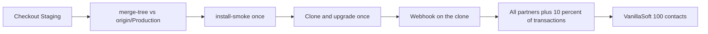

# Staging promotion rehearsal on the fixture clone

Architecture is already settled. This run uses the admitted fixture, `scripts/test_env.sh`, and the existing ERP and VanillaSoft importers. It does not add a module, bump a version, open a pull request, or write a production permit.

The execution contract for this plan is [`.cursor-commands/kernels/Validate & Repair.md`](.cursor-commands/kernels/Validate%20&%20Repair.md). This revision repairs the plan. It does not run the rehearsal. Runtime evidence stays Unknown until a later execution.

## What this is

A local rehearsal of the Staging tip that would be promoted, then a bounded data load on a disposable clone. It is not the promotion. The verdict is `ready` only when every required step below is Passed. An expected web-lead stop listed in `expected/blockers.yaml` is a finding, not a failure. A missing credential, a failed smoke, or a failed import is not `ready`.

## Planning baseline, not the repeat contract

Observed while this plan was written. `run.sh` reads the live values and does not require these snapshots.

- Local branch was `docs/brs-documents-logistics-ownership`, with one untracked campaign file. That file stays untracked.
- `origin/Staging` was `f4938b63`. `origin/Production` was `3318fa64`. Staging was 447 commits ahead, and Production had 1 commit not in Staging.
- Docker was up. Template `odoo_test_tpl_ee_c9e8a81f52f23680` was ready. Worktree owner was `w2495f48767`, so the default clone name was `odoo_test_w2495f48767`.

The repeat identity is whatever `git rev-parse` and `scripts/test_env.sh name` print at the start of the run. Do not bake the owner hash into an assertion. Cloning the default name would drop that existing worktree clone, so the data target stays `odoo_test_cutover`. [`scripts/test_env.sh`](scripts/test_env.sh) refuses any clone name containing `prod` or `staging`. Leave `ODOO_STAGE` unset. Do not pass `ERP_PRODUCTION_PERMIT`.



Web lead stays before ERP. The empty-partner census is only true on the fresh clone. VanillaSoft starts only after ERP passes, because contact placement resolves against imported partners.

## Repeatable kit

All rehearsal components go in [`.cursor-commands/tests/production-rehearsal/`](.cursor-commands/tests/production-rehearsal/). That tree is the governance checkout, not a PlasticOS addon. `make commit` in this repo omits `.cursor-commands`, so the kit is not published by `make pr`.

`run.sh` locates the PlasticOS root by finding `scripts/test_env.sh` and `config/test_env_fixture.conf`. It refuses to run when that root is missing. It does not assume the governance checkout is the addon tree.

| File | Role |
|---|---|
| `README.md` | When to run it, the verdict rule, and what it refuses. |
| `SPEC.md` | Live identity probes, fixture, clone name, limits, secret handling, webhook contract, pass rules, blocker catalog. |
| `run.sh` | The only entrypoint. Checkout check, merge-tree, one install-smoke, clone, one upgrade, web-lead e2e, ERP slice, then VanillaSoft if ERP passed. |
| `payloads/cognito_hot.json` | The HOT body copied from `plasticos_web_leads/tests/test_web_lead_material_grade.py`. |
| `weblead_e2e.sh` | HTTP POST bound to the cutover clone, then the record assertions and the blocker report. |
| `erp_slice.sh` | The empty-partner census and one `LIMIT=10%` import through `test_env.sh run`. |
| `crm_100.py` | One page of VanillaSoft upserts through `SyncOrchestrator`. It does not call `run_full_import`. |
| `expected/blockers.yaml` | The stops that are findings, not failures. A repeat diffs against this list. |

`run.sh` calls `scripts/test_env.sh clone odoo_test_cutover` and then `scripts/test_env.sh upgrade odoo_test_cutover` once. Later `run` commands skip that upgrade when the clone comment `src=` already matches the addon digest. Clone drops and recopies only `odoo_test_cutover` from the admitted template. If `scripts/test_env.sh status` does not say the template is ready, the kit stops and names `make test-env-rebuild` as operator recovery. It does not set `TEST_ENV_ALLOW_NEW_TEMPLATE` and it does not call rebuild itself. Summaries stay under `.l9/pr/` and are not committed. No secret is written into the kit.

## 1. Switch to Staging

`git checkout Staging` and confirm `git rev-parse --abbrev-ref HEAD` is `Staging` and `HEAD` equals `origin/Staging` at that moment. Do not pull, commit, or discard the untracked campaign file. Record the live SHAs in the run report.

## 2. Promotion check, no write to Production

Record `git rev-parse origin/Production` before the check. Run a read-only `git merge-tree` of `origin/Production` and `origin/Staging`. Conflicted paths are a finding. They do not authorize a merge, and they do not by themselves stop the data load. A merge-tree command that does not finish stops the run. Confirm `origin/Production` is still the SHA recorded at the start. No checkout of Production, no push, no `make pr`.

## 3. Load Staging on the fixture, once

`make install-smoke` is the load gate from `skills/plasticos-odoo-docker-testing`. It clones the pinned template onto the worktree smoke database (`scripts/test_env.sh smoke-name`) and upgrades the PlasticOS roster from the Staging worktree. Success is the line `install-smoke PASSED`. If it fails, the verdict is `failed` and the data load does not start. Do not point smoke at `odoo`, `odoo_install_smoke`, or a new template. Do not run smoke a second time in the same rehearsal.

Attached wait must cover the smoke run. Do not start it in the background. A handoff kill is `Terminated: 15`, and a killed upgrade is not resumed.

## 4. Fresh cutover clone, one upgrade

`bash scripts/test_env.sh clone odoo_test_cutover`, then `upgrade`, then `assert-clone`. The comment must show `role=clone`, the live owner from `scripts/test_env.sh name`, and `template=odoo_test_tpl_ee_c9e8a81f52f23680`. The template row stays `state=ready`.

This upgrade is the roster load for the data clone. It is a different database from the smoke clone. The import and webhook commands that follow must not upgrade the roster again when `src=` already matches.

Before any ERP write, census `res.partner` with the same exclusion the importer uses in [`plasticos_partner_import/scripts/import_erp_shell.py`](plasticos_partner_import/scripts/import_erp_shell.py) (company, users, and `l10n_*` reference partners). If that extra count is not zero, ERP is `blocked`. Do not set `ERP_REQUIRE_EMPTY=0`.

## 5. Web lead, webhook to the last wired record

After the one upgrade, start Odoo through `scripts/test_env.sh run odoo_test_cutover` so the harness appends `-d odoo_test_cutover`. Bind HTTP to `127.0.0.1` on a rehearsal port that is not `8069`. Stop that process when the assertions finish. Do not POST to the compose business database.

The body is the existing proven payload in [`plasticos_web_leads/tests/test_web_lead_material_grade.py`](plasticos_web_leads/tests/test_web_lead_material_grade.py): company `Grade Co`, material `HDPE plastic pallets`, source `Manufacturing production scrap`, quantity `2 loads per month`, weight `40000 lbs`, contaminants `none`, and no photos. Give `Entry.Number` a new value for the run. Set `ai_enabled` and `vision_enabled` false on the clone config. Do not mock `evaluate_economic_opportunity`. A cold decision is a failure of this step, not a reason to stub the classifier.

POST once to `/api/v1/cognito-webhook` with a bearer written only on the clone's `plasticos.web.lead.config`. POST the same body again and require the same `web_lead_id`. The bearer is not a production secret, is not printed, and is not stored in the kit.

The automatic path is: admit, classify, and for HOT create `plasticos.intake` with no partner, then [`plasticos_crm_bridge/models/web_lead.py`](plasticos_crm_bridge/models/web_lead.py) creates one `crm.lead` in the seeded New stage, unassigned, with no partner. Review is an Odoo activity, or `mack_review_state=blocked` when no internal reviewer is configured. That method does not call Mack, matching, email, or a commercial document.

Pass when the HTTP body is `status=ok` and the clone has all of:

- `plasticos.web.lead` with `decision=hot` and `state=intake_created`
- `plasticos.intake` linked from that lead, `partner_id` empty, `pending_company_name` set
- `crm.lead` linked from that lead, New stage, `user_id` empty, `partner_id` empty

`state=error` or a missing intake is a failure. Do not edit `web_lead.py`, the write or unlink guards, or `_find_or_create_partner()`.

These stops are recorded in the blocker report and matched to `expected/blockers.yaml`. They are not failures:

- No `res.partner` is created. Partner creation waits for an explicit buyer-match action.
- No material profile is created on this path.
- `action_match_to_buyers` is not called. Matching needs `GATE_URL` and a company, and Gate web-lead triage stays Phase 3.
- No `plasticos.offer` and no `plasticos.transaction` from this webhook.
- n8n and the live Cognito form are outside this repo and are not called.

## 6. ERP, every partner and 10% of transactions

One import. Do not run partners and commercial documents as two passes. [`plasticos_partner_import/models/erp_import_service.py`](plasticos_partner_import/models/erp_import_service.py) always reads every counterparty, address, contact, role, and salesperson. `LIMIT` is applied only when [`plasticos_transaction/models/native_document_import.py`](plasticos_transaction/models/native_document_import.py) selects worksheets. `LIMIT=10%` keeps the newest tenth of those worksheets, plus pinned worksheet `58699` when the source contains it.

```bash
bash scripts/test_env.sh run odoo_test_cutover -- \
  make import-erp ODOO_DB_NAME=odoo_test_cutover \
  LIMIT=10% REPORT_PATH=.l9/pr/rehearsal-erp-summary.json
```

Direct SQL is the source. `ERP_SQL_SERVER` and `ERP_SQL_DATABASE` must already be in the environment. Check that they are non-empty and do not print them. If they are missing, ERP is `blocked` and VanillaSoft does not start. Do not fall back to the frozen grid. Do not pass `ERP_PRODUCTION_PERMIT`, `PARTNERS_ONLY`, or `ERP_REQUIRE_EMPTY=0`.

Pass when the summary exists, `duplicates == 0`, `records_seen == records_created + records_updated + records_unchanged + records_rejected`, and the printed `DATA VERDICT` is not a refusal. A validator failure rolls the run back. This slice is the promotion proof. It is not a full historical load.

## 7. VanillaSoft, 100 contacts, only after ERP passes

If ERP is not Passed, this step is `blocked` and nothing is written.

`make import-vanillasoft` calls `run_full_import`, which has no contact cap and then pulls call history from the floor. `CONTACT_PAGE_SIZE` is 200. `test_env.sh` will not forward `VANILLASOFT_HISTORY_MAX_IDS`. `crm_100.py` is piped into `scripts/test_env.sh run odoo_test_cutover -- shell`. It calls the existing `SyncOrchestrator` upsert for one page with `limit=100` and `modified_after` of `2019-01-01T00:00:00Z`. It must not call `run_full_import`, and it must not copy importer logic into a second implementation. The summary at `.l9/pr/rehearsal-vanillasoft-summary.json` must say the cap is 100 and `records_seen <= 100`.

Preflight, before any CRM write: `plasticos_crm_sync.vanillasoft_api_key` must be set on the clone and the root must be HTTPS. If the clone has no key, copy that ICP row from the local compose database `odoo` inside Docker without printing the value and without writing it into the kit or the summary. If neither database has it, this step is `blocked`.

## Verdict

| Verdict | Rule |
|---|---|
| `ready` | Checkout, merge-tree command, install-smoke, clone upgrade, web lead, and ERP are Passed, and VanillaSoft is Passed. Expected web-lead blockers match `expected/blockers.yaml`. |
| `blocked` | A required credential or a non-empty partner census stopped a write, and no required step Failed. |
| `failed` | Smoke, webhook admission, classification, or an import validator failed, or a command did not finish. |

Do not report `ready` when a required step is `blocked` or `failed`.

## Out of scope

- Merging Staging into Production, Odoo.sh, `ODOO_STAGE=production`, or a production permit.
- `make test-env-rebuild`, a new template, or `TEST_ENV_ALLOW_NEW_TEMPLATE`.
- A second ERP pass, a second install-smoke, a full historical transaction load, call history, or the frozen 4,876-contact census.
- Addon edits, version bumps, and publication. The kit does not change `plasticos_web_leads`.
- Calling n8n, the live Cognito form, Gate, or `action_match_to_buyers`.
- Mocking `evaluate_economic_opportunity` or weakening the web-lead guards.

## Evidence to report

Live Staging HEAD, live `origin/Production` SHA before and after merge-tree, merge-tree result, install-smoke line, cutover clone comment including `src=`, web-lead ids through `crm.lead`, the blocker report against `expected/blockers.yaml`, ERP `DATA VERDICT` and the balance equation, VanillaSoft seen count at or under 100 or an explicit `blocked`, confirmation the template is still the admitted fixture, and the verdict.

## Build evidence (auto)

- detected_at: `2026-11-05T19:58:52Z`
- conversation_id: `74157114-8c7d-4158-8885-7f120d3bb588`
- generation_id: `2b96fcea-1d07-4023-ba2e-a415b392d4a1`
- transcript: `/Users/ib-mac/.cursor/projects/Users-ib-mac-IB-Odoo-19-LOCAL-IB-Odoo-19/agent-transcripts/74157114-8c7d-4158-8885-7f120d3bb588/74157114-8c7d-4158-8885-7f120d3bb588.jsonl`
- todos at build time:
- `checkout-staging`: completed
- `promotion-mergetree`: completed
- `install-smoke`: completed
- `clone-cutover`: completed
- `rehearsal-kit`: completed
- `weblead-e2e`: completed
- `erp-slice`: completed
- `crm-100`: completed
