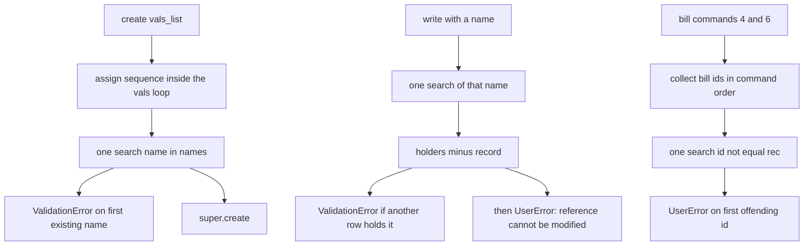

# Hoist transaction uniqueness searches

Gap fill of this plan against `kernels/Validate & Fill Gaps.md` (extends Validate & Repair). The code change is the same hoist. The filled gaps are the audit command, the fingerprint proof, the test base class, and the commit boundary. Code is not changed by this revision.

## What is wrong

[`extended_audit_report.json`](extended_audit_report.json) and `odoo_audit_report.json` are gitignored evidence (`.gitignore` lines 53–54). The extended report flags four `N_PLUS_ONE_QUERY` hits in [`plasticos_transaction/models/transaction.py`](plasticos_transaction/models/transaction.py). Fingerprints (type + file + source line) collapse them to the three HIGH rows in [`ci/baselines/extended_audit_baseline.json`](ci/baselines/extended_audit_baseline.json). The same four calls are on `origin/Staging` (`886194a71f49e486f58e66cb6d6b124a33ce1cdd`) at the same lines. [`plasticos_transaction/__manifest__.py`](plasticos_transaction/__manifest__.py) there is `19.0.2.3.51`. `transaction.py` on the current worktree matches that ref.

- `caa3abf62f585448` — `create()` line 951, `self.search([("name", "=", name)], limit=1)` inside the `vals_list` loop
- `cf9d3c92beb48062` — `write()` line 961, per-record name search
- `5dfba50bcb1ed1f0` — both bill searches at lines 1034 and 1042, because both source lines are `other = self.search(`

Out of scope, and not findings: `sale_inherit.py`, `transaction_import_service.py`, and the cron searches at lines 1415 and 1484 (already outside any loop). The scanner in [`scripts/audit/performance_audit.py`](scripts/audit/performance_audit.py) is not edited. A nested `FunctionDef` inside a loop is skipped by that scanner; do not put `search()` in one.

## Ownership

`models.Constraint("unique(name)")` at line 510 is the integrity owner. The Python searches are preflight messages, not a second integrity owner. Keep them.

- `create()` skips the preflight when the name is empty or `"New"`. A duplicate `"New"`, and a batch whose only collision is inside the batch, still reach the SQL constraint. Those paths raise the constraint message, not `Transaction reference '{name}' already exists.`
- `write()` runs the name preflight before `_validate_write_immutability`. A colliding rename raises `ValidationError`. A free rename then raises `UserError: Transaction reference cannot be modified.`
- `_validate_bill_uniqueness` only inspects command opcodes `4` and `6`. It does not gain parsing for missing `cmd[2]`, other opcodes, or a shared write-path API.

## Behavior that must stay



- Sequence assignment stays inside the first `create()` loop. The existence search runs once after names are final, outside any `for`.
- `write({"name": ...})` on a recordset where one member already holds that name must still raise `ValidationError`. `("id", "not in", self.ids)` hides that case. Use one search, then `holders - record` inside the record loop, with no `search()` call in that loop.
- Bill checks: collect ids from opcodes `4` and `6` in existing command order, one `search` per `_validate_bill_uniqueness` call, then raise on the first collected id that another transaction already holds. Exclude `rec`. `write()` still calls this helper once per record per field. That remaining per-record query is outside the scanner's same-function loop rule. Success is no `N_PLUS_ONE_QUERY` whose file is `transaction.py`, not one query per `write()`.

## Files in the commit

Exactly these five paths:

- [`plasticos_transaction/models/transaction.py`](plasticos_transaction/models/transaction.py)
- [`plasticos_transaction/__manifest__.py`](plasticos_transaction/__manifest__.py) — `19.0.2.3.51` to `19.0.2.3.52`. No migration. Re-read the version on the new branch before editing; the bump base is whatever that branch has, which is `19.0.2.3.51` on the inspected `origin/Staging`.
- [`plasticos_transaction/tests/test_uniqueness_batch.py`](plasticos_transaction/tests/test_uniqueness_batch.py)
- [`plasticos_transaction/tests/__init__.py`](plasticos_transaction/tests/__init__.py) — append `from . import test_uniqueness_batch` in the existing style. Do not reorder the other imports.
- [`ci/baselines/extended_audit_baseline.json`](ci/baselines/extended_audit_baseline.json) — delete the three fingerprints after the fingerprint assertion shows them stale, and add one sentence to `_root_cause`. The file must stay valid JSON.

`extended_audit_report.json` and `odoo_audit_report.json` stay untracked. Do not `git add -f` either. `AGENTS.md` stays unchanged: it is append-only, and the baseline file is the gate. Accepted risk, not a follow-up edit.

## Tests

Subclass [`PlasticosTestCase`](plasticos_base/test_common.py), the base that [`plasticos_transaction/tests/test_compliance_does_not_post.py`](plasticos_transaction/tests/test_compliance_does_not_post.py) uses to create `account.move`. Do not call `_skip_if_model_missing`. Vendor bills use that file's `account.move` create with `move_type` `in_invoice`. If the company has no purchase journal, create one in `setUpClass`.

Names under test are values this test has searched and found absent, so seed data cannot collide with them.

- Batch `create` of a new name plus an existing name raises `ValidationError` with `already exists`, and a following search shows the new name absent and the existing name still at count 1. This call raises before `super().create`.
- Do not use an intra-batch-only collision as that assertion. That collision is the SQL constraint, and its message is `Transaction reference must be unique.`
- Multi-record `write` of a name already held by one member raises `ValidationError`.
- `write` of a name nobody holds raises `UserError` `cannot be modified`.
- Command `4` linking a vendor bill already on another transaction raises `UserError` `already linked`.
- Command `6` replacing with a set that includes such a bill raises the same `UserError`. A replace whose bills are free succeeds.
- A bill already linked to the same transaction does not raise.

## Audit proof

[`scripts/audit/check_baseline.py`](scripts/audit/check_baseline.py) exits 1 when `--scanner-rc` and `--newer-than` are absent. The wired command is `make audit-baseline`, which runs [`scripts/audit/run_baseline_gate.sh`](scripts/audit/run_baseline_gate.sh). That script deletes each report, runs the scanner, and passes the fresh stamp through. It prints a stale count. It does not print fingerprint ids, so a green gate alone does not prove these three rows are the ones that went stale.

After the first `make audit-baseline`, and before any baseline edit, run this assertion against the fresh `extended_audit_report.json`. It must exit 0. `WANT` must be a subset of the stale set, and `transaction.py` must have no `N_PLUS_ONE_QUERY` in the HIGH findings.

```bash
python3 - <<'PY'
import json
import sys
from pathlib import Path

sys.path.insert(0, "scripts/audit")
from baseline_utils import diff_findings, load_baseline

report = json.loads(Path("extended_audit_report.json").read_text())
baseline = load_baseline(Path("ci/baselines/extended_audit_baseline.json"))
high = [item for item in report if item.get("severity") == "HIGH"]
_known, new, stale = diff_findings(high, baseline)
want = {"caa3abf62f585448", "cf9d3c92beb48062", "5dfba50bcb1ed1f0"}
tx = [
    item
    for item in high
    if item.get("file") == "plasticos_transaction/models/transaction.py"
    and item.get("type") == "N_PLUS_ONE_QUERY"
]
missing = want - set(stale)
if tx or new or missing:
    raise SystemExit(f"tx={tx!r} new={len(new)} missing_stale={sorted(missing)}")
print("three transaction.py fingerprints are stale and no new HIGH finding")
PY
```

Only after that exit 0, delete the three baseline entries. Then run `make audit-baseline` again. The second run is the proof of the files that will be committed. It must print `No audit baseline regression`. The three ids must be absent from the baseline file.

## Publication

Inspected 2026-11-05: branch `feat/native-opportunity-matching` at `afb2f78a`, porcelain empty. Local `Staging` is 14 commits behind `origin/Staging` (`0 14`). `HEAD` does not contain `origin/Staging`. `fix/transaction-uniqueness-prefetch` is absent locally and on `origin`. Those facts are a preflight, not a frozen lock. Re-read them before cutting the branch.

1. Record the starting branch. If porcelain is non-empty, stash only paths outside the five commit paths, including untracked files in that stash. If porcelain is empty, do not stash.
2. `git fetch origin Staging`. If `fix/transaction-uniqueness-prefetch` already exists locally or on `origin`, stop. Otherwise `git switch -c fix/transaction-uniqueness-prefetch origin/Staging`. Do not branch from local `Staging` or from the starting feature branch.
3. Implement the hoist, the version bump, and the tests. `ruff check` and `ruff format` the touched Python, including the manifest and the new test.
4. Run the audit proof above: `make audit-baseline`, the fingerprint assertion, the baseline prune, then `make audit-baseline` again.
5. `make test-module m=plasticos_transaction` on the fixture in [`config/test_env_fixture.conf`](config/test_env_fixture.conf). The runner upgrades the PlasticOS roster and runs this module's tests. It records `dirty: true` when the tree is uncommitted and does not fail for that flag. One run, after the code and the baseline prune are final. Do not run the roster a second time only to clear the flag. A failure outside the new tests blocks publication.
6. Confirm `git status --porcelain` lists only the five paths. `make commit` with message `fix(transaction): hoist uniqueness searches out of record loops`. `make commit` stages every non-ignored change, so this confirmation is the guard. If a pre-commit hook rejects the commit, fix the five paths and create a new commit. Do not amend. Do not stage a sixth path.
7. `make pr` with base `Staging`. Do not set `PR_STACK`. Do not pass `base=` to a feature branch. `make pr` refuses a dirty tree, does not commit, and runs `make audit-baseline` again through `pr-check` because these paths are not documentation.
8. Switch back to the starting branch. If a stash was created, pop it there. If the pop conflicts, stop and leave the stash. Do not drop it.
9. Reply with the PR URL.

No schema change. No scanner special case.

## Build evidence (auto)

- detected_at: `2026-11-05T13:31:54Z`
- conversation_id: `765abacc-d13a-42ea-8fe5-6151b18904f4`
- generation_id: `f225d99a-c0ca-414c-8543-11207ab3ab60`
- transcript: `/Users/ib-mac/.cursor/projects/Users-ib-mac-IB-Odoo-19-LOCAL-IB-Odoo-19/agent-transcripts/765abacc-d13a-42ea-8fe5-6151b18904f4/765abacc-d13a-42ea-8fe5-6151b18904f4.jsonl`
- todos at build time:
- `bind-branch`: completed
- `hoist-searches`: completed
- `version-and-tests`: completed
- `prove-and-prune`: completed
- `verify-and-publish`: completed
