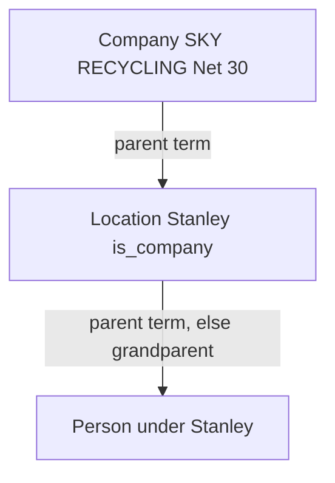

# Propagate vendor payment terms to children

The ERP import keeps writing `TermsCode` only on the counterparty, as `property_supplier_payment_term_id`. Locations stay blank because they are created with `is_company=True` in [`plasticos_partner_import/models/erp_import_service.py`](plasticos_partner_import/models/erp_import_service.py), and Odoo commercial sync skips company children. Do not change the importer or the sales payment term. The invoice term in the ERP is empty.

## Behavior

Put the walk next to the salesperson compute in [`plasticos_facility_profile/models/res_partner.py`](plasticos_facility_profile/models/res_partner.py). That module already shows this field on company and location cards, and `sale_management` brings in `account`.

- A partner with no parent keeps the term the import or a user stored.
- A child takes `parent_id.property_supplier_payment_term_id`.
- When that parent has none, the child takes `parent_id.parent_id.property_supplier_payment_term_id`.
- When both are empty, leave the partner's current term alone. Never assign `False`.



Redeclare the existing field so the new method is its stored compute and the company-dependent storage stays intact:

```python
property_supplier_payment_term_id = fields.Many2one(
    compute="_compute_supplier_payment_term_id",
    store=True,
    readonly=False,
)
```

Depends: `parent_id`, `parent_id.property_supplier_payment_term_id`, `parent_id.parent_id.property_supplier_payment_term_id`. A parent write then recomputes children and grandchildren. A location that receives the term is its own commercial partner, so Odoo still copies that stored value onto people under it.

## Existing rows

Bump [`plasticos_facility_profile/__manifest__.py`](plasticos_facility_profile/__manifest__.py) from `19.0.5.4.6` to `19.0.5.4.7`, and set the same version in [`plasticos_facility_profile/README.md`](plasticos_facility_profile/README.md). Add [`plasticos_facility_profile/migrations/19.0.5.4.7/post-migrate.py`](plasticos_facility_profile/migrations/19.0.5.4.7/post-migrate.py) in the shape of the salesperson migration: recompute every partner with a parent, including archived rows. Stanley then shows Net 30 without another ERP import.

## Test

Extend [`tests/test_partner_contact_hierarchy.py`](tests/test_partner_contact_hierarchy.py) the same way as the salesperson test: the depends list includes the parent and grandparent term, the compute assigns only when a source exists, and it never writes `False`.

## Build evidence (auto)

- detected_at: `2026-11-10T22:03:00Z`
- conversation_id: `5edc190e-fb6f-4be2-a3ed-b42655d981f9`
- generation_id: `b3e09198-9236-461e-88ae-4bf32ee38b5b`
- transcript: `/Users/ib-mac/.cursor/projects/Users-ib-mac-IB-Odoo-19-LOCAL-IB-Odoo-19/agent-transcripts/5edc190e-fb6f-4be2-a3ed-b42655d981f9/5edc190e-fb6f-4be2-a3ed-b42655d981f9.jsonl`
- todos at build time:
- `compute-walk`: completed
- `backfill`: completed
- `test`: completed
