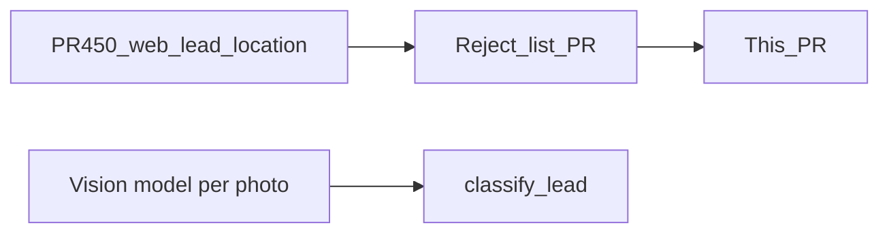

# Pass the vision record into classification intact

The vision model already returns a full reading per photo. Triage stores it on `ai_vision_results` and the evidence bundle. [`classify_lead`](plasticos_web_leads/models/classification_engine.py) never receives it. [`_merge_ai_and_vision`](plasticos_web_leads/models/web_lead.py) keeps three fields from the single highest-confidence photo and drops the rest. [`merge_vision_results`](plasticos_web_leads/models/image_analyzer.py) is only called from tests, and it still collapses every photo into one dict and nulls a low-confidence polymer hint.

This is the second web-lead pull request. It stacks on the pull request opened by the reject-list plan, which itself stacks on [#450](https://github.com/cryptoxdog/IB-Odoo_19/pull/450). Do not cut this branch from `origin/Staging`, `feat/screen-views`, or `feat/web-lead-location`.

## Remote stack

Parent chain already on the remote:

- [#448](https://github.com/cryptoxdog/IB-Odoo_19/pull/448) `Staging` <- `feat/screen-views`
- [#449](https://github.com/cryptoxdog/IB-Odoo_19/pull/449) `feat/screen-views` <- `feat/web-lead-readable-evidence`
- [#450](https://github.com/cryptoxdog/IB-Odoo_19/pull/450) `feat/web-lead-readable-evidence` <- `feat/web-lead-location` at `e08b6581`

The reject-list plan opens the next pull request with `make pr base=feat/web-lead-location`. This plan starts only after that pull request exists and its head SHA is on `origin`. Cut this branch from that SHA in a new worktree. `make pr base=<reject-list-branch>`.

`scripts/pr_stack_parent.sh prove` walks every open parent until the chain ends at `Staging`. There is no depth cap. This publish is `make pr base=<reject-list-branch>` while that chain still ends at `Staging` through #450, #449, and #448.

## Clean tree

`git status --porcelain` is empty before the branch is cut and again before `make pr`. [scripts/git_push_with_pr.sh](scripts/git_push_with_pr.sh) refuses a dirty work tree, index, or untracked file. Do not reuse the reject-list worktree. Do not leave the reject-list edit uncommitted on this branch. Commit only the vision handoff, then publish with porcelain still empty.

## Contract

`classify_lead` gains `vision_evidence: list[dict]`. The list is a deep copy of every successful image analysis, in photo order, with every key the model and the provider wrapper returned. No key is renamed, dropped, or overwritten before that handoff.

Keys that must survive on each dict:

- `observed_form`, `observed_color`, `observed_polymer_hint`, `material_form_observed`, `commercial_color`
- `containment`, `support_unit`
- `contamination_visible`, `contamination_notes`, `cleanliness`
- `quantity_visible`, `quantity_notes`
- `confidence`
- `provider` and `call_metadata`, which [`analyze_image_with_provider`](plasticos_web_leads/models/image_analyzer.py) adds after the model returns

A second photo is a second dict. Disagreement between photos stays visible. `merge_vision_results` stays a test helper. It is not the classifier input, because it keeps one base dict and clears `observed_polymer_hint` under 0.3 confidence.

Error wrappers (`{"error": ...}` from a failed call) are not model emissions. They stay on the attachment evidence row, where [`process_attachments`](plasticos_web_leads/models/attachment_processor.py) already records them. They are not inserted into `vision_evidence`.

The empty `reject_materials` list from the parent pull request stays empty. Do not restore `conduit`, `pvc pipe`, or the other six phrases.

## Weight stays the seller's number

`quantity_visible`, `quantity_notes`, and any extra `estimated_lbs` a model adds to a vision dict are evidence that the frame is a sample. They do not change `estimated_lbs` or `weight_source`.

A stated `100 tons` remains 200,000 lb from the seller parser even when a photo says one gaylord is in a hand. The packet path in `_merge_ai_and_vision` already ignores vision pounds. Leave that path. Do not add a vision-pounds fallback.

Add one sentence to `_VISION_SYSTEM_PROMPT`: the picture is a sample of the material; `quantity_visible` and `quantity_notes` describe the frame, not the seller's stock, and the model must not invent a lot weight.

## What the classifier may use

The intact list is always stored, including when it changes nothing about HOT or COLD.

- Seller or text polymer stays the polymer qualifier when it is present. Vision does not replace it.
- When that polymer is empty and every photo that has `observed_polymer_hint` names the same polymer, that hint is the polymer qualifier. Conflicting hints add no polymer and both dicts remain on the result.
- `quantity_visible: false`, a small visible pile, containment, and cleanliness do not open a cold gate.
- Contamination stays off the cold gates. It is already a broker conflict in [`reconcile_evidence`](plasticos_web_leads/models/evidence_reconciler.py).

The existing form, color, and contamination copy inside `_merge_ai_and_vision` can keep filling the intake payload. That copy is not the classification input.

## Both decision writes

[`_run_triage_pipeline`](plasticos_web_leads/models/web_lead.py) passes the `vision_results` list it already builds from successful analyses into `classify_lead`.

[`_reclassify_from_stored_evidence`](plasticos_web_leads/models/web_lead.py) passes stored `ai_vision_results` the same way. A replay must not classify without the photos already on the lead.

`ClassificationResult` carries `vision_evidence`. Both `decision_reasons` writes add it under the existing `KEY_VISION` from [`evidence_keys.py`](plasticos_web_leads/models/evidence_keys.py), beside `reasons`, `cold_gates`, and `hot_qualifiers`. The economic assessor already receives vision on the evidence bundle after the decision. That path stays advisory and still cannot flip HOT or COLD.

## Tests

In [`tests/test_triage_pipeline.py`](tests/test_triage_pipeline.py), on top of the reject-list test from the parent:

- Two successful analyses with disjoint keys, including `quantity_notes`, `containment`, `observed_polymer_hint`, `commercial_color`, `support_unit`, `cleanliness`, and `material_form_observed`, come back on the result unchanged and in order.
- An error dict is absent from `vision_evidence`.
- `estimated_lbs=200000` and `weight_source="explicit_tons"` stay the classified weight when vision says `quantity_visible` is false and `quantity_notes` is a single gaylord.
- An empty text polymer plus one agreed `observed_polymer_hint` of `PP` records the polymer qualifier. Two different hints do not.
- A text polymer of `HDPE` is kept when vision says `PP`, and the vision dict is still on the result.

## Version

The reject-list parent sets `plasticos_web_leads` to `19.0.2.9.1` in both the manifest and the README. This branch sets both to `19.0.2.9.2`. #450's manifest is `19.0.2.9.0` and its README is still the stale `19.0.2.8.12`; do not use that README number. No migration and no bulk reclassify. Stored leads pick up the vision list on the next triage or replay.

Out of scope: restoring the material reject list, the text normalizer's own unused fields, and the view-XML parser. The `defusedxml` finding on `tests/test_web_lead_readable_evidence.py` is already handled on this stack by `535ba441` and `c518fd99`.

## Build evidence (auto)

- detected_at: `2026-11-10T18:32:28Z`
- conversation_id: `3579d980-e56f-449e-b491-d903cad83db6`
- generation_id: `6228e1ae-59b4-4b20-bf69-7507139c2fce`
- transcript: `/Users/ib-mac/.cursor/projects/Users-ib-mac-IB-Odoo-19-LOCAL-IB-Odoo-19/agent-transcripts/3579d980-e56f-449e-b491-d903cad83db6/3579d980-e56f-449e-b491-d903cad83db6.jsonl`
- todos at build time:
- `branch`: completed
- `handoff`: completed
- `call-sites`: completed
- `authority`: completed
- `prompt`: completed
- `tests-version`: completed
- `publish`: completed

