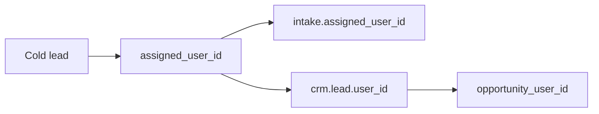

# Assigned To is already on PR 456

The web-lead form Arthur is looking at has no salesperson because that database does not have [PR #456](https://github.com/cryptoxdog/IB-Odoo_19/pull/456) yet. The code for the control he marked is already committed on that pull request.

## Seam

[#456](https://github.com/cryptoxdog/IB-Odoo_19/pull/456) is the only open pull request. Head `feat/web-lead-images-assigned-to` at `d70d0a55`, base `Staging`. This checkout is already that branch, one commit ahead of `origin/Staging`. There is no earlier open parent to stack on, and a new pull request with `base=feat/web-lead-images-assigned-to` would add the same field again.

Commit `d70d0a55` places the control where the red arrow points, in [plasticos_web_leads/views/web_lead_views.xml](plasticos_web_leads/views/web_lead_views.xml) under the submission date:

```xml
<h2><field name="submitted_at" readonly="1"/></h2>
<field name="assigned_user_id" widget="many2one_avatar_user" readonly="state == 'intake_created'"/>
```

The same commit adds the list column, copies the person onto the new intake, and, once an opportunity exists, copies them onto `crm.lead.user_id`. A cold lead such as CG-4-9258 stays editable because its state is `skipped`, not `intake_created`. After an intake exists the queue field locks, and [plasticos_crm_bridge/views/crm_lead_views.xml](plasticos_crm_bridge/views/crm_lead_views.xml) shows `opportunity_user_id` in that same title spot so the commercial owner can still change.



The same commit also fixes the one-thumbnail strip: `lead_image_strip` declares `relatedFields`, and the widget reads `currentIds` instead of the one-record page.

## Do not redo it

Leave the uncommitted worktree alone. The web-lead diff on top of `d70d0a55` only renames weight labels and moves the material description. Facility and transaction files in the same worktree are a different change. Do not commit them onto this branch and do not open another pull request.

## What execution does

Confirm the form field, the list column, the intake copy, and the opportunity inherit are the ones in `d70d0a55`. Point Arthur at [#456](https://github.com/cryptoxdog/IB-Odoo_19/pull/456). The field appears on CG-4-9258 after that pull request is on the database and `plasticos_web_leads` plus `plasticos_crm_bridge` are upgraded. No new module version: both manifests are already `19.0.2.10.0` and `19.0.3.5.0` on this commit.

## Build evidence (auto)

- detected_at: `2026-11-10T22:07:28Z`
- conversation_id: `22b7a5c9-aeba-4ade-b219-5ec7b5654ab0`
- generation_id: `0a15b7a9-5cd4-4de6-9fa7-b86887de1c47`
- transcript: `/Users/ib-mac/.cursor/projects/Users-ib-mac-IB-Odoo-19-LOCAL-IB-Odoo-19/agent-transcripts/22b7a5c9-aeba-4ade-b219-5ec7b5654ab0/22b7a5c9-aeba-4ade-b219-5ec7b5654ab0.jsonl`
- todos at build time:
- `confirm-456`: completed
- `leave-worktree`: completed

