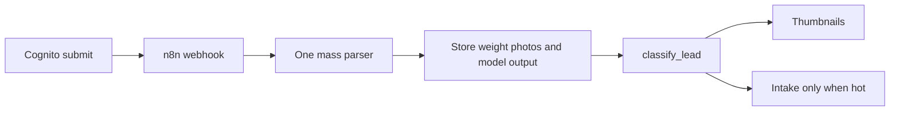

# Web lead date and photos

The form in your screenshot has no date under the lead id. `create_date` sits at the end of the list only. Cognito already sends `Entry.DateSubmitted` (`submitted_at` on the packet in [`plasticos_web_leads/adapters/cognito.py`](plasticos_web_leads/adapters/cognito.py)), and that value is dropped on the floor in [`create_from_packet`](plasticos_web_leads/models/web_lead.py).

The Sar Enterprise log is the photo bug. Vision did see the file (`form=Pellet, color=White, confidence=0.90`). The cold decision on that row is the weight gate (“No usable weight”), not a missing picture. After that decision the old pipeline logged `[IMG] SKIPPED (COLD lead — images not downloaded)` and never stored the bytes. The class docstring still says to skip images on cold. That skip is forbidden. A cold lead keeps every submitted photo. Signed Cognito URLs are not kept, so Re-Run Triage cannot fetch a photo that was never stored. It does not pull old files back from Google Drive. The Comproremex cold call is a separate weight-gate bug, covered below.

## Date

Add a stored, indexed `submitted_at` Datetime on `plasticos.web.lead`, labeled **Submitted**.

- Set it in `create_from_packet` from `packet.submitted_at`. If that is missing, use `create_date`.
- Default order: `submitted_at desc, id desc`.
- Form: show it readonly directly under the lead id in the title block of [`plasticos_web_leads/views/web_lead_views.xml`](plasticos_web_leads/views/web_lead_views.xml).
- List: first column, so the column header sorts the leads.
- Search: group by day.
- Backfill in `migrations/19.0.2.8.12/post-migrate.py` from `raw_payload` `Entry.DateSubmitted`, otherwise `create_date`. SQL update, so the intake write-guard does not block it.
- Bump [`plasticos_web_leads/__manifest__.py`](plasticos_web_leads/__manifest__.py) from `19.0.2.8.11` to `19.0.2.8.12`.

## Photos

Hard rule: a photo that arrived with the submission is stored on the lead. HOT and COLD use the same acquisition. Classification may set `state` to `skipped`. It must not skip the download, delete the attachment, or omit the file from the form.

On the packet path, [`process_attachments`](plasticos_web_leads/models/attachment_processor.py) already saves `ir.attachment` rows before classification. The cold branch in [`_run_triage_pipeline`](plasticos_web_leads/models/web_lead.py) still skips a download when the lead is not on that path, and the form never shows the files.

- Delete the cold image skip, the `[IMG] SKIPPED` log line, and the docstring line that tells agents to skip images on cold. Every admission path downloads and stores the submitted images before the decision is applied.
- A later cold write must not unlink those attachments. Search the triage path for any `unlink` or skip that keys off `decision == "cold"` or `state == "skipped"` and remove it.
- Add a computed Many2many `lead_image_ids` of image `ir.attachment` rows already linked to that lead. Cold and hot leads both populate it. No second photo model and no new ACL.
- Put a thumbnail strip in the Classification group. Each thumb is about 64px. Click opens one image; previous and next move through the set. A small OWL strip may render and page the thumbs. It does not become a store. Image URL is `/web/image/<id>`. An empty strip means the submission had no photo.

## Classifier audit

Production has 110 web leads, 0 hot. n8n marked a set of the same submissions Hot or Unclear Hot and wrote them to Airtable. Odoo is the authority and is supposed to be the stricter, deterministic classifier. The misses below are false colds, not a reason to copy n8n.

| Lead | Seller text | What was computed | What the decision used | n8n |
|---|---|---|---|---|
| Comproremex | `100 ton` | 200,000 lb, polymer PP, vision pellets/white 0.90 | `weight:unknown` because `weight_source` defaulted to `none` | Unclear Hot |
| ProCorp | `approximately 10,000 pounds` | 10,000 lb, source `ai_text` | same unknown-weight gate | Hot |
| Scott hill | stated about 10,000 lb | 10,000 lb stored | same gate | Hot |
| Industrial Brush | `10,000 - 20,000 rough guess` | nothing; parser returned none | 0 lb, `weight:unknown` | Hot at 15,000 |
| TGS Sports | `65,000 sqft` | 65,000 stored as if it were pounds | unknown-weight gate | Hot at 35,000 lb/load |
| Clean Management | 7,200 lb | 7,200 lb, source the weight field | below the 8,000 lb cold floor | Cold |

Clean Management stays cold. 7,200 lb is under the 8,000 lb floor, and n8n agreed. The floor does not move.

The other rows are bugs. The gate in [`classification_engine.py`](plasticos_web_leads/models/classification_engine.py) is `estimated_lbs == 0 or weight_source == "none"`. A real pound figure is discarded whenever the source tag is missing. The code that classified Comproremex called `classify_lead` without `weight_source`. The default `none` erased 200,000 lb after the model and the merge had already produced it.

Further drops, all of them “compute, then throw away”:

- [`ai_normalizer.py`](plasticos_web_leads/models/ai_normalizer.py) sets `estimated_lbs_per_load` to null when the number is above 200,000 lb. A 100 metric-ton load is about 220,462 lb. The model can return it and validation deletes it, so the classifier then says the weight is unknown.
- Two parsers currently disagree. [`parse_weight_lbs`](plasticos_web_leads/models/triage_helpers.py) keeps a bare number and a unit count. [`parse_explicit_weight_lbs`](plasticos_web_leads/models/triage_helpers.py) drops both, so `10,000 - 20,000 rough guess` becomes no weight. One function owns seller mass. The packet path calls that function. There is no second conversion table.
- The prompt tells the model to leave truckload, gaylord, and pallet counts null because the parser will convert them, and the packet parser then refuses. A stated unit count uses the unit table already in `triage_helpers.py` (truckload 42,000 lb, gaylord 1,000 lb, and the rest), source `unit_count:<unit>`, and the assumption is stored on the evidence. It is not a silent invention and it is not a null.
- Square feet are not pounds. TGS stays an area. Do not invent 35,000 lb to match n8n. Do not keep 65,000 sqft stored as 65,000 lb. The quantity text is the observation. The false pound figure is dropped.
- Vision is paid for, then the cold branch skips saving the file. The JSON observation and the bytes both have to remain on the lead.
- HOT still needs two independent qualifiers. After the weight gate is fixed, weight plus a polymer is enough. A weight with no plastic identity stays cold. That is the part that should stay stricter than n8n.

## Keep every observation

Hard rule for this module: if the pipeline calls a model, parses a seller field, or downloads a file, the result is stored on `plasticos.web.lead` and the decision reads that stored value. A later cold decision must not delete it, null it, or ignore it.

- Unknown weight means there is no positive pound figure. It does not mean the source label is `none` while pounds are present. `ai_text`, `explicit_tons`, `explicit_lbs`, `explicit_kg`, `explicit_metric_tons`, and `unit_count:*` all count.
- A seller range uses the low number as the classified weight. The high number is stored on `estimated_lbs_high`, null when the seller did not give a range. `rough guess` and `approximately` do not erase the numbers. The low number is the commitment. A midpoint is not invented to match n8n.
- A computed weight above 200,000 lb stays on `estimated_lbs_per_load`. `review_required` records the cap. The number is not replaced with null. 200,000 lb itself is inside the cap. The inclusive bound is `>` 200,000, so Comproremex is not cleared by the cap.
- Vision JSON, AI JSON, the parsed quantity, and the image bytes are written on hot and cold leads. The triage log must not contain an image-skipped line.
- Pass `lbs_source` into `classify_lead` on every path.

## Reclassify what is already stored

One owner. The migration does not reimplement HOT/COLD in SQL. It re-parses `quantity_text` with the same mass function and calls `classify_lead`. Polymer comes from `ai_analysis.polymer`, then `ai_normalized.polymer`. Company name and a free-text material line are not a second polymer detector.

Area-only quantity text does not count as mass, even when `estimated_lbs_per_load` already holds that area number. TGS stays cold. A stored 7,200 lb lead stays cold. A range that parses, with no stored polymer, stays cold on the two-qualifier rule. Industrial Brush is that case if HDPE never landed in `ai_analysis.polymer`. Comproremex, with a parsed 200,000 lb and stored polymer PP, is the row that becomes hot.

Only a lead in `received`, `skipped`, or `error` is rewritten. A lead that already has an intake is left alone. The migration is safe to run again.

A newly hot stored lead with no intake uses `_process_hot_lead_triage`, which already reuses `intake_id` and notifies only when the intake link was empty. Historical replay passes context that skips `_notify_admin_hot_intake`. A module upgrade must not file one activity per old lead. A live admission still notifies. CRM creation stays on the existing bridge method, and it still no-ops when `crm_lead_id` is set.

No new model call. No Cognito refetch. No second intake creator.

## Tests

In [`plasticos_web_leads/tests/`](plasticos_web_leads/tests/):

- A Cognito body with `Entry.DateSubmitted` stores that value on `submitted_at`.
- A cold admission that includes one image still has that `ir.attachment` after `state` is `skipped`, and the same file is in `lead_image_ids`. The triage log must not contain an image-skipped line.
- `classify_lead` with `estimated_lbs=200000` and `weight_source="none"`, and with `weight_source="ai_text"`, does not return `weight:unknown`.
- `100 ton` parses to 200,000 lb. `10,000 - 20,000 rough guess` classifies on 10,000 lb and keeps 20,000 lb as the high end. `1 truckload` uses the existing 42,000 lb unit weight and records `unit_count:truckload`.
- An AI weight of 220,462 lb is stored, not nulled. `65,000 sqft` does not become 65,000 lb.
- A stored lead whose quantity text is `100 ton` and whose stored polymer is PP becomes hot through `classify_lead`, with no new model call and no admin activity. A stored 7,200 lb lead stays cold. A stored `65,000 sqft` lead stays cold even if `estimated_lbs_per_load` is 65000. A second migration run does not create a second intake.

## Out of scope

- Lowering the 8,000 lb cold floor or the 10,000 lb hot minimum to match Airtable.
- Copying an n8n Hot label onto a lead that has no mass.
- Recovering a photo whose log says it was not downloaded. The Cognito link is gone. A Drive or Airtable file backfill is a separate job.

## Build evidence (auto)

- detected_at: `2026-11-10T15:21:57Z`
- conversation_id: `c7ad3c90-a864-4f50-91d6-5b2a002d7fb9`
- generation_id: `604630e0-fafc-425d-96de-ed168ebecb7e`
- transcript: `/Users/ib-mac/.cursor/projects/Users-ib-mac-IB-Odoo-19-LOCAL-IB-Odoo-19/agent-transcripts/c7ad3c90-a864-4f50-91d6-5b2a002d7fb9/c7ad3c90-a864-4f50-91d6-5b2a002d7fb9.jsonl`
- todos at build time:
- `submitted-at`: completed
- `keep-photos`: completed
- `weight-gate`: completed
- `keep-observations`: completed
- `reclassify-stored`: completed
- `tests`: completed

