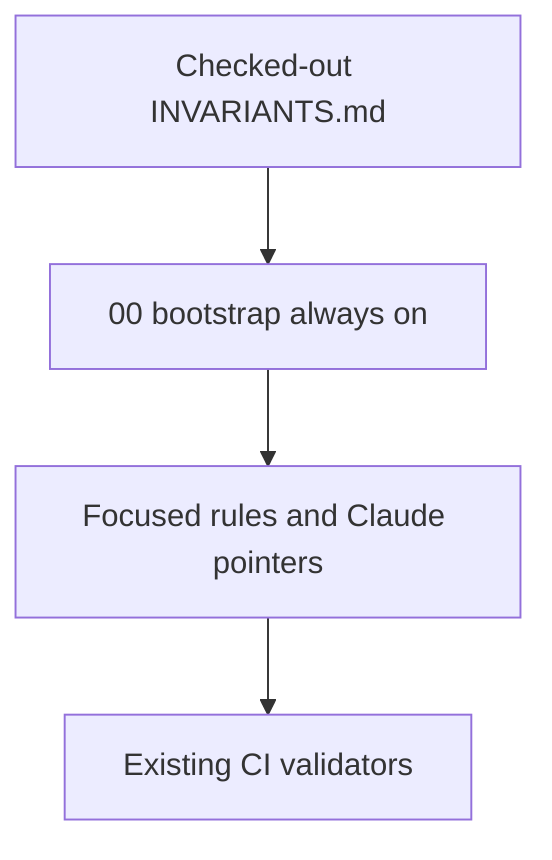

# Agent Instruction Realignment

Bind agent guidance to the active PlasticOS constitution in [INVARIANTS.md](INVARIANTS.md) (`Status: ACTIVE`, version 3.0.0, `POS-INV-01` through `POS-INV-20`, plus preserved `BAN001`). This is a surgical edit of existing owners. It does not create a new rules framework, and it does not change addon code.

The header is already `ACTIVE`. Four leftover sentences still say the file is a draft, that MUST/MUST NOT applies only until admission, and that agent guidance must wait. Those sentences would let a later agent ignore the constitution. This change removes only that wrapper. Invariant bodies stay as written. The file still does not claim the codebase already conforms.

Architecture is already settled: current validators and accepted ADRs own the facts the old rules got wrong.

- [tests/test_repo_dependency_integrity.py](tests/test_repo_dependency_integrity.py) explicitly does not enforce a layer order. Cycles are owned by `ci/check_circular_deps.py`.
- [plasticos_offer/models/offer.py](plasticos_offer/models/offer.py) already uses `intake_id = fields.Many2one("plasticos.intake")` with `plasticos_intake` in the offer manifest. [plasticos_intake/models/intake_match.py](plasticos_intake/models/intake_match.py) still stores `offer_id` as an `Integer` to dodge a layer cycle. That code stays for a later campaign. The rule that teaches the workaround goes away now.
- External intelligence is [docs/adr/ADR-003-single-external-intelligence-authority.md](docs/adr/ADR-003-single-external-intelligence-authority.md) and `POS-INV-17` / `POS-INV-18`. `plasticos_buyer_match_engine` is not in the tree.
- Pure-Python CI already runs `python3 -m pytest tests/` in [.github/workflows/ci.yml](.github/workflows/ci.yml). There is no hand-maintained test list.
- `POS-INV-19` forbids a layer diagram, a universal `noupdate` rule, or a blanket ACL formula from overriding real lifecycle and model semantics.

## Constitution wrapper

Edit only the status wrapper in [INVARIANTS.md](INVARIANTS.md):

- `Proposed version` becomes `Version: 3.0.0`.
- Supersession of v2.2.0 is unconditional. Drop "only after explicit approval".
- MUST and MUST NOT are binding. Keep the sentence that distinguishes assertion, observation, inference, proposal, approval, and posted fact.
- Ownership is current, not "once approved".
- Delete the admission checklist and the closing line "Architectural draft only".
- Replace them with three facts: this file is the canonical invariant source; it does not certify implementation conformance; unimplemented behavior must not be described as compliance. `BAN001` and `ci/check_banned_identifier.py` stay untouched.

No v2-to-v3 mapping memo and no BRS conflict memo in this change.

The ownership bullet that cites `plasticos_logistics/business_rules/README.md`, seven logistics chapters, and `SUPERSESSION.md` names a tree that is not in the repo. Delete that bullet in the wrapper edit. Do not replace it with a path. Generic sentences inside invariant bodies that say a threshold belongs to "the BRS" stay; they do not name a file. Do not copy, move, admit, or retarget anything under [docs/campaigns/PlasticOS_Native_First_BRS_v1.0.0_2026-10-25](docs/campaigns/PlasticOS_Native_First_BRS_v1.0.0_2026-10-25).

## Replace the bootstrap and delete the duplicate kernel

Replace the body of [.cursor/rules/00-plasticos-master-context.mdc](.cursor/rules/00-plasticos-master-context.mdc). Keep `alwaysApply: true`. Use the short router from the request, with these adjustments:

- The checked-out `INVARIANTS.md` is the canonical source. Historical agent text does not override it.
- Route models, manifests, XML, Odoo 19 patterns, web leads, upgrades, Enterprise tests, and deployment to rules 82, 81, 75, 84, 50, 89, 36, and 30.
- Do not tell the agent to read a BRS chapter, `SUPERSESSION.md`, or `plasticos_logistics/business_rules/`. That pack is not an admitted instruction target in this step.
- External intelligence stays on the accepted Gate path. Do not restore local matching or enrichment authority.
- Publication stays `make pr` into `Staging`. No raw git push. No merge, deploy, live activation, or financial-writer change without explicit authorization.
- Carry over the one unique hard abort from rule 10: never activate `pipeline_v2.py`; `ci/check_pipeline_v2_guard.py` rejects it.
- Do not copy the layer table, the integer-foreign-key instruction, the 29-module inventory, deploy recipes, or the ceremonial end marker.

Before deleting [.cursor/rules/10-plasticos-workspace-kernel.mdc](.cursor/rules/10-plasticos-workspace-kernel.mdc), confirm the three web-lead hotspots already live in rule 50. They do in the current 00/50 split: partner deferral, protected writes, and `_find_or_create_partner()`. Odoo 19 syntax stays in rule 84. Versioned upgrades stay in rule 89. Seed identity stays in the rewritten rule 75, without a universal `noupdate` mandate. Then delete rule 10.

Delete [.cursor/rules/35-plasticos-first-order-execution.mdc](.cursor/rules/35-plasticos-first-order-execution.mdc). Its always-on "defer external engine integration" line contradicts `POS-INV-17`. Fake-success rejection moves into the short rule 40. Nothing else in rule 35 is a PlasticOS owner.

## Rewrite the five retained rules

[.cursor/rules/40-plasticos-zero-stub-law.mdc](.cursor/rules/40-plasticos-zero-stub-law.mdc) — keep `globs: plasticos_*/models/**/*.py` and `alwaysApply: false`. Keep the ban on shipping `pass`, empty success returns, `NotImplementedError`, or "NOT IMPLEMENTED" as delivered behavior. Require a regression check that matches the behavior actually changed. Delete the 29-module map, PR #83/#85 anecdotes, local-engine and stub-mode exceptions, and duplicated test commands.

[.cursor/rules/81-ci-manifest-contract.mdc](.cursor/rules/81-ci-manifest-contract.mdc) — keep the manifest glob. Delete the ten-layer table and every claim that `test_depends_order_respects_layers` exists. Require a valid manifest, resolvable dependencies, no cycles (`ci/check_circular_deps.py`), and version format `19.0.X.Y.Z`. Point runtime version bumps and scoped `-u` at rule 89. Keep the phantom-dependency rule that matches `test_no_phantom_dependencies`.

[.cursor/rules/82-ci-module-wiring.mdc](.cursor/rules/82-ci-module-wiring.mdc) — delete the entire "Integer not Many2one" section. Require a real comodel, a manifest dependency, and an extension or bridge when a cycle would otherwise appear. Cite the offer addon as the owning side of the intake relation. An `if model not in self.env` guard is not permission to skip a dependency the installed graph actually needs. Keep `__init__.py` import wiring. Add one sentence for the existing commission/transaction cycle: it is the known non-fatal Makefile exception; do not copy it, and do not "fix" it by hiding a relation behind an integer.

[.cursor/rules/30-plasticos-deploy-validation.mdc](.cursor/rules/30-plasticos-deploy-validation.mdc) — split Enterprise Docker testing (`make test-module` / `make test-odoo`, fixture in rule 36) from Odoo.sh deployment (rule 98). Delete `make update-all`, the `plasticos_buyer_match_engine` upgrade example, local matching ICP checks, and the unverified `pg_dump` rollback. Scoped upgrade stays `make update m=<module>`. Activation and recovery require explicit authorization and a named runtime result. `make test-module` must not be documented as using a database named `odoo_test`.

[.cursor/rules/75-plasticos-xml-data-rules.mdc](.cursor/rules/75-plasticos-xml-data-rules.mdc) — replace "wrap ALL reference data in noupdate" and "crons are always noupdate and inactive" with lifecycle rules:

- Stable reference data that must survive `-u` uses `noupdate="1"`.
- Views, menus, and records that must refresh on upgrade do not.
- Cron `noupdate` and `active` follow the cron's real lifecycle and `tools/cron_invariant_check.py`, not one blanket.
- Keep XMLID prefix, no hardcoded database ids, no runtime CSV bootstrap, `numbercall`/`doall` bans, module-prefixed `model_id`, and `plasticos_base.user_system_cron` where that check still exists.
- Move XPath and view-pattern detail to a pointer to rule 84.
- Delete the `pg_try_advisory_lock` snippet. `cursor.execute(...)` does not return the lock boolean.

Also narrow the `noupdate="1"` example in [.cursor/rules/30-odoo-native.mdc](.cursor/rules/30-odoo-native.mdc) to stable reference data, with a pointer to rule 75. Leave rules 83, 84, and 95-test-fix-policy as they are unless a sentence repeats a retired doctrine.

## Change activation

- Keep always-on: rule 00, and [.cursor/rules/01-cursor-governance-law.mdc](.cursor/rules/01-cursor-governance-law.mdc). Rule 01 has no stale architecture claim; do not shorten it in this change.
- Set `alwaysApply: false` and rely on the description, with no globs: rules 02, 36, 70, 87, and 88. Rule 00 still states the publication prohibition so it survives when rule 70 is not selected.
- Rule 89: `alwaysApply: false` and `globs` covering `plasticos_*/**/*`, still pointing at `skills/plasticos-odoo-version-bump/SKILL.md`.
- Rule 50: keep the existing web-lead globs. Compare its pipeline text with `plasticos_web_leads/models/web_lead.py` and delete obsolete PR-history sentences. Keep partner deferral, idempotency, and protected transitions that the model still implements.
- Rule 88: keep the Odoo tooling boundary and `pyproject.toml` as the version authority. Drop any copied pin that the rule presents as a second source of truth.
- Rule 71: replace the blanket manager/user/readonly CRUD formula with "read the CSV, then judge effective ACL and record rules". State that `ci/check_acl_completeness.py` only proves an ACL row exists. Keep the preflight: read the whole CSV, refuse redundant rows, and do not mix XMLID prefixes.
- Rule 80: delete historical file counts and the PR #85 list. Point at `pytest tests/ --collect-only`, the pinned fixture in `config/test_env_fixture.conf`, and the separate outcomes `PASS`, `FAIL`, `NOT_RUN`, and skipped.
- Rule 86: delete the claim that pure-Python CI lists test files by hand. Describe `python3 -m pytest tests/` and the conftest collect-ignore. Keep SHA pins, fail-slow `ci-gate-result`, and the ban on reviving the deleted workflows.
- Rule 95 equipment: delete the buyer-matcher, graph-sync, and Cypher wiring steps. Facility evidence and projections stay in Odoo. Scoring semantics stay with CEG/EIE through Gate. Keep seed data, the capability flag, the facility packet, and a test of that Odoo projection.
- Rule 98: delete the snapshot table for build `36099032`. Keep discovery through gitignored `.env.local` (`ODOO_SH_STAGING_SSH` and `ODOO_SH_STAGING_URL`).

## Same change set for the other entry points

[.cursor/rules](.cursor/rules) is not the only surface Cursor and Claude load.

[AGENTS.md](AGENTS.md) is `additive_only` in [ops/config/root-file-protection.json](ops/config/root-file-protection.json). Insert a short binding block at the top: read the checked-out `INVARIANTS.md`, apply the cited `POS-INV-*` ids and `BAN001`, and do not follow a layer diagram, integer-foreign-key workaround, local matcher fallback, or universal `noupdate` rule from older text in this file. Removing the false lines is still required, because an agent reads the whole file. The commit that deletes those lines must contain:

`ALLOW-ROOT-DELETION: AGENTS.md — remove layer, universal noupdate, and depends-order instructions superseded by active INVARIANTS.md v3`

Delete or rewrite only the contradicted lines: Project Structure `Layer N` labels, the two universal `noupdate="1"` mandates, and the manifest-hook description that says the dependency test enforces depends order. Keep the tooling inventory, CI job map, ERP import corrections, repo-index path, and the existing "never treat local matcher as intelligence authority" prohibition. The PR body needs the protected-root stamp `<!-- L9_PROTECTED_ROOT_PR -->`.

[CLAUDE.md](CLAUDE.md) is managed, so an in-place edit is allowed. Remove Design Principles 2 and 3 (five-layer isolation and Neo4j scoring fallback) and the "18 invariants, all CI-enforced" lines. Replace principle 1 with lifecycle-specific seed data: stable reference records may use `noupdate="1"`; that is not a rule for every XML record. Keep the ERP import law and the generated formatter block.

[.claude/rules/invariants.md](.claude/rules/invariants.md) becomes a pointer to root `INVARIANTS.md`. Delete "18 CI-enforced invariants".

[.claude/rules/architecture.md](.claude/rules/architecture.md) drops the five-layer table and `plasticos_buyer_match_engine`. Point at manifest `depends`, `ci/check_circular_deps.py`, and accepted ADRs.

[.claude/rules/neo4j.md](.claude/rules/neo4j.md) drops local-graph scoring authority and the `graph_service.py` fallback. Point at ADR-003-single, the Gate ADRs, and `POS-INV-17` / `POS-INV-18`. Remove the `plasticos_buyer_match_engine` path glob.

[.claude/rules/xml-views.md](.claude/rules/xml-views.md) drops blanket `noupdate`. Point at rule 75.

[.claude/rules/security.md](.claude/rules/security.md) points at effective ACL and record rules, and at rule 71. Keep same-module ACL, the CSV preflight, and the `sudo()` justification rule.

## One regression test

Add [tests/test_agent_rule_alignment.py](tests/test_agent_rule_alignment.py) and negative fixtures under `tests/fixtures/agent_rule_alignment/`. The fixtures are not rule files.

The test parses `.mdc` frontmatter and checks the activation table above. It checks that rule 00 names `INVARIANTS.md` and that the constitution status line is `ACTIVE`. It scans only this instruction set: `.cursor/rules/*.mdc`, `AGENTS.md`, `CLAUDE.md`, and `.claude/rules/*.md`.

Banned in that set, as affirmative doctrine rather than as a prohibition:

- a layer-order mandate, including `test_depends_order_respects_layers` and "5 layers" / "Layer Isolation"
- an integer field recommended in place of `Many2one` to avoid a dependency
- a local matcher or Neo4j scoring fallback presented as acceptable intelligence
- "18 invariants" or "architectural draft"
- universal "wrap all reference data in noupdate"
- `make update-all` as a normal deploy path
- the retired staging build id `36099032` as operational truth
- a required read of `plasticos_logistics/business_rules/` or `SUPERSESSION.md`

The negative fixtures are one layer mandate, one local-matcher fallback, and one "18 invariants" assertion. Each must fail the same checker. Do not put the BAN001 identifier in any fixture. Do not scan addon Python, `skills/`, or root `ARCHITECTURE.md`. Those still contain old layer and `noupdate` teaching; they are a later documentation pass, not proof that this test is green.

`ci.yml` already collects `tests/`. Do not add a workflow. Do not edit `ci/check_banned_identifier.py`.

## Proof and boundary

Run `python3 -m pytest tests/test_agent_rule_alignment.py -q`. That is the automated proof. A fresh Cursor session that reads the checked-out `INVARIANTS.md` and names the relevant `POS-INV-*` ids is the manual proof; this change cannot record that session.

Out of scope: addon fields, the integer `offer_id` in `intake_match.py`, migrations, Docker upgrades, Odoo.sh activation, financial-writer cutover, skill-pack rewrites, and root `ARCHITECTURE.md`.

## Next step, not this one

The BRS chapters already sit in [docs/campaigns/PlasticOS_Native_First_BRS_v1.0.0_2026-10-25](docs/campaigns/PlasticOS_Native_First_BRS_v1.0.0_2026-10-25). That directory is their home. The following step admits that pack and points `INVARIANTS.md` and the rule 00 router at it. This step does not move those files, does not edit them, and does not tell agents to treat the pack as current required reading. `GOVERNANCE/AGENT_READ_FIRST.md` in that pack stays a future consumer contract until that later admission.
