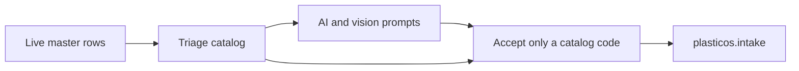

# Web-lead AI catalog

The phrase-sheet bridge, [plasticos_material_profile/models/material_normalizer.py](plasticos_material_profile/models/material_normalizer.py), is not part of this change. ERP and CRM keep looking up `material_mapping.csv`. This work is only the web-lead model path: [ai_normalizer.py](plasticos_web_leads/models/ai_normalizer.py), the merge in [web_lead.py](plasticos_web_leads/models/web_lead.py), the grade hints in [material_identity.py](plasticos_web_leads/models/material_identity.py), the polymer aliases in [evidence_reconciler.py](plasticos_web_leads/models/evidence_reconciler.py), and the vision prompt in [image_analyzer.py](plasticos_web_leads/models/image_analyzer.py).

## Catalog

At the start of triage, read the active rows and build one catalog. Inactive rows stay out, including form `BALES`.

- `plasticos.polymer`, `plasticos.material.form`, `plasticos.material.grade`, `plasticos.source.type`
- `plasticos.material.color`, `plasticos.material.attribute`, `plasticos.filler.type`, `plasticos.packaging.type`
- process codes from the intake `origin_process_type` selection

Each entry keeps that record's `code`, `name`, and description. The same catalog is passed into the prompt, the reply check, and the seller-text match. Nothing else is a vocabulary.

## Prompt and check

[ai_normalizer.py](plasticos_web_leads/models/ai_normalizer.py) stops listing the short polymer and form sets. The system prompt receives the current codes, with `material_grade` as its own field, separate from `form`. The model may return a listed code or null. The same code list goes into the vision prompt, replacing the fixed `Bale | Pellet | ...` and `HDPE | PP | ...` lines.

After either reply, keep a value only when its code or name is in the catalog. Seller text is matched the same way, on word boundaries, longest name first, and each kind is matched on its own. `HDPE stretch film` can fill grade `STRETCH_FILM` and form `FILM`. A code the model invents is dropped.

Delete `_POLYMER_NORMALIZE`, `_FORM_NORMALIZE`, `_SOURCE_NORMALIZE`, `_ITEM_GRADE_HINTS`, and `_POLYMER_ALIASES`. `rpet`, `vinyl`, `acetal`, and `pail` match only when that word is already the master's code, name, or description. Do not add those words to the seed files.

Do not substitute the `other` polymer or form. An empty slot stays empty. A pallet lead stores grade `PALLETS` and leaves form empty.

## Intake

`_create_intake` already writes `polymer_id`, `form_id`, `material_grade_id`, and `source_type_id`. Also write `color_id`, `packaging_type_id`, `filler_type_id`, `material_attribute_ids`, and `origin_process_type` when the catalog matched them. The intake model already has these fields, and [intake_delta_bridge.py](plasticos_material_profile/intake_delta_bridge.py) already copies them onto a material profile when a supplier partner exists later. Do not create a profile during triage.

## Proof

- Point [tests/test_web_lead_material_identity.py](tests/test_web_lead_material_identity.py) at the catalog matcher. It currently fails if `_FORM_NORMALIZE` is missing. Keep the pure grade-versus-form cases, including drum plus regrind and bucket plus film.
- In [plasticos_web_leads/tests/test_web_lead_material_grade.py](plasticos_web_leads/tests/test_web_lead_material_grade.py), the pallet lead expects form `other`. It should expect an empty form and grade `PALLETS`.
- Bump `plasticos_web_leads` from `19.0.2.11.1` to `19.0.2.11.2` in the manifest and the README `module_version`. No `plasticos_material_profile` bump.
