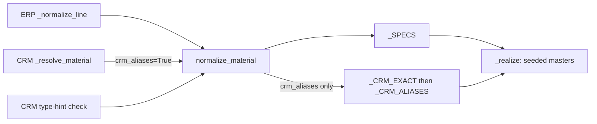

# Material ledger normalizer

## Outcome

[plasticos_material_profile/models/material_normalizer.py](plasticos_material_profile/models/material_normalizer.py) stays the only place that maps a material phrase. After this change:

- the 16 ledger rows whose cells name existing masters map on both importers;
- the 20 ledger rows that cannot be mapped are written to a review CSV with the same headers as the ledger;
- re-running either import fills empty material fields and never overwrites a stored one, including on ERP orders that are already confirmed.

The ledger is the operator decision record. The importers do not read it. A test keeps the code and the ledger in agreement.

## Review corrections

From the alignment review:

- The importers do not read the ledger at runtime. `CLAUDE.md` forbids CSV runtime bootstrap, and the ERP import law says never to extend CSV as the runtime architecture. The resolved rows go into `_SPECS`.
- The operator classification columns govern. The `proposed_status` and `evidence` columns were assistant output and do not decide a row.
- VanillaSoft `PE` and `Pallets` stay as they are. The VanillaSoft map lists both as `OPERATOR_APPROVED` and mapped.
- Process type is out of scope: no applied row has a usable process value.

From the gap check against the code:

- Confirmed purchase lines never reach `_upsert_purchase_line`. `_realize_purchase_groups` returns early for any order not in `_OPEN_PURCHASE_STATES`, so the purchase fill belongs in that branch. Confirmed sale lines do reach `_upsert_sale_line`, which returns after `_line_terms`, so the sale fill goes there.
- Adding packaging to the spec tuple would make today's conflict check (`len(set(specs)) > 1`) treat `PP Supersacs (Un-Lined)` plus a `PP Supersacs` type hint as a conflict, because packaging and attributes differ. Conflict now compares the identity slots only.
- `scripts/build_material_mapping.py` `spec_row` unpacks exactly six slots, so an eight-slot spec breaks the builder that owns `material_mapping.csv`.
- `material_mapping.csv` is generated by that builder. The 16 matrix rows are set to the values the builder emits from the new `_SPECS`, so a later builder run reproduces them instead of reverting them.
- Three `_CRM_ALIASES[...] = (...)` assignments after the dict (`hdpe frac melt`, `pvc rigid`, `ldpe thick gauge`) must become `_Spec` too, or `_realize` fails to unpack them.
- `normalize_crm_material` is defined in the normalizer and called from four files, not five.
- The material line fields come from `plasticos_order_lines`, which is `auto_install` and is not a dependency of `plasticos_transaction`. The existing `if field in model._fields` guard stays.

## How a ledger row is decided

Each row in [plasticos_material_profile/data/material_mapping_resolution_ledger_11-04-26.csv](plasticos_material_profile/data/material_mapping_resolution_ledger_11-04-26.csv) is applied only when every filled classification cell names exactly one seeded master after these deterministic steps. A row with any unresolved cell is held whole.

- `polymer`: uppercase, `/` becomes `_`, then match the `code` in `polymer_data.xml` (`PP/PE` becomes `PP_PE`, `fiber` becomes `FIBER`; `HDPE/PP` and `1_2_COMMINGLED_BOTTLES` match nothing). The code must also be in the stored `polymer` Selection on `plasticos.material.profile`. `FIBER`, `PP_PE`, `LLDPE`, and `MRP` are.
- `grade` (the material grade, not the A/B/C letter in `sub_grade`): match name or code in `material_grade_data.xml`, plus one alias, `Supersacs` to `SUPERACS`, the code `_SPECS["pp supersacs"]` already uses.
- `form`: a code in `material_form_data.xml`. A value in `FORMER_FORM_CODES` ([plasticos_material_profile/grade_codes.py](plasticos_material_profile/grade_codes.py)) is read as the material grade, and it conflicts if the `grade` cell names a different grade. `STACKED` matches nothing.
- `source_type`, `color`, `packaging_type`: a code, compared without case.
- `attributes`: split on spaces and commas; each part is an attribute code (`REPRO` is `repro`; `fluff` and `regrind` are forms, so they do not match).
- `process_type`, `filler_type`: any filled value holds the row.
- `material_template`: a `plasticos.grade.template` code whose polymer agrees. It is a check only; the profile has no template field.
- Operator review: `hdpe / ldpe regrind` and `gaylords of amazon returns` resolve mechanically but are held (reasons below).

The blank-headed column between `source_scope` and `grade` is ignored.

## Rows that apply

All of these go into `_SPECS`, so ERP and VanillaSoft both resolve them.

- `pp supersacs (un-lined)`, `pp supersacs - no liners`: PP, grade SUPERACS, attribute unlined, packaging bales
- `super sacks`: PP, SUPERACS, lined, bales
- `pp supersacs (lined)`: PP, SUPERACS, bales
- `tubs`: PP, TUBS_LIDS, POST_CONSUMER, bales
- `occ bales`, `old corrugated cardboard`: FIBER, OCC, POST_CONSUMER, bales
- `hd/pp cornerboards`: PP_PE, POST_CONSUMER, bales
- `pet bottles - post industrial`: PET, BOTTLES, POST_INDUSTRIAL, bales
- `clear film`: LLDPE, form FILM, STRETCH_FILM, bales
- `mixed pails`: HDPE, form LOOSE, BUCKETS
- `ldpe/lldpe clear repro`: LLDPE, form PELLETS, POST_INDUSTRIAL, repro, color CLEAR, gaylords
- `hdpe/pp transitional purge regrind (frac melt)`: PP_PE, form PURGE, POST_INDUSTRIAL, frac_melt, gaylords
- `pp/hd regrind`: PP_PE, form REGRIND, gaylords
- `strapping`: PET, STRAPPING
- `rigids`: MRP

`pe` already resolves to HDPE on both importers, which matches the ledger. Nothing changes for it.

`pp supersacs (un-lined)` and `pp supersacs (lined)` move from `_CRM_ALIASES` to `_SPECS`, so each phrase has one definition.

## Rows held for review

Write [plasticos_material_profile/data/material_mapping_resolution_remaining.csv](plasticos_material_profile/data/material_mapping_resolution_remaining.csv) with the ledger header byte-for-byte, including the blank column. Copy each held row and change only `evidence`, by appending the hold reason:

- `1_2_COMMINGLED_BOTTLES` is not seeded: `1 & 2 bottles`, `bottles (hd/pet)`, `1 & 2 bottles (pet/hdpe)`, `1 & 2 pet & hdpe co-mingled bottles (post consumer)`, `commingled bottles 1&2`
- polymer cell names no master (`HDPE/PP`, `Plastic Pallets - No Metal`): `pallets`, `compression molded`, `mixed hd/pp pallets and knockdowns`
- packaging `STACKED` has no master: `mixed dunnage trays`, `red totes on casters`, `plastic totes / trash cans (empty and clean)`
- process value is not a process code: `z bales`, `z-bales`, `compression molded regrind`
- grade cell names no master: `ldpe/hdpe grocery film`, `mixed plastic pallets - pp skids`
- attributes are forms (`fluff`, `regrind`): `hd and pp purge/regrind/fluff`
- template `grade_hdpe_toters` is HDPE against polymer PP_PE: `pe / pp regrind mixed`
- polymer PP_PE contradicts the HDPE/LDPE phrase: `hdpe / ldpe regrind`
- polymer OTHER conflicts with the normalizer rule "no mapping onto the OTHER polymer": `gaylords of amazon returns`

`pallets` keeps its current mapping to PLASTIC_PALLETS on both importers until you decide the row.

## One normalizer

- `normalize_material(env, description, grade_evidence=None, structured=None, *, crm_aliases=False)` is the only entry point. With `crm_aliases=True`, a description that misses `_SPECS` tries `_CRM_EXACT`, then `_CRM_ALIASES`. Grade evidence and structured hints match `_SPECS` only, as today.
- Delete `normalize_crm_material`. Update the four files that call it: [plasticos_crm_sync/services/orchestrator.py](plasticos_crm_sync/services/orchestrator.py) `_resolve_material`, [plasticos_crm_sync/tests/test_material_mapping_map.py](plasticos_crm_sync/tests/test_material_mapping_map.py), [plasticos_crm_sync/tests/test_orchestrator_upsert.py](plasticos_crm_sync/tests/test_orchestrator_upsert.py), and [plasticos_material_profile/tests/test_material_normalizer.py](plasticos_material_profile/tests/test_material_normalizer.py). The orchestrator's type-hint check keeps calling `normalize_material(self.env, hint)` with no aliases.
- [plasticos_transaction/models/native_document_import.py](plasticos_transaction/models/native_document_import.py) `_normalize_line` keeps calling `normalize_material(importer.env, description)`. The source-text assertions in `test_material_normalizer.py` and `test_orchestrator_upsert.py` (`normalize_material(` present, `normalize_crm_material` absent) still hold.
- `_Spec` is a `typing.NamedTuple`: `polymer, form, source, attributes, grade, material_grade, color, packaging_type`. `color` and `packaging_type` default to `None`. `_SPECS`, both `_CRM_EXACT` and `_CRM_ALIASES` comprehensions, and the three post-hoc `_CRM_ALIASES[...]` assignments all produce `_Spec`. Existing values do not change.
- Conflict: specs conflict when `(polymer, form, source, grade, material_grade)` differs. Attributes, color, and packaging come from the first matching spec, which is the description's when it matches. This keeps every conflict that exists today (`99 Clear LDPE Film` against `95 Clear LDPE Film`, `HDPE Drums` against `LDPE Film`), because no current pair differs only in attributes.
- `_realize` loads `plasticos.material.color` and `plasticos.packaging.type` by code. A missing master stays `missing <model> <code>`. `MaterialNormalization` and `_empty` gain `color` and `packaging_type`, both passed by keyword; an unresolved result keeps them empty.
- [scripts/build_material_mapping.py](scripts/build_material_mapping.py) `spec_row` reads the spec by field name. It accepts the builder's own six-slot `DECIDED_*` tuples by padding them with `None`, and it writes the `color` and `packaging_type` columns.

ERP descriptions still do not see `_CRM_ALIASES`. Opening those aliases to ERP is a separate decision (see Unknowns).

## Fill-empty writes

The importers write different targets, so their order cannot make one overwrite the other. ERP writes `product.template.polymer_id` and sale and purchase line material fields. VanillaSoft writes `plasticos.material.profile`. `make import-erp` (partners, then worksheets) and `make import-vanillasoft` keep their current order and entry points.

ERP, in `native_document_import.py`:

- `_normalize_line` caches results in `context["normalized"]` keyed by the collapsed description, so confirmed lines do not repeat master searches.
- `_material_line_values(importer, report, model_name, existing, detail_id, normalized)` sets `material_grade_id`, `form_id`, `source_type_id`, `color_id`, and `packaging_type_id` only when the stored field is empty. A different stored value is kept and reported with `report.anomaly("WKSDetail", detail_id, "<field> stored <A>, normalizer <B>; kept")`. Attributes stay link-missing only. A field the model lacks is skipped, as today.
- New `_fill_existing_line(importer, report, model_name, xml_id, detail_id, line)` looks up the line by xml id. If it exists, it normalizes the description and writes only the fill-empty values with `_import_context()`. It does not touch product, quantity, price, taxes, or the product's polymer.
- Sale: in `_upsert_sale_line`, when the order is not open, call `_fill_existing_line(..., "sale.order.line", f"legacy_erp_sol_{_token(detail_id)}", ...)` before the existing `return`.
- Purchase: in `_realize_purchase_groups`, in the branch where `order.state not in _OPEN_PURCHASE_STATES` and `existing_line is not None`, call `_fill_existing_line(..., "purchase.order.line", ...)` before `continue`. `_upsert_purchase_line` is not reached there, so `_line_terms` drift is not recorded twice.
- Open orders keep today's upsert, with fill-empty values. `_fill_polymer` already leaves a stored polymer alone.

CRM, in `orchestrator.py` `_write_profile_classification`:

- After the existing grade and source checks (which return early on conflict) and before the attributes block, fill `color_id` and `packaging_type_id` only when empty. A different stored value appends a `REQUIRED_MAPPING` classified error naming the field and is left unchanged. Unlike the existing grade and source conflicts, this does not return, so attributes are still linked.
- Profile identity in [plasticos_crm_bridge/models/material_profile.py](plasticos_crm_bridge/models/material_profile.py) stays partner + polymer + form + material grade, so packaging or color never creates a second profile. No change to that module.
- `_apply_section_specs` runs after classification and already reports `APPROVED_SKIP: color_id already set` when a contact's Color field disagrees. No change.

## Tests

- New pure-Python `tests/test_material_ledger_resolution.py` reads the ledger, the remaining CSV, the seed XML (with `defusedxml`, as `tests/test_material_mapping_masters.py` does), and `material_normalizer.py` through `importlib` (it has no Odoo import at module level). It asserts:
  - every ledger row is either a `_SPECS` key whose spec equals the row after the documented steps, or a row in the remaining CSV, and never both;
  - the remaining CSV header equals the ledger header;
  - each held row equals its ledger row except that `evidence` begins with the ledger text.
- `plasticos_material_profile/tests/test_material_normalizer.py`: each applied phrase resolves to the listed masters, color, and packaging with and without `crm_aliases`; each held phrase stays unresolved; `PE` and `Pallets` are unchanged; `PP Supersacs (Un-Lined)` with the structured hint `{"type": "PP Supersacs"}` resolves without conflict and keeps `unlined` and `bales`; the existing conflict cases still conflict.
- `plasticos_crm_sync/tests/test_material_mapping_map.py`: switch to `normalize_material(..., crm_aliases=True)`. The coverage test accepts a `_SPECS` key listed as `mapped` in either the VanillaSoft map or `material_mapping.csv` (`field_role=material`). In `plasticos_crm_sync/data/vanillasoft_material_mapping.csv`, change `Strapping`, `clear film`, `rigids`, and `super sacks` from `pending_decision` to `mapped` with the ledger values, and add `unlined` to `PP Supersacs (Un-Lined)`. Otherwise the existing "unmapped tokens stay unresolved" test fails once those phrases resolve.
- `plasticos_material_profile/data/material_mapping.csv`: set the 16 applied rows to `status=mapped`, `rule=worksheet_phrase`, and the columns `spec_row` emits. That clears `form=PARTS` on `tubs` and `pp supersacs - no liners`, and changes `occ bales` from polymer OCC, form BALES to FIBER, grade OCC. `tests/test_material_mapping_masters.py` then checks every code against the seed XML and the polymer Selection.
- `plasticos_transaction/tests/test_erp_worksheet_import.py`: after a run that confirms the sale and purchase orders, a replay with a newly mapped description fills an empty `form_id` and `packaging_type_id` on both the `legacy_erp_sol_` and `legacy_erp_pol_` lines, keeps a different stored `material_grade_id`, and records the anomaly. A second replay changes nothing.
- `plasticos_crm_sync/tests/test_orchestrator_upsert.py`: `super sacks` creates one PP SUPERACS profile with lined and bales. A profile with a different stored packaging keeps it and gets the classified error.

## Validation and release

- Bump `plasticos_material_profile` from `19.0.5.11.1` to `19.0.5.11.2`, `plasticos_transaction` from `19.0.2.3.50` to `19.0.2.3.51`, and `plasticos_crm_sync` from `19.0.1.9.16` to `19.0.1.9.17`. No migration: no field or table changes. `plasticos_crm_bridge` and `scripts/` take no bump.
- Run `ruff check --fix` and `ruff format` on the touched Python.
- Run `python3 -m pytest tests/test_material_ledger_resolution.py tests/test_material_mapping_masters.py tests/test_material_grade_codes.py tests/test_phantom_enum_values.py -q`. If the phantom-enum test flags a new `_SPECS` key, add it to `GLOBAL_ALLOWLIST` with a comment (rule 83); do not rename the key.
- Run `make audit-baseline`. A new HIGH finding (for example `N_PLUS_ONE_QUERY` on the confirmed-line fill) is a blocker to fix, not a finding to add to the baseline.
- Run `make test-module m=plasticos_material_profile`, then `make test-module m=plasticos_transaction`, then `make test-module m=plasticos_crm_sync` on the pinned fixture.
- Commit with `make commit`, then publish onto Staging with `make pr-nosmoke reason="operator skipped install-smoke for the material-ledger normalizer"`. Report the PR URL.
- After merge on Staging: `make update m=plasticos_material_profile,plasticos_transaction,plasticos_crm_sync`, then `make import-erp` and `make import-vanillasoft`.

## Unknowns

- Decide `hdpe / ldpe regrind` and `gaylords of amazon returns` in the review CSV. A later replay cannot undo a fill-empty write, so a wrong value written now would stay.
- Whether ERP descriptions should also match `_CRM_EXACT` and `_CRM_ALIASES` (for example `PET Bottles`). Today they do not, and tests assert that.
- `plasticos_crm_sync/data/vanillasoft_material_mapping.csv` is still a second review file. Retiring it in favor of `material_mapping.csv` is a separate change.
- A polymer-less ERP grade product shared across confirmed lines keeps no polymer. Only line fields are filled.
- Odoo 19 may block writes to protected fields on locked orders. The fill writes only PlasticOS material fields. The worksheet test on confirmed orders is the proof; until it runs, treat this as unproven.
- `make test-module` and `make audit-baseline` have not been run. Every result above is planned, not observed.
