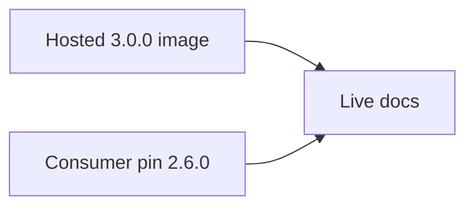

# Update memory docs for the 3.0.0 release

`l9-graphite-memory` **3.0.0** is the latest GitHub release (`v3.0.0`, published 2026-11-16). It is a hosted container, not a PyPI package. Release facts to cite, not invent past:

- Source `d8b33870c33dc4625f177282c5e99c888356efd8`
- Image `ghcr.io/quantum-l9/l9-graphiti-memory@sha256:73aae7ae580733406d23aa52c83a7f4e0b82530c10c5784f9d8b87de404866f3`
- Wheel `l9_graphite_memory-3.0.0-py3-none-any.whl` sha256 `c8967cd376414231d898bfc351ea0a5e682ed549cf8471bf828c832899af7bc6`
- Not on PyPI (3.0.1 is the stated PyPI resume)
- Deployed by `Quantum-L9/l9-deploy` run `43786931510`
- Position `ADMISSIBLE_WITH_ACCEPTED_RESIDUAL_RISK`

On that tag, [`docs/CURSOR_INSTANTIATION.md`](/Users/ib-mac/l9-graphiti-memory/docs/CURSOR_INSTANTIATION.md) still opens with `version: 2.3.0` and says the hosted 3.0 transport **is not deployed**. [`README.md`](https://github.com/Quantum-L9/l9-graphiti-memory/blob/v3.0.0/README.md) still says there is no `v3.0.0` tag and 3.0.0 is not an admitted release. The local `l9-graphiti-memory` checkout is the stale branch `feat/memory-front-door-signed-agent` (`v2.3.1-23`); do not edit that branch.

This repo still **binds package 2.6.0** in [`ops/config/memory-binding.json`](ops/config/memory-binding.json) and [`pyproject.toml`](pyproject.toml). [`ops/config/memory-receipt-contract.json`](ops/config/memory-receipt-contract.json) allows major `2` only. 3.0.0 cannot become the consumer pin in a docs change.

## Memory repository

Branch from fetched `v3.0.0`, not from the stale local feature branch.

Update the **body** of live operator docs so a reader sees 3.0.0 as the admitted hosted release:

- [`docs/CURSOR_INSTANTIATION.md`](/Users/ib-mac/l9-graphiti-memory/docs/CURSOR_INSTANTIATION.md): replace the sentence that the HTTPS MCP target is not deployed. Keep the local stdio `l9-memory client cursor` procedure as the local entry. State that the hosted door is the deployed 3.0.0 service (ADR-098 / ADR-038), and that this file does not install that remote entry.
- [`README.md`](/Users/ib-mac/l9-graphiti-memory/README.md) “Release and transport status”: replace “no `v3.0.0` tag / not an admitted release” with the release facts above. Keep older release sections as history.
- Same present-tense correction in [`QUICKSTART.md`](/Users/ib-mac/l9-graphiti-memory/QUICKSTART.md), [`RUNBOOK.md`](/Users/ib-mac/l9-graphiti-memory/RUNBOOK.md), [`AGENTS.md`](/Users/ib-mac/l9-graphiti-memory/AGENTS.md), and [`docs/COMPATIBILITY_MATRIX.md`](/Users/ib-mac/l9-graphiti-memory/docs/COMPATIBILITY_MATRIX.md) only where they still call 2.3 current or 3.0 future.

**L9_META `version: 2.3.0` headers stay.** [ADR-099](https://github.com/Quantum-L9/l9-graphiti-memory/blob/v3.0.0/docs/adr/ADR-099-retire-repository-inventory-and-l9-meta-enforcement.md) retired those headers: they are inert, not a release pin, and not maintained. GitHub search shows **89** files still carrying `version: 2.3.0`, including Python sources. `tests/regression/test_release_version_consistency.py` does not read them. The package version in `pyproject.toml` on the tag is already `3.0.0`. Bumping 89 headers would not change what the release is.

Do not rewrite ADR bodies, `CHANGE_SUMMARY.md` historical `## 2.3.0` / `## 2.3.1` sections, or “pre-v2.3” migration notes.

## This repository

Work on a **new branch from `origin/main`**. The current branch `feat/pr-review-permission` has unrelated dirty files and must not receive this.

Append-only, because [`CANONICAL_LAW.md`](CANONICAL_LAW.md) and [`AGENTS.md`](AGENTS.md) cannot have historical sections rewritten:

- Append a short law section after §8.10: 3.0.0 is the admitted hosted release (facts above). §8.8 remains the consumer package pin **2.6.0**. §8.4’s `2.3.1` pin stays historical.
- Append the same distinction to [`AGENTS.md`](AGENTS.md) (Memory control plane fragment) and to [`skills/l9-graphiti-memory/SKILL.md`](skills/l9-graphiti-memory/SKILL.md), which still describes the MCP adapter as local stdio. Point at law §8.10: hosted 3.0 MCP is authenticated Streamable HTTP; this checkout’s bound package is still 2.6.0 stdio until a separate rebind. Do not bump the skill’s own `version: 2.4.0` (that is the skill pack version).
- [`rules/03-graphiti-memory.mdc`](rules/03-graphiti-memory.mdc) and [`rules/98-graphiti-memory-gate.mdc`](rules/98-graphiti-memory-gate.mdc) already say Memory 3.0 is native HTTP. Add one line that 3.0.0 is deployed, and that this repo’s package pin is still 2.6.0. Do not tell agents to install 3.0.0.

Correct present tense in [`ops/memory/README.md`](ops/memory/README.md) where it still says the **live** pin is `v2.3.1` / `l9-graphite-memory==2.3.1` (production-pin paragraph and the cross-repo proof paragraph). Those sentences become: historical 2.3.1 upload; bound package is 2.6.0; hosted release is 3.0.0 and is not this lockfile. Leave the later “`2.6.0` is the current exact package binding” sentence true.

## Leave unchanged

- `expected_package_version`, `pyproject.toml`, `uv.lock`, `memory-receipt-contract.json`, `store_compat.py`
- Historical law, ADR-0030 / ADR-0032, built plans, test fixtures that assert `2.3.1 != 2.4.0`
- Unrelated `2.3` strings: mypy `2.3.0`, `AGENTS.md` §2.3, law §6.2.3, PlasticOS `19.0.2.3.*`, `skills/l9-dag-authoring` `2.3.0`, archived command versions

No consumer rebind and no `make pr` unless you ask after the docs are in place.
