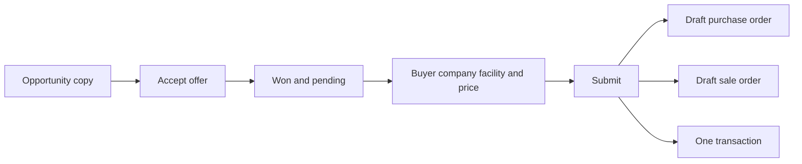

# Opportunity close

This replaces the earlier close that drafted a purchase order at offer acceptance. The opportunity stays the native `crm.lead` form. The supplier is the partner. At first save the opportunity copies the linked material profile, including notes and pictures, onto its own record. Later edits stay on that copy. They never write `plasticos.material.profile`. The approved lot stays frozen.

Arthur's price is what the buyer pays. The accepted offer's `price_per_lb` is what the purchase order pays the supplier.

## Execute via Cursor Build

Press **Build**. Plan on the current workspace. Execute on a clean `origin/fix/facility-profile-form` (pull request 423).

- If any open PR exists: **never** branch from `origin/main`. Sibling open-PR chains fail closed.
- `PR_STACK=auto` cannot choose a tip while pull requests 422 and 423 are both open. The authorized base is `fix/facility-profile-form`.
- If the board is empty: `origin/main` is allowed. The board is not empty.
- Do not run `make campaign`.
- Do not admit a Program Lock or Controller lease.
- Do not write `Lock: origin/main = <sha>`.
- Do not open a new worktree from tip as a **planning** requirement.
- Do not carry the dirty profile-editor tree on `feat/erp-company-role-tags`. It overlaps this whitelist.
- After Build todos complete: scoped-commit of the whitelist only, `l4_local.py authorize-release`, then `make pr-nosmoke base=fix/facility-profile-form` with a reason that names pull request 423. Do not use `PR_STACK=auto` and do not use `make pr` for this plan.
- The finish reply **must** display the opened PR URL as proof. Without that URL the Build is incomplete.

MEMORY_PREFETCH: namespace=`ib-odoo-19` snapshot_digest=`d5dad630493379a8f4bfdc046c4abbb08befd4954f823755cff68775cf45733f` conflicts=`0`. Depth from `route_plan.py` is `deep`; no gates are omitted.

## Metadata

| Field | Value |
|-------|-------|
| plan_id | `plan.simple.opportunity-close.v1` |
| name | Opportunity close |
| overview | Won opportunity keeps its own material copy. Admin submit creates one draft purchase order, one draft sale order, and one transaction. |
| schema_version | `1.0.0` |
| status | `draft` — V1, V2, and V3 have not run |
| is_project | `false` |
| owner | `igor_beylin` |
| created_at | `2026-11-09T21:25:00Z` |
| updated_at | `2026-11-09T21:25:00Z` |
| depth | `deep` |
| estimate | one pull request stacked on 423 |

## Architect framing

| Field | Value |
|-------|-------|
| planning_ssot | validated plan sections in this file; GAR intervention `USE_EXISTING` in `.l9/plans/opportunity_close.gar-decision.json` |
| plan_class | `bounded_execution_contract` |
| redesign_allowed | `false` |
| follow_on_schema_evolution_separate | `true` |
| framing_notes | Use the native opportunity, the native purchase order, and the native sale order. Do not add a second opportunity model. |

## Immutable baseline

| Field | Value |
|-------|-------|
| captured_at | `2026-11-09T21:25:00Z` |
| repository | `cryptoxdog/IB-Odoo_19` |
| workspace | `/Users/ib-mac/IB-Odoo_19 (LOCAL)/IB-Odoo_19` |
| branch | `feat/erp-company-role-tags` |
| commit_sha | `7a766c9cc8d10b9c59d8e8f536ae18ced4f30b53` |
| dirty | `true` |
| artifact_hashes | `{}` |
| allowed_local_dirt | none |
| overlap_policy | `stop_if_dirty_overlaps_may_modify` |
| verification_rule | `reverify_at_execution_start` |
| on_drift | `stop_and_replan` |

The dirty tree overlaps `plasticos_crm_bridge` and is the profile editor plus local facility-profile edits. Execution does not start on this tree. It starts from a clean `origin/fix/facility-profile-form`. On that branch the versions to bump are `plasticos_crm_bridge` `19.0.3.4.23` to `19.0.3.4.24`, `plasticos_transaction` `19.0.2.3.61` to `19.0.2.3.62`, and `plasticos_admin_dashboard` `19.0.1.1.2` to `19.0.1.1.3`.

## Objective

### Mission

A won supplier opportunity keeps its own material copy and never writes the live material profile. Accepting an offer marks it Won and creates no orders. Admin submit creates one draft purchase order at the accepted offer price, one draft sale order at the admin buyer price, and one transaction.

### Scope in

- `plasticos.opportunity.material`, copied once when `material_profile_id` is first set: polymer, material type, form, color, packaging, source, filler, attributes, the `SNAPSHOT_SCALAR_FIELDS` supply values, `freeform_notes`, and the profile's image attachments.
- The native form in [plasticos_crm_bridge/views/crm_lead_views.xml](plasticos_crm_bridge/views/crm_lead_views.xml) edits that copy, including its own pictures. New Quotation stays hidden.
- Native stages only. Offer acceptance in [plasticos_crm_bridge/models/match_lineage.py](plasticos_crm_bridge/models/match_lineage.py) marks Won and stops calling `_plasticos_draft_order_for_offer`.
- One header button, with no count, labeled Pending approval, opening won opportunities that have an accepted offer and no sale order.
- Submit creates the two unconfirmed drafts and one draft `plasticos.transaction`. [plasticos_transaction/models/sale_inherit.py](plasticos_transaction/models/sale_inherit.py) does not create a second row when `transaction_id` is already set. The `import_mode` path stays as it is.

Order lines already store the specification fields. Submit copies those values onto both lines and leaves `material_profile_id` empty.

### Success properties

| id | property | evidence_type | proof | blocking |
|----|----------|---------------|-------|----------|
| SP-01 | Editing the opportunity material copy does not change the source profile fields or its image attachments. | `runtime_behavior` | V1 | `true` |
| SP-02 | Accepting an offer sets the native Won stage and creates no purchase order, sale order, or transaction. | `runtime_behavior` | V1 | `true` |
| SP-03 | Submit creates one draft purchase order at the offer price, one draft sale order at Arthur's price for the selected facility, and one transaction. Confirming that sale order does not create a second transaction. | `runtime_behavior` | V1 | `true` |
| SP-04 | Pending approval opens that list and adds no count badge. | `structural` | V2 | `true` |
| SP-05 | The whitelist passes the repo hook catalog. | `quality_gate` | V3 | `true` |

## Capability preflight

| Field | Value |
|-------|-------|
| preflight_id | `preflight.plan.simple.opportunity-close.v1` |
| source_ref | `plan.simple.opportunity-close.v1` |
| phase_id | `preflight` |
| blocking | `true` |
| immutable_baseline_ref | `7a766c9cc8d10b9c59d8e8f536ae18ced4f30b53` |
| baseline_verified | `true` |
| drift_detected | `true` — dirty tree overlaps the whitelist; execution must move to a clean 423 base first |

### Probes

| id | capability | command_or_action | pass_criteria | blocking |
|----|------------|-------------------|---------------|----------|
| P0 | memory | MEMORY_PREFETCH | conflicts=0 and the digest above | `true` |
| P1 | depth | `route_plan.py --risk high --evidence sufficient` | depth `deep`, omit_gates empty | `true` |
| P2 | baseline | `git rev-parse HEAD` | SHA above; dirty checkout is not the execution base | `true` |
| P3 | hooks | `.pre-commit-config.yaml` | the file is the hook catalog for this repo | `true` |

## Execution envelope

Mutations outside this envelope are forbidden.

### File whitelist

`write_allow` is the only set Build may change:

- `plasticos_crm_bridge/__manifest__.py`
- `plasticos_crm_bridge/models/__init__.py`
- `plasticos_crm_bridge/models/opportunity_material.py`
- `plasticos_crm_bridge/models/crm_lead.py`
- `plasticos_crm_bridge/views/crm_lead_views.xml`
- `plasticos_crm_bridge/security/ir.model.access.csv`
- `plasticos_crm_bridge/tests/__init__.py`
- `plasticos_crm_bridge/tests/test_opportunity_material_copy.py`
- `plasticos_crm_bridge/data/crm_stage_data.xml`
- `plasticos_crm_bridge/migrations/19.0.3.4.24/post-migrate.py`
- `plasticos_crm_bridge/models/crm_mapping.py`
- `plasticos_crm_bridge/models/web_lead.py`
- `plasticos_crm_bridge/models/match_lineage.py`
- `plasticos_crm_bridge/tests/test_web_lead_opportunity.py`
- `plasticos_crm_bridge/tests/test_opportunity_approval.py`
- `plasticos_crm_bridge/tests/test_opportunity_release.py`
- `plasticos_crm_sync/tests/test_orchestrator_upsert.py`
- `plasticos_crm_sync/tests/test_crm45_classification.py`
- `tests/test_crm_sync_classification.py`
- `plasticos_transaction/__manifest__.py`
- `plasticos_transaction/models/sale_inherit.py`
- `plasticos_admin_dashboard/__manifest__.py`
- `plasticos_admin_dashboard/models/admin_dashboard.py`
- `plasticos_admin_dashboard/views/admin_dashboard_views.xml`

### Write deny

- `plasticos_material_profile/`
- `plasticos_material_profile/views/partner_material_ux.xml`
- `plasticos_order_lines/`
- `plasticos_logistics/`
- `plasticos_offer/`
- `plasticos_facility_profile/`
- `plasticos_crm_bridge/models/opportunity_approval.py`
- `plasticos_security_base/`
- `pipeline_v2.py`

`delete_allow:` none.

### Commands

- **allow:** `make runtime-test m=plasticos_crm_bridge,plasticos_crm_sync,plasticos_transaction,plasticos_admin_dashboard`; `pre-commit run --all-files`; `make pr-nosmoke base=fix/facility-profile-form`
- **deny:** `git push --force`, `git reset --hard`, admin merge, committing secrets, `make campaign`, `PR_STACK=auto`, `make pr`

### Network

| Field | Value |
|-------|-------|
| mode | `named_services_only` |
| allowed_services | `github.com` |

### Secrets

| Field | Value |
|-------|-------|
| access | `runtime_injected_only` |
| redaction_required | `true` |

### Autonomous merge

`autonomous_merge:` `false`. This plan confers no merge authority.

### Preserved contracts

- Opportunity edits never write `plasticos.material.profile`.
- The approved lot stays frozen.
- Arthur's price is the sale-order price. The accepted offer `price_per_lb` is the purchase-order price.
- Submit does not confirm orders, activate the transaction, or call `po_issue` or `so_issue`.
- `import_mode` sale confirmation still compiles worksheet transactions.
- No new buyer-purchase-order follow-up cron.

## Side effects and idempotency

| todo_id | side_effects | idempotency | retry | compensation | irreversible |
|---------|--------------|-------------|-------|--------------|--------------|
| opportunity-copy | `filesystem_mutation` | `safe_with_dedupe` | `retry_once` | `git restore` of its whitelist files | `false` |
| native-stages | `filesystem_mutation` | `safe_with_dedupe` | `retry_once` | `git restore` of its whitelist files; the post-migrate only remaps the named stage xmlids | `false` |
| admin-release | `filesystem_mutation` | `safe_with_dedupe` | `retry_once` | `git restore` of its whitelist files | `false` |

Submit itself is safe to repeat: a second submit returns the same purchase order, sale order, and transaction.

## Architecture impact

| todo_id | bounded_context | layer | owning_contract | prohibited |
|---------|-----------------|-------|-----------------|------------|
| opportunity-copy | `plasticos_crm_bridge` | `runtime` | opportunity copy never writes the live profile | write deny list |
| native-stages | `plasticos_crm_bridge` | `runtime` | acceptance marks Won and creates no orders | write deny list |
| admin-release | `plasticos_transaction` | `runtime` | one transaction when both drafts exist; confirm does not create a second | write deny list |

`plasticos_admin_dashboard` gains a dependency on `plasticos_crm_bridge`. No cycle: CRM Bridge does not depend on the dashboard.

## Rollback

| Field | Value |
|-------|-------|
| rollback_id | `rollback.plan.simple.opportunity-close.v1` |
| source_execution_ref | `plan.simple.opportunity-close.v1` |
| supported | `true` |
| automatic_allowed | `false` |
| approval_required | `false` |
| trigger_conditions | C1, C2, or C3 fails, or a whitelist file writes the live material profile |

| domain | mode | notes |
|--------|------|-------|
| code | `git_restore_scoped_paths` | restore the whitelist on the feature branch |
| data | `manual_recovery` | the stage post-migrate remaps named xmlids only; revert that commit to stop the mapping |
| external_state | `none` | submit sends no mail and confirms nothing |
| local_state | `git_restore_scoped_paths` | scoped to the whitelist |

No todo is irreversible. Re-run V1, V2, and V3 after a restore.

## Complexity and uncertainty

| Field | Value |
|-------|-------|
| complexity | `high` — admin-release changes when a transaction is born |
| uncertainty | `low` — no open product questions |
| blast_radius | `high` — a wrong close writes the supplier master or compiles a second transaction |
| architectural_boundaries_crossed | `crm.lead`, `purchase.order`, `sale.order`, `plasticos.transaction` |
| external_systems_touched | `github.com` |
| migration_required | `true` |
| unknown_dependency_count | `0` |

## Execution DAG

| Field | Value |
|-------|-------|
| topology_id | `dag.plan.simple.opportunity-close.v1` |
| topology_kind | `execution` |
| graph_type | `directed_acyclic_graph` |

| id | owner | layer | depends_on | outputs |
|----|-------|-------|------------|---------|
| opportunity-copy | `igor_beylin` | `runtime` | `[]` | opportunity material copy and form |
| native-stages | `igor_beylin` | `runtime` | `[]` | native stages and acceptance that creates no orders |
| admin-release | `igor_beylin` | `runtime` | `[opportunity-copy, native-stages]` | pending list, both drafts, one transaction |

**Critical path:** `opportunity-copy` → `native-stages` → `admin-release`

**Forbidden edges:** acceptance → draft purchase order; acceptance → draft sale order; opportunity edit → `plasticos.material.profile`; submit → `po_issue` or `so_issue`

## Property evidence matrix

| evidence_id | claim_id / SP | evidence_kind | method | command | expected_positive | status |
|-------------|---------------|---------------|--------|---------|-------------------|--------|
| V1 | SP-01, SP-02, SP-03 | `runtime_behavior_evidence` | Odoo runtime test | `make runtime-test m=plasticos_crm_bridge,plasticos_crm_sync,plasticos_transaction,plasticos_admin_dashboard` | copy, acceptance, and submit tests pass; confirm creates no second transaction | `not_run` |
| V2 | SP-04 | `structural_evidence` | file read | `plasticos_admin_dashboard/views/admin_dashboard_views.xml` contains Pending approval and no new urgency count | list opener only | `not_run` |
| V3 | SP-05 | `quality_gate_evidence` | hook catalog | `.pre-commit-config.yaml` via `pre-commit run --all-files` | pass | `not_run` |

## Stress and disconfirm

### Disconfirming cases

- An opportunity edit still writes the live profile through a related field or `action_attach_images`.
- Offer acceptance still calls `_plasticos_draft_order_for_offer`.
- `sale.order.action_confirm` creates a second transaction when `transaction_id` is already set.
- Submit confirms an order, activates the transaction, or sends `po_issue` or `so_issue`.

### Assumption failure conditions

- The same price is written on both orders.
- `PR_STACK=auto` is treated as able to choose a tip while 422 and 423 are open.
- The dirty profile-editor tree is used as the execution base.

### Blast radius notes

- A wrong close writes the supplier master profile, drafts orders before the admin chooses the buyer, or compiles a second transaction.

### Rollback constraints

- Restore is scoped to the whitelist. Do not reset the dirty profile-editor work on `feat/erp-company-role-tags`.

## Out of scope

- Writing `plasticos.material.profile` from the opportunity, including attributes and pictures.
- Editing the frozen `plasticos.opportunity.approval` lot.
- Drafting a purchase order or sale order at offer acceptance.
- Confirming either order, activating the transaction, or calling `po_issue` or `so_issue` from submit.
- A new buyer-purchase-order follow-up cron.
- Changes to `plasticos_order_lines`, `plasticos_logistics`, `plasticos_offer`, `plasticos_facility_profile`, or `partner_material_ux.xml`.
- Carrying the uncommitted profile-editor tree.
- `PR_STACK=auto` or `make pr` while pull requests 422 and 423 are both open.
- Retargeting the historical `import_mode` worksheet compiler.
- Force-push, hard-reset, admin-merge, or secret exfiltration.
- Weakening scanners or gates to obtain a pass.

## Convergence

| Field | Value |
|-------|-------|
| convergence_id | `conv.plan.simple.opportunity-close.v1` |
| source_ref | `plan.simple.opportunity-close.v1` |
| current_state | `draft` |
| implementation_ready | `false` |

### Gates

- **executable_when:**
  - execution checkout is a clean `origin/fix/facility-profile-form`
  - blocking probes P0–P3 pass
  - the DAG stays acyclic
  - the whitelist is unchanged
  - V1, V2, and V3 pass

### Evidence

- **required_evidence_refs:** V1, V2, V3
- **observed_evidence_refs:** none
- **missing_evidence:** V1, V2, V3

### Blockers / unknowns

| kind | id | note | resolution |
|------|----|------|------------|
| `open_blocker` | stop_reason | V1, V2, and V3 have not run | run them on the 423 base before publish |

### Next

| Field | Value |
|-------|-------|
| next_convergence_gate | Build on a clean `fix/facility-profile-form`, then V1, V2, and V3 |
| minimum_safe_next_action | Press Build only from that clean base. Publish with `make pr-nosmoke base=fix/facility-profile-form`. |
| execute_via | `cursor-build` |
| next_skill | Build, then the nosmoke publish above |
| broader_work_requires_separate_contract | `true` |

### Doc / root surface

| surface | action | reason |
|---------|--------|--------|
| `AGENTS.md` | `n_a` | No command, module-count, or invariant sentence changes. |
| `INVARIANTS.md` | `n_a` | No POS-INV text changes. The lot remains frozen and the live profile is not a write target. |
