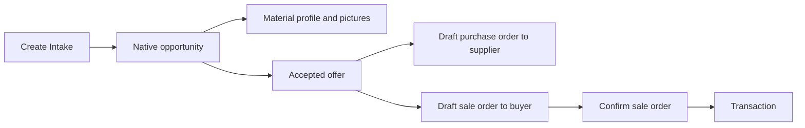

# Opportunity pipeline

The screen Create Intake opens is the native opportunity form of `crm.lead`. This change uses that form. It does not add a second opportunity model, a second stage widget, or a rebuilt partner or notes block.

The opportunity partner is the supplier. Closing the deal on this form is a purchase from that supplier. Confirming the buyer sale order stays the transaction compiler, because loads, commission, and documents already key off `sale.order`.

## What the broker sees

On [plasticos_crm_bridge/views/crm_lead_views.xml](plasticos_crm_bridge/views/crm_lead_views.xml), add one group at the top of the existing form, ahead of Expected Revenue:

- The linked material profile, with related read-only polymer, material type, form, color, packaging, weight per load, and `freeform_notes`.
- Two fields the broker types here: the price paid to the supplier, and the date the material is ready. Neither field exists today.
- A button that calls the profile’s existing `action_attach_images`. The photos stay on the profile. The button is hidden until a profile is linked.

The profile chooser uses the same owners as lot approval: the partner, its sites, and its company. The current domain only allows the partner itself.

Hide the `sale_crm` New Quotation button. On this form it would sell to the supplier. Leave Won, Lost, the partner, the address tab, and the native stage widget in place. Expected Revenue stays on the model and leaves the top of the sheet.

## Stage bar

The statusbar keeps Odoo’s native stages: New, Qualified, Proposition, and Won, plus the native Lost action. In [plasticos_crm_bridge/data/crm_stage_data.xml](plasticos_crm_bridge/data/crm_stage_data.xml), deactivate Qualified — HOT, Qualified — WARM, Resistant, Active Supplier, Dead Lead, and the extra New. Clear `is_won` on Active Supplier before it is deactivated.

A `19.0.3.4.25` post-migrate moves existing opportunities off those stages: the extra New goes to native New; HOT, WARM, Resistant, and Active Supplier go to native Qualified. Active Supplier does not become Won. Dead Lead becomes native Lost.

New opportunities and HOT web leads start on native New (`crm.stage_lead1`). [plasticos_crm_bridge/models/crm_mapping.py](plasticos_crm_bridge/models/crm_mapping.py) points VanillaSoft New at native New, and HOT, WARM, and Resistant at native Qualified. Nothing in that map sets Won. The broker moves Proposition and Won. Offer acceptance still does not mark the opportunity won.

## Purchase order

When an offer is accepted, [plasticos_crm_bridge/models/match_lineage.py](plasticos_crm_bridge/models/match_lineage.py) also creates one draft `purchase.order` to the supplier company, using the same partner rule as Make PO on the profile. The line carries the material profile, the supplier price, and the ready date as the line’s planned date. It is not confirmed and it compiles nothing.

The existing draft sale order to the buyer stays. Confirming that sale order still compiles the one transaction. This plan does not change [plasticos_transaction/models/sale_inherit.py](plasticos_transaction/models/sale_inherit.py) or the load, commission, or document spine.

## Stack

This sits on the profile-editor work that added `action_attach_images`, and on pull request 422’s contact form. It does not edit the contact material list or `partner_material_ux.xml`. `plasticos_crm_bridge` moves from `19.0.3.4.24` to `19.0.3.4.25`. No other module version changes.

## Done

- Create Intake from a facility or a profile still opens the native opportunity form.
- The top shows the supplier’s material, freeform notes, supplier price, ready date, and a way to review the profile’s pictures.
- The stage bar shows New, Qualified, Proposition, and Won. The VanillaSoft stage names are gone.
- Accepting an offer drafts a purchase order to the supplier and still drafts the buyer sale order. It does not mark the opportunity won and does not compile a transaction.
- The diff is the whitelist below. Ruff is clean on the edited Python.
