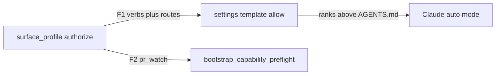

# Close the profile's thread-handling contradictions

Architecture is already settled. [`ops/autonomy/surface_profile.yaml`](ops/autonomy/surface_profile.yaml) is the autonomy contract. [`environment/agents/adapters/claude-code/settings.template.json`](environment/agents/adapters/claude-code/settings.template.json) is the Claude permission list. `authority_order` ranks `settings.allow_deny` above `AGENTS.md`, so a profile verb with no allow entry is denied. This change makes those two surfaces name the same two REST routes. It does not add a helper, a gate, or a new publish path.

The current checkout is [`feat/fail-closed-plan-pipeline`](feat/fail-closed-plan-pipeline) at `ffac59a6`, behind `origin/main` (`8e4b352`), with unrelated dirty files plus an uncommitted `pr_threads.py` helper. Leave that tree untouched. Edit a wired worktree cut from `origin/main` with [`ops/scripts/worktree_add_wired.sh`](ops/scripts/worktree_add_wired.sh). The only open PR is [#837](https://github.com/Quantum-L9/Cursor-Governance/pull/837) (kernel routing). Publish this change against `origin/main`. Stacking it onto #837 would mix unrelated work.

## F1 — own-PR thread reply and resolve, approval forbidden

In [`ops/autonomy/surface_profile.yaml`](ops/autonomy/surface_profile.yaml) at `main@8e4b352`:

- Append to `authorize`: `review_thread_reply_and_resolve_on_own_open_pr` and `pr_status_comment_on_own_open_pr`, with the comments in the request.
- Append to `forbid`: `pull_request_review_approval`. This moves "never approve" out of [`remediation.note`](ops/autonomy/surface_profile.yaml) (line 260) into the list the adapters read. Leave the note in place.
- Under `surface_capabilities.github`, add `review_threads` with the four fields from the request: reply `POST repos/{o}/{r}/pulls/{n}/comments/{comment_id}/replies`, resolve `POST repos/{o}/{r}/pulls/{n}/ccr/comments/{comment_id}/resolve`, list `GET repos/{o}/{r}/pulls/{n}/ccr/review_threads`, `key: comment_id`, and the own-open-PR scope. Those routes are already the ones in [`rules/62-github-openclaw-authority.mdc`](rules/62-github-openclaw-authority.mdc).

Companion in [`settings.template.json`](environment/agents/adapters/claude-code/settings.template.json) `permissions.allow`, next to the existing `Bash(gh api --method GET:*)` entry. Four strings, two routes, both spellings. The file's standing read grant uses `--method`; the denial on IB-Odoo_19 #392 was `-X POST`. Either spelling still prompts if only the other is listed.

- `Bash(gh api --method POST *repos/*/pulls/*/comments/*/replies*)`
- `Bash(gh api -X POST *repos/*/pulls/*/comments/*/replies*)`
- `Bash(gh api --method POST *repos/*/pulls/*/ccr/comments/*/resolve*)`
- `Bash(gh api -X POST *repos/*/pulls/*/ccr/comments/*/resolve*)`

The resolve pattern requires the path segment `/resolve`, so `/unresolve` does not match. Do not add `Bash(gh api --method POST:*)` or `Bash(gh api -X POST:*)`. [`tests/adapters/claude_code/test_capability_friction_contract.py`](tests/adapters/claude_code/test_capability_friction_contract.py) forbids those exact broad grants, and [`validate_claude_env.py`](environment/agents/adapters/claude-code/validate_claude_env.py) rejects any `Bash(gh …)` entry in `permissions.deny`.

Narrow the `_comment` sentence that says `gh api POST` is not a standing grant, so it excepts these two routes. A comment that still denies every POST recreates the contradiction inside the same file.

`pr_status_comment_on_own_open_pr` stays a profile verb with no allow entry. Rule 62's route is `POST /repos/{o}/{r}/issues/{n}/comments`. Settings will still prompt on that call. That matches the request's count of two routes.

Own-PR scope stays declarative. These globs match the path shape on any repo the session can call. No new enforcer in this change.

## F2 — PR watch comes from the profile

Under `l4_local_autonomy.post_push`, add:

`pr_watch: subscribe_pr_activity_events_only`

[`environment/agents/adapters/claude-code/hooks/bootstrap_capability_preflight.sh`](environment/agents/adapters/claude-code/hooks/bootstrap_capability_preflight.sh) line 27 is a hardcoded "Do not invoke Send Later" sentence. Replace that assignment with a bare-`python3` read of `pr_watch` from `$HOME/.cursor-governance/ops/autonomy/surface_profile.yaml` (no PyYAML; SessionStart cannot require the venv). When the value is `subscribe_pr_activity_events_only`, the emitted line still contains `Do not invoke Send Later` and names `l9-pr-remediation` as the owner of convergence. A missing key keeps today's sentence, so an older profile does not blank the warning.

## F3 — one credential name, one transport list

`pr_stacking.github_rest` is declared only in the profile. Nothing in Python reads `pat_ref`. Replace the block so it matches `surface_capabilities.github.credential_model` and rule 62:

- `transports: surface_capabilities.github`
- `pat_ref: GITHUB_TOKEN` with a comment that this is the Infisical `cursor-governance` name, and only on credential-holding surfaces; `openclaw-igorbot/github#token` remains the legacy alias in rule 62, not a second secret
- `sanctioned_routes`: `gh api` only. Bare `gh pr` / `gh repo` stay off this list
- `second_pat: forbidden` unchanged
- Replace the comment above the block that still says "same openclaw PAT"

## F4 — native publish is named on `required_command`

Change `l4_local_autonomy.post_push.required_command` to:

`make pr # native routes: the consumer's pr / pr-nosmoke target per ops/config/publish-authority.json`

Do not edit `session_start_block`. It already describes the IB-Odoo_19 native route (lines 317–327). [`ops/config/publish-authority.json`](ops/config/publish-authority.json) stays the registry; this comment only points at it. The live native target for `github.com/cryptoxdog/ib-odoo_19` is `pr`, with `pr-check` as the check target.

## F5 — stamp the edit

Set `updated` to `2026-11-06`.

## Projections and tests

Do not hand-edit generated files.

- [`ops/scripts/reconcile_claude_settings.py`](ops/scripts/reconcile_claude_settings.py) `--root <worktree> --skip-user` rewrites the worktree's [`.claude/settings.json`](.claude/settings.json) from the template. [`test_preflight_is_registered_and_projects_without_drift`](tests/adapters/claude_code/test_capability_friction_contract.py) compares those two.
- [`ops/scripts/project_llm_rules.py`](ops/scripts/project_llm_rules.py) `--root <worktree>` refreshes the manifest hash of the profile. `llm_rules_override` is not edited, so [`zz-autonomy-surface-override.md`](environment/generated/llm-rules/zz-autonomy-surface-override.md) body stays the same unless the hash row moves.

Extend [`tests/adapters/claude_code/test_capability_friction_contract.py`](tests/adapters/claude_code/test_capability_friction_contract.py): the four allow strings are required; the two broad POST strings stay forbidden; the preflight source reads `pr_watch` and still contains `Do not invoke Send Later`. Add assertions in [`tests/ops/autonomy/test_surface_profile.py`](tests/ops/autonomy/test_surface_profile.py) for the new authorize verbs, the forbid entry, `review_threads`, `pr_watch`, and `pat_ref: GITHUB_TOKEN`.

Checks, from the worktree, with its locked interpreter:

- `python3 ops/scripts/validate_autonomy_contracts.py`
- `python3 environment/agents/adapters/claude-code/validate_claude_env.py`
- `python3 ops/scripts/project_llm_rules.py --root .` then the projector's check mode if the script exposes `--check`
- `python3 -m pytest tests/adapters/claude_code/test_capability_friction_contract.py tests/ops/autonomy/test_surface_profile.py -q`

## Out of scope

Copilot quota, CodeRabbit `tests/**` filters, Context7 identity, and SonarCloud are repo or secret settings. The second `make pr` cycle is already covered by `remediator_git_push_of_open_pr`. The uncommitted helper under the dirty checkout is a different design and is not part of this branch.

## Finish

Scoped-commit on the new branch, `l4_local.py authorize-release`, then `PR_REMEDIATE=0 make pr` against `origin/main`. Show the PR URL.
