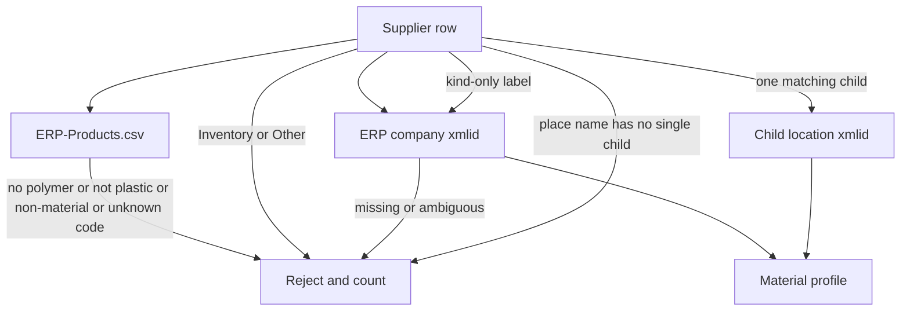

# Supplier material profiles from the ERP product map

The ERP sync does not create material profiles. [`plasticos_partner_import`](plasticos_partner_import) writes companies, locations, and orders. `InvoiceDesc` is stored only as the order-line description in [`native_orders.py`](plasticos_partner_import/erp/native_orders.py). This backfill is a separate command. It does not change `make import-erp`.

[`normalize_material`](plasticos_material_profile/models/material_normalizer.py) is not the reader. It loads [`material_mapping.csv`](plasticos_material_profile/data/material_mapping.csv), keeps only `status=mapped` rows that name a polymer, and has no quality-tier slot. Every `status` cell in [`ERP-Products.csv`](plasticos_material_profile/data/ERP-Products.csv) is empty, so that reader would keep none of these products.

Sources, counted from the current files:

- [`ERP-Products.csv`](plasticos_material_profile/data/ERP-Products.csv) — 197 product rows, utf-8-sig. Not listed in the module manifest.
- [`ERP-Material-Profiles-Suppliers.csv`](plasticos_material_profile/data/ERP-Material-Profiles-Suppliers.csv) — 1,379 rows, cp1252, columns `Product`, `Supplier`, `Ship From`. 609 suppliers. 568 ship-from values are `invoice`.
- [`ERP-Products-non-material.csv`](plasticos_material_profile/data/ERP-Products-non-material.csv) — products that never become a profile.

[`plasticos.material.profile`](plasticos_material_profile/models/material_profile.py) requires `polymer_id`. The unique index is partner + polymer + form + material grade, with nulls distinct. The partner field domain `[('parent_id','!=',False)]` is a form filter, not a constraint. A profile whose partner is the supplier company still appears on that company's Material Profile tab. Do not change the domain and do not set `facility_profile_id`.

## Map authority

Join `Product` to `source_value` by casefolding and collapsing whitespace. Do not add a second punctuation-stripped key.

Do not fill empty polymer cells. `PP` (39 supplier rows) and `PS` (3) stay `no_polymer`, as do the other polymer-less products, including `#7 Mixed Resin`, `HDPE / LDPE Regrind`, and `IBC Totes`. The map notes leave those polymers empty on purpose.

The only edit to the product map is the packaging typo. Three rows say `BALES`. The seed code in [`packaging_type_data.xml`](plasticos_material_profile/data/packaging_type_data.xml) is `bales`, and 32 other product rows already use `bales`. Change those three cells to `bales`. That covers the `PP Supersacs` rows.

Split `color` and `attributes` on commas and whitespace, then drop empty tokens. `BLUE, WHITE` is the two seed colors `BLUE` and `WHITE`.

A non-empty code that is not in the seed master, or a process code that is not in [`PROCESS_CODES`](plasticos_material_profile/process_codes.py), rejects the row as `unknown_code`. Do not add masters. These current cells stay rejected: material grade `RESIN`, attributes `OPAQUE` and `TRANSLUCENT`.

`is_plastic=FALSE` rejects the row even when a polymer is present. A blank `is_plastic` with a polymer does not reject.

## Partner target

Company candidates are active `res.partner` rows with `is_company` set, no parent, and an `ir.model.data` row in module `plasticos_transaction` whose name starts with `legacy_erp_cp_`. That is the module [`erp_import_service.py`](plasticos_partner_import/models/erp_import_service.py) writes. Match the supplier name to `partner.name` by casefolding and collapsing whitespace. Zero matches reject as `missing_company`. Two matches reject as `ambiguous_company`. A same-named partner without that xmlid is not a candidate.

`(Inventory)` and `(OTHER)` reject as `not_a_supplier` before the lookup. A blank product rejects as `blank_product`. A product on the non-material list rejects as `non_material` before the map is read.

Ship-from resolution, in this order:

- [`is_kind_only_label`](plasticos_partner_import/erp/mapping.py) true, which includes `invoice`, `primary`, and `pick up address`: the profile partner is the company. Do not search children. The CSV has no AddressID. This label is the company site because the ERP location title never creates a partner named with a kind word. It is not proof that every one of the 568 `invoice` rows was the folded billing address.
- Otherwise, active `is_company` children of that company that carry a `plasticos_transaction` xmlid starting with `legacy_erp_address_`. Exactly one name match is the profile partner. Zero matches reject as `missing_location`. Two reject as `ambiguous_location`. Do not fall back to the company. Do not create a partner or a location. A contact person is not a location.

## Write rules

Library: [`plasticos_material_profile/scripts/supplier_material_profiles.py`](plasticos_material_profile/scripts/supplier_material_profiles.py). Shell: [`plasticos_material_profile/scripts/import_supplier_material_profiles_shell.py`](plasticos_material_profile/scripts/import_supplier_material_profiles_shell.py). Neither file is imported from the addon `__init__.py`. Tests and the library load `mapping.py` and the library by file path so pytest does not execute [`plasticos_material_profile/__init__.py`](plasticos_material_profile/__init__.py) or [`plasticos_partner_import/__init__.py`](plasticos_partner_import/__init__.py). No manifest change and no version bump: these scripts are not loaded on module upgrade.

The library classifies rows and a partner catalog. It does not open a database. The shell builds the catalog, resolves codes with `search([("code", "=", code)])`, and writes `origin_process_type` from `PROCESS_CODES`. Quality tier is `plasticos.material.quality.tier` by code. The normalizer does not resolve that field.

Makefile target `import-supplier-material-profiles` uses the same Docker-or-local `odoo shell` choice as `make import-erp`. It does not call the ERP shell and does not pass SQL settings. Unset `APPLY` is a dry-run. The recipe passes `SUPPLIER_PROFILE_APPLY=1` only when `APPLY=1`. It passes `SUPPLIER_PROFILE_TARGET_DB` as the database the shell connected to.

The shell refuses, writes nothing, and exits 2 when any of these hold:

- `current_database()` is not `SUPPLIER_PROFILE_TARGET_DB`
- `ODOO_STAGE` is `production`
- the database name contains `production` or `prod`, using the same markers as [`validate_partner_layer.py`](plasticos_partner_import/scripts/validate_partner_layer.py)
- `TEST_ENV_VERIFIED_CLONE` is set and names a different database

There is no production permit on this command.

On apply, create the profile only when that partner and polymer + form + grade do not already exist. Replay leaves profile fields unchanged. The replay marker is `ir.model.data` module `plasticos_material_profile`, name `erp_supplier_profile_` plus the first 16 hex characters of the SHA-256 of the normalized supplier, ship-from, polymer, form, and grade. The hash does not contain a database id. If that marker is absent and the unique index already has the profile, apply writes only the marker and the row is `records_unchanged`. If the marker points at a different profile than the unique index, the row is `identity_marker_conflict` and the marker is not moved.

Inside one file, the first row of a source identity is the keeper. A later row with the same optional codes (source, attributes, colors, filler, process, quality tier, packaging) is a duplicate. A later row with different optional codes is `identity_conflict`. The keeper is still created. An existing profile is `records_unchanged` even when the CSV's optional codes differ. Do not merge colors or attributes onto it.

## Summary contract

Write `.l9/pr/import-supplier-material-profiles-summary.json` in the shape of [`import-run-summary.schema.json`](contracts/schemas/draft/import-run-summary.schema.json). `additionalProperties` is false, so the file has only that schema's fields. `source` is `erp_supplier_material_profiles_dry` or `erp_supplier_material_profiles`. `records_updated` is 0. Duplicates are the collapsed rows. Rejected rows, including conflicts, are `records_rejected`. `errors` holds one `{record_ref, message}` per rejected row, capped at 1000, while `records_rejected` counts every rejected row. `record_ref` is the supplier, ship-from, and product. No secret keys or values.

The shell exits 1 unless:

- `records_seen = records_created + records_updated + records_unchanged + records_rejected + duplicates`
- `records_valid = records_created + records_unchanged + duplicates`
- `records_updated = 0`

`final_status` is `success` when `records_rejected` is 0, `partial` when some rows were rejected, and `failed` when the equation does not close. Exit 0 for `success` and `partial`. After a run that writes the file, `python3 scripts/validate_import_summary.py` must accept it. This summary is not an ERP import summary and does not feed `make import-erp`.

## Proof

[`tests/test_erp_supplier_material_profiles.py`](tests/test_erp_supplier_material_profiles.py) loads the library by file path and reads the real CSVs. It asserts:

- `PP`, `PS`, `#7 Mixed Resin`, and `IBC Totes` are `no_polymer`
- `PP Supersacs` resolves packaging `bales`
- `BLUE, WHITE` resolves both color codes
- `RESIN`, `OPAQUE`, and `TRANSLUCENT` are `unknown_code`
- a non-material row and an `is_plastic=FALSE` row are rejected
- `(Inventory)` is `not_a_supplier`
- against a fake catalog, `invoice` binds the company, one child name binds that child, an unmatched place name is `missing_location`, and two ERP companies with the same normalized name are `ambiguous_company`
- a repeated identity is a duplicate, a repeated identity with a different color is `identity_conflict`, and the equation closes

The customer CSV is out of scope.

When those tests pass, run `make import-supplier-material-profiles` with `APPLY` unset if a local Odoo database is reachable. A database with no `legacy_erp_cp_` partners produces `missing_company` and `final_status=partial`; that is a completed dry-run, not a failed tool. Do not run `APPLY=1` as part of building the command. A later apply, including any staging or production database, is a separate operator decision. Production remains refused by the shell.
