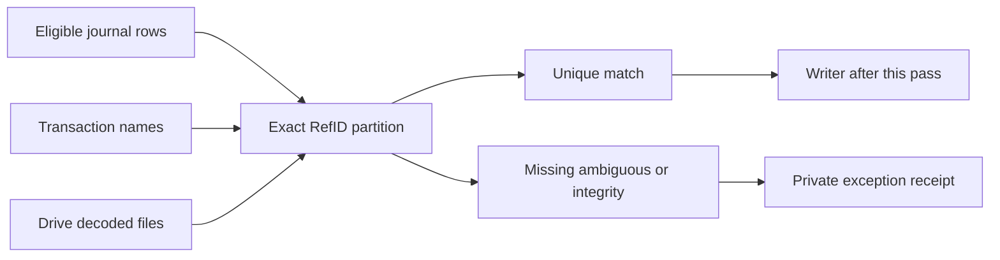

# Worksheet image importer

Validated cursor-build projection: [worksheet_image_importer_c4e81b07.plan.md](/Users/ib-mac/Cursor-Governance/docs/plans/worksheet_image_importer_c4e81b07.plan.md). Section receipt passed. Status stays draft until V1–V4 run during Build.

The running Production database `cryptoxdog-ib-odoo-19-production-29882273` on host `ampp304` (checkout `eff41988`, 2026-11-10 02:13 UTC) already has Enterprise `documents` and `documents_account`. [`plasticos_documents_native/__manifest__.py`](plasticos_documents_native/__manifest__.py) is `auto_install: True` at `19.0.1.2.13` and is already in that checkout, but `ir.module.module` reports it **uninstalled**. That module is what adds `documents.document.transaction_id` in [`document_native.py`](plasticos_documents_native/models/document_native.py).

`create()` on that model refuses a direct write of `verified` and does not call `sync_native_to_legacy`. The sync runs only from `action_associate_exact` and from the batch that requires `doc_type`. Leaving `owner_id` and `doc_type` empty keeps the import out of that batch and creates no activity.

`make pr` publishes only to Staging. Installing the bridge on the current Production build does not deploy the new writer. This pass does not upload the 97,346 files. The current checkout is `feat/web-lead-location` at `e08b6581`. The writer branch is cut from `origin/Staging`, not from that branch.

## Match rule

`RefID` equals `plasticos.transaction.name` by character, including suffixes and hyphens. `51687-JCH` matches only `51687-JCH`. Many images may share one worksheet. A match is one transaction. A sale-order number is not a match. Only `ImportScope = eligible` enters the partition (`W` and `#`, 97,346 rows). `P`, `E`, and `B` stay out.

A row is a unique match only when that name exists once and `decoded/<ImageID>.<ext>` exists. ImageID `633316` is the known `not_gzip` row and has no file, so it is an integrity failure. Zero names is missing. Two names is ambiguous. Those three stay in the exception list.

The identity that must close before any writer runs:

`eligible = unique match + missing transaction + ambiguous transaction + integrity failure`

## 1. Count before the writer exists

Read-only, on this Mac:

- Journal: `/Users/ib-mac/Odoo-ERP-Files/journal.import-scope.csv` (original `journal.csv` stays untouched)
- Names: `/Users/ib-mac/Odoo-ERP-Files/private/production-transactions.csv` (7,727 rows, 7,727 distinct names, company Scrap Management Inc)
- Files: `/Users/ib-mac/Library/CloudStorage/GoogleDrive-ib@scrapmanagement.com/My Drive/ERP Blobs Restored/decoded` (111,009 files)

Write `/Users/ib-mac/Odoo-ERP-Files/private/crosswalk-receipt.json` with the four counts and the exception rows. Do not commit it. If the identity does not close, stop. Do not install the bridge and do not start the writer.

## 2. Install the bridge on Production

Read `ir.module.module` for `documents`, `documents_account`, `plasticos_documents`, `plasticos_logistics`, `plasticos_transaction`, `plasticos_intake`, `plasticos_material_profile`, and `plasticos_security_base`. If any state is not installed, stop and name that module. If all are installed, install `plasticos_documents_native` on the Production database and confirm `transaction_id` exists on `documents.document`. No image upload in this step. This installs the code already at `eff41988`.

## 3. Pure matcher

On a branch cut from `origin/Staging`, add [`plasticos_documents_native/erp_worksheet_match.py`](plasticos_documents_native/erp_worksheet_match.py) with no Odoo import. It takes journal rows, transaction names, and a decoded directory and returns the four partitions. It refuses an eligible `ImportScope` whose `RefType` is not `W` or `#`.

[`tests/test_erp_worksheet_image_match.py`](tests/test_erp_worksheet_image_match.py) covers a suffixed hit, a bare-number miss, a duplicate name, a missing name, and ImageID `633316` with no file.

## 4. Writer

- Add stored indexed `documents.document.erp_source_key`. Unique when set, so empty keys on ordinary documents stay valid. The value is `erp_SM:<ImageID>`, not the worksheet number.
- Add AbstractModel `plasticos.erp.worksheet.image.importer`. For each unique match it creates one `ir.attachment` from the decoded file and one `documents.document` in `plasticos_documents_native.folder_plasticos_inbox` with `transaction_id` and `erp_source_key` set. When `company_id` exists on the document, set it from the transaction's sale order.
- Do not pass `verified`, `owner_id`, or `doc_type`. Do not call `sync_native_to_legacy` or `action_associate_exact`.
- Search the key first. A second run creates zero documents and zero attachments. Commit every 200 successful images so a retry resumes by key.
- Missing, ambiguous, and missing-file rows are returned and not written. The method does not write `plasticos.transaction`, orders, invoices, stock, or mail.
- Bump `plasticos_documents_native` from `19.0.1.2.13` to `19.0.1.2.14` and import the new model file from [`models/__init__.py`](plasticos_documents_native/models/__init__.py).
- [`plasticos_documents_native/tests/test_erp_worksheet_image.py`](plasticos_documents_native/tests/test_erp_worksheet_image.py) asserts one create, a zero-create replay, an unchanged `mail.mail` count, and an unchanged transaction write count.

Publish with `make pr` into Staging. The Drive folder is not an argument of that run. A later Production load is allowed only after this commit is the running Production build and the private receipt still matches.

## Checks

- Eligible identity closes, and `51687-JCH` does not match `51687`.
- Replay creates nothing.
- Production module state is installed and `transaction_id` is present.
- Changed Python passes [`.pre-commit-config.yaml`](.pre-commit-config.yaml).

## Held back on purpose

- No backup and no second database. The extract and the Drive folder remain the source copy.
- No Production upload of the 97,346 files in this pass.
- No new document model and no change to verification.
- No edit of `AGENTS.md` or `INVARIANTS.md`.
