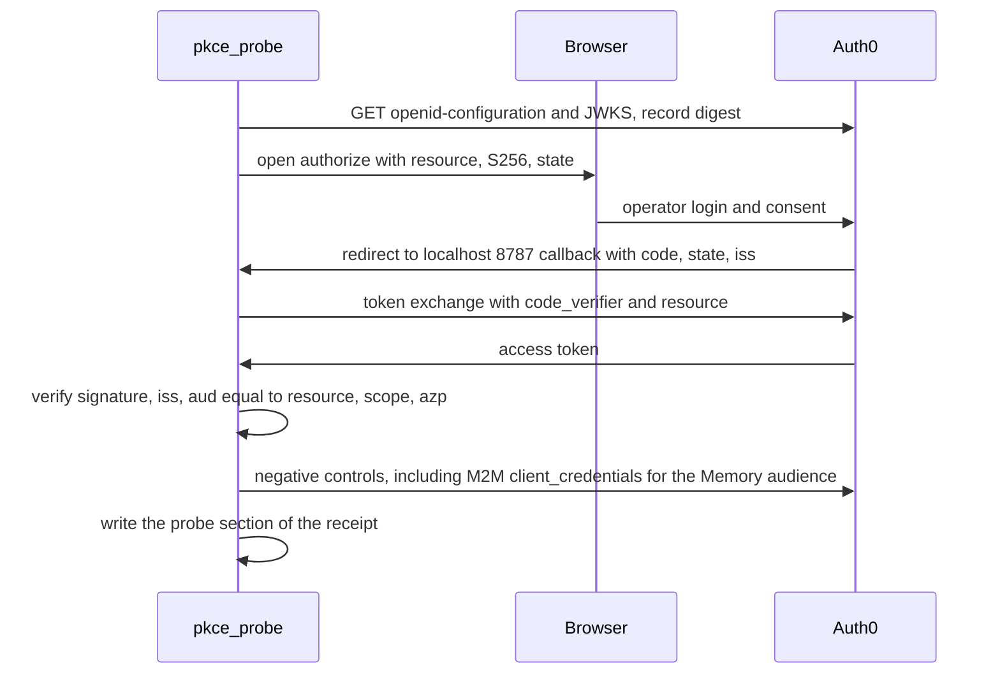

# AUTH-01: Auth0 tenant configuration and live PKCE receipt

Handoff mode: `cursor-build` (`kind: simple`, `execute_via: cursor-build`, `status: current`).

Architecture is already decided by [docs/adr/ADR-100-native-oauth-mcp-full-cutover.md](docs/adr/ADR-100-native-oauth-mcp-full-cutover.md):
- Auth0 is the only issuer.
- The resource is `https://memory.quantumaipartners.com/mcp`.
- No OAuth proxy.
- The token must be audience-bound.

This plan only binds the tenant to that decision.

**Workspace baseline:**
- The local branch `publish/memory-resource-identifier` (HEAD `6f7ce01`) is already merged to `origin/main` as #106 (`896049c`). It is not a base for new work.
- `origin/main` is at `ae6e2c0`.
- Open pull requests are #110 (a Dependabot bump of certifi) and #111 (a fix for phone-number detection during sensitive-data admission). Neither is related to this work.
- `docs/campaigns/` is entirely untracked, both locally and on `origin/main`.

## Facts this plan rests on

- **Auth0 CLI:** not installed, and not needed. Configuration goes through the Management API, using a token minted in-process.
- **Infisical bind gate:** `AUTH0_DOMAIN`, `AUTH0_CLIENT_ID`, `AUTH0_CLIENT_SECRET` and `AUTH0_MANAGEMENT_API_TOKEN` all return `not-in-inventory` today. They are missing from `root_env_keys` in `~/.cursor-governance/ops/secrets/infisical-cursor-governance.yaml`.
- **No surface restriction on binds:** `capability_bind.py` binds any gated name on any surface that has a machine identity. It resolves that identity "environment, then workstation file" (line 130). Meanwhile `~/.cursor-governance/docs/account-fields/SETUP_SCRIPT.md` (lines 195-200) says `AUTH0_CLIENT_SECRET` must "stay out of hosted sessions".
- **Credential runner:** `capability_exec.py` passes one secret to a fixed command line. Auth0's env login needs three values, so the plan binds in-process instead (`capability_bind.bind`).
- **Resource parameter:** the tenant setting is `resource_parameter_profile`, either `audience` (the default) or `compatibility`. Without `compatibility`, a request that carries only `resource=` gets the userinfo audience. Sources: [Auth0 compatibility profile](https://auth0.com/ai/docs/mcp/guides/resource-param-compatibility-profile) and the Auth0 support article "MCP Audience Error with Auth0".
- **Real redirect URIs** ([Claude connector authentication](https://claude.com/docs/connectors/building/authentication)):
  - Cursor desktop with a static client ID uses `http://localhost:8787/callback`.
  - Hosted Claude (web, Desktop, mobile) uses `https://claude.ai/api/mcp/auth_callback`.
  - Claude Code uses a loopback address on a different port each session.
- **Token libraries:** `PyJWT` and `cryptography` are in the `phase6` and `dev` extras of [pyproject.toml](pyproject.toml), not in the base install.
- **Repository conventions:**
  - Tracked receipts live in `docs/receipts/`, named by subject and `YYYYMMDD` date (for example `l9-memory-repair-retest-20261008.md`).
  - ADR changes are dated `## Amendment — ...` sections (see ADR-083).
  - `tools/assurance/check_secrets.py` scans `docs/` and `tools/` for patterns like `client_secret: "..."`.
  - Ruff runs the `S` (security) rules on `tools/`.
  - CI has no Cursor-Governance clone.
- **Why the probe runs as the Cursor client:** the live host still returns 404 for protected-resource metadata. Neither real client can discover Auth0 through Memory until P02 ships, so the actual client logins stay in AUTH-07. The local probe can still run a real PKCE login as the registered Cursor client, on that client's real redirect URI.

## Decisions taken

- **Credential names:** `AUTH0_DOMAIN`, `AUTH0_CLIENT_ID`, `AUTH0_CLIENT_SECRET` for the machine-to-machine client. Each run mints a short-lived Management API token from them.
  - `AUTH0_MANAGEMENT_API_TOKEN` is not added to the bind gate. Nothing reads it, and a stored bearer expires anyway.
  - Recommended: delete it from Infisical once the run works.
- **API scopes:** `memory:read`, `memory:write`, `memory:maintain`. There is no admin scope.
  - They are issued through Auth0 RBAC: a `memory-operator` role assigned to one operator user.
  - The token therefore carries only granted permissions, not whatever was requested.
- **Client registration:** no dynamic client registration and no client ID metadata documents. Each client is created explicitly:
  - `app_type: native`
  - `token_endpoint_auth_method: none`
  - PKCE S256
  - grant types `authorization_code` plus `refresh_token` only
- **Login:** one dedicated database connection, `l9-memory-operators`, is the only connection enabled for either client.
- **Sources of truth:**
  - `tools/auth0/tenant_spec.json` is the desired state, by name.
  - The tenant is the actual state.
  - One receipt file records what happened.
  - Nothing else stores client IDs or tenant values.



## Steps

### 1. Cursor-Governance bind gate (separate repository, its own pull request first)

**In `ops/secrets/infisical-cursor-governance.yaml`:**
- Add `AUTH0_DOMAIN`, `AUTH0_CLIENT_ID`, `AUTH0_CLIENT_SECRET` to `root_env_keys`.
- Add a new list, `operator_only_keys`, containing the same three names.
- Add a notes line: Auth0 tenant administration, operator workstation only, never rendered into client config.

**In `ops/secrets/capability_bind.py`:** a name in `operator_only_keys` binds only when both are true:
- The machine identity came from the workstation profile file, not the environment.
- `CLAUDE_CODE_REMOTE` is unset.

Otherwise it reports `unbound source=operator-only-refused` and prints no value.

**Tests:** the existing capability_bind test location covers three cases:
- Refusal with an environment-sourced identity.
- Refusal with `CLAUDE_CODE_REMOTE=1`.
- A bind with the workstation profile.

**Publish and close:**
- Publish through `make pr` in Cursor-Governance.
- After merge, with the live clone at tip, `capability_bind.py --check AUTH0_DOMAIN AUTH0_CLIENT_ID AUTH0_CLIENT_SECRET` reports `source=infisical` for all three on this workstation.
- The same check reports `operator-only-refused` with `CLAUDE_CODE_REMOTE=1` set.

This is a hard blocker. Without it, no tenant call can authenticate.

### 2. Desired tenant state: [tools/auth0/tenant_spec.json](tools/auth0/tenant_spec.json)

**The API:**
- `identifier: "https://memory.quantumaipartners.com/mcp"`, `name: "L9 Memory"`, `signing_alg: "RS256"`.
- `scopes`: the three above.
- `enforce_policies: true` and `token_dialect: "access_token_authz"`. RBAC is on, and permissions are written into the token.
- `allow_offline_access: true` and `skip_consent_for_verifiable_first_party_clients: true`.
- `token_lifetime: 3600`. A one-hour bearer token, renewed through the rotating refresh token.
- Restricting the API to granted clients: `subject_type_authorization.user.policy: "require_client_grant"`, plus one user-type client grant for each of the two clients with the three scopes.
  - If Auth0 rejects that field with a 400, the apply records `client_grant_policy: unsupported` in the receipt and continues.
  - Negative control 5 still proves that no other client gets a token.

**The role:** `memory-operator`, holding exactly the three permissions.

**The connection:** `l9-memory-operators`.
- `strategy: "auth0"`, `disable_signup: true`.
- Enabled for exactly the two clients.
- Every other connection, including any default Google login connection, is disabled for both clients.

**The two clients:**
- `l9-memory-cursor`: `callbacks: ["http://localhost:8787/callback"]`.
- `l9-memory-claude`: `callbacks: ["https://claude.ai/api/mcp/auth_callback", "http://127.0.0.1/callback", "http://localhost/callback"]`.
  - The two loopback entries are kept only if loopback check 6 in step 4 passes. Otherwise `--apply` removes them, and the receipt records Claude Code as unsupported for a static client.
- Both: `app_type: "native"`, `token_endpoint_auth_method: "none"`, `grant_types: ["authorization_code", "refresh_token"]`, `refresh_token: {rotation_type: "rotating", expiration_type: "expiring"}`.

**Tenant settings:**
- `flags.enable_dynamic_client_registration: false`
- `client_id_metadata_document_supported: false`
- `authorization_response_iss_parameter_supported: true`
- `resource_parameter_profile: "audience"`, until step 5 decides.
- If Auth0 rejects any of these names, the apply fails closed and names the field. It does not drop it silently.

**Contents:** the spec holds names and settings only. It contains no client IDs, user IDs, emails, or secrets.

### 3. Apply tool: [tools/auth0/management.py](tools/auth0/management.py)

**Binding and token:**
- `capability_bind` is imported inside `bind_credentials()` from `$L9_GOVERNANCE_DIR/ops/secrets`. Importing the module needs neither Cursor-Governance nor the network.
- The tool binds the three names in-process and mints a Management API token with client credentials.
- It decodes the token's granted scopes without verifying them; Auth0 enforces them. It compares them to this exact set:
  - `read/create/update/delete:resource_servers`
  - `read/create/update/delete:clients`
  - `read/create/update/delete:client_grants`
  - `read/update:tenant_settings`
  - `read/create/update/delete:connections`
  - `read/create/update/delete:roles`
  - `read/create:role_members`
  - `read:users`
- A missing scope stops the run. With `--apply`, an extra scope is a refusal and is listed by name.

**Modes:**
- Dry run is the default. It prints the planned create, update and delete actions per object and writes nothing.
- `--apply`:
  1. Saves the current tenant settings it will change.
  2. Applies the spec, matching objects by API identifier, client name, connection name, and role name.
  3. Looks up the operator by the email in `L9_AUTH0_OPERATOR_EMAIL` within `l9-memory-operators` and assigns `memory-operator`. Exactly one match is required; zero or several stops the run.
  4. Fetches each object again and fails on any difference from the spec.
- A second `--apply` with no spec change makes zero writes.
- `--rollback`:
  - Deletes the two clients, the role, the connection and the API.
  - Restores the saved tenant settings from the receipt's `apply.tenant_settings_before`.

**The receipt:**
- One file: `docs/receipts/l9-memory-auth01-auth0-tenant-YYYYMMDD.json`, dated by the UTC day of the run.
- `--apply` writes its `apply` section:
  - The settings before and after.
  - The object IDs and client IDs.
  - A sha256 of the operator user ID.
  - The client-grant policy outcome.
- Re-running `--apply` replaces that section.

**Output rules:**
- Never prints, logs or writes the secret, the Management token, an access token, or the operator's email.
- Only HTTPS to the bound tenant domain is allowed. The URL scheme and host are checked before each request, which is what Ruff S310 asks for.

### 4. Probe: [tools/auth0/pkce_probe.py](tools/auth0/pkce_probe.py)

**Modes:**
- `--mode profile-off-control` runs only the positive login and records its result. It never fails the run on a missing Memory audience.
- `--mode full` runs the positive login plus all six controls below. It exits non-zero if any acceptance check or control fails.

**Login request:**
- Runs as `l9-memory-cursor`, using the client ID looked up by name.
- Fetches `https://` + bound `AUTH0_DOMAIN` + `/.well-known/openid-configuration` and the JWKS. Records the issuer, endpoints and `code_challenge_methods_supported`, plus a sha256 of the document.
- Sends `resource=` only, never `audience=`. Asks for the three scopes and `offline_access`, without `openid`, so `aud` is a single string.
- Generates a fresh S256 verifier, `state` and `nonce` per request.
- Listens on `localhost:8787` for one callback, with a 300-second timeout, then closes the listener.

**Callback checks:**
- `state` must match.
- `iss` must equal the discovered issuer.
- An `error` parameter is recorded verbatim and counts as a refusal.

**Token checks (acceptance):**
- Signature verified against the JWKS, with RS256 only.
- `iss` equals the discovered issuer.
- `aud` equals `https://memory.quantumaipartners.com/mcp` exactly.
- The token's scopes and permissions equal exactly the three `memory-operator` permissions.
- `azp` equals the Cursor client ID.
- `exp` minus `iat` is at most 3600.

**Negative controls (each has an explicit pass rule):**

1. **Mismatched resource:** `resource=https://memory.quantumaipartners.com/not-memory`, through the browser. Pass when an error comes back or no token has that audience.
2. **No resource and no audience:** through the browser. Pass when no token has `aud` equal to the Memory resource. A userinfo or opaque result is recorded as "does not count".
3. **Callback mismatch:** the Claude client ID with the Cursor redirect, as an HTTP request to `/authorize` with no browser. Pass on a callback-mismatch error.
4. **Dynamic registration:** `POST /oidc/register`, HTTP only. Pass on any 4xx.
5. **Ungranted client:** the machine-to-machine client asks for a client-credentials token with `audience` equal to the Memory resource. HTTP only, and the secret is bound in-process. Pass on `access_denied` or `unauthorized_client`.
6. **Loopback check:** `/authorize` for the Claude client with `redirect_uri=http://127.0.0.1:53682/callback`, HTTP only. A login page means any-port loopback is accepted. A callback-mismatch error means it is not, and the outcome drives the step 2 Claude callbacks.

**Receipt writes:**
- The `probe` section of the same receipt JSON:
  - The discovery digest and fields.
  - Token claims, with `sub` hashed and only a sha256 of the token.
  - Each control's request summary and outcome.
  - The run mode.
- The matching `.md` summary is rendered from the JSON by the probe.
- A `profile-off-control` run is kept as `probe.profile_off_control` and is never overwritten by the full run.

### 5. Deciding the Resource Parameter Compatibility Profile (in order)

1. Apply the spec with `resource_parameter_profile: "audience"`.
2. Run `--mode profile-off-control`.
   - If it yields `aud` equal to the Memory resource, leave the profile off and record that.
   - If it yields a userinfo or opaque token, or an error, the profile is required.
3. Record the documentation evidence that Claude and Cursor send `resource=` in the receipt as URLs: the Auth0 compatibility-profile page, Claude connector authentication, and the MCP authorization specification. Watching the real clients do it belongs to AUTH-07.
4. When step 2 shows the profile is required, change the spec to `resource_parameter_profile: "compatibility"`, run `--apply`, then `--mode full`. Acceptance is the full run alone.

### 6. Tests (offline, run in CI by `pytest -q`)

**[tests/unit/test_auth0_tenant_spec.py](tests/unit/test_auth0_tenant_spec.py)** loads the real spec and checks:
- The identifier is exact, and `token_lifetime` is 3600.
- RBAC is on.
- The role holds exactly the three scopes.
- Public clients use auth method `none`, and neither has `client_credentials`.
- No callback has a wildcard.
- The only enabled connection is `l9-memory-operators`, with `disable_signup: true`.
- Dynamic registration and client ID metadata documents are off.
- There is no field named `client_id`, `client_secret`, `email` or `user_id`.

**[tests/unit/test_auth0_management.py](tests/unit/test_auth0_management.py)** runs against an in-memory tenant test double through the tool's HTTP interface. It checks:
- A dry run makes zero writes.
- A first apply creates every object, and a second apply makes zero writes.
- A re-fetch that differs from the spec fails the apply.
- A missing Management scope stops the run, and an extra one refuses `--apply`.
- Zero or two operator matches stop the run.
- Rollback restores the saved tenant settings exactly.
- An injected `test-` secret never appears in stdout, stderr or the receipt.
- Importing the module does not import `capability_bind`.

**[tests/unit/test_auth0_pkce_probe.py](tests/unit/test_auth0_pkce_probe.py)** checks:
- The RFC 7636 S256 test vector.
- A callback with the wrong `state` or the wrong `iss` is refused.
- The listener closes after its timeout.
- The claim checker rejects a userinfo `aud`, a list `aud`, a wrong `iss`, a missing scope, an extra scope, `exp - iat > 3600`, and the HS256 or `none` algorithms. Test tokens are signed with a key generated inside the test.
- The receipt contains no token and no raw `sub`.
- Each negative-control pass rule classifies both a pass and a fail fixture correctly.

**Conventions:** all three files load `tools/auth0` through `sys.path.insert`, the existing pattern in `tests/regression/`. Fixture credentials use `test-` prefixes so `check_secrets.py` treats them as placeholders.

### 7. Run commands (operator workstation, after step 1 has landed)

Before these commands, the operator exports `L9_AUTH0_OPERATOR_EMAIL` in the same shell, set to the address of the user they created in `l9-memory-operators`. `management.py --apply` stops if the variable is unset.

```bash
export L9_GOVERNANCE_DIR="$HOME/.cursor-governance"
uv run --extra dev python tools/auth0/management.py --spec tools/auth0/tenant_spec.json
uv run --extra dev python tools/auth0/management.py --spec tools/auth0/tenant_spec.json --apply
uv run --extra dev python tools/auth0/pkce_probe.py --spec tools/auth0/tenant_spec.json --mode profile-off-control
# step 5: set the profile to compatibility in the spec if the control requires it, then
uv run --extra dev python tools/auth0/management.py --spec tools/auth0/tenant_spec.json --apply
uv run --extra dev python tools/auth0/pkce_probe.py --spec tools/auth0/tenant_spec.json --mode full
```

The address is set only in the shell, never committed, and never written to the receipt.

### 8. Documentation

**Committed in this pull request:**
- The receipt JSON and `.md` from steps 3 and 4.
- A dated `## Amendment — AUTH-01 tenant binding` section in ADR-100, headed with the UTC date of the full probe run. It names the issuer domain, the two public client IDs, the profile outcome, the client-grant policy outcome, and the receipt path.
- The matching ADR-100 row in [docs/adr/README.md](docs/adr/README.md).
- Closed by `python3 tools/assurance/validate_adrs.py`.

**Local only, not committed:** `docs/campaigns/` is untracked, so `assurance/AUTH-01_PROBE_2026-10-27.md` and D-01 in `contracts/DECISION_REGISTER.md` are updated locally to point at the receipt.

### 9. Validate and publish

- Run `bash scripts/validate_release.sh` and the three new test files.
- Then publish with `PR_STACK=auto PR_REMEDIATE=0 make pr` and report the pull request URL.
- If `PR_STACK=auto` would stack on #110 or #111, stop and ask. Neither is a parent of this work.

## Operator steps (human, cannot be automated)

- After the first `--apply` creates `l9-memory-operators`, create one user there in the dashboard and set its password. Then run `--apply` again so the role gets assigned.
- Narrow the machine-to-machine client's Management API scopes if step 3 reports extra ones.
- Complete the browser login and consent for the positive run and controls 1 and 2. Expect a consent screen, because the redirect is localhost.
- Approve the `--apply` and `--rollback` runs.

## Contract, migration, rollback

- **Contract impact:** none on Memory runtime. This change adds tenant state, operator tools, one receipt, and an ADR-100 amendment.
- **Migration impact:** none.
- **Wiring path:** `tools/auth0/*` binds lazily through Cursor-Governance's `capability_bind`, on the operator workstation only. Nothing is added to client config, which preserves `AGENTS.md` invariants 7 and 9.
- **Rollback:**
  - `management.py --rollback` removes every object it created and restores the saved tenant settings.
  - The repository change is undone by reverting the pull request.
- **Rollback conditions (tenant behavior only):**
  - A mismatched resource yields a Memory-audience token.
  - The machine-to-machine client or any ungranted client obtains a Memory-audience token.
  - A token carries scopes beyond the `memory-operator` role.
  - Any connection other than `l9-memory-operators` is enabled for either client after the apply.

## Not in scope

- P02 resource server (protected-resource metadata, JWT middleware).
- AUTH-07 logins from the real Claude and Cursor clients.
- `mcp.json` or Claude connector setup.
- C1 cutover.
- Committing the campaign pack.

## Build-start housekeeping (from the l9-plan-simple contract)

Plan mode could not write files, so these run first in Build:
1. Memory prefetch (`ops/hooks/plan_memory_prefetch.py`).
2. Emit and validate the PLAN_DOCUMENT with `validate_plan_document.py`.
3. Render with `render_plan_pe_autonomy.py --execute-via=cursor-build --workspace .`.
4. Generate and validate the section receipt with `--gar-invoked`, citing ADR-100 as the settled architecture. It must report zero unfilled parameters.

A failure in any of these blocks the build. It does not switch the plan to another mode.

## Audit record

### Recursive Alignment (2026-11-04)

These findings are corrected in the steps above:
- **H-1:** the Auth0 admin secret was bindable on hosted surfaces.
- **H-2:** the "third client" rollback condition had no test.
- **H-3:** the receipt was aimed at untracked `docs/campaigns/`.
- **M-1:** the plan was pinned to a merged branch.
- **M-2:** there was no RBAC.
- **M-3:** the Management API scopes were never checked.
- **M-4:** importing the bind module at load would break CI.
- **M-5:** rollback reset settings to a fixed value.
- **M-6:** the profile decision called a deliberately failing run "the positive case".
- **L-1 to L-3:** local schema validation, the unused stored bearer, and lint and scanner noise.

### Validate and Eliminate Stubs (2026-11-04)

Status: PartiallySucceeded. The plan is free of stubs. Execution is still blocked on step 1 and on the live tenant.

**Findings (all Confirmed and Resolved in this revision unless stated):**
- **S-1 (High, unfilled placeholders).** The plan contained angle-bracket date slots in the receipt and amendment names, and a domain slot in the issuer check. The l9-plan-simple section receipt fails on any unfilled slot (`G_UNFILLED_PARAMETER`).
  - Fix: names use the `YYYYMMDD` date of the run, matching `docs/receipts/`, and the issuer comes from discovery.
- **S-2 (High, fake validation).** `management.py` held the diff, idempotency, scope-check and rollback logic but had no tests.
  - Fix: `test_auth0_management.py` against an in-memory tenant double.
- **S-3 (High, security gap).** The probe never checked the callback `state`, and had no listener timeout.
  - Fix: `state` and `iss` checks, a 300-second single-use listener, and tests for both.
- **S-4 (High, Probable, unwired control).** Disabling signup on one connection did not stop other enabled connections, such as a default Google login, from issuing Memory-audience tokens. This is a property of new Auth0 tenants, checked by read-back at apply time.
  - Fix: a dedicated `l9-memory-operators` connection as the only enabled connection, a spec test, and a rollback condition.
- **S-5 (Medium, unspecified values).** The plan said "a token lifetime", "users read" and "one database connection" without saying which.
  - Fix: `token_lifetime: 3600`, the exact Management scope list, and the named connection.
- **S-6 (Medium, deferred decisions).** Two open "if" branches had no rule to settle them: the Infisical-permissions alternative in step 1, and the Claude Code loopback.
  - Fix: one chosen mechanism in step 1, and loopback check 6 settles the loopback by measurement.
- **S-7 (Medium, competing source of truth).** Writing client IDs back into the spec, plus a separate snapshot file, gave three stores for one fact.
  - Fix: names-only spec, and one receipt with `apply` and `probe` sections.
- **S-8 (Medium, missing input).** The plan never said how role assignment finds the operator.
  - Fix: `L9_AUTH0_OPERATOR_EMAIL`, exactly one match required.
- **S-9 (Medium, unwired entrypoints).** There were no invocation commands, and the extras PyJWT needs were not named.
  - Fix: step 7 commands with `uv run --extra dev`.
- **S-10 (Low, pass rules not stated).** Controls 2 and 4 had no pass rule.
  - Fix: each control has an explicit pass rule and a pass/fail fixture test.

**Remaining Unknowns (each resolved by measurement, never assumed):**
- Whether the tenant accepts `subject_type_authorization`. A 400 is recorded and the run continues.
- The exact tenant-settings field names. A rejected name fails closed.
- Whether default connections exist in this tenant. Read-back at apply.
- Whether Auth0 accepts loopback redirects with any port. Control 6.

**Next action:** open the Cursor-Governance pull request from step 1. Every tenant step depends on that bind.
