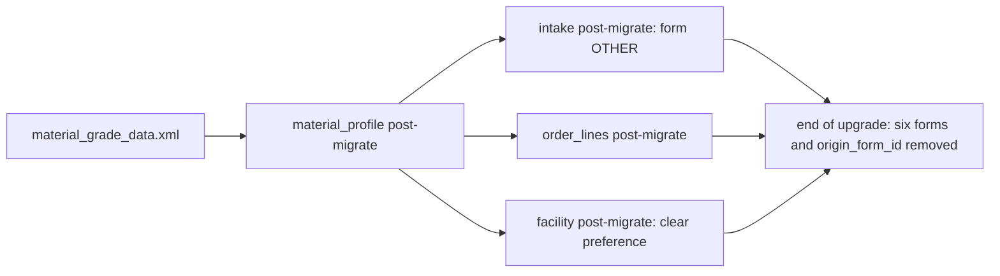

# Material grade catalog

Revision: `Staging` at `662a9973`, clean tree. This plan was revised against `.cursor-commands/kernels/Recursive Alignment.md` and then against `.cursor-commands/kernels/Validate & Fill Gaps.md`, which extends `Validate & Repair.md`. Both sets of findings are listed at the end, and every fix is already in the sections in between.

`plasticos.grade.template` stays as it is. A grade template requires a polymer and is a full spec preset. The new list has no polymer, so it gets its own master, alongside [`plasticos.material.form`](plasticos_material_profile/models/material_form.py).

## Decisions

- Operator, this session: the grade goes after the polymer and before the form on the product line.
- Operator, this session: `origin_form_id` is removed after its values are copied. This is the explicit approval that repo rule 9 (additive migrations only) requires.
- Operator, this session: source type has nothing to do with this change. `source_type_id` stays on the intake and everywhere else.
- Derived from code: intakes keep a form. `plasticos.intake.form_id` is `required=True` ([`intake.py`](plasticos_intake/models/intake.py) lines 189-196), so the six forms on intakes become `OTHER`. That is the same fallback CRM conversion already uses ([`crm_lead.py`](plasticos_crm_bridge/models/crm_lead.py) lines 402-413). Profiles and order lines have optional forms, so those links are cleared.

## New master

- Model `plasticos.material.grade` in [`models/material_grade.py`](plasticos_material_profile/models/material_grade.py), with `name`, `code` (unique, `models.UniqueIndex`), `sequence`, and `active`. Same shape as the form master. Import it in [`models/__init__.py`](plasticos_material_profile/models/__init__.py).
- New [`grade_codes.py`](plasticos_material_profile/grade_codes.py) holds `GRADE_CODES`, in the same style as `form_codes.py`.
- Seed file [`data/material_grade_data.xml`](plasticos_material_profile/data/material_grade_data.xml), `noupdate="1"`. Xmlids are `material_grade_<code>`, because `grade_template_data.xml` already uses `grade_ibc_totes`, `grade_hdpe_drums`, and other `grade_*` ids in the same module.
- 22 grades, title case, with `OCC` and `IBC` in capitals. `Superacs` keeps the screenshot spelling. Codes are UPPER_SNAKE: `BUCKETS`, `DRUMS`, `SUPERACS`, `TRAYS`, `LIDS`, `TUBS_LIDS`, `TOTES`, `TOTERS`, `IBC_TOTES`, `LINERS`, `DRIP_TUBE`, `PALLETS`, `BOTTLES`, `STRAPPING`, `CRATES`, `BUMPERS`, `RETURNS`, `DUNNAGE`, `STRETCH_FILM`, `OCC`, `TRASH`, `SHEET`.
  - The displayed names are: Buckets, Drums, Superacs, Trays, Lids, Tubs/Lids, Totes, Toters, IBC Totes, Liners, Drip Tube, Pallets, Bottles, Strapping, Crates, Bumpers, Returns, Dunnage, Stretch Film, OCC, Trash, Sheet.
- The `Sheet` form record (`form_sheet`) stays. The `Sheet` grade is a separate record.
- ACL: add two rows to [`ir.model.access.csv`](plasticos_material_profile/security/ir.model.access.csv), in the file's unprefixed id format. `access_plasticos_material_grade_user` gives `base.group_user` read. `access_plasticos_material_grade_admin` gives `base.group_system` full CRUD. Do not copy the form's third `_all` row (line 23, `base.group_user` CRUD), because that row makes the user read row redundant.
- New [`views/material_grade_views.xml`](plasticos_material_profile/views/material_grade_views.xml): a list, an action, and a menu under `menu_plasticos_config`, next to Grade Templates.
- [`__manifest__.py`](plasticos_material_profile/__manifest__.py) `data`:
  - `data/material_grade_data.xml` goes after `data/polymer_data.xml`, so it loads before `data/material_form_data.xml` and `data/grade_template_data.xml`. Grade templates reference the grades.
  - `views/material_grade_views.xml` goes after `views/grade_template_views.xml`, because that file defines the parent menu `menu_plasticos_config` (lines 89-96).
  - Run `ruff format` after the edit.
- New pure test `tests/test_material_grade_codes.py` asserts two things: `GRADE_CODES` equals the grade seed codes, and none of the six former form codes is still in `FORM_CODES` or `material_form_data.xml`. The `tests/test_form_enum_alignment.py` named in the `form_codes.py` docstring does not exist, so the drift guard is written here and the docstring points at it.

## Move the six forms

- Remove `form_drums`, `form_buckets`, `form_bottles`, `form_pallets`, `form_crates`, and `form_totes` from [`material_form_data.xml`](plasticos_material_profile/data/material_form_data.xml), and fix the header comment on line 10.
  - That block is `noupdate="0"`, so Odoo's end-of-upgrade cleanup unlinks the removed records (Odoo 19 `ir.model.data._process_end`).
  - `_process_end_unlink_record` calls `record.unlink()` without error handling, so any remaining `ondelete="restrict"` link aborts the whole upgrade. The migrations below clear every link before that point.
- [`grade_template_data.xml`](plasticos_material_profile/data/grade_template_data.xml): four templates swap `form_id` for `material_grade_id`. Three are `noupdate="0"` (`grade_plastic_pallets_no_metal` line 10, `grade_hdpe_crates` line 113, `grade_hdpe_drums` line 133). `grade_ibc_totes` (line 244) is `noupdate="1"`. Removing a field tag from the XML does not clear the stored value, so the post-migrate also clears it on those four records.
- [`form_codes.py`](plasticos_material_profile/form_codes.py): remove the six codes from `FORM_CODES`. `SHEET` stays. `EQUIPMENT_GATED_FORMS` does not name any of the six, so the graph and matcher gates do not change. Facility form preferences read `FORM_SELECTION`, so those six options leave that dropdown.

## Migrations

Each module migrates its own tables in `migrations/<new_version>/post-migrate.py`.
- A post-migrate runs after that module's data loads and before the end-of-upgrade cleanup (Odoo 19 `odoo/modules/loading.py` line 230 for post scripts, line 523 for `_process_end`).
- All of these modules are upgraded in one `make update` run.
- Each script runs again safely: it skips the copy when `origin_form_id` is already gone, and it skips records that already have a grade.
- They use `api.Environment(cr, SUPERUSER_ID, {})` and ORM writes, the same pattern as [`plasticos_order_lines/migrations/19.0.1.0.1/post-migrate.py`](plasticos_order_lines/migrations/19.0.1.0.1/post-migrate.py). That way the stored names and codes recompute.

The old column:
- Once `origin_form_id` leaves the model, Odoo's end-of-upgrade cleanup unlinks its `ir.model.fields` record, and `IrModelFields.unlink` drops the column (`_drop_column`, `ir_model.py` lines 879-895 and 1027). The operator approved that drop.
- The post-migrates therefore copy the values and check counts but issue no `ALTER TABLE`.
- A count mismatch raises, which stops the upgrade before the cleanup runs.

Per module:

- `plasticos_material_profile` `19.0.5.11.0`. The folder `migrations/19.0.5.11.0/` is new; `migrations/19.0.5.9.0/` already exists.
  - Profiles: set `material_grade_id` from the form code when the form is one of the six, otherwise from the `origin_form_id` code. Set the grade first, then clear `form_id`, in one write.
  - If the form and the origin disagree, the form-derived grade wins and the origin form name is appended to `freeform_notes`.
  - An `origin_form_id` that points at a form with no grade code (for example `FILM`) has its form name appended to `freeform_notes`.
  - Count check: copied rows plus noted rows must equal the number of non-null `origin_form_id` rows, or the script raises.
  - The four grade templates: set the grade and clear the form.
- `plasticos_intake` `19.0.5.4.0`: the same copy and count check. Then `form_id` is set to `OTHER` for the six forms, because it is required. Unmapped origin values go to `intake_notes`.
- `plasticos_order_lines` `19.0.1.1.0`: on sale and purchase lines, set the grade from the six forms, then clear `form_id`. The stored `material_description` recomputes. Existing line `name` text is not rewritten.
- `plasticos_facility_profile` `19.0.5.4.0`: clear `form_preference_id` on facility profiles and facility templates (`facility_profile.py` line 131, `facility_template.py` line 81) when it points at one of the six. Log each cleared id. There is no grade-preference field, and adding one would need separate approval.

## Profile identity

Once the form is cleared, `HDPE Drums` and `HDPE Buckets` for the same partner would share the identity (partner, HDPE, no form). That collides with `_unique_partner_polymer_form` ([`material_profile.py`](plasticos_material_profile/models/material_profile.py) lines 401-404), and it lets the reuse helpers merge distinct materials. Add `material_grade_id` to each of these:

- The unique index: `(partner_id, polymer_id, form_id, material_grade_id) NULLS NOT DISTINCT WHERE partner_id IS NOT NULL`, with the message changed to match.
- `_check_unique_triple_before_save` (lines 406-431) takes a grade argument, and its error text names the grade.
- Its callers: `create` (lines 585-596) passes `vals.get("material_grade_id")`. `write` (lines 598-608) reads the grade from `vals` or the record, and also runs the check when `material_grade_id` is in `vals`.
- [`plasticos_crm_bridge/models/material_profile.py`](plasticos_crm_bridge/models/material_profile.py): `reuse_facility_polymer_profile` (line 132) and `reuse_lead_facility_material` (line 168) take a `grades` argument, which goes into every search domain and create value.
- [`plasticos_crm_sync/services/orchestrator.py`](plasticos_crm_sync/services/orchestrator.py): both reuse calls (lines 2278-2291) pass `normalized.material_grade`. The section identity tuple (lines 2348-2356) becomes (polymer, form, grade).
- [`test_nullable_form_uniqueness.py`](plasticos_material_profile/tests/test_nullable_form_uniqueness.py) gains a case where the same partner and polymer, with no form and two different grades, are both allowed.

## Rename origin_form_id

Every live use of the name becomes `material_grade_id` on `plasticos.material.grade`, and the view label "Origin Form" becomes "Material Grade". The unrelated publication test `test_authorized_origin_forms_bind_the_repository` stays.

- [`material_profile.py`](plasticos_material_profile/models/material_profile.py) line 308: the field.
- [`plasticos_intake/models/intake.py`](plasticos_intake/models/intake.py) lines 213 and 558: the field, and the copy from the profile.
- [`material_profile_intake.py`](plasticos_intake/models/material_profile_intake.py) line 61: `default_material_grade_id`.
- [`intake_delta_bridge.py`](plasticos_material_profile/intake_delta_bridge.py) lines 21 and 115, and [`tests/test_material_profile_intake_delta_bridge_pure.py`](tests/test_material_profile_intake_delta_bridge_pure.py) line 69.
- [`crm_lead.py`](plasticos_crm_bridge/models/crm_lead.py) line 313: the snapshot pair.
- Docs:
  - [`ADR-004`](docs/adr/ADR-004-intake-vs-material-profile-domain-split.md) and [`ADR-005`](docs/adr/ADR-005-intake-material-profile-delta-bridge.md): field lists.
  - [`plasticos_material_profile/README.md`](plasticos_material_profile/README.md) line 57.
  - [`plasticos_intake/README.md`](plasticos_intake/README.md) line 65.
  - [`plasticos_intake_normalizer/README.md`](plasticos_intake_normalizer/README.md) line 31. That line documents an `origin_form` payload key that no code emits; it becomes `material_grade`.

`process_codes.py` and `profile_features.py` stay. Process codes are process types, and residue detection reads the notes and `origin_process_type`.

## Names, documents, and views

The order is polymer, then grade, then form.

- Profile `display_name` (lines 24-35): polymer, then grade, then form. `@api.depends` adds `material_grade_id`, so a drum profile still reads `HDPE Drums`.
- Order lines:
  - `material_grade_id` (`ondelete="restrict"`) is added to `sale.order.line` and `purchase.order.line` ([`sale_order_line.py`](plasticos_order_lines/models/sale_order_line.py) and [`purchase_order_line.py`](plasticos_order_lines/models/purchase_order_line.py), lines 28-66).
  - `_compute_material_description` adds it to its `@api.depends` (lines 75-84), and its help text names the grade.
  - `_onchange_material_profile_id` (lines 92-111) copies it.
- [`projected_material`](plasticos_order_lines/models/material_label.py) puts the grade first in the specs list (line 15), right after the product or polymer and before color, filler, and form.
- Printed documents:
  - The standard SO, PO, and invoice PDFs print `line.name`, and PlasticOS does not override them.
  - Extend `sale.order.line._get_sale_order_line_multiline_description_sale` and `purchase.order.line._get_product_purchase_description` (Odoo 19 `addons/sale/models/sale_order_line.py` line 421 and `addons/purchase/models/purchase_order_line.py` line 620). When the line has a material description, it becomes the first line of the description.
  - The profile onchange also refreshes `name`.
  - Invoice lines take `name` from the order line (`_prepare_invoice_line` and `_prepare_account_move_line`), so invoices and their emails carry the grade too.
  - Historical line names are not recomputed, because Odoo's name compute depends only on the product.
- PO built from a profile: `action_create_purchase_order` sets `"name": f"{polymer} - {partner}"` explicitly ([`material_profile.py`](plasticos_material_profile/models/material_profile.py) line 636). That explicit name bypasses the description hook.
  - Change it to the material description (polymer, grade, form, and the other specs), keeping the ` - {partner}` suffix.
  - Add `material_grade_id` to those line values (lines 634-646).
- Views, with the grade between polymer or product and form:
  - Profile ([`material_profile_views.xml`](plasticos_material_profile/views/material_profile_views.xml)): the list at line 13, and the form at line 92. The old line 119 field in Volume / Supply moves to the Source group.
  - [`partner_material_ux.xml`](plasticos_material_profile/views/partner_material_ux.xml) line 39.
  - [`grade_template_views.xml`](plasticos_material_profile/views/grade_template_views.xml): the list at line 13, the form at line 34, and the search group-by at line 77.
  - Intake ([`intake_views.xml`](plasticos_intake/views/intake_views.xml)): the lists at lines 19 and 86, and the form's Material group at line 281. Source Type stays where it is.
  - Order lines ([`sale_order_views.xml`](plasticos_order_lines/views/sale_order_views.xml) and [`purchase_order_views.xml`](plasticos_order_lines/views/purchase_order_views.xml)): the line columns right after `product_id` (line 28), the search field at line 49, and a Grade group-by beside the Source one at line 59.
- `_emit_material_packet` (lines 664-705) gains `material_grade` and `material_grade_name` beside `form`. It is an unconsumed stub (`_ = packet`), so no consumer contract changes.

## Writers and the normalizer

- [`material_normalizer.py`](plasticos_material_profile/models/material_normalizer.py):
  - `MaterialNormalization` (line 205) gains a `material_grade` argument and attribute. `grade` stays the A/B/C letter. Its only constructors are `_realize` (line 283) and `_empty` (line 287), and both are updated.
  - The `_SPECS`, `_CRM_EXACT`, and `_CRM_ALIASES` entries that put the six codes in the form slot move to a grade slot.
  - `pp supersacs`, `pet strapping`, `hdpe toters`, and `tpo bumpers` get their grade. `ldpe stretch film` keeps the `FILM` form and gains the `STRETCH_FILM` grade.
  - `_realize` resolves the grade on `plasticos.material.grade`. A missing code is reported as unresolved, the same way forms are.
- [`grade_template.py`](plasticos_material_profile/models/grade_template.py): `material_grade_id`, which `get_template_values` (lines 93-105) copies.
- crm_sync orchestrator: writes `material_grade_id` from `normalized.material_grade`. See also Profile identity.
- [`native_document_import.py`](plasticos_transaction/models/native_document_import.py) lines 1451-1469: `_material_line_values` writes `material_grade_id` when the normalizer resolved one.
- [`web_lead.py`](plasticos_web_leads/models/web_lead.py) lines 1094-1133. Rule 50 applies: read the tests and run `make test-module m=plasticos_web_leads` before and after.
  - Once the forms are gone, the existing `_lookup(Form, code, "other")` already falls back to `OTHER` for pallet, tote, crate, and bottle terms.
  - Add one grade lookup on the same code, and set `material_grade_id` in the intake values.
  - The `_FORM_TERM` map, line 990, and `economic_policy.py` work on the merged code string, so classification does not change. `tests/test_triage_pipeline.py` lines 370-385 cover that policy, and they stay as they are.
  - No partner creation, guard, or state change is touched.

## Mapping sheet

[`material_mapping.csv`](plasticos_material_profile/data/material_mapping.csv) is generated by [`scripts/build_material_mapping.py`](scripts/build_material_mapping.py). That script reads the normalizer, the seed XML, `web_lead.py`, and the VanillaSoft export. Change the builder, not the CSV:

- Add a `material_grade` column after `form` in `COLUMNS` (lines 60-80), read the codes from `material_grade_data.xml`, and send the six former form codes to that column.
- Regenerate with the same `--vanillasoft` export as the last build.
- Add `"material_grade": "material_grade_data.xml"` to `MASTER_FILES` (lines 28-37) in [`tests/test_material_mapping_masters.py`](tests/test_material_mapping_masters.py).
- Leave the historical builder input `plasticos_crm_sync/data/vanillasoft_material_mapping.csv` as it is.

## Tests

Existing tests that move from form to grade:

- [`plasticos_material_profile/tests/test_material_normalizer.py`](plasticos_material_profile/tests/test_material_normalizer.py): the DRUMS, BOTTLES, and TOTES form assertions (lines 34-46, 136, 186-190).
- `plasticos_crm_sync/tests/test_crm45_classification.py` lines 147, 169, 181, 201, 226, 520, and 572.
- `plasticos_crm_sync/tests/test_orchestrator_upsert.py` lines 1093, 1171, 1251, and 1286, which are DRUMS form fixtures.
- `plasticos_transaction/tests/test_erp_worksheet_import.py` line 1491. The `PALLETS-9` strings in that file are invoice numbers and stay.

New tests:

- Naming: the grade appears between the polymer and the form in the profile name, in `material_description`, in SO and PO `name`, and in the PO line built from a profile.
- Migrations: follow [`plasticos_logistics/tests/test_load_cardinality.py`](plasticos_logistics/tests/test_load_cardinality.py) lines 23-26. That file loads the script with `importlib` and calls `migrate(cr, version)`.
  - The test adds a temporary `origin_form_id` column in its transaction, plus test-only forms with the six codes.
  - It covers the copy, the `OTHER` intake form, the note path, the count mismatch raise, and a second run that changes nothing.

## Versions and upgrade

- `plasticos_material_profile` 19.0.5.10.14 to 19.0.5.11.0
- `plasticos_intake` 19.0.5.3.4 to 19.0.5.4.0
- `plasticos_order_lines` 19.0.1.0.1 to 19.0.1.1.0
- `plasticos_facility_profile` 19.0.5.3.13 to 19.0.5.4.0
- `plasticos_crm_bridge` 19.0.3.4.18 to 19.0.3.4.19
- `plasticos_crm_sync` 19.0.1.9.15 to 19.0.1.9.16
- `plasticos_transaction` 19.0.2.3.49 to 19.0.2.3.50
- `plasticos_web_leads` 19.0.2.8.5 to 19.0.2.8.6

Upgrade only those modules, in one run. The Makefile accepts a comma list (`Makefile` lines 544-553):

`make update m=plasticos_material_profile,plasticos_intake,plasticos_order_lines,plasticos_facility_profile,plasticos_crm_bridge,plasticos_crm_sync,plasticos_transaction,plasticos_web_leads`

Run `ruff check && ruff format` after the manifest edits.

## Validation

None of these checks has run yet. Each one is a gate for implementation.

- Pure tests:
  - `pytest tests/test_material_grade_codes.py tests/test_material_mapping_masters.py tests/test_material_profile_intake_delta_bridge_pure.py tests/test_phantom_enum_values.py tests/test_triage_pipeline.py`.
  - The phantom-enum test collects canonical codes from every `data/*.xml`, so the grade seed keeps `PALLETS`, `TOTES`, `CRATES`, and `BOTTLES` registered for `web_lead.py` and `economic_policy.py`.
- Static checks: `python3 scripts/check_module_wiring.py`, `python3 ci/check_odoo19_xml.py`, and `ruff check && ruff format --check`.
- Odoo tests, on the pinned fixture clone (`make test-module m=<module>`): material_profile, intake, order_lines, facility_profile, crm_bridge, crm_sync, transaction, and web_leads.
- Upgrade proof on the clone:
  - Before and after the upgrade, count the rows that link the six forms, the non-null `origin_form_id` rows, and the `material_grade_id` rows.
  - After the upgrade, confirm that the six form xmlids are gone and that `origin_form_id` no longer exists in either table.
- `make pr-check`, then `make pr`.

## Alignment audit (Recursive Alignment)

The governing sources are the repo hard rules, `CLAUDE.md`, `AGENTS.md`, `.cursor/rules` 50, 71, 75, 81, and 89, and the operator decisions above. Each fix is already in the plan.

- RA-01, Critical: clearing the six forms collides with the unique index and lets the reuse helpers merge materials. Fix: Profile identity.
- RA-02, Critical: intake `form_id` is required. Fix: `OTHER` form plus the grade.
- RA-03, High: the earlier plan dropped a column without approval. Fix: the operator approved the drop, and a count check runs before it.
- RA-04, High: facility `form_preference_id` (restrict) was not migrated. Fix: facility post-migrate.
- RA-05, High: Returns was missing, and the planned `grade_*` xmlids would have collided with existing grade-template ids. Fix: 22 grades with the `material_grade_` prefix.
- RA-06, High: printed PDFs were left unchanged. Fix: Odoo's line-description hooks.
- RA-07, High: `native_document_import.py` and `web_lead.py` were missing as writers. Fix: Writers.
- RA-08, Medium: the plan hand-edited a generated CSV. Fix: change the builder and regenerate.
- RA-09, Medium: the plan described two migration mechanisms. Fix: post-migrates only.
- RA-10, Medium: the cited drift test does not exist. Fix: a new pure test.
- RA-11, Low: copying the form's ACL pattern would add a redundant row. Fix: two rows.

## Gap fill (Validate & Fill Gaps)

Scope: confirmed gaps, broken wiring, missing required entries, and honest validation. Nothing here adds a feature.

- VG-01, High: the plan claimed `plasticos_material_profile` has no migrations folder, but `migrations/19.0.5.9.0/post-migrate.py` exists. Fix: corrected.
- VG-02, High: the new data and view files were not wired into the manifest, and the menu file must load after the file that defines its parent menu. Fix: manifest entries in New master.
- VG-03, High: a manual `ALTER TABLE` would race Odoo's own cleanup, which drops the removed field's column. Fix: copy and count only, and let Odoo drop the column.
- VG-04, High: a remaining restrict link aborts the upgrade, because `_process_end` unlinks without error handling. Fix: stated in Move the six forms, and covered by the migrations.
- VG-05, High: the uniqueness check's `create` and `write` callers ignored the grade. Fix: Profile identity.
- VG-06, High: `material_description` would not recompute on a grade change, because its `@api.depends` omits the grade. Fix: Names.
- VG-07, High: the PO built from a profile sets an explicit `name`, which bypasses the description hook. Fix: Names.
- VG-08, Medium: `plasticos_intake_normalizer/README.md` line 31 still names `origin_form`. Fix: Rename.
- VG-09, Medium: the view placements were vague. Fix: exact anchors, with the grade between polymer and form.
- VG-10, Medium: the migration tests had no named pattern, and the scripts were not required to run twice safely. Fix: the `test_load_cardinality.py` pattern and re-runnable scripts.
- VG-11, Low: the tests to update had no line numbers, and the phantom-enum and triage tests were not in validation. Fix: Tests and Validation.
- Rejected: replacing `source_type_id` on the intake. The operator agreed it is unrelated, and it feeds the Gate match query, the normalizer check, the delta bridge, and the web-lead snapshot.

## Unknowns and residual risk

- Staging row counts for the six forms and for `origin_form_id` are not known, because the local `odoo` database has no PlasticOS tables. The upgrade-proof counts on the clone settle this. Unmapped values are noted, not lost.
- The column drop relies on Odoo deleting the removed field's `ir.model.fields` record at the end of the upgrade. The `_process_end` and `_drop_column` code was read; that the field record is caught by that cleanup is inferred, and the upgrade proof confirms it. If the column survives, it is inert and can be dropped in a follow-up.
- Whether the VanillaSoft export used for the last mapping build is still available is not known. If it is not, the mapping-builder step stops, and the CSV is not hand-edited.
- `plasticos_semantic_kernel` is uninstalled and stays that way. Its `form_id` fields and the DRUMS tests in `test_crm_sync_collision.py` are left alone, and would need updating if it is ever installed.
- After migration, matching sees `OTHER` or no form for these materials. Matching has no grade input, and the matching authority is Gate/CEG (ADR-003), so that is out of scope.
- Readiness: NotReady until the tasks and validation above pass. Convergence: converged for planning, with no further pass objective.
- Next safe action: build `grade-model` and `identity` first. Every migration depends on them.
